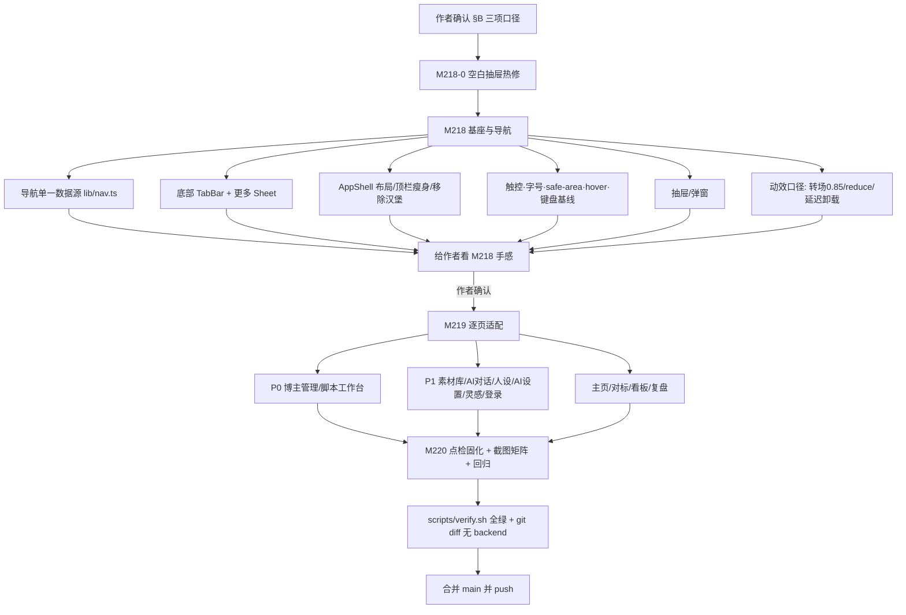

# R-218 开发设计：移动端适配（导航重构 + 全站响应式 + 点检）

- **对应需求**: `requirements/R-218-mobile-adaptation.md`
- **日期**: 2026-11-05
- **状态**: 📝 需求 + 开发设计完成，**待作者确认 §B 三项口径后开发**（开发仍分 M218 → M219 → M220 交付，M218 先给作者看手感）
- **前置**: D-018 / D-045（导航与断点决策）、R-175（动效规范）、R-202（进行中）、R-205（抽屉退出动画）、R-199/R-204/R-206（既有动效）、R-244/R-237/R-252/R-253（看板/复盘）、R-203（tab 换行先例）
- **原则**: 纯前端；**后端零改动**；不新增依赖；CSS 断点显隐优先（不 JS 条件挂载）；桌面 `md+` 尽量保持现状；每个改动可被探针验证
- **点检基线（2026-11-05）**: `.tmp/audit/mobile/REPORT.md`（4 档视口 × 13 路由）、`static-layout.md`（80 条代码证据）、`motion.md`（39 项动效实测）

---

## 1. 开发背景

R-218 已登记（2026-09-30）但一直「先别开工」；2026-11-05 全页面点检确认：**移动端没有适配完成，且移动端导航是空白抽屉（P0）**。本设计把 M218/M219/M220 一次性设计到位，供作者确认后按阶段实现。

点检结论摘要（证据见需求文档 §1.1）：
- **P0-1** 移动抽屉里复用桌面 `<Sidebar>`（`app-shell.tsx:72` + `sidebar.tsx:49` `hidden md:flex`）→ 11 个导航项全部不可见；手机上无任何页面导航入口。
- **P0-2** 博主管理账号行 flex 不换行 + 右侧 5 控件 → 320/375/390 页面横溢 82/27/12px，文字「一行一字」；时间线 8381px 横条。
- **P0-3** 脚本工作台 320px tab 被裁、抽屉 307px 时「版本」tab 不可见、底栏状态文案竖排。
- **P1** 无底部 Tab/更多、抽屉弹窗 96vw/94vw、0 safe-area、122 处 <44px 触控、145 处 <12px 字号、hover 依赖、无 dvh/键盘处理、AI 对话无历史会话。
- **动画**：落定/开合/退出/断点切换/进行中均正常（0 console error），但抽屉弹窗未全屏、页面转场首帧全透明、reduce 未生效。

本设计沿用 2026-09-30 作者已确认的导航结构（底部 Tab 5 项 + 更多）与分阶段交付方式，不改需求边界。

---

## 2. 涉及的技术

| 技术 | 用途 | 改动范围 |
|---|---|---|
| React 19 + TypeScript | 组件/页面 | `frontend_v2/src/**` |
| Tailwind CSS v4 | 响应式类、安全区、触控/字号基线 | `src/index.css`、全部页面/组件 |
| Framer Motion 12 | Tab 选中滑块、More Sheet、页面转场、reduced-motion 判断 | `lib/motion.ts`、布局组件 |
| Radix UI（dialog/popover/tabs/select…） | 会话 Sheet、More Sheet、全屏弹窗 | `components/ui/*` |
| react-router-dom 7 | 底部 Tab 导航（NavLink）、更多 Sheet 跳转 | `components/layout/*` |
| Playwright | M220 移动端点检脚本 + 截图矩阵 | `frontend_v2/mobile-*.mjs`（新增） |
| lucide-react | Tab/更多图标 | `lib/nav.ts` |
| 无后端改动 | 无新接口/表/定时任务 | — |

**不新增依赖**；不引入 UI 框架；不引入 PWA/离线缓存。

---

## 3. 开发流程图



阶段门禁：
- M218 结束：手机视口逐页走查 + 基座探针 + 既有 5 个 headless 点检 + `verify.sh`；给作者看，**等作者确认手感**。
- M219 结束：逐页探针 + 截图矩阵；`verify.sh`。
- M220 结束：全断言 + 截图矩阵 + 5 个既有回归 + `verify.sh`。

---

## 4. 数据流转图

本次**不新增/不修改任何数据通道**；只在前端消费现有数据。新增的「流转」是布局状态与响应当前数据：

```mermaid
flowchart LR
    subgraph 现有后端（不改）
        API1[GET /api/tasks?status=pending,running]
        API2[GET /api/platform/jobs?status=running]
        API3[GET/POST /api/chat/*]
        API4[GET /api/library /api/videos/:id]
        API5[GET /api/creators/* /api/timeline]
        API6[GET /api/douyin-dashboard/* /api/douyin-review/*]
        API7[GET /api/drafts /api/persona /api/settings ...]
    end
    API1 & API2 --> AW[ActiveWorkProvider /api/tasks + SSE]
    AW --> HDR[顶栏「进行中 N」紧凑形态]
    API3 --> CHAT[AI 对话页]
    API4 --> VIDEOS[素材库]
    API5 --> CREATORS[博主管理]
    API6 --> DASH[数据看板/视频复盘]
    API7 --> PAGES[脚本/人设/设置/灵感/主页/对标]

    NAVCFG[lib/nav.ts 静态配置] --> SIDEBAR[桌面 Sidebar md+]
    NAVCFG --> TABBAR[底部 TabBar <md]
    NAVCFG --> MORE[更多 Sheet <md]
    ROUTE[Location/Route] --> TABBAR
    ROUTE --> SIDEBAR
    ROUTE --> MORE

    CSS[CSS 断点 md=768] -->|显隐| SIDEBAR
    CSS -->|显隐| TABBAR
    TABSEL[Tab 选中态 layoutId] --> TABBAR
    SAFE[env safe-area-inset-bottom] --> TABBAR
    SAFE --> DRAWER[抽屉 footer/弹窗]
    VV[visualViewport/100dvh] --> CHAT
    VV --> INSP[灵感随手记]
```

关键点：
- **数据不搬家**：导航只决定「去哪个路由」，各页数据仍由各自 `useQuery` 拉取；不新增 store。
- **导航配置单一数据源**：`lib/nav.ts` 静态常量（非接口数据），三端共用，避免菜单不同步。
- **进行中状态**：沿用 `ActiveWorkProvider`（`hooks/use-active-work.tsx`），只改顶栏展示形态与安全区，不改事实源。

---

## 5. 实现细节

### 5.0 实施顺序总览

| 任务 | 内容 | 依赖 |
|---|---|---|
| M218-0 | 空白抽屉热修 | 无 |
| M218-1 | `lib/nav.ts` 数据源 + 拆分 `SidebarNav` | 无 |
| M218-2 | `MobileTabBar` + `MoreSheet` + AppShell 布局/顶栏 | M218-1 |
| M218-3 | 删除移动汉堡抽屉 + 顶栏紧凑「进行中」 | M218-2 |
| M218-4 | 触控/字号/safe-area/hover/键盘基线（公共组件 + index.css/index.html） | 无（可与 2 并行） |
| M218-5 | Drawer/Dialog 全屏化 | 无 |
| M218-6 | 动效口径（转场 0.85、reduce、延迟卸载、filter none） | 无 |
| M219-1… | 逐页适配（P0 → P1 → 其余） | M218 |
| M220 | 探针脚本 + 截图矩阵 + 回归 | M219 |

### 5.1 导航单一数据源

新增 `frontend_v2/src/lib/nav.ts`：

```ts
import type { LucideIcon } from 'lucide-react'
import { LayoutDashboard, Clapperboard, PenLine, NotebookPen, MessageSquare,
         ChartNoAxesCombined, BarChart3, Target, Users, Fingerprint, Settings2 } from 'lucide-react'

export interface NavItem { to: string; label: string; shortLabel?: string; icon: LucideIcon }

// 底部 Tab 5 项（顺序即作者 2026-09-30 定型）
export const PRIMARY_NAV: NavItem[] = [
  { to: '/home', label: '主页', icon: LayoutDashboard },
  { to: '/videos', label: '素材库', shortLabel: '素材库', icon: Clapperboard },
  { to: '/drafts', label: '脚本工作台', shortLabel: '脚本', icon: PenLine },
  { to: '/inspiration', label: '灵感随手记', shortLabel: '灵感', icon: NotebookPen },
  { to: '/chat', label: 'AI 对话', shortLabel: '对话', icon: MessageSquare }
]

// 「更多」4 项
export const MORE_NAV: NavItem[] = [
  { to: '/benchmark', label: '博主对标', icon: Target },
  { to: '/creators', label: '博主管理', icon: Users },
  { to: '/persona', label: '人设档案', icon: Fingerprint },
  { to: '/prompts', label: 'AI 设置', icon: Settings2 }
]

// 桌面侧栏 11 项（顺序保持现状；数据看板/视频复盘在素材库之后，与 R-248 侧栏调整一致）
export const SIDEBAR_NAV: NavItem[] = [
  ...PRIMARY_NAV.slice(0, 2),
  { to: '/dashboard', label: '数据看板', icon: ChartNoAxesCombined },
  { to: '/video-review', label: '视频复盘', icon: BarChart3 },
  ...PRIMARY_NAV.slice(2),
  ...MORE_NAV
]

export const ALL_NAV = SIDEBAR_NAV
```

- 桌面侧栏 `sidebar.tsx` 的 `NAV` 常量删除，改用 `SIDEBAR_NAV`。
- 当前页判定统一 `location.pathname === item.to`（避免 `/videos` 误匹配 `/video-review`）。
- 图标尺寸：Tab 20px、更多 22px、侧栏保持 16px。

### 5.2 M218-0：空白抽屉热修（首个 commit）

**根因**：`app-shell.tsx:72` 把 `<Sidebar>` 放进移动抽屉，而 `sidebar.tsx:49` 根节点是 `<motion.aside className="hidden md:flex …">`，`<md` 下整个 aside `display:none`。

**最简修复（过渡）**：把侧栏内容抽成 `SidebarNav`（只含 logo/导航列表/收起按钮的「内容」），桌面 `Sidebar` 负责 aside 外壳；移动抽屉里用无 `hidden` 的外壳 + `SidebarNav`：

```tsx
// components/layout/sidebar.tsx
export function SidebarNav({ collapsed, onToggle }: { collapsed: boolean; onToggle: () => void }) {
  return (
    <>
      <div className="flex h-14 items-center gap-2.5 px-4">…logo…</div>
      <nav className="flex-1 space-y-0.5 overflow-y-auto px-2 py-2">…NAV.map…</nav>
      <div className="border-t border-border p-2">…收起…</div>
    </>
  )
}
export function Sidebar(props) {
  return <motion.aside initial={false} animate={{ width: … }} className="hidden md:flex h-full flex-col …" {...props}>
    <SidebarNav {...props} />
  </motion.aside>
}
```

移动抽屉（`app-shell.tsx`）：

```tsx
<div className="relative flex h-full w-64 flex-col border-r border-border bg-card backdrop-blur">
  <SidebarNav collapsed={false} onToggle={() => setMobileNav(false)} />
  <button aria-label="关闭导航" …>…X…</button>
</div>
```

**验收**：390/320 打开抽屉 `visibleLinks=11/11`，点「博主管理」能跳页；R-205 关闭动画（0→-110→-226→-277→卸载）不回归。
**注意**：M218 完成、汉堡删除后，该抽屉代码一并删除；此热修只用于过渡。

### 5.3 底部 Tab 栏 `MobileTabBar`

新增 `frontend_v2/src/components/layout/mobile-tab-bar.tsx`：

```tsx
const TABS = [...PRIMARY_NAV, { key: 'more', label: '更多', shortLabel: '更多', icon: MoreHorizontal }]

export function MobileTabBar({ moreOpen, onMore }: { moreOpen: boolean; onMore: () => void }) {
  const { pathname } = useLocation()
  const id = 'mobile-tab-active'
  return (
    <nav aria-label="底部导航"
      className="fixed inset-x-0 bottom-0 z-40 border-t border-border bg-card/95 backdrop-blur md:hidden">
      <div className="grid grid-cols-6" style={{ paddingBottom: 'env(safe-area-inset-bottom)' }}>
        {TABS.map((t) => {
          const active = t.key !== 'more' && pathname === t.to
          const Comp = t.key === 'more' ? 'button' : NavLink
          return (
            <Comp key={t.key} to={t.to} onClick={t.key === 'more' ? onMore : undefined}
              aria-current={active ? 'page' : undefined} aria-label={t.label}
              className="relative flex min-h-[56px] flex-col items-center justify-center gap-0.5 text-[12px] ...">
              {active && <motion.span layoutId={id} className="absolute inset-x-2 top-1 h-9 rounded-lg bg-accent-soft" transition={EASE_SPRING} />}
              <t.icon className={cn('relative z-10 h-5 w-5', active ? 'text-accent' : 'text-muted-foreground')} />
              <span className={cn('relative z-10 text-[12px]', active ? 'text-accent' : 'text-muted-foreground')}>{t.shortLabel ?? t.label}</span>
            </Comp>
          )
        })}
      </div>
    </nav>
  )
}
```

关键规则：
- **6 格等分**（`grid-cols-6`）；320/6≈53px，标点短名（脚本/对话）≤3 字，12px 下不折行（`whitespace-nowrap`）。
- **触控**：每格 `min-h-[56px]`、整格可点（≥44×44）。
- **选中态**：`layoutId` 共享滑块（R-204 同款 spring 420/34）+ 图标/文字变主题色；`aria-current="page"`。
- **更多格**：是 `<button>` 不是链接；`aria-expanded={moreOpen}`。
- **安全区**：底部 `paddingBottom: env(safe-area-inset-bottom)`；`main` 底部留白同步（见 5.5）。
- **不遮挡内容**：`main` 的 `padding-bottom: calc(56px + env(safe-area-inset-bottom))`（`<md`）。
- **活跃判定**：精确匹配 pathname（底部 Tab 页面无子路由；`/prompter` 不在 AppShell 不涉及）。

### 5.4 「更多」Sheet `MoreSheet`

新增 `frontend_v2/src/components/layout/more-sheet.tsx`，用 Radix Dialog 做底部 Sheet（复用 portal/焦点管理/ESC）：

```tsx
<Dialog.Root open={open} onOpenChange={onOpenChange}>
  <Dialog.Portal>
    <Dialog.Overlay className="fixed inset-0 z-50 bg-black/45 data-[state=closed]:animate-out data-[state=open]:animate-in ..." />
    <Dialog.Content
      className={cn(
        'fixed inset-x-0 bottom-0 z-50 rounded-t-2xl border-t border-border bg-card p-4 pb-[calc(1rem+env(safe-area-inset-bottom))] shadow-2xl md:hidden',
        'data-[state=open]:animate-in data-[state=open]:slide-in-from-bottom-4 data-[state=closed]:animate-out data-[state=closed]:slide-out-to-bottom-4'
      )}
      aria-describedby={undefined}>
      <div className="mx-auto mb-3 h-1 w-10 rounded-full bg-border" />
      <Dialog.Title className="mb-3 text-sm font-semibold">更多</Dialog.Title>
      <div className="grid grid-cols-2 gap-2">
        {MORE_NAV.map((item) => (
          <button key={item.to} onClick={() => { onOpenChange(false); navigate(item.to) }}
            aria-current={pathname === item.to ? 'page' : undefined}
            className="flex min-h-[56px] items-center gap-2.5 rounded-xl border border-border bg-card px-3 text-[13px] ...">
            <item.icon className="h-5 w-5" />
            <span>{item.label}</span>
            {pathname === item.to && <span className="ml-auto text-[11px] text-accent">当前</span>}
          </button>
        ))}
      </div>
    </Dialog.Content>
  </Dialog.Portal>
</Dialog.Root>
```

关键规则：
- **入场/退出**：Radix `data-state` + tw-animate-css 的 slide/fade，`animate-out` 由 Radix Presence 等 CSS 动画结束再卸载（实测 Dialog exit 165ms 正常），符合 R-205 精神；不引入第二个自定义延迟卸载。
- **首帧可见**：入场为「面板从底部滑入 + 遮罩淡入」，不存在全透明空白帧。
- **交互**：点条目→先关 Sheet 再 `navigate`（避免 Sheet 停在页面上）；遮罩/ESC 关闭；`Dialog.Title` 必须存在（a11y）；`aria-describedby={undefined}` 避免 Radix 警告。
- **宽度**：`inset-x-0` 全宽；桌面 `md:hidden` 不渲染入口（TabBar 本身隐藏）。
- **安全区**：底部 padding 含 `env(safe-area-inset-bottom)`。

### 5.5 AppShell 布局调整

`components/layout/app-shell.tsx`：

1. **删除**移动抽屉状态/遮罩/面板（`mobileNav`/`mobileNavMounted`/`useEffect` 延迟卸载、`Menu` 图标、`X`）。
2. 顶栏：`<header>` 保持 `h-14`；移动端隐藏汉堡；标题 `truncate`；右侧顺序：通知 → 进行中（紧凑）→ 主题；`gap-2 md:gap-3`；`px-3 md:px-4`。
3. 内容区：`<main className="min-h-0 flex-1 overflow-y-auto pb-[calc(56px+env(safe-area-inset-bottom))] md:pb-0">`。
4. 在 `<div className="flex h-full">` 末尾（`main` 同级、`div.flex.min-w-0.flex-1.flex-col` 内或外层）渲染 `<MobileTabBar />` + `<MoreSheet />`（仅 `<md` 可见；MoreSheet 受控开合）。
5. 顶栏「进行中」紧凑形态：`active-work-indicator.tsx` 的触发按钮改为
   ```tsx
   <button aria-label={`进行中 ${count}`}
     className="flex h-11 min-w-11 items-center justify-center gap-1 rounded-md border border-accent/30 bg-accent-soft/50 px-2 text-xs font-medium text-accent md:h-9 cursor-pointer">
     <LoaderCircle className="h-3.5 w-3.5 animate-spin" />
     <span className="tnum">{count}</span>
   </button>
   ```
   弹层宽度 `w-[min(360px,92vw)]`、`max-h-[60dvh]`、内部 `ScrollArea`。
6. **断点不闪白**：底部 Tab 与侧栏都用 CSS 显隐（`md:hidden` / `hidden md:flex`），不经 JS 挂载；宽度变化只重排。

### 5.6 断点与 CSS 显隐

- 全站判据只写 `md`（768px）：导航（TabBar vs Sidebar）、抽屉/弹窗全屏、触控/字号基线。
- 内容栅格：允许 `<md` 内细分，但「移动/桌面」判据不用 `sm`：
  - 列表类：`grid-cols-1 md:grid-cols-2 lg:grid-cols-3/4`（320 单列优先保证可读；素材库卡片可保留 2 列，但需满足字号/触控断言）。
  - 已有 `sm:grid-cols-3` 等写法（videos/benchmark/drafts/prompts/creators posts）在 M219 统一改为 `md:` 起，避免「640 就桌面布局但导航仍移动端」。
- **JS 条件渲染仅用于交互**（Sheet 开关、当前 Tab 高亮），不用于「移动/桌面」结构。

### 5.7 抽屉 `<md` 全屏化

`components/ui/drawer.tsx`：

```tsx
// 桌面保留原宽度；<md 全屏
<motion.div
  style={{ ['--drawer-w' as string]: width }}
  className={cn(
    'fixed inset-y-0 right-0 z-50 flex w-full flex-col border-l border-border bg-card shadow-2xl md:w-[var(--drawer-w)]',
    className
  )}
  …
/>
```

- `width` 默认仍 `min(680px, 96vw)`（桌面生效）；`<md` 用 `w-full` 覆盖。
- `DrawerFooter` 加 `pb-[calc(0.75rem+env(safe-area-inset-bottom))]`；`DrawerBody` 保持 `flex-1 overflow-y-auto`，不改结构（现状底栏不覆盖正文是正确实现）。
- 延迟卸载：`340ms → 400ms`（覆盖 spring 收口，消除 5.4px 截尾）。
- 关闭按钮热区 `<md` ≥44：`className="… p-1.5 max-md:-m-2 max-md:p-3"`（视觉不变、热区变大）。

各页显式 width 的调用不变（`drafts/edit-drawer` `min(860px,96vw)`、`videos/cloud-drawer` `min(620px,96vw)`），`<md` 一律全屏。

### 5.8 弹窗 `<md` 全屏化

`components/ui/dialog.tsx`：

```tsx
<DialogPrimitive.Content
  className={cn(
    'fixed z-50 flex flex-col border border-border bg-card shadow-xl outline-none',
    // 移动：全屏；桌面：居中浮层（保持现状）
    'inset-0 h-[100dvh] w-screen rounded-none p-4',
    'md:left-1/2 md:top-1/2 md:inset-auto md:h-auto md:max-h-[85dvh] md:w-[min(560px,94vw)] md:-translate-x-1/2 md:-translate-y-1/2 md:rounded-lg md:p-5',
    'max-h-[100dvh] overflow-y-auto',
    className
  )}
/>
```

- 页面级 `className` 里的 `w-[min(920px,96vw)]` 等仍作用在桌面（移动被 `w-screen` 覆盖；需要 `max-md:!w-full` 之类确保优先级——Tailwind v4 中后写类不保证顺序，统一用 `max-md:` 变体覆盖页面级宽度，或在各页把宽度类改为 `md:w-[…]`）。
- **规则**：所有 `DialogContent` 页面级宽度类统一改成 `md:` 前缀（如 `md:w-[min(920px,96vw)]`），移动端由基类全屏；避免 `!important`。
- 内容滚动：`max-h-[100dvh] overflow-y-auto`；内部如需固定底部操作，页面自己用 `sticky bottom-0` 操作条 + 安全区 padding。
- 矮屏（320×568）验收：打开后能滚到底、底部按钮可点。
- 关闭按钮热区同上放大。

### 5.9 安全区

1. `frontend_v2/index.html`：
   ```html
   <meta name="viewport" content="width=device-width, initial-scale=1.0, viewport-fit=cover" />
   ```
2. `index.css` 增加：
   ```css
   :root {
     --safe-top: env(safe-area-inset-top, 0px);
     --safe-bottom: env(safe-area-inset-bottom, 0px);
   }
   ```
3. 使用点：
   - `MobileTabBar` 容器 `padding-bottom: var(--safe-bottom)`
   - `AppShell main` `pb-[calc(56px+var(--safe-bottom))] md:pb-0`
   - `DrawerFooter`、弹窗底部操作条、chat 输入区、MoreSheet 底部
   - 登录页/提词器外的全屏页顶部兜底（提词器不做）
4. 验收替代：Playwright 无法注入真实 env，可在探针中 `addStyleSheet` 覆盖 `--safe-bottom: 34px`，断言 Tab 栏高度增加、内容不被遮挡；真机由作者复验。

### 5.10 触控基线（≥44px）

优先改公共组件，页面只补自定义可点元素：

`components/ui/button.tsx` 尺寸改为移动优先：

```ts
size: {
  default: 'h-11 md:h-9 px-4',
  sm: 'h-11 md:h-8 px-3 text-xs',
  lg: 'h-11 md:h-10 px-5',
  icon: 'h-11 w-11 md:h-9 md:w-9'
}
```

- `TabsTrigger`：`min-h-11 md:min-h-0`（移动端 tab ≥44）；`TabsList` 移动端 `h-auto flex-wrap`（见 5.15.5/5.15.10）。
- `Switch`：外层 label 包一层 `min-h-11 min-w-11 flex items-center justify-center`（开关本体视觉不变）。
- `Checkbox`：行容器 `min-h-11`（整行可点，见人设页）。
- 自定义按钮（卡片操作/关闭/时间线条目/列表行）：加 `min-h-11 min-w-11` 或 `p-3 -m-3` 扩大热区。
- **白名单（M220 探针跳过）**：正文内联 `a`（段落里的链接）、`pre/code` 内交互、ProseMirror 工具栏图标（编辑器内密集工具，允许 36px 热区；但需在报告中说明）。白名单写在探针配置文件，逐条注释原因。

### 5.11 字号基线（≥12px）

原则：**移动 12px、桌面维持原字号**。对 145 处 `<12px` 做机械替换：

| 原类 | 新类 | 说明 |
|---|---|---|
| `text-[9px]` | `text-xs md:text-[9px]` | 迁移后移动 12px、桌面 9px |
| `text-[10px]` | `text-xs md:text-[10px]` | 同上 |
| `text-[11px]` | `text-xs md:text-[11px]` | 同上 |

执行方式：
1. 用脚本/手工在 `frontend_v2/src` 做限定替换（排除 `*.test.tsx`、`prompter/`）。
2. 图表 SVG 的 `fontSize="10"/"11"`：改为 `className="text-xs"` 并去掉 `fontSize` 属性（SVG 继承 CSS font-size），或 `fontSize` 改为 `12`（移动/桌面统一 12，图表字号提升可接受）。
3. `index.css` 不新增全局 `!important` 覆盖（避免不可控）。
4. 审计报告中的 145 处为起点；M219 完成后用探针复核 0 处 <12px（白名单除外）。

### 5.12 hover → 触屏等价物

| 位置 | 现状 | 移动端方案 |
|---|---|---|
| 素材卡播放提示 `material-card.tsx:138` | `opacity-0 group-hover:opacity-100` | `<md` 常显小播放角标（`max-md:opacity-100`），桌面保持 hover 效果 |
| 素材编辑抽屉封面更换 `edit-drawer.tsx:408` | `opacity-0 hover:opacity-100` | `<md` 常显「更换封面」按钮（44px 热区） |
| AI 对话会话重命名/删除 `chat:325,335` | `hidden group-hover:block` | 会话 Sheet 内每行常显「⋯」菜单（点击弹出重命名/删除） |
| 时间线 hover 位移/缩放 | 装饰 | 不处理（不影响功能）；桌面保留 |
| Tooltip 唯一语义（图标按钮） | 大量 | 图标按钮补 `aria-label`；移动端需要用户知道的信息不得只放 Tooltip |

### 5.13 键盘 / 动态视口

新增 `frontend_v2/src/hooks/use-visual-viewport.ts`（仅两个页面用，避免过度抽象）：

```ts
export function useVisualViewportHeight(): number {
  const [h, setH] = useState(() => window.visualViewport?.height ?? window.innerHeight)
  useEffect(() => {
    const vv = window.visualViewport
    if (!vv) return
    const onResize = () => setH(vv.height)
    vv.addEventListener('resize', onResize)
    vv.addEventListener('scroll', onResize)
    onResize()
    return () => { vv.removeEventListener('resize', onResize); vv.removeEventListener('scroll', onResize) }
  }, [])
  return h
}
```

- **AI 对话**（`chat/index.tsx:303`）：`h-[calc(100vh-8.5rem)]` → `h-[calc(100dvh-8.5rem-env(safe-area-inset-bottom))]`，并加 `useVisualViewportHeight` 兜底（iOS Safari 键盘弹起时容器高度 = `vv.height`，输入区保持可见）；底部 padding 含安全区。
- **灵感随手记**（`inspiration/index.tsx`）：textarea `onFocus` 时 `el.scrollIntoView({ block: 'center', behavior: 'smooth' })`（reduce 下 `behavior:'auto'`），避免键盘遮挡；不改变页面结构。
- **通用**：全站不再新增 `100vh` 计算高度；新代码用 `dvh`。

### 5.14 动效落地

#### 5.14.1 页面转场首帧（按需求 §B-1 待确认）

`lib/motion.ts`：

```ts
export const pageVariants: Variants = {
  initial: { opacity: 0.85, y: 12, filter: 'blur(3px)' },   // 原 0 / 12 / 4
  animate: { opacity: 1, y: 0, filter: 'none' },            // 原 blur(0px)，落定彻底 none
  exit: { opacity: 0, y: -8, filter: 'blur(4px)' }
}
```

- 只改首帧透明度与落定 filter，位移/时长/缓动不变；实测首帧 opacity 0.85（不再有全透明帧）。
- 若作者坚持「保持现状」，则保留 0，但在验收中注明 1 帧空白与 R-175 冲突。

#### 5.14.2 `prefers-reduced-motion` 全站生效

1. `index.css` 全局兜底：
   ```css
   @media (prefers-reduced-motion: reduce) {
     *, *::before, *::after {
       animation-duration: 0.001ms !important;
       animation-iteration-count: 1 !important;
       transition-duration: 0.001ms !important;
       scroll-behavior: auto !important;
     }
   }
   ```
   覆盖 CSS 循环动画（thinking-dot / progress-slide / animate-spin / animate-pulse / login 光斑）。
2. Framer 组件：页面转场、Drawer、MobileTabBar 滑块、MoreSheet、列表 stagger 使用 `useReducedMotion()`：
   ```ts
   const reduce = useReducedMotion()
   const transition = reduce ? { duration: 0 } : pageTransition
   ```
   简化规则：reduce 时**只保留状态切换**（opacity 直接 1、位移 0），不做位移/缩放/弹簧。
3. 已经 reduce-aware 的 dashboard 图表系列不动。

#### 5.14.3 抽屉/弹窗延迟卸载

- `Drawer` 延迟卸载 `340ms → 400ms`（spring 340/36 收口约 390–420ms；实测 340ms 时还差 5.4px）。
- `AppShell` 移动抽屉代码随 M218 删除，不再有该问题。
- 其它依赖 `AnimatePresence` 的列表退场：M220 逐个实测；若某处 exit 确实不触发（仓库注释称 React19+framer12 有该问题），按 R-205 模式改「受控 animate + 延迟卸载」；不改动画观感。

#### 5.14.4 动效回归清单（M220 必测）

| 动效 | 位置 | 断言 |
|---|---|---|
| Tab 选中滑块 | `ui/tabs.tsx`、`MobileTabBar` | 滑块存在且移动，落定与选中项对齐 |
| 换批逐格交接 | `videos/index.tsx` + `material-card.tsx` | 换博主/筛选：旧卡错峰退场、新卡 scale 0.8→1，无整片空白 |
| 参考视频切换 | `video-review/index.tsx`（R-252/253） | 切 tab 不整片闪白；更新按钮 0 位移 |
| 抽屉退出 | `ui/drawer.tsx` | 关抽屉播放退出动画后卸载，无残留遮罩 |
| 讨论 tab 动效 | `drafts/edit-drawer.tsx`（R-206） | 切讨论 tab 有入场、贴底跟随 |
| 删除重排 | `drafts/index.tsx`（R-250） | 删除卡片其余仅单帧重排，无飞行 |
| 页面转场 | `app-shell.tsx` | 首帧 ≥0.85、落定 1/none/none |

### 5.15 逐页适配设计（M219）

> 每页：**现状证据 → 改造清单（组件/类名/交互）→ 移动端验收断言**。所有文件路径相对 `frontend_v2/src/`。通用项（触控/字号/安全区/弹窗全屏）不重复，只列页面特有改造。

#### 5.15.1 主页 `pages/home.tsx`

- **现状**：单列可读；tab 高 32px（`h-8`）；按钮 `h-7`；10/11px 字号；320 下灵感行（平台+徽标+标题+生成按钮）不换行，标题被 truncate 到近 0 宽；「切入角度」弹窗 `w-[min(680px,94vw)]` 非全屏。
- **改造**：
  - 灵感条目改为移动两行布局：外层 `flex flex-col gap-2 md:flex-row md:items-center`；第一行 `flex flex-wrap items-center gap-2`（平台/徽标/标题 `line-clamp-2 min-w-0`）；第二行 `flex items-center gap-2`（数据 + 操作按钮）。桌面恢复单行。
  - `TabsList` 基类移动端 ≥44（见 5.10）；「生成文案」等按钮用默认尺寸（移动 44）。
  - 字号替换 9/10/11 → 移动 12。
  - 弹窗：删除页面级 `w-[min(680px,94vw)]`，改用基类全屏（移动）+ `md:w-[min(680px,94vw)]`。
- **验收**：320 下灵感标题可读 ≥2 行不被压成 1 字；tab/按钮 ≥44；弹窗 320×568 可滚到底；无页面横溢。

#### 5.15.2 数据看板 `pages/dashboard/*`

- **现状**：KPI 说明 `text-[10px]`（`index.tsx:91,94`）；选择器 `h-8`/`h-7`（`:165`、`post-analysis.tsx:256`）；图表 `text-[10px]`/`fontSize="10"`；作品分析 tab 行 `overflow-x-auto`（宽 340 > 320 容器）无提示；320 有「进行中」时顶栏标题换行（已由 M218 顶栏修复）。
- **改造**：
  - 字号替换（5.11）。
  - 周期选择/图表切换/「数据表/看图」按钮 ≥44。
  - 图表 SVG 字号移动 12；`h-[400px]`/`h-[380px]` 固定高度改 `max-h-[60vh]` 或保留但内部滚动可滚。
  - 作品分析 tab 行加边缘渐隐（`after:` 遮罩或 `mask-image`）+ 选中 tab `scrollIntoView({ inline: 'nearest', block: 'nearest' })`（reduce 时 behavior auto）；不改变 tab 结构。
  - KPI 2 列在 320 保持（124px/卡可读），字号提升后 `min-h` 自适应。
- **验收**：320/390 下 KPI 文字 ≥12；tab 可滑动且当前项可见；图表不产生页面横溢；选择器 ≥44。

#### 5.15.3 素材库 `pages/videos/*`

- **现状**：筛选控件写死 `w-44/w-32/w-28/w-36/w-24` + `h-9`（`index.tsx:451-535`），320 下拆 6 行；卡片操作 4 个 `h-7 w-7`；抽屉 `96vw`；表单 `grid-cols-2`（`edit-drawer.tsx:472`、`cloud-drawer.tsx:95,129`）；播放弹窗 96vw；贴底栏 `h-9`；hover 播放提示。
- **改造**：
  - 筛选区：`<md` 改为 `grid grid-cols-2 gap-2`；搜索标题 `col-span-2`；查询/自动合并 `col-span-1`；控件 `w-full` + 高度 ≥44；`md+` 恢复现有行内布局（`md:flex md:flex-wrap`，宽度类加 `md:` 前缀）。
  - 卡片操作：按钮从 `h-7 w-7` 改为 `h-11 w-11 md:h-7 md:w-7`（视觉图标不变）；4 个按钮在 138px 卡宽下可等分（44×4=176 > 138），改为 `flex-wrap` 或收进「⋯」菜单——采用「移动端 3 个常显 + 删除进菜单」或「全部收进 ⋯」二选一，以 320 实测不溢出为准；菜单项 ≥44。
  - 卡片 hover 播放提示：`max-md:opacity-100`（常显小播放角标）+ 桌面 hover 保持。
  - 抽屉：`Drawer` 全屏（5.7）；表单 `grid-cols-1 md:grid-cols-2`；标签/备注全宽；footer 按钮 ≥44。
  - 贴底状态栏：`h-9 → h-11` + `pb-[env(safe-area-inset-bottom)]` 使用；`main` 底部已有 padding，避免最后一行被盖。
  - 播放弹窗：全屏（5.8）；视频 `max-h-[70dvh]` 改为移动端横向全宽、高度自适应。
- **验收**：320 筛选只有 3–4 行且每控件可点；批量/卡片操作全部可达；抽屉全屏、保存/取消可见；无页面横溢。

#### 5.15.4 视频复盘 `pages/video-review/*`

- **现状**：tab 行 `order-1 min-w-0 overflow-x-auto`（320 下 cw 254 / sw 340，第 4 个 tab 不可见无提示）；`charts.tsx:38` 表格 `min-w-[420px]`、`:109` 折线图 `min-w-[560px]`；`fontSize 10/11`；「数据表/看图」`h-8`。
- **改造**：
  - tab 行：保持横滑（不换行，避免挤压内容区），加 `relative` + 右侧渐隐 `pointer-events-none absolute inset-y-0 right-0 w-8 bg-gradient-to-l from-background`；选中 tab `scrollIntoView({ inline: 'nearest' })`。
  - 数据表：`<md` 不在横滚表里看，改「卡片式行」——每条指标一行（label + 值 + 说明），桌面保持表格。实现：`ChartFrame` 增加 `mobileCards` 渲染分支（同一份 rows 数据），CSS 显隐 `md:hidden` / `hidden md:block`（不 JS 判宽）。
  - 折线图：移动端保留 SVG 但用 `w-full h-auto` + `viewBox`（`min-w-[560px]` 仅 `md:min-w-[560px]`），坐标轴文字移动 12px；若一屏显示过密，移动端只显示 5 个刻度（`fontSize`、间距不变）。
  - 按钮 ≥44（数据表/看图、更新、采用）。
- **验收**：320 下 tab 可滑且当前项可见；图表不横向溢出页面（内部横滚也允许但必须可见）；文字 ≥12。

#### 5.15.5 脚本工作台 `pages/drafts/*`

- **现状**：列表 `TabsList` 4 项总宽 330 > 320 内容区（`index.tsx:390-395`），第 4 项被裁；抽屉 `min(860px,96vw)`（`edit-drawer.tsx:706`），内部 tab 354px > 307px 抽屉、2 个 tab 不可见（`:821-827`）；表单 `grid-cols-2/3`（`:747,767,796`）；footer 单行 4 控件 + 状态文案竖排（`:1215-1268`）；卡片操作 24–28px。
- **改造**：
  - `ui/tabs.tsx` 基类：`TabsList` 增加 `max-md:h-auto max-md:flex-wrap`（移动换行；桌面单行不变），`TabsTrigger` `min-h-11 md:min-h-0`。影响全站 tab（视觉上移动端换行，符合「不裁切」验收；dashboard/复盘的自定义横滑 tab 不受影响——它们不是用 `TabsList` 基类，需逐页确认）。
  - 列表状态 tab：换行后 4 项两行显示，不裁切；页面横向溢出消失。
  - 抽屉：全屏（5.7）；抽屉内 tab 换行；表单 `grid-cols-1 md:grid-cols-2`、三列改 `grid-cols-1 md:grid-cols-3`。
  - 底栏：`<md` 两行结构——第一行 `保存`（主）+ `定稿` + `关闭`（图标按钮）；第二行自动保存状态文案（`text-xs`、truncate）；整体 `pb-[env(safe-area-inset-bottom)]`；桌面保持单行。
  - 卡片操作：采用/不采用/完成/退回/删除/记反馈 用 `min-h-11` 或收进菜单（保留全功能）。
- **验收**：320 列表 4 tab 全可见可点；抽屉 4 tab 全可见；表单单列可填；保存/定稿/关闭可见；页面无横溢；自动保存/断网提示不回归。

#### 5.15.6 灵感随手记 `pages/inspiration/index.tsx`

- **现状**：输入 textarea + `h-9` 按钮；列表操作 `h-7`；时间 `text-[11px]`；无键盘处理。
- **改造**：按钮默认尺寸（移动 ≥44）；列表操作 `h-11 w-11`；字号替换；textarea `onFocus` 滚动补偿（5.13）；页面底部留白（main padding 已含 Tab 栏高度）。
- **验收**：320 输入/记下可点；列表操作 ≥44；聚焦输入框不被键盘遮（模拟 `visualViewport` 缩小场景）。

#### 5.15.7 博主对标 `pages/benchmark/*`

- **现状**：卡片栅格 `sm:3 lg:4`；播放量角标 10px、指标 11px、标签 10px；按钮 `h-7`（AI 分析/改写）、`h-8`；洗稿弹窗 `w-[min(920px,96vw)]` + 双 `h-72` ScrollArea，无 max-h（320×568 会裁）；分析理由 `overflow-hidden` 无展开。
- **改造**：栅格改 `md:` 起；字号替换；按钮 ≥44；洗稿弹窗全屏 + 内部 `h-[calc(100dvh-…)]` 两段可滚 + 底部关闭/采用可见（5.8）；分析理由加「展开/收起」（`line-clamp` + 按钮，触控 ≥44）。
- **验收**：320 洗稿弹窗可滚到底、关闭可见；按钮 ≥44；数据文字 ≥12。

#### 5.15.8 博主管理 `pages/creators/*`（P0）

- **现状**：`account-row.tsx:51` 外层 `flex items-center gap-3`、`:108-137` 右侧 5 控件；中段 badges `flex items-center gap-1.5` 不换行 → 320/375/390 页面横溢 82/27/12px、文字竖排；`timeline-card.tsx:43-44` 8381px 横条；头像上传 `h-5 w-5`；编辑/删除 `h-8 w-8`；表单 `grid-cols-2`（`index.tsx:641`）；`ml-4 pl-4` 嵌套缩进。
- **改造（账号行）**：
  ```tsx
  <div className="flex flex-col gap-2 rounded-lg border border-border bg-card px-3 py-2.5 md:flex-row md:items-center md:gap-3">
    {/* 行1：头像 + 昵称 + 平台/状态徽标（可换行） */}
    <div className="flex min-w-0 flex-1 items-start gap-2.5">
      <Avatar className="h-10 w-10 shrink-0">…</Avatar>
      <div className="min-w-0 flex-1">
        <div className="flex flex-wrap items-center gap-1.5">
          <Badge>抖音</Badge><span className="truncate …">{nickname}</span>{状态徽标}
        </div>
        {/* 行2：数据完整文字（12px，可换行） */}
        <div className="tnum mt-1 flex flex-wrap gap-x-3 gap-y-0.5 text-xs text-muted-foreground">
          <span>粉丝 {fmtNum(followers)}</span><span>作品 {fmtNum(posts_total)}</span>
          <span>获赞 {fmtNum(likes_total)}</span>{last_sync && <span>{fmtDate(last_sync)} 同步</span>}
        </div>
      </div>
    </div>
    {/* 行3：操作（移动换行；桌面单行） */}
    <div className="flex flex-wrap items-center gap-1">
      <Button variant="outline" size="sm" …>同步</Button>
      <Button variant="ghost" size="sm" …>作品</Button>
      <Button variant="ghost" size="icon" className="h-11 w-11 md:h-8 md:w-8" …>编辑</Button>
      <Button variant="ghost" size="icon" className="h-11 w-11 md:h-8 md:w-8 text-destructive" …>删除</Button>
      <Switch … />   {/* 外层热区 ≥44 */}
    </div>
  </div>
  ```
  头像上传按钮 `max-md:h-11 max-md:w-11`（视觉图标可 12px）；
  徽标不再被挤压（`flex-wrap` 后按自然宽度换行，卡片内不会出现一行一字）。
- **改造（时间线）**：
  - `md+`：保留 `TimelineCard` 现有横向画布（`overflow-x-auto`）。
  - `<md`：新增 `TimelineListMobile`（同文件或 `components/timeline-card.tsx` 内分支）——按月分组、每条：日期 + 封面缩略（44×44/56×56，CoverImage 复用）+ 标题（2 行省略）+ 来源博主；纵向滚动。
  - 实现方式：同一份 `timeline model` 数据，渲染两个 DOM，`<div className="md:hidden">` / `<div className="hidden md:block">`，避免 JS 断点闪白。
  - 条数：首屏渲染最近 40 条（数据全量仍在 model 里），底部「查看更早」（若需要）；避免长列表卡顿。
- **改造（其他）**：主博主条 `flex-wrap` + 按钮 ≥44；账号/博主/预算弹窗全屏 + 单列；嵌套 `ml-4 pl-4` 改 `ml-2 pl-2 md:ml-4 md:pl-4`；删除确认弹窗全屏。
- **验收**：320/375/390 页面 main 无横溢（=0）；账号行数据完整显示非竖排（探针断言：文本行高 < 2 行）；时间线 `<md` 无横向滚动容器、纵向可读；所有操作 ≥44；R-219 同步进度条不回归。

#### 5.15.9 人设档案 `pages/persona/index.tsx`

- **现状**：复选框 16px、标签操作 `h-7 w-7`、输入框 `h-8 w-64/w-20`；大量 10/11px；确认/拒绝 28px。
- **改造**：复选框行外层 `min-h-11 flex items-center gap-2`（整行可点）；标签操作 `h-11 w-11 md:h-7 md:w-7`；固定宽输入框改 `w-full md:w-64`；字号替换；按钮 ≥44。
- **验收**：320 下所有控件可点 ≥44；长列表滚动正常；无横溢。

#### 5.15.10 AI 设置 `pages/prompts/index.tsx`

- **现状**：tab 已换行（R-203，正确保留）；「Kimi（月之暗面）」在 `w-36` 触发器折两行（`select.tsx` 无 truncate）；API Key `w-64` 占位被裁；`h-8/h-9` 控件；保存行偏挤。
- **改造**：`SelectTrigger` 增加 `truncate` 语义（或 `className="w-full md:w-36 [&>span]:truncate"`）；Model/厂家/ASR 下拉 `<md` 全宽、`md+` 原宽；API Key/数字输入 `w-full md:w-64/md:w-20`；按钮 ≥44；保存行 `<md` 改 sticky 底部（含安全区）或换行；「基础/高级」tab 移动 ≥44。
- **验收**：320 下拉单行不折字、占位完整可读；保存按钮可见可点。

#### 5.15.11 AI 对话 `pages/chat/index.tsx`

- **现状**：会话列 `hidden w-56 shrink-0 flex-col md:flex`（`:305`）；重命名/删除 `hidden group-hover:block`（`:325,335`）；`h-[calc(100vh-8.5rem)]`（`:303`）；工具审批 `h-6`（`:370-374`）；复制 10px；空态文案「选择左侧会话」。
- **改造**：
  - 新增手机会话入口：顶栏右侧（或输入区上方）`<md` 显示「会话」图标按钮（≥44），打开 `ChatHistorySheet`（Radix Dialog 底部/全屏）复用现有会话列表组件：列表项含标题 + 时间 + 「⋯」菜单（重命名/删除常显在菜单里，不依赖 hover）；底部「新对话」按钮；顶部可选搜索。
  - 会话列表组件抽取：现有 `aside` 内容抽成 `ConversationList`（桌面侧栏 + 移动 Sheet 共用），桌面保持现状。
  - 高度：`h-[calc(100dvh-8.5rem-env(safe-area-inset-bottom))]` + `useVisualViewportHeight` 兜底；输入区 `pb-[env(safe-area-inset-bottom)]`。
  - 审批/复制等按钮 ≥44（`h-6 → h-11 md:h-6`）；字号替换。
  - 空态文案：`<md` 显示「选择会话或新建」，桌面保持「选择左侧会话」。
- **验收**：手机端能打开历史会话并切换/重命名/删除；输入框键盘弹起可见；审批按钮可点；页面无横溢。

#### 5.15.12 登录 `pages/login.tsx`

- **现状**：基本可用；input/button `h-10`（40px）。
- **改造**：`h-11`；上下安全区 padding；装饰光斑在 reduce 下停止（5.14.2 全局兜底即可）。
- **验收**：320 卡片不溢出；输入/按钮 ≥44；reduce 下无漂浮动画。

#### 5.15.13 提词器（不改）

- 不修改；M220 回归既有 `r214-prompter.mjs` 必须全绿。

### 5.16 M220 点检脚本与回归

新增（提交到仓库，非 `.tmp`）：`frontend_v2/mobile-probe.mjs`（主探针）+ `frontend_v2/mobile-probe.config.mjs`（白名单/断言阈值）。风格对齐现有 `r2xx-*.mjs`（`playwright` + token 从 `.env` / 环境变量）。

**视口**：320×568 / 375×667 / 390×844 / 412×915（R-218 验收前三档；412 加测）。

**路由**：`/login`（无 token）+ 11 个 AppShell 页 + `/prompter/:id` 冒烟（不做断言）。

**断言（每条带文件名/行号输出）**：
1. `main.scrollWidth <= clientWidth + 1` 且 `document.documentElement.scrollWidth <= 视口宽 + 1`。
2. 越界元素：可见元素 `rect.right > vw+2 || rect.left < -2`，除非祖先链上有 `overflow-x:auto/scroll` 的容器（白名单：tab 行、图表横滚容器、桌面时间线——`<md` 时间线必须不存在横滚容器）。
3. 触控：所有 `button, a[href], input, textarea, select, [role=tab], [role=button], [role=combobox], [role=switch], [role=checkbox], [contenteditable]` 可见时 `w>=44 && h>=44`；白名单（正文内联链接、复选框视觉本体、ProseMirror 工具栏）写在 config 并注明原因。
4. 字号：所有可见文本节点 `fontSize >= 12`（含 SVG `<text>`）；白名单同 config。
5. 底部 Tab：`nav[aria-label="底部导航"]` 存在、6 个可点格、每格 ≥44、`env(safe-area-inset-bottom)` 已用于容器（通过注入 `--safe-bottom` 验证 padding 变化）、当前页 `aria-current="page"`。
6. 抽屉/弹窗：逐个打开（只开不提交）断言 `width === innerWidth`（<768）、footer 按钮 rect 在视口内、320×568 下 `scrollHeight` 可滚到底。
7. 断点：390→768→390，每次立即/200ms 采样：`main` opacity=1、无横向溢出、侧栏/底栏 display 互斥。
8. 转场：rAF 采样首页→素材库，首帧 `opacity >= 0.85`、落定 `opacity 1 / transform none / filter none`。
9. reduce：`reducedMotion:'reduce'` 上下文，`document.getAnimations()` 中 running 的 CSSAnimation 数量 = 0（或仅 `spin` 等必要状态除外，白名单）；转场无位移。
10. 控制台：`console.error`/`pageerror` = 0。
11. 截图矩阵：`shots/m218-<vp>-<route>.png` + 抽屉/弹窗/Tab/更多/时间线；提交给作者看。

**回归**：现有 `r206-discuss-tab-motion.mjs` / `r212-autosave.mjs` / `r213-offline.mjs` / `r214-prompter.mjs` / `r217-brand-text.mjs` 全部复跑必须绿。

**接入**：可在 `scripts/verify.sh` 的 frontend 段追加「如 3000 端口可用则跑 mobile-probe」，或在 `AGENTS.md` 交付前步骤中要求手动跑；为避免 verify 依赖 dev server，**verify.sh 只跑静态/构建**，探针由开发者在交付前手动执行并在 PR 描述贴结果（与现有 r2xx 脚本惯例一致）。

---

## 6. 新增/修改表结构

**无。** 本需求不改数据库：不新增表、不新增/修改列、不新增迁移、不改 Alembic；`docs/DATABASE.md` 不变。

---

## 7. 新增/修改接口

**无。** 本需求不改任何后端接口（无新路由、无参数/响应变更、无错误码变更）。

移动端新增的「会话列表 Sheet」「时间线纵向视图」都复用现有接口：

| 复用接口 | 用途 | 移动端影响 |
|---|---|---|
| `GET /api/tasks?status=pending,running&limit=200` | 顶栏「进行中」 | 仅展示形态变化（紧凑），请求不变 |
| `GET /api/platform/jobs?status=running&limit=50` | 进行中同步任务 | 不变 |
| `GET /api/events`（SSE） | 进行中实时增量 | 不变 |
| `GET /api/library`、`GET /api/videos/{id}` | 素材库/抽屉 | 不变 |
| `GET /api/drafts?limit=500`、`GET/PATCH /api/drafts/{id}` 等 | 脚本工作台/编辑抽屉 | 不变 |
| `GET /api/creators/*`、`/api/platform/jobs`、时间线数据 | 博主管理/时间线 | 不变（时间线纵向视图复用同一份数据） |
| `GET /api/chat/conversations`、`GET/PATCH/DELETE /api/chat/conversations/{id}`、`POST /api/chat/stream` 等 | AI 对话/会话 Sheet | 不变 |
| `GET /api/douyin-dashboard/*`、`/api/douyin-review/*` | 看板/复盘 | 不变 |
| `GET/PUT /api/settings/*`、`GET /api/prompts/*`、`GET/PUT /api/persona/*`、`/api/inspiration/*`、`/api/benchmark/*` | 其余页面 | 不变 |

错误处理：所有接口的失败表现沿用现有 toast/空态，不新增错误码。

---

## 8. 数据来源与原始字段明细

> 本需求不改数据口径；下表说明移动端各展示块的数据来自哪个现有接口/计算、空值处理，确保实现不引入新数据源。

| 展示块 | 原始字段（现有） | 来源 | 移动端处理 | 空值/缺失 |
|---|---|---|---|---|
| 底部 Tab / 更多项 | 静态配置（`lib/nav.ts`） | 作者 2026-09-30 定型 | 纯前端常量 | — |
| 顶栏「进行中 N」 | `tasks[].id/kind/status/progress/label/note/target`、`jobs[].progress_done/total` | `GET /api/tasks`、`GET /api/platform/jobs` + SSE | 紧凑显示 count；弹层列表不变 | 无任务 → 不渲染入口（现状） |
| 主页内容机会/灵感池 | `opportunities`、`ideas` 各自现有字段 | 现有接口 | 只改布局 | 现有空态 |
| 数据看板 KPI/曲线/作品 | `account`, `daily_snapshots`, `works` 现有关联字段 | 现有接口（R-244） | 字号/高度/tab 可见性 | 现有空态/错误提示 |
| 素材库卡片/抽屉 | `library` 卡片字段、`videos` 明细字段 | 现有接口 | 筛选重排/操作按钮/抽屉全屏 | 现有空态/失败 toast |
| 视频复盘图表 | `retention`、`metrics`、`references` 现有字段 | 现有接口（R-237/245/248） | 移动端卡片化/字号 | 现有空态 |
| 脚本草稿/编辑 | `drafts`、`draft_versions`、`quality` 现有字段 | 现有接口 | 布局/抽屉/底栏 | 自动保存/断网提示现状 |
| 灵感条目 | `inspiration_notes` 现有字段 | 现有接口 | 布局/热区 | 现有空态 |
| 博主/账号/时间线 | `creators`、`accounts`、`timeline`（前端由作品/素材计算） | 现有接口 | 账号行卡片化、时间线纵向 | 现有空态；时间线无数据 → 现有空态 |
| 人设四层/标签 | `persona_tags` 与 `persona` 现有字段 | 现有接口 | 热区/宽度/字号 | 现有空态 |
| AI 设置 | `model_settings`、`ai_prompts`、ASR 配置现有字段 | 现有接口 | 控件全宽/不折字 | 「已配置/来自 .env」 |
| AI 对话 | `conversations`、`messages` 现有字段 | 现有接口（流式不变） | 手机会话入口/输入区高度 | 空态文案按断点切换 |
| 登录 | 本地 token 校验 | 现有 | 尺寸/安全区 | 现有错误提示 |

---

## 9. 风险与回滚

| 风险 | 影响 | 缓解 |
|---|---|---|
| 导航重构改动所有页面外层容器 | 回归面大（滚动、抽屉 portal、fixed 定位） | M218 完成后先跑既有 5 个 headless；M220 全页探针；抽屉已 portal 不受 main 高度影响 |
| 移动端 `position: fixed` 底栏与键盘/安全区叠加 | 输入区被遮挡 | `dvh` + `visualViewport`；320 模拟 + 真机作者复验 |
| 全局 `Button` 尺寸移动端改 44 影响密集布局 | 个别行高变化、图标错位 | 逐页截图对比；每处 `className` 优先覆盖；允许 icon 按钮「44 热区 + 28 视觉」 |
| 字号机械替换 145 处 | 桌面误伤（若前缀写错） | 统一 `text-xs md:text-[原]` 写法；替换脚本限定 `src` 排除 test/prompter；review diff |
| `TabsList` 全局换行影响其它页 tab | AI 设置本就换行、其余页移动端也应变高 | 逐页截图核对；dashboard/复盘横滑 tab 不走基类 |
| 时间线双视图增加 DOM/性能 | 长列表渲染变慢 | 移动视图只渲染最近 40 条 + 「更早」；封面缩略走现有 CoverImage |
| 动效口径待确认（§B-1/B-2） | 返工 | 设计同时给出「0.85 起」与「保持 0」两种落点；实现前作者拍板 |
| 提词器/录像不手机化 | 用户在手机点进提词器体验差 | 非目标已确认；不在移动导航入口暴露提词器（它本来就只能从草稿抽屉进） |

**回滚**：纯前端改动，按 milestone 独立 commit（M218-0 / M218 / M219 / M220 分开）；`git revert <commit>` 即可回滚；不涉及数据/迁移。

---

## 10. DoD / 验证

1. `scripts/verify.sh` 全绿（ruff/mypy/pytest 后端不涉及；前端 lint/typecheck/build/vitest；文档一致性含 R-218 需求+设计成对）。
2. `frontend_v2/mobile-probe.mjs` 四档视口全断言绿；截图矩阵产出。
3. 既有 5 个 headless 全绿（r206/r212/r213/r214/r217）。
4. 手动点检动效清单（5.14.4）与 R-202 进行中；320/390 截图人工复核。
5. `git diff --stat` 无 `backend/` 改动。
6. 服务保持运行：后端 8000 / 前端 3000；health 与页面可访问。
7. M218 单独交付给作者看手感，确认后才继续 M219/M220。

---

## 11. 文件改动清单（预估）

**新增**
- `frontend_v2/src/lib/nav.ts`
- `frontend_v2/src/components/layout/mobile-tab-bar.tsx`
- `frontend_v2/src/components/layout/more-sheet.tsx`
- `frontend_v2/src/components/layout/conversation-list.tsx`（从 chat 抽取，桌面+移动共用）
- `frontend_v2/src/hooks/use-visual-viewport.ts`
- `frontend_v2/src/components/timeline-list-mobile.tsx`（或并入 `timeline-card.tsx`）
- `frontend_v2/mobile-probe.mjs`、`frontend_v2/mobile-probe.config.mjs`（M220）
- `frontend_v2/src/components/layout/mobile-tab-bar.test.tsx`（可选：导航配置/选中判定单测）

**修改（公共）**
- `frontend_v2/index.html`（viewport-fit=cover）
- `frontend_v2/src/index.css`（safe-area 变量、reduce 兜底、渐隐工具类）
- `frontend_v2/src/components/layout/app-shell.tsx`（删移动抽屉、加 TabBar/MoreSheet、main padding、顶栏）
- `frontend_v2/src/components/layout/sidebar.tsx`（拆 SidebarNav、用 SIDEBAR_NAV）
- `frontend_v2/src/components/layout/active-work-indicator.tsx`（紧凑形态）
- `frontend_v2/src/components/ui/button.tsx`、`tabs.tsx`、`drawer.tsx`、`dialog.tsx`、`select.tsx`、`switch.tsx`、`checkbox.tsx`、`toaster.tsx`
- `frontend_v2/src/lib/motion.ts`（转场首帧/落定 filter；reduce 支持）
- `frontend_v2/src/pages/**`（逐页，见 5.15）
- `frontend_v2/src/components/timeline-card.tsx`（双视图）
- `frontend_v2/src/pages/creators/account-row.tsx`（卡片化）

**不改**
- `backend/**`、`frontend_v2/src/pages/prompter/**`（非目标）

---

## 12. 分阶段任务拆分与估时

### M218（基座与导航）≈ 2–2.5 天

- [ ] M218-0 空白抽屉热修（0.5h）+ 回归 R-205
- [ ] `lib/nav.ts` + 拆分 `SidebarNav`（0.5h）
- [ ] `MobileTabBar` + `MoreSheet` + AppShell 布局/顶栏 + 删除汉堡（0.5d）
- [ ] 触控/字号/safe-area 基线：公共组件 + 145 处字号替换（0.5d）
- [ ] Drawer/Dialog 全屏化 + 各页宽度类改 `md:`（0.5d）
- [ ] 动效口径：转场 0.85、reduce 全站、延迟卸载 400ms、filter none（0.5d）
- [ ] M218 自测：手机逐页走查 + 既有 5 点检 + `verify.sh`（0.5d）
- [ ] 交付作者看手感

### M219（逐页适配）≈ 3–4 天

- [ ] P0：博主管理（账号行 + 时间线 + 弹窗）（1d）
- [ ] P0：脚本工作台（列表 tab + 抽屉单列/底栏）（0.5d）
- [ ] P1：素材库（筛选/卡片操作/抽屉/播放/贴底栏）（0.5d）
- [ ] P1：AI 对话（会话 Sheet/高度/按钮）（0.5d）
- [ ] P1：人设/AI 设置/灵感/登录（0.5d）
- [ ] 其余：主页/对标/看板/复盘（0.75d）
- [ ] 逐页探针 + 截图 + `verify.sh`（0.5d）

### M220（点检与回归）≈ 1 天

- [ ] `mobile-probe.mjs` + config（白名单）（0.5d）
- [ ] 四档视口全断言 + 截图矩阵（0.25d）
- [ ] 既有 5 个 headless 回归 + 动效清单 + reduce/断点人工复核（0.25d）
- [ ] `verify.sh` 全绿、合并 `feat/r218` → `main` 并 push、删除本地分支（保留远程）

> 总计约 6–7.5 个工作日（M218 先交付确认；若作者手感需要调整，M218 可能多 0.5–1 天）。

---

## 13. 待作者确认清单（开发前）

1. 页面转场首帧 `opacity: 0.85`（替代 0）——确认 or 保持现状。（需求 §B-1）
2. 底部 Tab 上线后**删除**移动端汉堡抽屉——确认 or 保留入口。（需求 §B-2）
3. 数据看板、视频复盘**纳入** M219 逐页适配——确认 or 另排期。（需求 §B-3）
4. 底部 Tab 短标签（脚本 / 对话）与 6 格布局——确认文案。
5. 触控白名单（正文内联链接、复选框视觉本体、ProseMirror 工具栏 36px 热区）——确认可接受。

作者回复「继续」后，从 M218-0 开始实现；M218 完成后再次交付手感确认。
