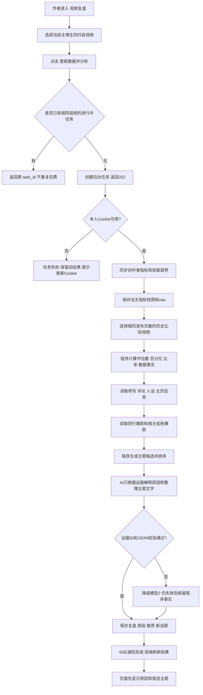
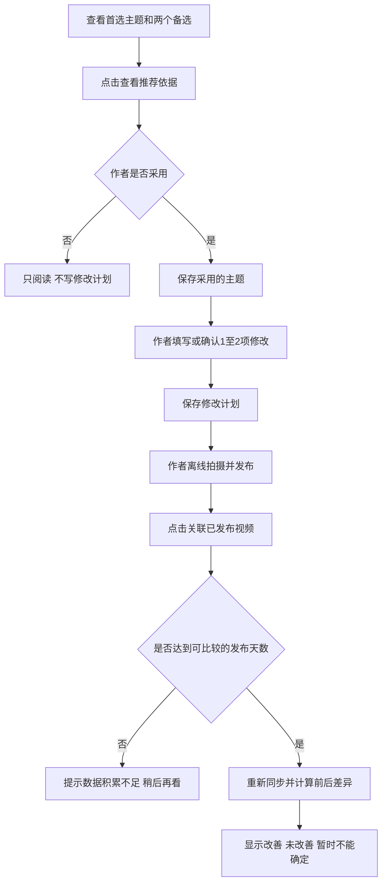
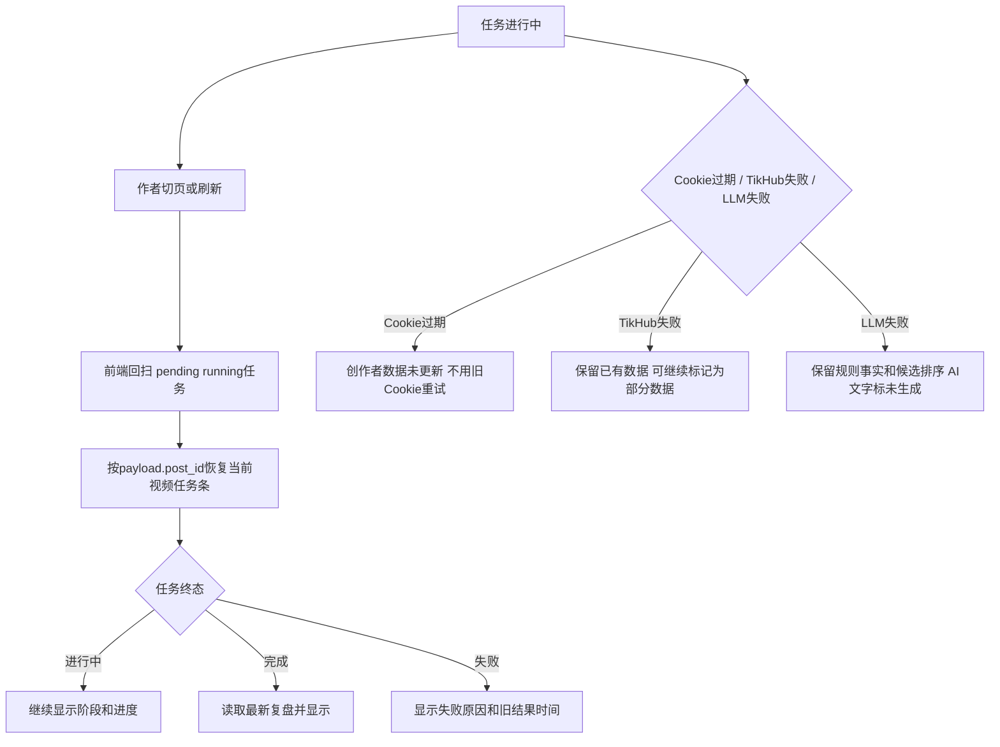
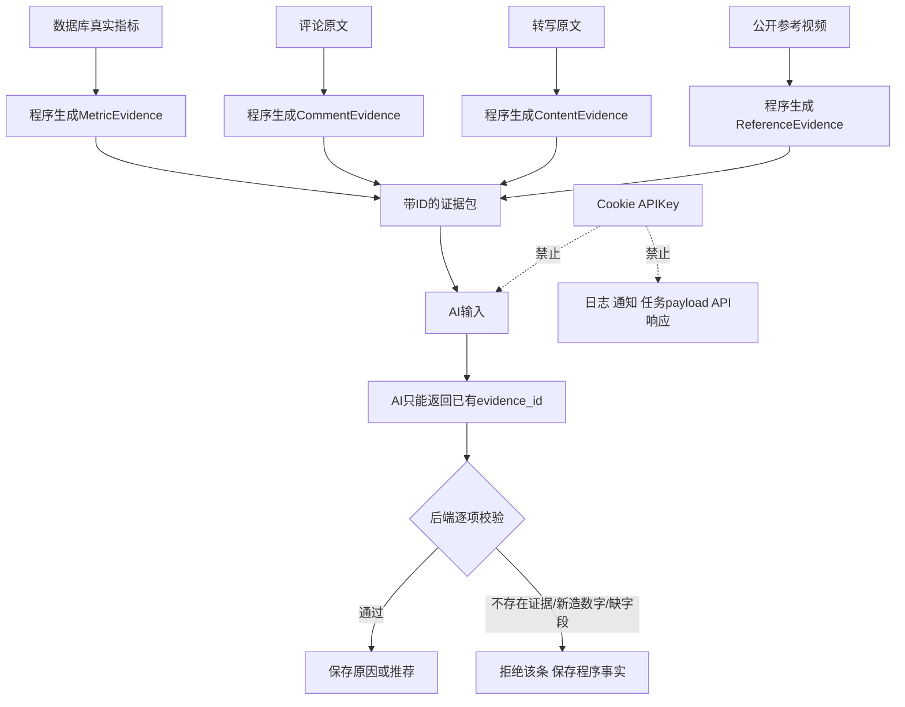

# R-237 开发设计：抖音视频复盘、涨粉与下一步主题

- **对应需求**：`requirements/R-237-douyin-video-review.md`
- **日期**：2026-10-29
- **状态**：代码完成；2026-10-30 已完成真实 TikHub + 真实 LLM 全链路联调（含本人创作者私有字段、低粉爆款、同行播放量补采、失败回退），实现细节以代码与真实响应为准
- **重要说明**：本文中的新表、新接口、阈值均为实施前设计；开发时按本文实现并补测试，实施后以真实 `docs/DATABASE.md`、`docs/API.md` 为准。

## 1. 开发背景

### 1.1 要解决的问题

作者已有抖音作品、公开互动数据、对标账号、评论、转写、人设和后台任务能力，但现有系统不能把数据可靠地转成以下答案：

1. 这条视频到底哪项好、哪项差，比较对象是谁。
2. 数据差异可能由什么内容问题造成，依据是什么。
3. 哪些内容真正带来关注，而不是只有播放。
4. 下一条首选主题是什么，为什么排第一，后续三条讲什么。
5. 上次修改发布后有没有效果。

### 1.2 现有可复用能力

- `creators / creator_accounts`：区分当前主博主和作者手动添加的对标博主。
- `platform_posts / platform_post_stats / platform_post_comments`：作品、按天公开指标和评论。
- `videos / transcripts`：本地视频和 ASR 转写。
- `TikHubClient`：真实平台请求、全局限速、重试和每日预算。
- `opportunity.py`：评论清洗、问题识别、相似度、已讲内容查重。
- `benchmark.py`：读取当前主博主的对标账号及其作品。
- `persona_tags`：作者人设、内容立场和禁区。
- `llm_router.py`：模型1/模型2、失败降级、实际模型记录。
- `background_tasks + SSE + ActiveWorkProvider`：长任务、进度、通知、切页和刷新恢复。
- React + TypeScript + TanStack Query + Framer Motion + lucide 图标。

### 1.3 核心设计决定

1. **先由程序算事实，再由 AI 解释**：指标、比较对象、百分位、爆款倍数、候选排序都由 Python 计算；AI 不得自行生成数值或选择不存在的证据。
2. **不把“相关”写成“原因”**：规则命中只产生数据事实；内容原因必须带原文依据并标记“结合内容推测”。
3. **同行由作者关系认定**：只有当前主博主下 `kind=benchmark` 的抖音账号才是同行。低粉爆款只是相关公开参考，不能自动称为同行。
4. **不做一个不可解释的总分**：播放、互动、完播、涨粉分别判断；主题推荐分数只用于排序，页面展示分数背后的证据。
5. **只支持抖音**：新路由、新页面和新表均不扩展为其他平台。
6. **保留旧结果**：刷新或 AI 失败不能清空上一次成功分析；旧结果显示真实数据时间。

### 1.4 边界

- 不自动发布、剪辑或生成完整脚本。
- 不通过公开数据推算同行完播率或单条涨粉。
- 没有逐秒转写时间轴时，不把文本段落强行对应到具体秒数。
- 播放量低于 200 的观看趋势只作参考，不作为强结论。
- 初次同步缺少历史创作者指标时，不伪造“发布后第 N 天”的历史比较。

## 2. 涉及的技术

### 2.1 后端

| 技术或模块 | 用途 | 本次使用方式 |
|---|---|---|
| FastAPI + Pydantic | 新接口与请求/响应校验 | 新增 `/api/douyin-review` 路由，复用 `X-Access-Token` |
| SQLAlchemy 2.x | 数据查询与写入 | 新增独立模型文件，服务层处理业务，路由保持轻量 |
| PostgreSQL | 保存指标、复盘、推荐和修改记录 | JSON 继续用 TEXT，与现有项目一致 |
| Alembic | 表结构迁移 | 新增一个 revision，禁止 `create_all` 或启动补列 |
| httpx | 调用 TikHub | 在 `TikHubClient` 增加带相同限速/重试的 POST 请求能力 |
| TikHub Creator V2 | 自己的创作者数据 | Cookie 仅在服务端请求体使用，不写日志、不由响应返回 |
| TikHub Billboard / Index | 低粉爆款和相关公开视频 | 保存公开参考，不混入作者手动对标账号 |
| 现有 `opportunity` 方法 | 评论清洗、相似度、查重 | 抽取可复用函数，不复制一套评论规则 |
| 现有 `llm_router` | 内容解释和主题文字生成 | 新增 `video_review` 功能路由，输入只允许真实证据 |
| 现有 `tasks` / `events` | 后台分析、进度与通知 | 新增任务 kind，复用 `/api/tasks/{id}` 和 SSE |
| Python 标准库 statistics / json / hashlib | 中位数、百分位、证据和输入指纹 | 不新增科学计算或 AI 框架 |

### 2.2 前端

| 技术或模块 | 用途 | 本次使用方式 |
|---|---|---|
| React 19 + TypeScript | 新“视频复盘”页面 | 新增 `/video-review` hash 路由 |
| TanStack Query | 查询、刷新、任务完成后的结果回填 | 以 `post_id` 和 `review_id` 为查询键 |
| openapi-fetch + openapi-typescript | 类型化 API | 后端接口完成后运行 `npm run gen:api` |
| Framer Motion | 区域入场、展开依据、榜单切换 | 保留旧内容再替换，禁止空白闪帧 |
| lucide-react | 常见图标 | 播放、点赞、时钟、用户加号等图标必须配中文 |
| 现有任务恢复机制 | 切页/刷新恢复分析 | `core/task_meta.py` 增加任务中文名与跳转路径 |

### 2.3 计划新增或修改的文件

**后端新增**：

- `backend/app/api/douyin_review.py`：薄路由、权限和参数校验。
- `backend/app/schemas/douyin_review.py`：接口契约。
- `backend/app/models/video_review.py`：本需求新表模型。
- `backend/app/services/douyin_creator_sync.py`：Cookie 校验、创作者指标和观看趋势同步。
- `backend/app/services/douyin_references.py`：低粉爆款及公开参考同步。
- `backend/app/services/video_review_comparison.py`：同发布时间比较、 baseline 和百分位。
- `backend/app/services/video_review_rules.py`：播放/互动/完播/涨粉事实规则。
- `backend/app/services/video_review_topics.py`：候选生成、证据、排序、去重和后续主题。
- `backend/app/services/video_review_llm.py`：受约束的内容解释与 JSON 校验。
- `backend/app/services/video_review_service.py`：整段任务编排、保存和查询。

**后端修改**：

- `platform/tikhub.py`：新增安全 `_post()`，复用令牌桶、重试、预算；不记录 Cookie 或请求体。
- `models/__init__.py`、`main.py`、`core/task_meta.py`：注册模型、路由和任务。
- `llm_router.py`、`model_settings.py`、`budget_settings.py`：注册“视频复盘”模型功能和预算。
- `core/analytics_views.py`：只允许新增脱敏复盘视图；凭证表和原始 Cookie 永不进入白名单。

**前端新增**：

- `frontend_v2/src/pages/video-review/index.tsx`
- `frontend_v2/src/pages/video-review/types.ts`
- `frontend_v2/src/pages/video-review/use-review-task.ts`
- `frontend_v2/src/pages/video-review/components/`：视频选择、原因、涨粉、主题、参考、修改记录和 Cookie 弹窗组件。

**前端修改**：`App.tsx`、导航和标题文件；复用现有 `Dialog / Tabs / Skeleton / Progress / toast`。

### 2.4 外部接口

| 外部接口 | 用途 |
|---|---|
| `POST /api/v1/douyin/creator_v2/fetch_item_list` | 自己的作品列表及播放、跳出、完播、平均播放、主页访问和粉丝增量等 |
| `POST /api/v1/douyin/creator_v2/fetch_item_overview_data` | 单条或批量作品总览，保留原始返回 |
| `POST /api/v1/douyin/creator_v2/fetch_item_watch_trend` | `analysis_type=1/2/7` 的留存、点赞、跳出趋势 |
| `POST /api/v1/douyin/creator_v2/fetch_author_diagnosis` | 账号近 7 天诊断，只作补充，不代替单条数据 |
| `POST /api/v1/douyin/billboard/fetch_hot_total_low_fan_list` | 近 1/24/72/168 小时的官方低粉爆款榜 |
| `POST /api/v1/douyin/index/fetch_item_query` | 按关键词、类别、发布时间、时长和标签搜索公开视频 |
| `GET /api/v1/douyin/app/v3/fetch_video_statistics` | 补齐公开作品播放、点赞、分享等统计 |

外部字段先保存 `raw`，映射不到的字段写 NULL；不能用 0 代替“平台没有返回”。

### 2.5 运行依赖与凭证加密

不引入 pandas、NumPy、向量数据库、消息队列或新的 LLM SDK。统计使用 Python 标准库，异步任务复用当前数据库任务表和线程。使用项目环境已安装的 `cryptography`（Fernet）加密 Cookie：密文存本地数据库，密钥只放 `.env` 的 `ECHO_DOUYIN_COOKIE_KEY`。接口永不回显，日志、通知、任务 payload、分析证据和 AI 上下文均不得包含 Cookie。

## 3. 开发流程图

### 3.1 用户发起单条视频复盘



### 3.2 采用主题并检查修改



### 3.3 异常恢复



## 4. 数据流转图

### 4.1 总体数据流

```mermaid
flowchart LR
    subgraph EXT[外部数据]
        A[抖音创作者中心]
        B[同行公开作品]
        C[低粉爆款榜和公开搜索]
    end
    subgraph ADAPTER[数据接入]
        D[TikHubClient GET POST]
        E[字段映射 缺失保持NULL raw留存]
    end
    subgraph DB[(PostgreSQL)]
        F[现有作品 评论 转写 人设]
        G[创作者指标快照]
        H[公开参考视频]
        I[复盘和原因]
        J[主题推荐和修改计划]
    end
    subgraph LOGIC[程序计算]
        K[同发布天数比较]
        L[指标事实和规则]
        M[同行和爆款筛选]
        N[主题候选评分去重]
    end
    subgraph AI[受约束的模型]
        O[内容解释]
        P[主题文字和后续3条]
        Q[证据ID及JSON校验]
    end
    A --> D --> E --> G
    B --> D --> E --> F
    C --> D --> E --> H
    F --> K
    G --> K --> L
    F --> M
    H --> M
    L --> N
    M --> N
    L --> O --> Q --> I
    N --> P --> Q --> J
    I --> R[GET 复盘结果]
    J --> R
    R --> S[视频复盘页面]
    S --> T[采用主题 记录修改 关联发布]
    T --> J
```

### 4.2 证据流与禁止流向



### 4.3 关键数据所有权

- 当前主博主只能读取自己的创作者指标；所有接口按当前 `owner` 重新校验 `account/post` 归属，不能相信前端传入的 owner_id。
- 同行读取范围必须是 `Creator.parent_id=current_owner.id AND Creator.kind='benchmark'`。
- 低粉参考使用独立表，不创建虚假 `CreatorAccount`，不污染现有对标、素材库和人设语料。
- 对标视频、低粉视频只作参考，绝不进入主博主人设学习。
- 主题采用、修改记录和发布关联必须以作者点击为准，AI 不自动写成已执行。

## 5. 实现细节

### 5.1 创作者数据同步与缺失值

1. 路由取得当前主博主，再查找其 `platform='douyin' AND enabled=true` 的账号。
2. `douyin_creator_sync` 从独立凭证表读取 Cookie；Cookie 不进入 `BackgroundTask.payload`，任务只保存 `account_id/post_id`。
3. `fetch_item_list` 按时间范围和游标拉取作品；先复用 `_ensure_post` 保存基本作品和公开指标，再保存创作者私有指标。
4. `fetch_item_overview_data(ids=...)` 补充总览；`fetch_item_watch_trend` 分别请求 `analysis_type=1/2/7`，保存三组趋势。
5. 同一天多次同步更新同一 `(post_id, snapshot_date)`，另保存 `captured_at` 表示最近抓取时间。历史日期不回头改写。
6. 数值缺失为 NULL；0 只表示平台明确返回 0。比率在库中保存 0～1，接口和页面再格式化为百分比。
7. 每次真实外部请求仍经过现有预算和全局限速。凭证失效属于永久错误，不重复请求；429/5xx/传输错误按现有策略有界重试。
8. 同步部分成功时保存成功项并返回 `warnings`，任务可完成“部分数据分析”；Cookie 无效导致没有任何新数据时任务失败并保留旧结果。
9. 趋势播放量不足 200 时保存 `trend_reliable=false`，前端显示“播放量较少，趋势仅供参考”。

### 5.2 公平比较：到底和谁比

#### 第一步：固定比较时点

设目标视频当前已发布 `a` 天：

- 目标使用当前最新快照。
- 每条历史视频取“发布后不超过 `a` 天的最近一张快照”，目标天数允许 ±1 天的快照误差。
- 没有该时点快照的历史视频不进入定量比较，只能作为内容参考。
- 首次接入时没有历史私有指标，公开指标可比较，私有指标明确显示“历史数据不足”。

#### 第二步：建立候选池

- 只属于当前主博主的同一抖音账号。
- 排除目标视频、广告、未发布、无发布时间作品。
- 默认取目标之前最近 30 条；不足 30 条使用实际数量。
- 先满足相同比较时点，再按主题和时长排序，最多取 10 条进入相近组。

#### 第三步：相近程度排序

只用于排序，不用于伪造原因：

- 有相同 `main_topics`：+1.0。
- 规范化标签重合度 `>=0.5`：+0.6。
- 标题字符 bigram 相似度 `>=0.5`：+0.4。
- 时长差在目标时长的 ±20% 或 ±15 秒之内：+0.5。
- 同分取发布时间更近者。

没有相似项时使用最近同账号作品，并明确“按近期视频比较”，不能写成“同类视频”。

#### 第四步：计算中位数和百分位

- 每个指标独立剔除 NULL，不用 0 补齐。
- `baseline=median(历史值)`。
- 百分位表示目标在比较组中的位置；2 秒跳出率反向解释，其他越高越好的指标正向解释。
- 点赞率、评论率、收藏率、转发率分别用 `对应次数/播放量`；每千次播放关注用 `粉丝增量/播放量×1000`。播放量小于 30 时不据此下强弱结论。

#### 第五步：样本不足规则

| 有效历史视频数 | 能做什么 |
|---|---|
| 0～1 | 只展示当前数据，不判断“好于/差于平时” |
| 2～4 | 显示数值差异和“比较样本较少”，不给整体好坏结论 |
| 5～9 | 可以判断单项高低，结论注明样本数量 |
| 10 条相近组 | 正常判断，并展示相近组选择依据 |

#### 第六步：单项强弱与整体描述

- 百分位 `>=75`：该项“高于平时”；`<=25`：该项“低于平时”；其余为“接近平时”。
- 次数类指标还需与 baseline 相差至少 20%，避免微小差异被夸大；baseline=0 时只描述实际多少，不计算倍数。
- 比率类指标还需相差至少 3 个百分点，避免把 0.1% 的波动当问题。
- 粉丝增量还需绝对差至少 1 人；不把 0 到 1 的变化写成“暴涨”。

整体不使用加权总分：

- 播放、互动、完播、涨粉四项中至少两项偏弱：**整体需要改进**。
- 至少两项偏强且没有偏弱项：**整体表现较好**。
- 其他：**有好有坏**。

页面仍先列具体维度，不能只显示“好/差”。

### 5.3 复盘归因：为什么好、为什么差

#### 原则

- 第一层是 `MetricFact`：字段名、当前值、baseline、百分位、差值、样本数、证据 ID，全部程序生成。
- 第二层是 `RuleResult`：只有明确组合条件才命中。
- 第三层是可选 `ContentHypothesis`：AI 只能引用真实转写、评论和事实 ID，必须输出原文证据。
- 没有命中规则时显示“目前无法判断”，不让 AI 自由补一个原因。

#### 规则表

| 规则 | 必须同时满足的数据事实 | 可以给出的内容判断 | 不能越界说什么 |
|---|---|---|---|
| 开头留人偏弱 | 2 秒跳出高于平时，或 5 秒完播低于平时；样本足够 | 若转写开头确有问候、长背景、结果未前置，可推测“进入主题偏慢”，引用原句 | 不能仅因跳出高就断定标题或封面有问题 |
| 开头后衔接偏弱 | 2 秒跳出接近平时，但 5 秒完播低 | 可检查前段是否重复、承诺后没有马上给信息 | 不能伪称知道观众在第几秒离开 |
| 中后段留人偏弱 | 5 秒完播接近或好于平时，但完整完播或平均播放比例低 | 可引用中后段重复、多个主题、长结尾，标记推测 | 无时间轴不能把某段文字映射到具体秒点 |
| 封面吸引偏弱 | 封面点击率低，且样本足够 | 可评价标题/封面文字是否具体，但不替作者生成虚假点击率 | 推荐流播放低不能单独证明封面差 |
| 有播放但互动弱 | 播放接近或高于平时，点赞率/评论率至少一项低 | 评论和原文可支持“共鸣/讨论点不足”的推测 | 不能说观众一定不喜欢 |
| 内容受欢迎但分发较少 | 播放低，但点赞率、完播或每千次播放关注至少两项较强 | 建议保留主题，先修改封面或开头中确有问题的部分 | 不能承诺修改后一定爆款 |
| 有播放但主页兴趣弱 | 播放接近或高于平时，主页访问低 | 可推测内容偏一次性问题，未形成持续期待 | 不能说账号定位一定有问题 |
| 进主页但关注弱 | 主页访问接近或高于平时，粉丝增量或每千次播放关注低 | 只有实际主页信息支持时，才能指出简介、近期方向或置顶不一致 | 不获取同行私有数据，不编造自己的主页缺失信息 |
| 涨粉内容值得继续 | 每千次播放关注高，或粉丝增量高，样本足够 | 将该主题证据加权进入主题候选 | 播放低不等于内容差 |
| 搜索带来观看 | 搜索来源和关键词确有数据 | 可围绕真实高频搜索词生成候选 | 不能把平台未返回的词写成用户搜索词 |
| 观看趋势异常点 | 有趋势、播放>=200、相邻点下降幅度超过全曲中位下降幅度的 2 倍且差值>=5个百分点 | 显示具体时间点；有带时间轴文本才解释对应内容 | 无时间轴文本只展示位置，不自动指认某句台词 |

#### AI 输出契约

AI 输入只包含：当前指标事实、规则结果、证据清单、人设禁区、主页已有信息。输出 JSON：

```json
{
  "findings": [
    {
      "rule_key": "early_retention_weak",
      "title": "开头进入主题可能偏慢",
      "judgement_type": "hypothesis",
      "evidence_ids": ["metric:12", "content:34"],
      "conclusion": "……",
      "suggestion": "……",
      "target_metric": "completion"
    }
  ]
}
```

后端逐条拒绝：不存在的 `rule_key/evidence_id`、AI 新造数值、与规则方向相反、缺少建议、命中人设禁区的内容。模型1失败降级模型2；都失败则保存 `MetricFact/RuleResult`，AI 文案字段为空并显示“数据事实已生成，内容解释暂不可用”。

### 5.4 涨粉与主页分析

1. 按主题聚合作者自己的视频，分别计算粉丝增量、每千次播放关注、主页访问的中位数；样本少于 3 条时不排“最佳主题”，只显示单条事实。
2. “高播放不涨粉”需要播放百分位>=75 且每千次播放关注百分位<=25；播放量低时不使用每千次比率夸大个别关注。
3. “播放不高但适合账号”需要播放百分位<=25，同时每千次播放关注或完播百分位>=75；只说明值得小规模继续，不承诺一定涨粉。
4. 主页检查拆成可见字段：简介是否获取、简介是否说明持续内容、最近 10 条主题是否集中、是否有置顶信息、当前视频主题是否出现在近期主题中。
5. 主题集中度使用已有标签/标题相似度，只作辅助；AI 可总结但必须引用具体主页文字和作品 ID。
6. 未获取简介或置顶时返回 `needs_author_input`，页面显示“需要作者补充”，不自动判为主页差。
7. 作者补充的简介、置顶作品 ID 和主页方向说明保存在该账号现有 `creator_accounts.extra_config` 的 `review_homepage` 命名空间，不修改表字段、不与 Cookie 混存；后续复盘可复用，并显示“作者补充”而不是“平台返回”。

### 5.5 同行爆款：凭什么算同行、凭什么算爆款

#### 同行认定

仅认作者已在“博主管理”添加的关系：

```text
current owner
  -> Creator(kind=benchmark, parent_id=current_owner.id)
  -> CreatorAccount(platform=douyin, enabled=true)
  -> PlatformPost
```

搜索、低粉榜或 AI 发现相似账号都不能自动进入“同行爆款”。没有手动对标账号时显示“请先在博主管理添加抖音同行”。

#### 爆款筛选

每个同行账号独立计算，不跨账号使用固定播放量：

1. 默认取近 30 天作品，排除广告和无有效播放数据作品。
2. 使用该账号最近 30 条有同时间点数据的作品作为 baseline；至少 5 条才正式标“爆款”。
3. 候选需位于该账号播放百分位>=75，并且 `候选播放量 >= 2 × 该账号播放中位数`。
4. 样本 2～4 条但达到 2 倍时，只显示“高于该同行平时”；不足 2 条不做爆款判断。
5. 排序先看播放倍数，再看点赞率和评论率；不同粉丝量同行之间不直接比较绝对播放。
6. 页面展示判断依据，例如“该账号相近时点中位数 1.2 万，本条 4.8 万，为 4 倍”。

#### 内容分析

- 转写、评论已有时才分析开头、内容和讨论点；缺失时可复用现有下载/转写任务，但必须显示进行中。
- 观察同一作者近 10 条是否有同主题、爆款后是否延续；这些是公开内容事实。
- 不生成“这条给同行涨了多少粉”的结论。

### 5.6 低粉爆款：来源与相关性

1. “低粉爆款”标签只来自官方低粉榜或 `label_type=1` 的搜索返回，系统不自行按粉丝数发明门槛。
2. 默认 `date_window=168` 或搜索 `date_type=7`，按 `external_post_id` 去重，保留来源和最近出现时间。
3. 低粉视频叫“相关低粉爆款”，不自动叫“同行”。
4. 与作者相关性排序：
   - 内容类别与当前账号主方向一致：+40。
   - 与作者人设、历史主题或当前视频关键词重合：0～30，按实际重合项计算。
   - 与作者评论问题或搜索词重合：0～20。
   - 时长与作者常见 1～2 分钟口播相近：+10。
5. 总分低于 40 的只留在“全部低粉爆款”，不得进入作者主题候选。类别未知且没有关键词证据时标“与账号关系未判断”。
6. 同分按发布时间新、播放量高排序；播放跨数量级时使用 `log1p(plays)` 仅作同组次级排序，避免大数字完全压过相关性。
7. AI 可解释“为什么适合参考”，但不能改变官方标签、虚构作者粉丝数或把低粉视频变成同行证据。

### 5.7 下一个视频主题：候选如何产生

候选来自六路，每一路必须带来源 ID：

| 来源 | 候选生成方法 |
|---|---|
| 自己涨粉较好的内容 | 从每千次播放关注或粉丝增量较强的视频提取主题和未展开问题 |
| 自己评论问题 | 复用评论清洗与聚类，把重复问题变成候选，保存原评论 ID |
| 自己高播放但可改进内容 | 保留已证明需求的主题，只改变角度或确有问题的开头/封面 |
| 同行爆款 | 从手动同行中已达到爆款规则的视频提取主题，保存作品和倍数证据 |
| 相关低粉爆款 | 只取相关性>=40的公开视频，保存官方标签和相关性证据 |
| 相关热点 | 仅作补充，必须同时与人设或观众问题匹配，不能单独成为首选 |

主题归一化复用现有 `_norm/_sim`：先去话题、@、空白和标点，再按字符 bigram/SequenceMatcher 合并；AI 聚类只能返回输入候选 ID，不能新增候选。重复候选合并来源，不重复计算同一作品。

### 5.8 下一个视频主题：凭什么排第一

每个候选按 100 分排序，分数只用于本次候选之间排序，不是“爆款概率”。

| 维度 | 分值 | 计算依据 |
|---|---:|---|
| 自己真实涨粉证据 | 0～30 | 同主题有效视频数、每千次播放关注相对位置、样本是否足够；没有真实涨粉数据不得给这部分分 |
| 观众需求 | 0～25 | 不同评论者重复提问数、问题点赞、真实搜索词；同一用户刷屏只算一人 |
| 与作者适合程度 | 0～20 | 已有同方向内容、人设一致、存在真实经历或素材证据；禁区直接排除 |
| 同行与低粉公开证据 | 0～15 | 达到规则的作品数、不同作者数、相对本人表现；同一作者多条不当作多人验证 |
| 新鲜程度 | 0～10 | 近 7 天证据最高，8～30 天递减，超过 30 天不得作为“近期”证据 |

计分细节固定如下，避免不同次分析随意变分：

- **涨粉 0～30**：同主题至少 3 条有效视频才计满分档；每千次播放关注达到高分位得 20、达到中位得 10，粉丝增量达到高分位得 10、达到中位得 5。只有 1～2 条时每项最多得一半并在理由中写“样本较少”，没有真实涨粉数据得 0。
- **观众需求 0～25**：不同评论者人数贡献 `min(15, 3×log2(1+人数))`；问题评论点赞贡献 `min(5, log2(1+点赞数))`；不同真实搜索词贡献 `min(5, 2×搜索词数)`。同一评论者重复发言只算一人。
- **作者适合程度 0～20**：已有同方向作品 8 分；与已确认人设/内容立场一致 6 分；有作者真实经历、转写或素材可作内容依据 6 分。没有对应证据 ID 的项不得分；所以首选要求的 12 分至少意味着两类真实适合依据。
- **同行与低粉 0～15**：每个达到规则的不同手动同行作者 5 分，最多 10；每个相关低粉作者 2 分，最多 5。同一作者多条只算一个作者，但可保留多条作品作为内容证据。
- **新鲜程度 0～10**：最新证据距今 0～7 天得 10，8～30 天得 5，超过 30 天得 0。自己的长期涨粉证据可保留在其他维度，但不能同时伪装成近期证据。

额外规则：

- 最近 30 天已经讲过且没有新评论问题或新角度：扣 25 分；完全重复且无新证据的候选不进入首选。
- 命中人设禁区：直接排除，不用高分抵消。
- 只有热点一个来源：不得成为首选。
- 首选必须至少有两类证据，并且“与作者适合程度”>=12；否则显示“目前没有足够依据给出可靠首选”，而不是硬推。
- 选总分最高且满足门槛者为首选；之后选两个不同主题簇为备选。
- 同分时依次比较：自己证据>观众需求>同行作者数>更新时间。
- 页面展示 `score_detail` 对应的自然语言理由，不向小白展示“算法权重”“向量”“embedding”等词。

### 5.9 首选的后续三条和新话题

- AI 输入首选主题、作者证据、评论问题、已讲标题和禁区；输出恰好 3 条不重复的后续内容。
- 三条分别标记：`吸引新观众 / 帮助了解作者 / 加强关注理由`，若证据不足以承担某作用则允许写“共同相关主题”，不能硬编。
- 后端检查非空、去重、未覆盖、与首选相关、无新造第一人称经历；失败时使用评论问题或同一主题未展开角度，仍不足则少显示，不凑数。
- 账号新话题与下一条主题使用不同候选池：允许与现有方向相邻，但至少需要“观众相关证据 + 作者可讲依据”之一，并明确还缺什么。
- 新话题显示 3 个；不足 3 个时显示实际数量，不为了页面整齐编造。

### 5.10 采用、修改计划和发布检查

- “采用主题”只写推荐采用状态并创建/更新计划，不创建草稿、不自动发布。
- 修改计划最多 2 个重点修改项，后端校验；保留原始 AI 建议与作者实际填写内容的区别。
- 关联新视频时校验同属当前主博主同一抖音账号，且发布时间晚于原计划；不能跨账号关联。
- 检查时使用原计划指定的主要指标和相同发布天数，不因结果好坏临时换指标。
- 每项输出 `improved / not_improved / uncertain`：达到第 5.2 节差异门槛才可判改善或变差，否则为接近或不确定。
- 样本不足、发布天数不一致或缺指标时必须是 `uncertain`，不能写“修改成功”。

### 5.11 后台任务与幂等

新增任务：

- `douyin_review_analyze`：`payload={account_id,post_id,refresh}`；同视频进行中时返回原任务。
- `douyin_review_references`：`payload={owner_id,filters}`；同筛选进行中时复用。
- `douyin_review_plan_check`：`payload={plan_id}`；同计划进行中时复用。

`input_fingerprint` 包含作品/指标更新时间、转写、评论、主页、人设版本、参考更新时间和规则版本。`refresh=false` 且指纹相同的已完成复盘可直接复用；`refresh=true` 或作者主动重新分析生成新记录，历史不覆盖。

任务阶段建议：5% 校验归属 → 20% 同步数据 → 40% 计算比较 → 60% 整理参考 → 80% AI 解释和主题 → 100% 保存。前端显示中文阶段，不显示虚假精确耗时。

### 5.12 安全、额度与性能

- Cookie 只在服务端读取；请求/响应日志不打印请求体；外部错误文本先清理 Cookie 再保存。
- 凭证接口 GET 只返回状态和掩码，永不返回 Cookie；任务 payload、分析 raw 证据、AI 输入和通知也不得包含。
- `raw` 只保存平台作品数据，凭证与作品 raw 分离。
- 同一视频进行中任务防重；相同输入可复用复盘；外部参考按条件复用近期结果，避免反复扣额度。
- 单条分析外部请求设上限：作品总览 1 次、三类趋势最多 3 次、缺失公开统计按需补充；达到上限后保存警告，不无限补全。
- 比较和候选查询使用 `account_id/publish_time/stat_date` 索引，批量预加载 stats/comments/transcripts，禁止逐条 N+1。
- 单条 LLM 内容截断只影响输入长度，证据 ID 清单仍完整保存；长评论优先高赞和不同用户，不用单纯前 50 条偏差代替所有评论。

### 5.13 前端交互细节

- 首屏先加载最近完成复盘，不在打开页面时自动消耗 TikHub/LLM。
- 切换视频保留当前已显示内容并显示局部加载，不用整页白屏；新数据返回后替换对应区域。
- 原因、依据、主题、参考区域使用局部骨架屏；进行中任务条固定显示当前阶段。
- “采用/记录/关联”成功后立即更新本地查询缓存并 toast；失败保留作者输入。
- Cookie 弹窗使用密码输入；保存时不把 Cookie 写入 TanStack Query 缓存、浏览器存储或日志。
- 320px 起可用：指标两列或单列、表格改卡片、主要触控高度至少 44px。

#### 图表组件与一眼可读规则

不新增图表库，使用现有 React + CSS + SVG 实现小型图表，避免为一个页面引入大型依赖。每个图都有中文标题、一句话结论、直接数值、单位和“查看数据表”按钮。

| 组件 | 图形与输入 | 关键实现规则 |
|---|---|---|
| `MetricCards` | 带图标的指标卡；输入 `metrics[]` | 同时显示当前值、baseline、差值、方向和样本数；缺失显示暂无数据，不显示0 |
| `BaselineBars` | 当前与平时横向双条；输入 `charts.comparison[]` | 每条从0开始，当前/平时有文字，跳出率注明“越低越好” |
| `WatchTrendChart` | SVG 折线；输入 `charts.retention` | x=秒、y=0～100%；当前与同类参考两条线；异常点直接标时间和幅度 |
| `SourceBars` | 播放来源横条；输入 `charts.traffic[]` | 每项同时显示次数和百分比，按次数降序 |
| `SearchTermBars` | 搜索词横条；输入 `charts.search_terms[]` | 使用真实词和次数，无数据只显示空状态 |
| `CommentQuestionBars` | 评论问题横条；输入评论聚类证据 | 显示不同评论者人数和点赞，点击展开原评论 |
| `FollowerTopicBars` | 主题涨粉横条；输入 `charts.follower_topics[]` | 每千次播放关注与粉丝增量分行，显示样本数，样本<3加提示 |
| `PeerComparisonBars` | 同行本条与平时双条 | 标出 play_multiple 和 sample_count，不跨同行比较绝对播放 |
| `PlanComparisonCharts` | 修改前后小图组；输入 `charts.plan[]` | 每个指标独立单位和坐标，显示改善/未改善/不确定 |

统一约束：条形图不得截断非零起点；折线图不从非零时间开始；当前与对比除颜色外必须有文字和线型区别；关键值无需悬浮即可看到，悬浮/点按只补充详情；NULL 不进入坐标计算；样本不足时用数据表代替强弱图；主题和原因不使用雷达图、综合仪表盘。图表动画只改变宽/高或路径插值，初始透明度不低于0.6，更新期间保留旧图和数值。

图表原始数据与表格来自同一个 `charts` 响应，禁止前端各组件分别用不同公式重算。SVG 提供 `role="img"`、中文 `title/desc`，图表数据表用真实表格语义，颜色对比满足现有深浅主题。

### 5.14 测试与验收设计

外部服务一律 mock，至少覆盖：

- 0/1/2/4/5/10 条历史样本；NULL 与真实 0；baseline=0；播放量<30。
- 相同发布天数选择、缺少历史私有指标、主题/时长相近组选择。
- 2 秒跳出反向解释、整体四种描述、比率 3 个百分点门槛。
- 每条归因规则的命中与不命中；AI 假证据 ID、假数字、错误 JSON 被拒绝。
- 只有手动对标账号才能算同行；低粉视频不混为同行。
- 同行爆款 2 倍、百分位、至少 5 条及样本不足文案。
- 主题候选来源合并、重复评论者去重、禁区排除、单一热点不能首选、首选至少两类证据。
- 后续三条不足时不硬凑；无依据时首选为空。
- 修改计划最多两项、跨账号关联拒绝、检查指标不足返回 uncertain。
- Cookie 不出现在 API 响应、任务 payload、日志和 AI 输入。
- 重复点击复用任务；刷新后恢复；TikHub 成功但 LLM 失败仍有事实结果。
- Alembic 空库 upgrade、现有库 upgrade 和 downgrade；新接口 401/404/422/409 契约。
- 前端按钮、字段含义、空数据、旧结果保留、移动端和局部加载测试。
- 图表与数据表数值一致；NULL 不画成0；条形图零起点；折线时间/百分比坐标；跳出率方向；样本不足提示；SVG 中文说明；手机点按详情；深浅主题可读性。

完成后必须运行 `scripts/verify.sh`，再做真实 TikHub 单账号小范围联调；真实联调只用作者本人或已授权 Cookie，不在测试和文档中保存凭证。

## 6. 新增或修改的表结构、表结构字段描述

### 6.1 总览

计划新增 7 张表，不修改现有表字段。所有表使用 PostgreSQL；JSON 与项目现状一致使用 TEXT；时间字段使用应用统一北京时间。外键用于归属和查询，删除主博主/作品前必须先处理关联记录，不能静默级联删除作者修改记录。

| 表名 | 用途 |
|---|---|
| `douyin_creator_credentials` | 每个本人抖音账号的创作者 Cookie 状态 |
| `douyin_post_metrics` | 每条自己作品的创作者指标按天快照 |
| `douyin_reference_videos` | 低粉榜和公开搜索参考视频 |
| `video_reviews` | 每次复盘的主记录、状态和输入版本 |
| `video_review_findings` | 每条原因、证据和修改建议 |
| `video_topic_recommendations` | 首选、备选、后续三条和新话题 |
| `video_improvement_plans` | 作者采用的修改计划与发布后检查 |

新增索引遵循查询路径；唯一约束防止同一天重复快照和同一推荐位置重复。凭证表不加入 AI 对话分析视图。

### 6.2 `douyin_creator_credentials`

| 字段 | 类型 | 可空/默认 | 中文含义 |
|---|---|---|---|
| `id` | INTEGER PK | 否 | 主键 |
| `account_id` | INTEGER FK→creator_accounts.id | 否，唯一 | 对应的本人抖音账号 |
| `cookie_value` | TEXT | 否，默认 `''` | Fernet 加密的 Cookie 密文；只供服务端解密调用，永不回显 |
| `status` | VARCHAR(20) | 否，`missing` | `missing/valid/expired/invalid` |
| `last_validated_at` | DATETIME | 可空 | 最近一次验证时间，无论成功失败 |
| `last_success_at` | DATETIME | 可空 | 最近一次成功获取创作者数据时间 |
| `last_error` | TEXT | 否，`''` | 清理敏感信息后的失败原因 |
| `created_at` | DATETIME | 否，当前时间 | 创建时间 |
| `updated_at` | DATETIME | 否，当前时间，更新时刷新 | 最近修改时间 |

约束/索引：`uq_douyin_credential_account(account_id)`；账号只能是当前主博主名下抖音账号。Cookie 不进入其他 JSON 字段。

### 6.3 `douyin_post_metrics`

| 字段 | 类型 | 可空/默认 | 中文含义 |
|---|---|---|---|
| `id` | INTEGER PK | 否 | 主键 |
| `post_id` | INTEGER FK→platform_posts.id | 否 | 对应的本人抖音作品 |
| `snapshot_date` | VARCHAR(10) | 否 | 指标所属日期 `YYYY-MM-DD` |
| `captured_at` | DATETIME | 否 | 本次实际抓取时间 |
| `bounce_2s_rate` | FLOAT | 可空 | 2 秒内跳出占比，0～1 |
| `finish_5s_rate` | FLOAT | 可空 | 播放超过 5 秒占比，0～1 |
| `finish_rate` | FLOAT | 可空 | 完整完播率，0～1 |
| `avg_play_seconds` | FLOAT | 可空 | 平均播放时长（秒） |
| `cover_click_rate` | FLOAT | 可空 | 封面点击率，0～1 |
| `profile_visits` | INTEGER | 可空 | 观看后主页访问次数 |
| `follower_gain` | INTEGER | 可空 | 观看该作品后新增关注数 |
| `traffic_sources` | TEXT JSON | 否，`{}` | 播放来源及各自数值 |
| `search_terms` | TEXT JSON | 否，`[]` | 搜索词及对应数据 |
| `retention_trend` | TEXT JSON | 否，`[]` | `analysis_type=1` 留存点 |
| `like_trend` | TEXT JSON | 否，`[]` | `analysis_type=2` 点赞点 |
| `bounce_trend` | TEXT JSON | 否，`[]` | `analysis_type=7` 跳出点 |
| `similar_author_trend` | TEXT JSON | 否，`{}` | 平台提供的同类作者趋势，仅作参考 |
| `trend_reliable` | BOOLEAN | 否，`false` | 播放>=200且趋势完整时才为 true |
| `raw` | TEXT JSON | 否，`{}` | 创作者接口原始返回，不含 Cookie |
| `created_at` | DATETIME | 否，当前时间 | 创建时间 |

约束/索引：`uq_douyin_post_metric_day(post_id,snapshot_date)`；`ix_douyin_post_metrics_post_date(post_id,snapshot_date)`。公开播放/点赞仍留在 `platform_post_stats`，本表只保存新增创作者指标，避免两套公开数字被误加总。

### 6.4 `douyin_reference_videos`

| 字段 | 类型 | 可空/默认 | 中文含义 |
|---|---|---|---|
| `id` | INTEGER PK | 否 | 主键 |
| `external_post_id` | VARCHAR(200) | 否 | 抖音作品 ID |
| `source` | VARCHAR(30) | 否 | `low_fan_billboard/index_search` |
| `source_label` | VARCHAR(30) | 否，`''` | 平台返回标签，如低粉爆款 |
| `author_id` | VARCHAR(200) | 否，`''` | 公开作者 ID，不关联 creators |
| `author_nickname` | VARCHAR(100) | 否，`''` | 公开作者昵称 |
| `author_followers` | INTEGER | 可空 | 公开作者粉丝数 |
| `title` | VARCHAR(500) | 否，`''` | 视频标题 |
| `cover_url` | VARCHAR(1000) | 否，`''` | 封面地址 |
| `video_url` | VARCHAR(1000) | 否，`''` | 抖音原视频链接 |
| `publish_time` | DATETIME | 可空 | 发布时间 |
| `duration_seconds` | INTEGER | 可空 | 视频时长（秒） |
| `plays` | INTEGER | 可空 | 公开播放量 |
| `likes` | INTEGER | 可空 | 公开点赞数 |
| `comments` | INTEGER | 可空 | 公开评论数 |
| `shares` | INTEGER | 可空 | 公开分享数 |
| `category_id` | VARCHAR(40) | 否，`''` | 查询或返回的内容类别 |
| `keyword` | VARCHAR(200) | 否，`''` | 本次命中关键词 |
| `top_comments` | TEXT JSON | 否，`[]` | 实际获取的公开评论，不包含私有数据 |
| `analysis` | TEXT JSON | 否，`{}` | 基于公开内容生成的参考分析、可借鉴点和证据 |
| `analyzed_at` | DATETIME | 可空 | 最近一次完成参考分析的时间 |
| `raw` | TEXT JSON | 否，`{}` | 公开接口原始返回 |
| `first_seen_at` | DATETIME | 否，当前时间 | 首次进入参考库时间 |
| `last_seen_at` | DATETIME | 否，当前时间 | 最近一次榜单/搜索出现时间 |

约束/索引：`uq_douyin_reference_post(external_post_id)`；`ix_douyin_reference_source_time(source,publish_time)`、`ix_douyin_reference_author(author_id)`。同一作品再次出现时更新公开指标与 `last_seen_at`，不重复建行。

### 6.5 `video_reviews`

| 字段 | 类型 | 可空/默认 | 中文含义 |
|---|---|---|---|
| `id` | INTEGER PK | 否 | 复盘 ID |
| `account_id` | INTEGER FK→creator_accounts.id | 否 | 本人抖音账号 |
| `post_id` | INTEGER FK→platform_posts.id | 否 | 被分析作品 |
| `task_id` | INTEGER FK→background_tasks.id，可空 | 可空 | 生成该复盘的后台任务 |
| `status` | VARCHAR(20) | 否，`running` | `running/done/partial/failed` |
| `input_fingerprint` | VARCHAR(64) | 否，`''` | 输入与规则版本指纹，用于复用 |
| `rule_version` | VARCHAR(20) | 否 | 规则版本，便于旧结论追溯 |
| `comparison_count` | INTEGER | 否，0 | 实际参与比较的历史视频数 |
| `comparison_post_ids` | TEXT JSON | 否，`[]` | 比较视频 ID 列表 |
| `summary` | TEXT | 否，`''` | 一句话结论 |
| `overall_result` | VARCHAR(30) | 否，`unknown` | `good/mixed/needs_improvement/unknown` |
| `metrics_snapshot` | TEXT JSON | 否，`{}` | 本次分析的指标、比较事实和图表数据快照，防止历史结果被后续数据改写 |
| `homepage_analysis` | TEXT JSON | 否，`{}` | 主页检查及需补充项 |
| `new_topics` | TEXT JSON | 否，`[]` | 最多 3 个账号新话题及证据 |
| `warnings` | TEXT JSON | 否，`[]` | 部分数据缺失或降级说明 |
| `model_name` | VARCHAR(120) | 否，`''` | 实际生成解释的模型，无 AI 时为空 |
| `prompt_version` | INTEGER | 可空 | 使用的复盘提示词版本 |
| `error` | TEXT | 否，`''` | 清理敏感信息后的错误 |
| `created_at` | DATETIME | 否，当前时间 | 发起时间 |
| `completed_at` | DATETIME | 可空 | 完成时间 |

索引：`ix_video_reviews_post_created(post_id,created_at)`、`ix_video_reviews_account(account_id)`、`ix_video_reviews_fingerprint(input_fingerprint)`。每次重新分析新建记录，保留历史。

### 6.6 `video_review_findings`

| 字段 | 类型 | 可空/默认 | 中文含义 |
|---|---|---|---|
| `id` | INTEGER PK | 否 | 原因 ID |
| `review_id` | INTEGER FK→video_reviews.id | 否 | 所属复盘 |
| `dimension` | VARCHAR(20) | 否 | `plays/engagement/completion/followers` |
| `rule_key` | VARCHAR(60) | 否 | 命中的程序规则，不是 AI 自造名称 |
| `title` | VARCHAR(300) | 否 | 小白可读的原因标题 |
| `judgement_type` | VARCHAR(20) | 否 | `fact/hypothesis/unknown` |
| `conclusion` | TEXT | 否 | 具体结论 |
| `metric_evidence` | TEXT JSON | 否，`[]` | 当前值、baseline、百分位、样本数等 |
| `content_evidence` | TEXT JSON | 否，`[]` | 转写/评论/主页证据 ID 与原文位置 |
| `comparison_post_ids` | TEXT JSON | 否，`[]` | 该原因实际使用的比较视频 |
| `suggestion` | TEXT | 否，`''` | 可执行修改建议 |
| `target_metric` | VARCHAR(30) | 否，`''` | 主要改善目标 |
| `sort_order` | INTEGER | 否，0 | 页面展示顺序 |
| `created_at` | DATETIME | 否，当前时间 | 创建时间 |

索引：`ix_video_review_findings_review(review_id,sort_order)`。程序事实与 AI 推测都落同表，由 `judgement_type` 明确区分。

### 6.7 `video_topic_recommendations`

| 字段 | 类型 | 可空/默认 | 中文含义 |
|---|---|---|---|
| `id` | INTEGER PK | 否 | 推荐 ID |
| `review_id` | INTEGER FK→video_reviews.id | 否 | 所属复盘 |
| `parent_id` | INTEGER FK→本表.id，可空 | 可空 | 后续三条指向首选主题 |
| `role` | VARCHAR(20) | 否 | `primary/backup/follow_up` |
| `rank` | INTEGER | 否 | 同角色中的顺序，首选为 1 |
| `topic` | VARCHAR(500) | 否 | 具体主题 |
| `reason` | TEXT | 否，`''` | 推荐理由 |
| `fit_reason` | TEXT | 否，`''` | 为什么适合作者 |
| `evidence` | TEXT JSON | 否，`[]` | 真实证据 ID、来源类型和摘要 |
| `outline` | TEXT JSON | 否，`[]` | 简要内容顺序，不是完整脚本 |
| `opening_line` | TEXT | 否，`''` | 开头第一句建议 |
| `target_metric` | VARCHAR(30) | 否，`''` | 主要目标 |
| `follow_up_role` | VARCHAR(40) | 否，`''` | 吸引新观众/帮助了解作者/加强关注理由 |
| `source_types` | TEXT JSON | 否，`[]` | 自己涨粉/评论/同行/低粉/热点等 |
| `score` | FLOAT | 否，0 | 本次排序分，不代表爆款概率 |
| `score_detail` | TEXT JSON | 否，`{}` | 五个维度及扣分原因 |
| `adopted_at` | DATETIME | 可空 | 作者实际采用时间 |
| `created_at` | DATETIME | 否，当前时间 | 创建时间 |

约束/索引：`uq_video_topic_position(review_id,role,rank)`；`ix_video_topic_review(review_id)`。同一复盘的首选只有 1 条、备选最多 2 条、后续最多 3 条，由服务层校验角色、数量和 `parent_id`：`follow_up` 必须指向同一复盘的 `primary`，其他角色的 `parent_id` 必须为空。

### 6.8 `video_improvement_plans`

| 字段 | 类型 | 可空/默认 | 中文含义 |
|---|---|---|---|
| `id` | INTEGER PK | 否 | 修改计划 ID |
| `review_id` | INTEGER FK→video_reviews.id | 否 | 来源复盘 |
| `source_post_id` | INTEGER FK→platform_posts.id | 否 | 原视频 |
| `recommendation_id` | INTEGER FK→video_topic_recommendations.id，可空 | 可空 | 作者采用的主题 |
| `kept_text` | TEXT | 否，`''` | 本次保留的做法 |
| `changes` | TEXT JSON | 否，`[]` | 作者确认的 1～2 项修改 |
| `target_metrics` | TEXT JSON | 否，`[]` | 发布后主要观察指标 |
| `status` | VARCHAR(20) | 否，`recorded` | `recorded/linked/checked` |
| `published_post_id` | INTEGER FK→platform_posts.id，可空 | 可空 | 作者关联的新发布视频 |
| `check_result` | TEXT JSON | 否，`{}` | 每项改善/未改善/不确定及依据 |
| `checked_at` | DATETIME | 可空 | 最近检查时间 |
| `created_at` | DATETIME | 否，当前时间 | 创建时间 |
| `updated_at` | DATETIME | 否，当前时间，更新时刷新 | 最近修改时间 |

索引：`ix_video_improvement_source(source_post_id,created_at)`、`ix_video_improvement_published(published_post_id)`。`changes` 后端限制最多 2 项；作者修改不会覆盖原推荐。

### 6.9 现有表复用与明确不改

- `platform_posts`：继续存自己和同行公开作品。
- `platform_post_stats`：继续存公开互动按天快照。
- `platform_post_comments`：继续存真实评论。
- `creator_accounts`：不增加 Cookie 字段，避免把敏感凭证混入普通账号响应；作者主动补充的主页简介、置顶作品 ID 和方向说明只保存在现有 `extra_config.review_homepage`，复用现有 JSON 结构，不新增列。
- `background_tasks`：不改字段，只新增 kind。
- `ai_prompts`：通过 migration 增加 `video_review` 默认提示词，不改旧 key。
- 不为本需求修改 `videos/transcripts/persona_tags`；只读取已有转写和人设。

## 7. 新增或修改的接口详细信息

### 7.1 通用约定

- 新接口前缀：`/api/douyin-review`。
- 全部需要 `X-Access-Token`，并校验当前主博主归属；不能用传入 ID 读取其他主博主数据。
- 成功响应使用下述 JSON；错误沿用 `{"detail":"中文原因"}`。
- `401`：访问令牌无效；`404`：资源不存在或不属于当前主博主；`409`：状态冲突；`422`：参数校验失败。
- TikHub/LLM 长任务返回 `202 + task_id`，任务状态复用现有 `GET /api/tasks/{task_id}`，不重复造任务查询接口。
- 所有响应 Cookie 字段都不存在，不能返回 `null` 形式占位。

### 7.2 视频选择列表

**`GET /api/douyin-review/videos`**

用途：顶部选择自己的抖音视频，不触发外部分析。

Query：

| 参数 | 类型/默认 | 含义 |
|---|---|---|
| `account_id` | int，可选 | 当前主博主抖音账号；缺省取唯一启用账号 |
| `query` | string，`''` | 标题关键词，最长 100 |
| `cursor` | int，0 | 上一页最后一个作品 ID |
| `limit` | int，20 | 1～50 |

响应 `200`：

```json
{
  "account": {"id": 1, "nickname": "作者", "avatar": "/covers/a.jpg"},
  "items": [
    {
      "post_id": 81,
      "title": "视频标题",
      "cover_url": "/covers/p.jpg",
      "publish_time": "2026-10-28T09:00:00",
      "video_url": "https://...",
      "latest_review_id": 12,
      "review_status": "done",
      "latest_sync_at": "2026-10-29T06:00:00",
      "running_task_id": null
    }
  ],
  "next_cursor": 70,
  "credential_status": "valid"
}
```

错误：`400 请先绑定当前主博主的抖音账号`；`404 账号不属于当前主博主`。

### 7.3 发起或复用复盘

**`POST /api/douyin-review/analyze`**

请求：

```json
{"post_id": 81, "refresh": true, "force": false}
```

- `post_id` 必填，必须是当前主博主自己的抖音作品。
- `refresh=true` 先同步创作者数据；`false` 只用本地数据。
- `force=false` 时相同指纹可复用；`true` 强制生成新复盘，但仍复用进行中任务。

响应 `202`：

```json
{"task_id": 901, "review_id": 12, "reused": false}
```

`reused=true` 可表示复用进行中任务或相同输入的已完成复盘；已完成复用返回 `200` 而不是 `202`。

错误：`400 Cookie未设置`（仅 refresh=true 且必须更新时）、`404 视频不存在`、`409 当前作品正在同步媒体，请稍后`。

### 7.4 读取完整复盘

**`GET /api/douyin-review/reviews/{review_id}`**

响应 `200` 的主要结构：

```json
{
  "id": 12,
  "status": "done",
  "post": {"post_id": 81, "title": "...", "cover_url": "...", "publish_time": "...", "video_url": "..."},
  "data_time": "2026-10-29T06:00:00",
  "summary": "播放较好，但涨粉没有同步变好",
  "overall_result": "mixed",
  "comparison": {"count": 10, "post_ids": [70, 71], "sample_note": "按相近主题和发布天数比较"},
  "metrics": [
    {"key": "plays", "label": "播放量", "value": 48000, "baseline": 12000, "percentile": 90, "state": "high", "missing": false}
  ],
  "findings": [
    {
      "id": 101,
      "dimension": "followers",
      "title": "看完以后继续了解账号的人较少",
      "judgement_type": "fact",
      "conclusion": "...",
      "suggestion": "...",
      "target_metric": "followers",
      "metric_evidence": [],
      "content_evidence": [],
      "comparison_post_ids": [70, 71]
    }
  ],
  "follower_analysis": {"strong_topics": [], "high_play_low_follow": [], "homepage": {}},
  "recommendations": {"primary": null, "backups": [], "follow_ups": []},
  "new_topics": [],
  "improvement_plan": null,
  "warnings": [],
  "model_name": "kimi-k2.6",
  "created_at": "...",
  "completed_at": "..."
}
```

字段规则：`value/baseline/percentile` 在缺数据时为 `null` 且 `missing=true`；没有可靠首选时 `primary=null`，不得返回假推荐。

同一响应还包含 `charts`，它是图表和“查看数据表”共用的数据契约，不由前端重新发明计算：

| `charts` 字段 | 子字段与单位 | 来源 |
|---|---|---|
| `comparison[]` | `key/label/unit/current/baseline/state/sample_count/missing`；次数为整数，比率为0～1 | 第5.2节比较结果 |
| `retention` | `points[{time_seconds,time_label,current,similar_author}]`、`reliable/plays/has_timed_transcript` | 实际观看趋势；无趋势时 points=[] |
| `traffic[]` | `name/value/ratio`，次数和0～1占比 | `traffic_sources` 原始数据 |
| `search_terms[]` | `term/value` | 实际搜索词，不由AI补词 |
| `comment_questions[]` | `group_title/commenter_count/likes/comment_ids` | 评论清洗聚类结果 |
| `follower_topics[]` | `topic/follower_gain/follower_per_1k/sample_count` | 自己同主题创作者指标聚合 |
| `peer_comparisons[]` | `post_id/title/plays/baseline/play_multiple/sample_count` | 手动同行的公开数据 |
| `plan[]` | `metric/label/unit/before/after/result` | 作者关联后的修改检查 |

`charts` 中任何未知数值必须为 `null` 或空数组并同时有 `missing/warnings`，不能为作图补0。比率仍按0～1传输，由统一格式化函数显示为百分比；图表和数据表读取完全相同的值。

错误：`404 复盘不存在或不属于当前主博主`。

### 7.5 按视频读取最近复盘

**`GET /api/douyin-review/posts/{post_id}/latest-review`**

用途：切换视频和刷新恢复。

响应：无复盘时 `200 {"review":null,"running_task_id":901}`；有复盘时 `200 {"review":{同7.4},"running_task_id":null}`。不能因尚未分析返回 404。

### 7.6 查询同行或低粉参考

**`GET /api/douyin-review/references`**

Query：

| 参数 | 类型/默认 | 含义 |
|---|---|---|
| `kind` | `peer/low_fan`，必填 | 手动同行爆款或官方低粉爆款 |
| `category_id` | string，`''` | 内容类别 |
| `keyword` | string，`''` | 关键词 |
| `date_days` | int，7 | 低粉允许 1/3/7；同行默认30 |
| `duration_type` | int，0 | 与抖音搜索一致的时长选项 |
| `limit` | int，20 | 1～50 |

响应 `200`：

```json
{
  "items": [
    {
      "id": "peer:91",
      "kind": "peer",
      "title": "...",
      "author_nickname": "...",
      "author_followers": 10000,
      "publish_time": "...",
      "plays": 48000,
      "likes": 3000,
      "comments": 200,
      "video_url": "...",
      "verdict": "同行爆款",
      "verdict_evidence": {"baseline_plays": 12000, "play_multiple": 4.0, "sample_count": 10},
      "relevance": 75,
      "analysis": null
    }
  ],
  "warnings": []
}
```

`kind=low_fan` 时 `verdict` 来自官方标签，`verdict_evidence` 包含来源，不返回系统自创低粉门槛。

### 7.7 刷新低粉参考

**`POST /api/douyin-review/references/refresh`**

请求：`{"category_id":"628","keyword":"面试","date_window":168,"tags":[]}`。

响应 `202 {"task_id":902,"reused":false}`。只刷新公开参考；同行数据仍走现有对标同步，避免重复扣费。

错误：`422 时间窗口只支持1/24/72/168小时`、`400 缺少有效筛选类别或关键词`（防止无界抓取）。

### 7.8 读取凭证状态

**`GET /api/douyin-review/credentials?account_id=1`**

响应 `200`：

```json
{
  "account_id": 1,
  "status": "valid",
  "has_cookie": true,
  "last_validated_at": "...",
  "last_success_at": "...",
  "last_error": ""
}
```

不返回 `cookie_value`，即使掩码也不返回完整长度等不必要信息。

### 7.9 保存并验证凭证

**`PUT /api/douyin-review/credentials`**

请求：`{"account_id":1,"cookie":"<作者本人或已授权Cookie>"}`。

处理：校验归属 → 保存到独立凭证表 → 服务端发起最小创作者请求 → 更新状态。响应同 7.8，不返回 Cookie。失败时 `400 {"detail":"Cookie已过期或无法获取创作者数据"}`，旧有效数据保留；不能把含 Cookie 的异常写入 `last_error`。

### 7.10 采用推荐主题

**`POST /api/douyin-review/recommendations/{recommendation_id}/adopt`**

请求：`{"kept_text":"保留现在的主题","changes":["开头先给结果"],"target_metrics":["completion","followers"]}`。

`changes` 必填 1～2 项；`target_metrics` 至少 1 项。

响应 `200`：

```json
{"plan_id":31,"recommendation_id":501,"status":"recorded","adopted_at":"..."}
```

同一推荐重复采用返回原计划，不重复建行；若修改内容不同则更新原计划并保留 `updated_at`。

### 7.11 修改计划

**`PATCH /api/douyin-review/plans/{plan_id}`**

请求字段均可选但至少要有一项：`kept_text/changes/target_metrics`。

响应 `200` 返回完整计划。已 `checked` 的计划被修改后清空旧 `check_result`；已有关联视频时状态回到 `linked`，未关联时回到 `recorded`。保留关联视频，避免静默丢失作者操作。

错误：`422 最多重点修改2项`、`404 计划不存在或不属于当前主博主`。

### 7.12 关联已发布视频

**`POST /api/douyin-review/plans/{plan_id}/link`**

请求：`{"published_post_id":95,"replace":false}`。

校验同一当前主博主、同一抖音账号、新视频发布时间晚于计划。

响应 `200 {"plan_id":31,"status":"linked","published_post_id":95}`。重复关联同一视频幂等；已关联另一视频时返回 `409`，只有作者明确传 `replace=true` 才替换并清空旧 `check_result`。

### 7.13 检查修改效果

**`POST /api/douyin-review/plans/{plan_id}/check`**

请求：`{"refresh":true}`。

响应 `202 {"task_id":903}`。任务结果写入 `check_result`：

```json
{
  "status": "checked",
  "comparison_days": 3,
  "items": [
    {"metric":"completion","before":0.2,"after":0.28,"result":"improved","reason":"高8个百分点"},
    {"metric":"followers","before":10,"after":12,"result":"uncertain","reason":"样本或数据不足"}
  ],
  "checked_at": "..."
}
```

未关联时 `409 请先关联已发布视频`；发布天数不足时任务正常完成并返回 `uncertain`，不是接口失败。

### 7.14 读取计划与历史

**`GET /api/douyin-review/plans?post_id=81&limit=20`**

响应 `200 {"items":[完整计划...]}`；`post_id` 可选，用于当前视频历史，默认只返回当前主博主最近计划。完整计划包含原推荐、作者修改、关联视频和检查结果，便于区分“AI 建议”与“作者实际执行”。

### 7.15 补充主页信息

**`PUT /api/douyin-review/homepage`**

用途：平台未返回简介或置顶信息时，由作者主动补充；不替作者自动生成事实。

请求：`{"account_id":1,"bio":"持续分享求职和面试经验","pinned_post_ids":[70,71],"direction_note":"主要讲求职、面试和转行"}`。

响应 `200` 返回相同字段及 `source:"author"`、`updated_at`。`bio` 最长 1000 字，`direction_note` 最长 500 字，`pinned_post_ids` 最多 3 个且必须属于该账号。数据保存到 `creator_accounts.extra_config.review_homepage`，不影响其他账号配置。

### 7.16 修改的现有接口与任务元数据

- `GET /api/tasks/{task_id}`：路径和响应结构不变；新任务复用 `id/kind/status/progress/note/result/payload`。
- `GET /api/tasks?status=pending,running`：不变，用于刷新恢复。
- `core/task_meta.py`：新增三种 kind 的中文名和 `/video-review?post=...` 跳转，不属于 HTTP 接口变更。
- `GET /openapi.json`：新增上述 schema；前端运行 `npm run gen:api` 更新 `src/api/schema.d.ts`。
- 实施完成后，`docs/API.md` 按真实路由补充；本文不替代实际 API 文档。

## 8. 数据来源与原始字段明细

### 8.1 数据来源总表

本节回答“原始数据到底从哪里来”。数据分为五类：第三方接口、现有功能/表、作者输入、程序计算、AI 整理。页面不能把后两类伪装成平台原始数据。

| 来源类别 | 具体来源 | 主要原始数据 | 先保存到哪里 | 主要用途 |
|---|---|---|---|---|
| 第三方私密创作者接口 | TikHub 转发的抖音 Creator V2 | 完播、跳出、平均播放、主页访问、单条涨粉、观看趋势 | `douyin_post_metrics` | 自己视频复盘和涨粉分析 |
| 第三方公开接口 | TikHub 抖音公开作品、统计、榜单和搜索 | 同行及低粉视频、公开互动、作者粉丝数 | `platform_posts/platform_post_stats` 或 `douyin_reference_videos` | 同行爆款、低粉爆款、主题证据 |
| 现有同步功能 | `platform_sync`、评论同步、媒体/转写任务 | 作品、按天指标、评论、封面、视频转写 | 现有对应表 | 历史比较、内容分析、评论问题 |
| 现有业务表 | 博主、人设、热点、选题池、任务表 | 同行关系、作者适合程度、已讲内容、任务状态 | 只读取，不复制为新“原始数据” | 归属、权限、候选排序和恢复 |
| 作者输入 | 视频复盘页面和设置弹窗 | Cookie、采用主题、修改项、发布关联、主页补充 | 凭证表、计划表、`extra_config.review_homepage` | 获取私有数据、记录真实执行、补充主页事实 |
| 程序计算 | 本设计第 5 节规则 | 中位数、百分位、爆款倍数、相关性、主题分、检查结果 | 复盘/原因/推荐/计划表 | 可重复、可测试的判断 |
| AI 整理 | 现有模型1/模型2 | 原因文字、建议、主题文字、后续三条 | 复盘/原因/推荐表 | 把已有证据变成小白能懂的文字，不能产生原始事实 |

### 8.2 TikHub 自己作品的原始字段

调用 `fetch_item_list` 和 `fetch_item_overview_data` 时，请求中的 `cookie/start_time/end_time/ids/fields` 是请求参数，不是视频数据，不能进入复盘证据。以下才是响应中用于分析的原始内容。

**已知原始 key 按文档写；TikHub 没有公开完整响应 key 的高级指标，不猜测 key 名。实施时必须先用本人账号的真实样例建立映射测试，未识别字段保持 NULL，原始响应保留在 `raw`。**

| 原始字段或位置 | 中文含义 | 清洗/单位 | 落库字段 | 页面用途 | 空值处理 |
|---|---|---|---|---|---|
| `items[].item_id` / 总览作品 ID | 抖音作品唯一 ID | 转字符串，不用整数，避免精度丢失 | `platform_posts.platform_post_id` | 关联作品、趋势和公开统计 | 缺失则整条不导入 |
| `items[].metrics.play_count` | 播放量 | 非负整数 | `platform_post_stats.plays` | 播放比较、互动率分母 | NULL 表示未知，不能写 0 |
| `items[].metrics.digg_count` | 点赞量 | 非负整数 | `platform_post_stats.likes` | 点赞及点赞率 | 同上 |
| `items[].metrics.comment_count` | 评论量 | 非负整数 | `platform_post_stats.comments` | 评论及评论率 | 同上 |
| `items[].metrics.share_count` | 分享量 | 非负整数 | `platform_post_stats.shares` | 分享及分享率 | 同上 |
| `items[].metrics.collect_count` | 收藏量 | 非负整数 | `platform_post_stats.favorites` | 收藏及收藏率 | 同上 |
| 高级指标中的“2s跳出率”字段，真实 key 待样例确认 | 播放后 2 秒内离开的占比 | 若源为百分数则除以100；若已为0～1则原样保存 | `douyin_post_metrics.bounce_2s_rate` | 开头留人判断 | 未识别则 NULL，禁止用 5 秒数据代替 |
| 高级指标中的“5s完播率”字段，真实 key 待样例确认 | 播放超过 5 秒的占比 | 统一为0～1 | `finish_5s_rate` | 前段留人判断 | 未识别则 NULL |
| 高级指标中的“完播率”字段，真实 key 待样例确认 | 完整看完整条的占比 | 统一为0～1 | `finish_rate` | 完整完播判断 | 未识别则 NULL |
| 高级指标中的“平均播放时长”字段，真实 key 待样例确认 | 平均每人播放时长 | 统一为秒；若源为毫秒则除以1000 | `avg_play_seconds` | 中后段内容分析 | 未识别则 NULL，不用视频总时长代替 |
| 高级指标中的“封面点击率”字段，真实 key 待样例确认 | 封面曝光后点击的占比 | 统一为0～1 | `cover_click_rate` | 封面吸引判断 | 无曝光或字段缺失则 NULL |
| 高级指标中的“主页访问量”字段，真实 key 待样例确认 | 观看后进入主页的次数 | 非负整数 | `profile_visits` | 涨粉路径分析 | 未识别则 NULL |
| 高级指标中的“粉丝增量”字段，真实 key 待样例确认 | 观看该作品后关注作者的数量 | 整数；平台定义为准 | `follower_gain` | 单条涨粉和每千次播放关注 | 不用账号总涨粉代替 |
| 作品标题/简介 | 视频公开文字 | 保留原文；展示标题另去话题 | `platform_posts.title/desc` | 主题提取、相似比较 | 空字符串，不生成假标题 |
| 发布时间 | 视频首次发布时间 | 转应用统一时间 | `publish_time` | 计算发布天数 | 无发布时间不参与按天比较 |
| 封面地址 | 视频封面 | 仅保存公开 URL/本地缓存路径 | `cover_url/cover_path` | 页面和封面分析 | 显示默认封面，不伪造地址 |
| 视频时长 | 视频总时长 | 统一为秒 | 从公开 `raw` 读取；参考表为 `duration_seconds` | 相近视频筛选 | NULL，不估算 |
| 审核/可见状态 | 作品是否可公开访问 | 保留原始值 | `platform_posts.raw` | 异常排查 | 不作为表现好坏指标 |
| 流量来源数据 | 推荐、搜索、主页等来源及数值 | 保留平台来源名和原始值 | `traffic_sources` JSON | 播放来源分析 | 空对象表示本次未返回 |
| 搜索关键词数据 | 搜索词及对应数据 | 词原文不去重改意；展示时合并完全相同的词 | `search_terms` JSON | 观众需求与主题候选 | 空数组，不生成搜索词 |
| 接口完整作品响应 | 上述字段及其他平台字段 | 移除请求 Cookie 后保存 | `douyin_post_metrics.raw` / `platform_posts.raw` | 后续补字段和审计 | 不传给无关页面或 AI 全量读取 |

### 8.3 TikHub 观看趋势原始字段

来源：`fetch_item_watch_trend`，每个作品分别请求 `analysis_type=1/2/7`。请求 `item_id` 必须等于当前作品的外部 ID。

| 原始字段 | 中文含义 | 清洗/计算 | 落库字段 | 使用限制 |
|---|---|---|---|---|
| `analysis_trend.current_item[].key` | 当前作品趋势时间点，格式 `mm:ss` | 转秒并保留原始文本 | 各趋势 JSON 的 `time/key` | 时间点必须在视频时长合理范围内 |
| `analysis_trend.current_item[].value` | 当前作品在该时间点的比例 | 保持0～1浮点 | 各趋势 JSON 的 `value` | 不是人数，不能乘播放量伪造人数 |
| `analysis_trend.similar_author[].key` | 同类作者趋势时间点 | 保留原始文本 | `similar_author_trend` | 只作平台参考，不代替自己的历史比较 |
| `analysis_trend.similar_author[].value` | 同类作者在该时间点的比例 | 保持0～1浮点 | 同上 | 平台未解释样本时不用于强结论 |
| 请求值 `analysis_type=1` | 留存趋势类型 | 作为类型标记，不是趋势数值 | `retention_trend` | 播放量<200时仅供参考 |
| 请求值 `analysis_type=2` | 点赞趋势类型 | 同上 | `like_trend` | 点赞点不能自动等同内容优点 |
| 请求值 `analysis_type=7` | 跳出趋势类型 | 同上 | `bounce_trend` | 异常点还需满足第5.3节幅度规则 |
| 当前公开播放量 | 判断趋势样本是否足够 | `plays>=200` 且趋势非空 | `trend_reliable` | false 时页面显示样本提示 |

趋势证据只保存实际返回点，不插值制造更多秒点。没有带时间轴的转写时，趋势只能关联到时间，不能关联到某句台词。

### 8.4 TikHub 同行与低粉公开数据字段

| 原始字段/内容 | 来源 | 中文含义 | 落库字段 | 用途与限制 |
|---|---|---|---|---|
| 手动对标 `Creator` 关系 | 现有博主管理，不是第三方推断 | 哪个账号是作者认定的同行 | 现有 `creators` | `kind=benchmark` 且属于当前主博主 |
| 对标账号平台和启用状态 | 现有 `creator_accounts` | 是否是需要读取的抖音账号 | 现有表 | 只读取 `douyin + enabled` |
| 公开作品 ID | 同行作品列表/公开搜索 | 去重和获取统计的依据 | `platform_post_id/external_post_id` | 转字符串 |
| `itemId`（搜索文档已知字段） | 抖音 Index 视频搜索 | 公开视频 ID | `external_post_id` | 低粉参考去重 |
| `itemTitle`（搜索文档已知字段） | 抖音 Index 视频搜索 | 公开视频标题 | `title` | 主题和相关性 |
| 作者 ID、昵称 | 公开作品/搜索 | 区分不同作者 | `author_id/author_nickname` | 同一作者多条不能当多人验证 |
| 作者粉丝数 | 公开搜索/主页 | 当前可见粉丝规模 | `author_followers` | 不作为系统自创低粉门槛 |
| 公开播放、点赞、评论、分享 | 视频搜索或统计接口 | 公开互动表现 | `plays/likes/comments/shares` | 缺失为 NULL；必要时用统计接口补齐 |
| 官方“低粉爆款”标签 | 低粉榜或 `label_type=1` 搜索 | 为什么叫低粉爆款 | `source_label` | 只能来自官方结果，不能由 AI 添加 |
| 榜单时间窗口 | 作者的筛选条件 | 近1小时/1天/3天/7天 | 查询条件及证据 | 不是作品发布时间，二者分开 |
| 类别 ID、关键词、时长选项 | 作者的筛选条件及返回 | 为什么该视频进入当前结果 | `category_id/keyword/duration_seconds` | 相关性计算 |
| 公开评论 | 评论同步 | 观众讨论和追问 | `top_comments` 或现有评论表 | 显示实际条数，不代表全部评论 |
| 公开原始响应 | 榜单、搜索、统计接口 | 后续核对来源 | `raw` | 不含私有指标，不含 Cookie |

### 8.5 现有功能和数据库表的原始字段

#### A. `creators`：博主和同行关系

| 原始字段 | 中文含义 | 本功能怎么读 | 用途 |
|---|---|---|---|
| `id` | 博主 ID | 当前主博主或对标 ID | 数据归属 |
| `kind` | `owner/benchmark` | 只接受当前 owner 和其 benchmark | 同行认定 |
| `parent_id` | 对标所属主博主 | 必须等于当前主博主 ID | 防止读到其他主博主同行 |
| `name` | 博主名称 | 原样读取 | 页面展示 |
| `is_current` | 是否当前主博主 | 确定分析身份 | 不信任前端 owner_id |

#### B. `creator_accounts`：平台账号

| 原始字段 | 中文含义 | 本功能怎么读 | 用途 |
|---|---|---|---|
| `id` | 平台账号 ID | 关联凭证、作品和复盘 | 归属校验 |
| `creator_id` | 所属博主 | 必须属于当前主博主或其手动对标 | 权限过滤 |
| `platform` | 平台名 | 只取 `douyin` | 平台限制 |
| `enabled` | 是否启用 | 只取 true | 禁用账号不同步 |
| `nickname` | 账号昵称 | 原样读取 | 顶部和同行展示 |
| `home_link` | 主页链接 | 原样读取 | 主页跳转 |
| `platform_user_id` | 平台作者 ID | 获取公开主页和作品 | 数据关联 |
| `avatar_path/avatar_url` | 本地/远端头像 | 本地优先 | 页面展示 |
| `extra_config` | 账号增强 JSON | 只读写 `review_homepage` 命名空间 | 保存作者补充主页信息 |
| `last_sync_at` | 最近公开同步时间 | 原样读取 | 区分公开数据与创作者数据时间 |

#### C. `platform_posts`：公开作品

| 原始字段 | 中文含义 | 用途 |
|---|---|---|
| `id` | 本地作品 ID | 复盘、指标、评论和计划的外键 |
| `account_id` | 所属账号 | 自己和同行归属过滤 |
| `platform` | 平台 | 必须 douyin |
| `platform_post_id` | 外部作品 ID | 调趋势/统计接口和去重 |
| `title/desc` | 标题和简介 | 主题提取与相似度 |
| `tags` | 已解析标签 JSON | 相近视频与主题归类 |
| `is_ad` | 是否广告 | 广告不进入爆款和主题推荐 |
| `cover_url/cover_path` | 封面来源 | 页面和封面检查 |
| `publish_time` | 发布时间 | 相同发布天数比较 |
| `raw` | 公开原始数据 | 补充时长等未独立建列字段 |
| `local_video_id` | 关联本地素材 | 查找转写和作者标签 |
| `created_at/updated_at` | 本地记录时间 | 输入指纹和最近更新判断 |

#### D. `platform_post_stats`：公开指标按天快照

| 原始字段 | 中文含义 | 计算用途 |
|---|---|---|
| `post_id` | 对应作品 | 关联目标与历史视频 |
| `stat_date` | 快照日期 | 选择发布后第 N 天数据 |
| `plays` | 公开播放量 | baseline、百分位、互动率分母、爆款倍数 |
| `likes` | 点赞量 | 点赞率与互动判断 |
| `favorites` | 收藏量 | 收藏率 |
| `shares` | 分享量 | 分享率 |
| `comments` | 评论量 | 评论率 |
| `extra` | 平台额外指标 JSON | 只读取明确已知字段，不猜 |
| `source` | 数据来源标识 | 区分平台同步和其他来源 |
| `created_at` | 本地写入时间 | 数据新鲜度和输入指纹 |

#### E. `platform_post_comments`：评论原文

| 原始字段 | 中文含义 | 用途 |
|---|---|---|
| `id` | 评论证据 ID | AI 引用和后端校验 |
| `post_id` | 属于哪条作品 | 当前视频/同主题评论汇总 |
| `text` | 评论原文 | 问题、赞同、反对和需求 |
| `likes` | 评论点赞数 | 需求强度的次级证据 |
| `user_nick` | 评论者公开昵称 | 仅用于不同评论者去重；页面按需脱敏 |
| `created_at` | 本地同步时间 | 证据新鲜度 |

评论者人数用 `user_nick` 辅助去重；昵称为空时不能把所有空昵称当成一个人，应使用评论 ID 计数并标注“按可见评论估算”。

#### F. `videos / transcripts`：本地素材与转写

| 原始字段 | 中文含义 | 用途 |
|---|---|---|
| `videos.id` | 本地素材 ID | 通过 `local_video_id/work_id` 关联 |
| `videos.creator_id` | 素材归属 | 防止对标内容进入作者人设和自身证据 |
| `videos.main_topics` | 作者内容方向标签 | 相近视频、适合程度 |
| `videos.tags` | 自定义标签 | 主题聚类与查重 |
| `videos.is_ad` | 广告标记 | 排除 |
| `videos.status/published_at` | 发布状态和时间 | 已讲内容与发布关联 |
| `transcripts.corrected_text` | AI 校对后的转写 | 内容分析优先文本 |
| `transcripts.transcript_text` | ASR 原始转写 | 无校对稿时使用 |
| `transcripts.asr_status` | 转写状态 | 未完成时限制内容定位 |

#### G. `persona_tags`：作者适合程度和禁区

| 原始字段 | 中文含义 | 用途 |
|---|---|---|
| `creator_id` | 人设归属 | 只读取当前主博主 |
| `label/description` | 人设标签与说明 | 主题适合作者的证据 |
| `layer` | 人设层级 | `forbidden` 用于排除，其他层用于适合判断 |
| `evidence` | 人设证据原文 | 推荐理由可查看的依据 |
| `frequency` | 证据出现频次 | 辅助判断稳定性，不直接当视频表现 |
| `confirm_strength` | 确认强度 | 作者确认程度 |
| `status` | 建议状态 | 只使用 `confirmed` |
| `version` | 人设版本 | 输入指纹与历史追溯 |

#### H. `topic_ideas / hot_topics`：评论问题和热点补充

| 原始字段 | 中文含义 | 用途 |
|---|---|---|
| `topic_ideas.id` | 灵感证据 ID | 候选来源 |
| `source` | hot/comment | 区分热点和评论 |
| `platform` | 来源平台 | 只使用 douyin 或当前功能允许的来源 |
| `title/detail` | 评论问题或热点文字 | 候选主题输入 |
| `post_id/post_title` | 来源作品 | 证据跳转 |
| `creator_id` | 来源博主 | 区分自己观众和同行 |
| `likes` | 来源评论点赞 | 需求分次级证据 |
| `used` | 是否已使用 | 默认只取未使用，避免重复推荐 |
| `hot_topics.title/url/topic_date` | 热点原文、链接和日期 | 只作与人设/观众匹配后的补充 |

#### I. `ai_prompts / background_tasks`：分析版本和恢复

| 原始字段 | 中文含义 | 用途 |
|---|---|---|
| `ai_prompts.key` | 提示词功能名 | 只取 `video_review` |
| `ai_prompts.version` | 提示词版本 | 保存到复盘便于追溯 |
| `ai_prompts.content` | 提示词正文 | 约束 AI 输出，不作为视频事实 |
| `ai_prompts.status` | 版本状态 | 只取 enabled |
| `background_tasks.id` | 后台任务 ID | 页面恢复与复盘关联 |
| `kind/status/progress/note` | 任务类型和进度 | 进行中展示 |
| `payload` | 非敏感任务参数 | 只存 account/post/plan ID，不存 Cookie |
| `result/error` | 任务结果或错误 | 完成回填、失败提示；错误先脱敏 |

### 8.6 作者输入字段

| 输入字段 | 从哪里来 | 保存位置 | 中文含义与校验 | 是否可当平台事实 |
|---|---|---|---|---|
| `cookie` | 作者在数据设置弹窗输入 | `douyin_creator_credentials.cookie_value` | 本人或已授权账号凭证；非空；不回显 | 否，永不展示或提供给 AI |
| `kept_text` | 采用主题时作者填写 | `video_improvement_plans.kept_text` | 本次保留的做法 | 作者真实输入，不是 AI 结论 |
| `changes` | 作者确认修改项 | `video_improvement_plans.changes` | 1～2项；每项非空、去重 | 是作者计划，不代表已经执行 |
| `target_metrics` | 作者选择主要目标 | `target_metrics` | 至少1项合法指标 | 发布后按原目标检查 |
| `published_post_id` | 作者点击关联视频 | `published_post_id` | 同账号且发布时间晚于计划 | 是作者确认的关联，不自动猜 |
| `bio` | 作者补充主页简介 | `extra_config.review_homepage.bio` | 最长1000字 | 标记“作者补充”，不是平台返回 |
| `pinned_post_ids` | 作者选择置顶作品 | `review_homepage.pinned_post_ids` | 最多3个且属于该账号 | 用于主页检查 |
| `direction_note` | 作者补充主页方向 | `review_homepage.direction_note` | 最长500字 | 用于判断持续关注意义 |
| 参考筛选项 | 类别、关键词、时间、时长 | 查询条件及推荐证据 | 限制数据范围，避免无界抓取 | 不是视频本身数据 |

### 8.7 程序计算字段明细

这些字段不是第三方原始返回，页面和证据必须能说明计算过程。

| 派生字段 | 输入原始字段 | 公式/规则 | 保存或返回位置 |
|---|---|---|---|
| 发布天数 `age_days` | 当前时间、`publish_time` | 按应用时区计算发布日至数据日天数 | 比较证据 |
| 历史同时点快照 | 历史 `publish_time/stat_date` | 不超过同一 age_days 的最近快照，允许±1天 | 比较证据，不另建表 |
| `baseline` | 比较组同一原始指标 | 剔除 NULL 后的中位数 | 指标证据 |
| `percentile` | 目标值和比较组 | 目标在组内的相对位置；跳出率反向解释 | 指标证据 |
| `like_rate` | likes、plays | likes/plays，plays>=30才用于强弱判断 | 程序事实 |
| `comment_rate` | comments、plays | comments/plays | 程序事实 |
| `favorite_rate` | favorites、plays | favorites/plays | 程序事实 |
| `share_rate` | shares、plays | shares/plays | 程序事实 |
| `avg_play_ratio` | avg_play_seconds、视频时长 | 平均播放秒数/视频总秒数；时长大于0 | 完播辅助证据 |
| `follower_per_1k` | follower_gain、plays | follower_gain/plays×1000，plays>0 | 涨粉指标 |
| `overall_result` | 四个维度的强弱结果 | 按第5.2节整体规则，无加权总分 | `video_reviews.overall_result` |
| `comparison_count` | 实际有效历史作品 | 每指标可另有有效数，主记录存比较组数量 | `video_reviews.comparison_count` |
| `trend_reliable` | plays、趋势数组 | plays>=200且趋势非空 | 指标快照 |
| 趋势异常点 | 相邻趋势点 | 降幅>全曲中位降幅2倍且>=5个百分点 | 内容/指标证据 |
| 同行 `play_multiple` | 候选 plays、该账号 baseline | 候选播放/该账号中位数；baseline>0 | 爆款判断证据 |
| 同行爆款 `verdict` | 百分位、play_multiple、样本数 | 前25%、至少2倍、至少5条 | 参考结果 |
| 低粉相关性 | 类别、关键词、评论/搜索、时长 | 40+0～30+0～20+10，按第5.6节 | 推荐证据 |
| 主题总分 `score` | 五类证据 | 涨粉30+需求25+适合20+公开15+新鲜10-扣分 | 推荐表 |
| `score_detail` | 各原始证据和计算中间值 | 每项得分、样本数、扣分与排除原因 | 推荐表 |
| `input_fingerprint` | 输入更新时间与规则版本 | SHA-256；不包含 Cookie | 复盘表 |
| `improved/not_improved/uncertain` | 原计划指标、前后同时点值 | 达到第5.2节差异门槛才判改善/未改善 | 修改计划 |
| `data_time` | 各来源最近成功时间 | 分来源展示；汇总取最早关键数据时间并附警告，避免新旧混称 | 复盘响应 |

### 8.8 AI 生成字段与证据来源

| 输出字段 | AI 能读取的原始材料 | 保存位置 | 必须满足的约束 |
|---|---|---|---|
| 原因 `title/conclusion` | 程序事实、规则、转写、评论、主页证据 | `video_review_findings` | 只能引用已有证据 ID，不能新造数字 |
| `judgement_type` | 规则和是否有内容推测 | 同上 | 程序事实为 fact，内容原因通常为 hypothesis |
| `suggestion` | 已命中的问题和真实内容 | 同上 | 必须具体可执行，对应一个目标 |
| 主题 `topic/reason/fit_reason` | 候选及程序评分证据、人设、已讲内容 | `video_topic_recommendations` | 不得新增候选来源，不得编造作者经历 |
| `outline/opening_line` | 已选主题、证据和作者风格 | 同上 | 只是方向，不是完整脚本，不含虚假第一人称事实 |
| 后续三条 | 首选主题、评论问题、已讲标题 | 同表 `follow_up` | 最多3条、去重、与首选相关 |
| 新话题 | 相邻方向、观众兴趣、作者素材 | `video_reviews.new_topics` | 不足3个不硬凑，标出缺少的依据 |

AI 输出不是原始数据。`model_name/prompt_version/input_fingerprint` 必须同时保存，确保以后能知道这段文字在什么数据和规则下产生。

### 8.9 更新时间、空值与证据追溯统一规则

- **原始时间**：作品发布时间、指标所属日期、实际抓取时间分别保存，不能混为一个“更新时间”。
- **NULL**：平台未返回、未识别、无权限或不适用；页面显示“暂无数据”。
- **0**：平台明确返回的数值零；例如确实没有收藏。不能用 0 代替 NULL。
- **空数组/空对象**：本次来源返回但没有项目，例如没有搜索词；与字段未返回通过 `warnings` 区分。
- **证据 ID**：`metric:*` 指向指标事实，`comment:*` 指向真实评论，`content:*` 指向转写，`reference:*` 指向公开作品，`author:*` 指向作者补充。
- **每个证据至少包含**：来源类型、来源 ID、原始字段、原始值、抓取/写入时间；派生值还需包含公式和输入 ID。
- **禁止作为证据**：Cookie、API Key、无来源的 AI 文字、无法追溯的截图文字、其他主博主数据、对标内容充当作者自身经历。
- **真实样例补映射**：TikHub 未公开的高级指标响应 key 在首次真实联调时用脱敏样例确认，并把样例字段映射加入 mock 测试；在此之前对应功能标记未实现/暂无数据，不能用猜测字段上线。

