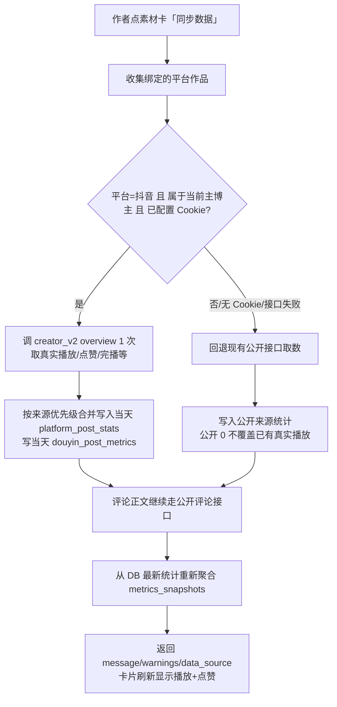
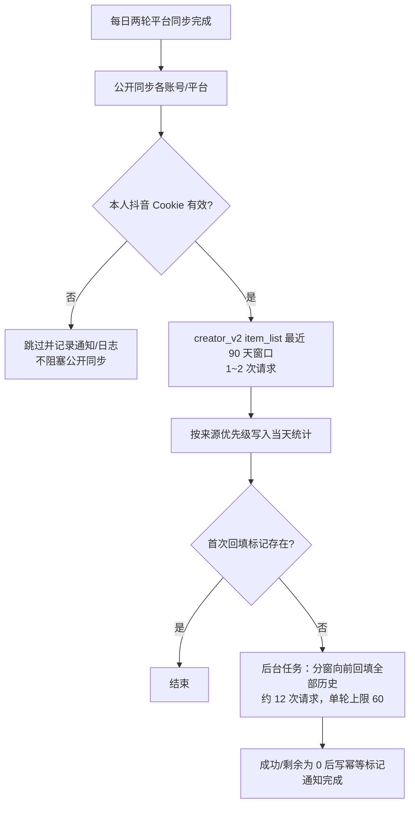
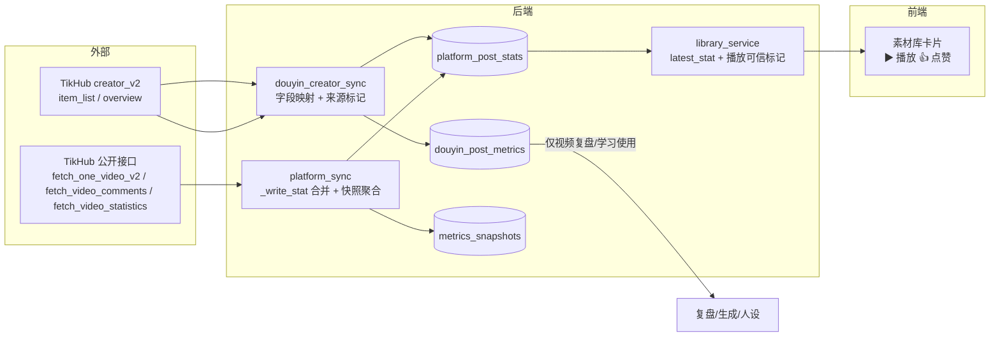

# R-238 开发设计：素材库本人抖音作品数据改用创作者中心接口

- **对应需求**：`requirements/R-238-material-library-creator-data.md`
- **日期**：2026-10-30
- **状态**：⛔ 已并入 R-239（2026-10-30 作者确认合并），不再单独实施；本文保留作历史设计记录，落地以 `development-design/R-239-account-cookie-data-source.md` 为准
- **前置依赖**：R-237 的创作者中心取数能力（`backend/app/services/douyin_creator_sync.py`、`TikHubClient` 的 creator_v2 方法）。R-237 当前在 `feat/r237` 工作区尚未提交，本需求编码前需先将 R-237 提交/合并，再从 main 建 `feat/r238` worktree（一需求一分支）。
- **重要说明**：本文中的接口与字段为实施前设计；实施后以真实 `docs/API.md`、`docs/DATABASE.md` 为准。**本需求不新增/修改表结构。**

## 1. 开发背景

### 1.1 现状与问题

| 问题 | 实测证据（2026-10-30） |
|---|---|
| 素材库本人抖音播放量恒为 0 | 本人 415 条抖音作品 414 条播放为 0；公开来源 4696 条统计行 0 条 plays>0 |
| 公开接口不返回播放量 | 单条公开详情返回 `plays: 0, likes: 46, favorites: 2, comments: 3`；列表接口同样为 0 |
| 页面只显示点赞 | `material-card.tsx` 只渲染 `likes`；`LatestStat` 类型无 `plays`，收藏字段名错写为 `collects` |
| 有真实数据但会被覆盖 | `_write_stat` 对同一天行无条件写入，公开同步会把 creator 写入的 3587 改回 0 |
| 历史快照陈旧 | `metrics_snapshots` 仅 80 行且停在 2026-09-05（旧库迁移），之后无自动写入 |
| 创作者中心数据可用 | `creator_v2` 同一作品 `view_count=3587`，并带 2 秒跳出/5 秒完播/完播率/平均播放/主页访问/吸粉量；全历史 426 条作品 12 次请求可覆盖 |

### 1.2 复用能力

- `TikHubClient` 已有限速、重试、预算计费、HTTP 200 业务错误码识别（R-237 修复）。
- `douyin_creator_sync.py` 已有：Cookie 加解密、`_apply_item_metrics` 指标映射、`sync_post_creator_data`（复盘用 5 次请求路径）、`sync_account_creator_data`（最近 30 条一次 item_list）、`backfill_peer_plays`（同行播放量补采）、`_charge_requests` 安全计费。
- `platform_sync.py` 已有：`_write_stat`、`_bound_platform_posts`、`sync_local_video_metrics`、`_sync_one_post`、`run_sync`、每日同步 `run_daily_sync_all`、后台任务与通知。
- 前端已有素材卡 `material-card.tsx`、`LatestStat` 类型、`/api/library` 返回 `latest_stat`（已含 plays/favorites/shares/comments）。

### 1.3 边界

- 只覆盖**当前主博主的本人抖音账号**（`CreatorAccount.creator_id == 当前 owner.id` 且 `platform == "douyin"`）。
- 不改变评论、媒体下载、B 站、小红书、对标/低粉路径。
- 不补历史每日快照，只写当天累计值。
- 平台不返回的字段（如封面点击率）继续留空，不估算。

## 2. 涉及的技术

| 技术/模块 | 用途 | 本次使用方式 |
|---|---|---|
| FastAPI + Pydantic | 接口层 | 现有接口行为扩展，不新增路由 |
| SQLAlchemy 2.x + PostgreSQL | 数据访问 | 复用 `platform_post_stats`、`douyin_post_metrics`、`platform_posts`、`app_kv` |
| TikHub `creator_v2` | 本人抖音真实指标 | `fetch_douyin_creator_item_list`（批量窗口）、`fetch_douyin_creator_overview`（单条） |
| 现有后台任务/通知 | 回填与每日保鲜 | 复用 `start_task`/`find_running_task`/通知中心，不新增页面 |
| React + TS + TanStack Query | 素材库展示 | 卡片新增播放数字，沿用现有动效 |
| pytest | 离线回归 | 假客户端测试映射、合并规则、回退、分页、幂等 |

无新增第三方依赖；无新增表；无 Alembic revision。

## 3. 开发流程图

### 3.1 素材库「同步数据」本人抖音作品



### 3.2 每日自动保鲜与首次回填



### 3.3 失败与恢复

- Cookie 缺失/失效/业务错误码 8 → 使用公开数据 + 返回 warning，不写 0、不覆盖旧值。
- 公开接口失败 → 保留旧值，错误写入返回的 `warnings`。
- 回填失败/达到上限 → 保留进度，不写幂等标记，下次继续。
- 所有后台回填沿用任务进度/通知，切页刷新可恢复「进行中」。

## 4. 数据流转图



## 5. 实现细节

### 5.1 数据源选择规则（输入、判断、降级）

输入：`post`（PlatformPost）、`account`（CreatorAccount）、`current_owner`、TikHub client、Cookie 行。

判断顺序：

1. `post.platform != "douyin"` → 公开接口。
2. `account.creator_id != current_owner.id` → 公开接口（对标账号绝不可调 creator_v2）。
3. `client.mode != "real"`（mock/测试）→ 公开接口（保持现有测试行为）。
4. `post.is_ad` 为真 → 公开接口（广告作品创作者接口可能不返回）。
5. Cookie 行存在且 `cookie_value` 非空且 `status != "invalid"` → 尝试 creator_v2。
6. creator_v2 任一失败 → 回退公开接口，`warnings` 记录原因；**不写 0 覆盖旧值**。

### 5.2 单帖同步（素材库「同步数据」）

新增轻量函数（放在 `douyin_creator_sync.py`）：

```text
creator_metrics_for_post(db, account, post, client=None) -> dict
步骤：
1. 解密 Cookie；调 fetch_douyin_creator_overview(item_id=post.platform_post_id)（1 次请求）。
2. _item() 取到对应作品；items 为空或业务错误 → 抛 CredentialError（由调用方回退公开）。
3. _apply_item_metrics(db, post, item) 写当天 platform_post_stats（source=tikhub_creator）与当天 douyin_post_metrics。
4. 返回标准 stats：{plays, likes, favorites, shares, comments, extra:{source, duration_seconds, private_metrics...}, source:"tikhub_creator"}。
5. finally 里按实际请求数计预算，异常不覆盖主流程错误。
```

说明：素材库同步**不调**流量来源/搜索词/观看趋势（那是视频复盘的 5 次请求路径）；只调 1 次 overview，保证素材库成本不上升。

### 5.3 批量窗口同步（账号级，每日保鲜/回填共用）

把现有 `_creator_items` 升级为「时间窗 + 向前翻页」：

- 窗口大小 `WINDOW_DAYS = 90`；每窗请求 `count=100`（TikHub 上限）。
- 翻页方式：**`end_time = 响应中的 max_cursor`**（实测 `cursor` 参数无效、返回同一页；`max_cursor` 为最早作品时间戳毫秒）。
- 终止条件：`items` 为空 / `has_more=false` / 请求数达到本次上限 / 窗口早于 `2019-01-01`。
- 每个窗口内按 `post.platform_post_id` 匹配 DB 作品；只更新已存在的作品，**不新建平台作品**（云端作品入库仍由公开同步负责，避免标题/封面口径变化）。
- 每轮上限：每日保鲜 ≤ 3 次请求；首次回填单轮 ≤ 60 次请求（可多轮续跑）。
- 失败处理：单窗口失败记录 warning，继续下一窗口；不写空行。

### 5.4 同一天多来源合并规则（最高风险项）

问题：`platform_post_stats` 字段 `NOT NULL default 0`，「平台不返回」与「真实 0」无法区分；公开同步会把 creator 的 3587 改成 0。

方案（不改表）：

1. `_write_stat(db, post, stats, *, commit=True, source="tikhub")` 增加来源参数与合并逻辑。
2. 来源可信度：`tikhub_creator`(3) > `tikhub_statistics`(2) > `tikhub`(1)。
3. 写入规则：
   - 新建行：按传入值写入，`source` 记录来源。
   - 更新行：
     - 传入 `source` 可信度 **高于** 行内 source → 用非空传入值覆盖；传入 0 视为真实值可覆盖（creator 的 0 可信）。
     - 传入 `source` 可信度 **低于或等于** 行内 source：仅当传入值 > 0 时覆盖；传入 0 且行内已有 >0 时保留旧值（公开 0 永远不能把真实播放冲掉）。
     - 传入 `stats` 缺失的字段不覆盖（例如 `fetch_video_statistics` 没有 favorites，不写 0）。
   - 每次写入后更新行内 `source` 为本次来源（保持血缘可追溯）。
4. 幂等：同一来源同一天重复同步结果一致；不同来源按优先级合并后稳定。
5. 兼容历史：已有 4696 条公开来源 plays=0 行不变；首次回填后当天行变为 creator 真实值；历史日期不追改。

### 5.5 `metrics_snapshots` 聚合修正

现状：`sync_local_video_metrics` 用「本次内存 totals」写快照，单平台失败会少算，且多平台求和口径与历史单平台快照不一致。

修正：

1. 同步完所有绑定帖后，从 DB 重新读取每个绑定帖的**最新一条** `platform_post_stats`（`DISTINCT ON (post_id) ORDER BY stat_date DESC`），按平台求和。
2. 只有至少一个平台同步成功才写当天 `metrics_snapshots`；一个都没成功不写（不写 0）。
3. 字段保持现有：`plays/likes/favorites/comments/source`；`shares` 仍不写（表无该列，不改表）。
4. `source` 写 `tikhub`（表字段语义为“平台同步”，本次不改枚举）；如后续需要区分来源，另立需求。

### 5.6 每日自动保鲜接入

在 `run_daily_sync_all`（每日 06:00/17:00）现有调用 `sync_account_creator_data` 的位置：

1. 先把 `sync_account_creator_data` 改为窗口分页、只取最近 90 天（≤3 次请求），写当天统计与 `douyin_post_metrics`。
2. 再检查首次回填标记：不存在则入队一次性回填任务（见 5.7）。
3. 任一步失败只写 warning/通知，不影响公开同步结果。

手动「同步所有博主前15条」（`sync-all`）也在结束后补一次同样的本人抖音保鲜，避免手动同步把真实播放冲成 0。

### 5.7 首次历史回填

- 任务类型：复用后台任务框架，kind=`douyin_creator_backfill`；payload `{account_id, owner_id, cursor_end, requests_used}`。
- 幂等标记：`app_kv` key `douyin_creator_backfill_done:{account_id}`，值为完成时间；仅在「无剩余/覆盖到最早作品」时写入。
- 触发：每日同步完成后标记不存在则入队；同一账号进行中任务复用（`find_running_task`）。
- 单轮上限 60 次请求；达到上限时保存进度并结束，下次每日同步继续（不重复已完成窗口可由 `cursor_end` 记录）。
- 回填只写当天统计行与当天创作者指标；不伪造历史日期。
- 完成后发通知「本人抖音历史播放数据已补齐 N 条」。

### 5.8 `/api/library` 播放可信标记

`platform_post_stats.source` 结合平台判断「播放是否可信」：

| 平台/来源 | plays_known | 页面 |
|---|---|---|
| 本人抖音 `tikhub_creator` | true | 显示真实播放（含 0） |
| 任意抖音 `tikhub_statistics` | true | 显示真实播放 |
| B 站 `tikhub` | true | 显示真实播放 |
| 抖音公开 `tikhub` | false | 不显示播放（视为未知） |
| 小红书 | false | 一期不显示播放（现状为 0） |

`latest_stat` 新增：`plays_known: bool`、`plays_source: str`。合并多平台时：取「可信来源中的最大播放」；`plays_known = 任一平台可信`；`plays_source` 记录该值的来源。

### 5.9 前端展示规则

- `LatestStat` 类型：新增 `plays/plays_known/plays_source`，把 `collects` 改为 `favorites`（修正历史字段名错写）。
- 卡片渲染：
  - `plays_known && plays != null` → 显示「▶ 数字」（真实 0 显示 0）。
  - `!plays_known && plays > 0` → 显示播放（历史数据里可能已有少量真实值）。
  - 否则不显示播放。
  - 点赞保持现有「>0 才显示」风格。
- 不新增页面、不改变卡片尺寸与布局节奏；数字更新沿用现有 React 渲染，不加额外动画。

### 5.10 异常、预算与降级

| 异常 | 处理 |
|---|---|
| Cookie 未配置/解密失败 | 回退公开接口；同步响应 `warnings` 提示「创作者数据未设置」 |
| TikHub 业务错误码 8/5（未登录/过期） | 回退公开接口；通知/日志提示重新保存 Cookie；不写 0 |
| TikHub HTTP 400（偶发抖动） | 客户端已有重试；仍失败则回退公开接口并记录 warning |
| 预算不足 BudgetExceeded | 中止本次 creator 调用，回退公开接口并记录 warning（不吞掉预算异常） |
| 公开接口失败 | 保留旧值，写入响应 warnings |
| 回填中断 | 保留进度，不写幂等标记，下次续跑 |
| 达到请求上限 | 记录剩余数量，不重复扣额度 |

### 5.11 请求成本

| 场景 | 现状 | 改造后 |
|---|---|---|
| 素材库单卡同步（1 条抖音作品） | 1 次公开详情 + 1 次评论 | 1 次 creator overview + 1 次评论（成本持平，数据更全） |
| 每日本人抖音保鲜 | 公开列表/逐条详情（播放为 0） | 1~2 次 item_list（真实播放） |
| 首次全历史回填（426 条） | 无（播放为 0） | 约 12 次（单轮上限 60） |
| 评论/媒体/B 站/小红书/对标 | 不变 | 不变 |

### 5.12 测试计划

后端 pytest（mock/假客户端，不联网）：

1. 字段映射：creator_v2 真实形状 → `platform_post_stats`/`douyin_post_metrics` 值正确。
2. 合并规则：公开 0 不覆盖 creator 真实值；creator 0 可覆盖；低优先级非 0 可覆盖；缺失字段不覆盖。
3. 分页：90 天窗口 + `end_time=max_cursor` 多页去重、终止条件、请求上限。
4. 回退：Cookie 缺失/业务码 8/接口异常 → 走公开接口 + warning，不写 0。
5. 幂等：首次回填标记存在时不重复入队；同来源重复同步结果一致。
6. `latest_stat`：`plays_known/plays_source` 计算正确（本人抖音/B 站/公开抖音/无统计）。
7. 现有 R-237/R-067 测试不回归。

前端：`npm run lint`、`vitest`（若类型/纯函数可测）；真机点检素材库卡片显示。

真实接口冒烟（交付前）：同步 1 条本人抖音作品 → 卡片显示真实播放；跑一次每日同步 → 播放不被冲 0；触发回填 → 覆盖比例达标；Cookie 置失效 → 提示且旧值保留，再恢复。

## 6. 新增或修改的表结构

**本需求不新增表、不修改表结构、不新增 Alembic revision。** 复用的现有表与关键字段：

| 表 | 字段 | 类型 | 可空/默认 | 中文含义 | 本次变化 |
|---|---|---|---|---|---|
| `platform_post_stats` | `post_id, stat_date` | int/str | 非空 | 平台作品每天统计 | 仅写入规则变化 |
| | `plays, likes, favorites, shares, comments` | int | 非空 default 0 | 播放/点赞/收藏/转发/评论 | 写真实播放；公开 0 不再覆盖真实值 |
| | `source` | str | non-null "tikhub" | 数据来源 | 新增取值 `tikhub_creator`/`tikhub_statistics`（枚举语义扩展，无迁移） |
| | `extra` | text(JSON) | 非空 "{}" | 附加指标 | creator 路径写入 duration/private_metrics 说明 |
| `douyin_post_metrics` | `view/…`（现有字段） | — | — | 创作者私有指标按天快照 | 复用 R-237 字段，不新增列 |
| `platform_posts` | `local_video_id` | int | 可空 | 素材与平台作品绑定 | 不变 |
| `metrics_snapshots` | `plays/likes/favorites/comments/source` | — | — | 本地素材多平台聚合快照 | 聚合来源改为 DB 最新统计 |
| `app_kv` | key/value | str | — | 幂等标记/预算 | 新增 key `douyin_creator_backfill_done:{account_id}` |

## 7. 新增或修改的接口

**不新增路由。** 需要同步 `docs/API.md` 的行为变化：

### 7.1 `GET /api/library`

- 请求：不变。
- 响应：`items[].cloudPosts[].latest_stat` 增加 `plays_known: boolean`、`plays_source: string`；`plays/favorites/shares/comments` 保持原字段。
- 错误：不变。
- 兼容：新增字段为增量；旧前端忽略即可。

### 7.2 `POST /api/platform/videos/{video_id}/sync`

- 用途：本地素材卡「同步数据」。
- 行为变化：本人抖音作品优先 creator_v2；失败回退公开。
- 响应：在现有 `message/platforms/stats/errors/comments_added/comments_updated/media` 基础上增加 `data_source`（`creator|public|mixed`）与 `warnings: string[]`。
- 错误码：素材不存在 404；未绑定平台作品 400（保持现状）；预算不足 400。
- 幂等：同一天重复点击结果稳定（合并规则幂等）。

### 7.3 `POST /api/platform/works/{work_id}/sync`、`POST /api/platform/posts/{post_id}/sync`

- 行为与响应变化同上（本人抖音帖优先 creator_v2；增加 `data_source/warnings`）。

### 7.4 `POST /api/platform/sync`、`POST /api/platform/sync-all`

- 请求/响应不变；行为变化：每日同步结束后对本人抖音做 creator 保鲜；`sync-all` 同样补齐。
- 失败：Creator 失败只记录 warnings，不影响整体同步结果。

### 7.5 后台任务（内部）

- kind=`douyin_creator_backfill`，payload `{owner_id, account_id, cursor_end}`；进度与通知复用现有机制；不暴露新 HTTP 路由。
- 如实施时为了手动重试需要新增触发路由，必须在 `docs/API.md` 同步并更新路由计数。

## 8. 数据来源与原始字段明细

### 8.1 第三方接口（已用 2026-10-30 真实响应确认）

| 数据 | 接口 | 原始字段/路径 | 中文含义 | 清洗/计算 | 落库字段 | 使用页面 | 更新时间 | 空值处理 |
|---|---|---|---|---|---|---|---|---|
| 播放量 | creator_v2 `fetch_item_list`/`fetch_item_overview_data` | `metrics.view_count`（字符串数字） | 作品播放次数 | 转 int | `platform_post_stats.plays` | 素材库卡片 | 同步时 | 无值不写；0 为真实 0 |
| 点赞 | 同上 | `metrics.like_count` | 点赞数 | 转 int | `platform_post_stats.likes` | 卡片 | 同步时 | 无值不写 |
| 评论数 | 同上 | `metrics.comment_count` | 评论数 | 转 int | `platform_post_stats.comments` | 接口/学习 | 同步时 | 无值不写 |
| 收藏 | 同上 | `metrics.favorite_count` | 收藏数 | 转 int | `platform_post_stats.favorites` | 接口 | 同步时 | 无值不写 |
| 转发 | 同上 | `metrics.share_count` | 转发数 | 转 int | `platform_post_stats.shares` | 接口 | 同步时 | 无值不写 |
| 2 秒跳出率 | 同上 | `metrics.bounce_rate_2s` | 2 秒内离开比例 | 0~1 归一 | `douyin_post_metrics.bounce_2s_rate` | 视频复盘 | 同步时 | 空 |
| 5 秒完播率 | 同上 | `metrics.completion_rate_5s` | 看到第 5 秒比例 | 0~1 | `douyin_post_metrics.finish_5s_rate` | 复盘 | 同步时 | 空 |
| 完整完播率 | 同上 | `metrics.completion_rate` | 完整看完比例 | 0~1 | `douyin_post_metrics.finish_rate` | 复盘 | 同步时 | 空 |
| 平均播放时长 | 同上 | `metrics.avg_view_second` | 平均观看秒数 | float | `douyin_post_metrics.avg_play_seconds` | 复盘 | 同步时 | 空 |
| 主页访问量 | 同上 | `metrics.homepage_visit_count` | 看完进主页次数 | int | `douyin_post_metrics.profile_visits` | 复盘 | 同步时 | 空 |
| 吸粉量 | 同上 | `metrics.subscribe_count` | 该视频带来的新增关注 | int | `douyin_post_metrics.follower_gain` | 复盘 | 同步时 | 空 |
| 封面点击率 | — | 平台不返回 | — | 不估算 | `cover_click_rate` 留空 | 复盘显示暂无 | — | 空 |

真实样例（作品 1902，2026-10-30）：`view_count=3587、like_count=46、comment_count=3、favorite_count=2、share_count=0、bounce_rate_2s=0.420021、completion_rate_5s=0.294087、completion_rate=0.020138、avg_view_second=10.521806、homepage_visit_count=148、subscribe_count=2`。

### 8.2 公开接口（回退/其他平台，字段与现在一致）

| 数据 | 接口 | 原始字段 | 落库 | 空值处理 |
|---|---|---|---|---|
| 播放 | 抖音公开详情/列表 | `statistics.play_count` | `platform_post_stats.plays` | 抖音恒为 0 → `plays_known=false`，不覆盖 creator |
| 点赞/评论/收藏/转发 | 抖音公开 | `statistics.digg_count/comment_count/collect_count/share_count` | 对应列 | 真实值 |
| B 站播放/点赞等 | B 站公开接口 | `View.stat.*` | 对应列 | 播放可信 |
| 小红书 | 小红书公开 | `interact_info` 等 | 对应列 | 播放一期不展示 |
| 评论正文 | 公开评论接口 | `comments[].text/digg_count` | `platform_post_comments` | 保持现状 |

### 8.3 程序计算（无第三方来源）

| 字段 | 计算规则 | 用途 |
|---|---|---|
| `latest_stat.plays_known` | 平台/来源组合：本人抖音 creator / 抖音 statistics / B 站 → true；抖音公开 → false | 前端决定是否显示 0 |
| `latest_stat.plays_source` | 取展示播放值所属统计行来源 | 提示/排查 |
| `platform_post_stats.source` | 本次写入来源（creator/statistics/public），按 5.4 规则更新 | 血缘与合并 |
| `metrics_snapshots.plays` | 绑定平台作品最新统计中播放求和 | 学习/对话/生成权重 |
| 回填幂等标记 | `app_kv` key + 完成时间 | 只回填一次 |

### 8.4 作者输入

本需求不新增作者输入。沿用：Cookie 由作者在「视频复盘 → 抖音数据设置」保存（Fernet 加密）；素材与平台作品绑定关系沿用现有编辑抽屉。

## 9. 实施顺序与验收步骤

1. 前置：提交/合并 R-237（其中 `douyin_creator_sync.py` 等是 R-238 依赖）→ 从 main 建 `feat/r238` worktree（端口 8038/3038、独立库 `echo_r238`）。
2. 后端：`_write_stat` 来源合并 → `creator_metrics_for_post` 单帖 → 窗口分页批量 → 每日保鲜接入 → 首次回填任务 → `latest_stat` 可信标记。
3. 前端：`LatestStat` 类型 + 卡片播放展示。
4. 测试：pytest + 前端 lint/build + `scripts/verify.sh` 全绿。
5. 真实冒烟：同步 1 条本人抖音作品 → 播放正确；公开同步不覆盖；回填覆盖比例；Cookie 失效降级；素材库页面点检。
6. 文档：如有行为变化同步 `docs/CHANGELOG.md`、`docs/milestones.md` 
