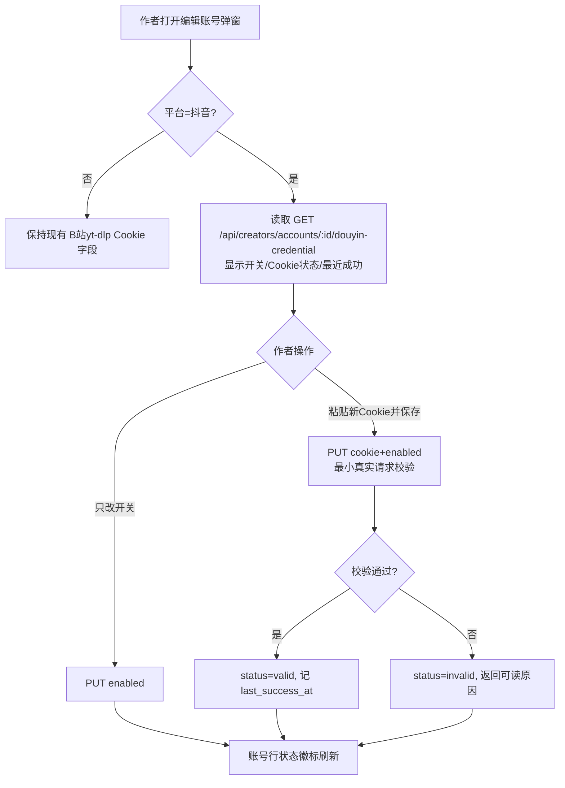
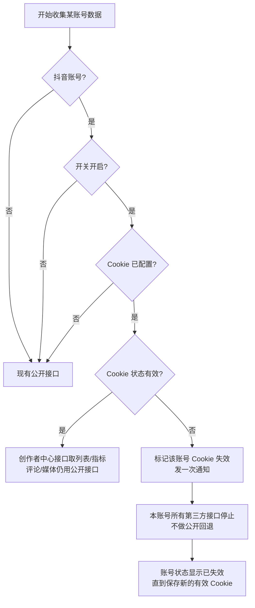
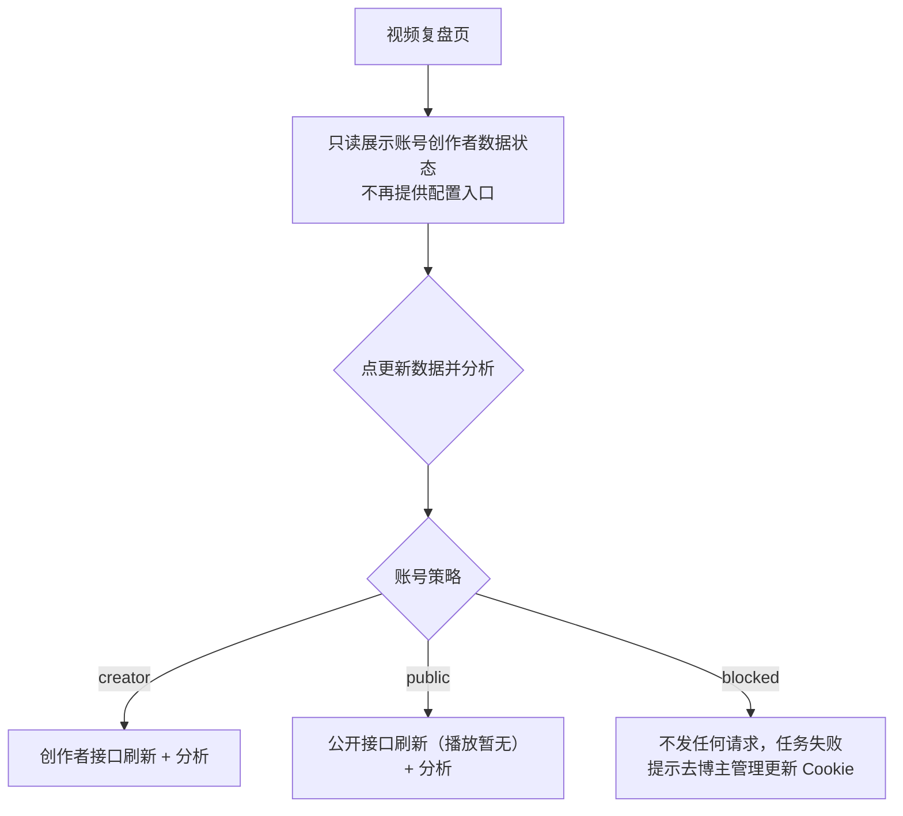
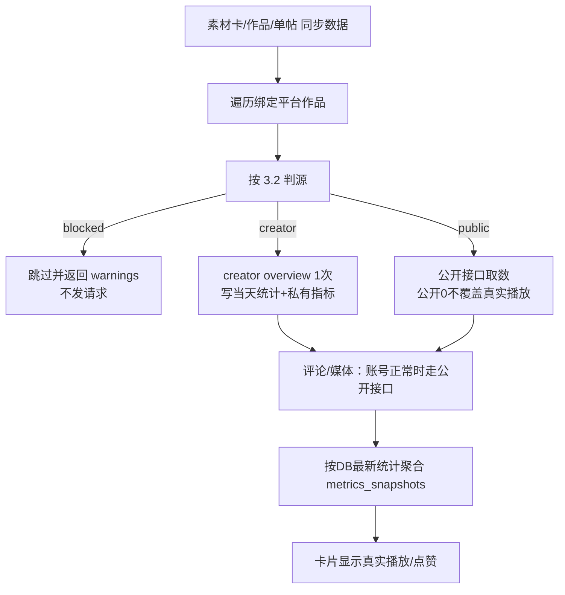
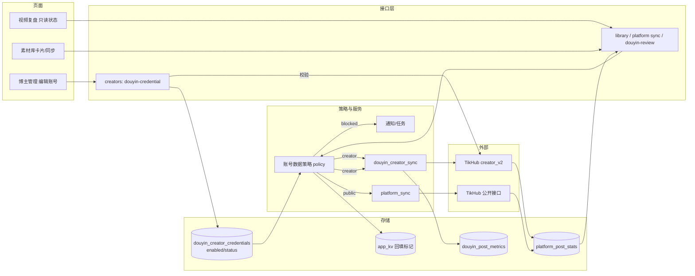

# R-239 开发设计：账号级创作者 Cookie 与数据源策略

- **对应需求**：`requirements/R-239-account-cookie-data-source.md`
- **日期**：2026-10-30
- **状态**：✅ 已按本文实现（2026-10-30，verify 全绿 + 真实接口冒烟；实施细节以代码与真实响应为准）
- **合并说明**：R-238（素材库本人抖音改创作者中心、素材卡显示真实播放、防覆盖、回填、每日保鲜）并入本需求，按本文第 5.9 节实施；R-238 不再单独开发。
- **前置依赖**：R-237（创作者中心取数能力）当前在 `feat/r237` 工作区未提交。开工前需先提交/合并 R-237，再从 main 建 `feat/r239` worktree（API 8039 / WEB 3039、独立库 `echo_r239`，遵循一需求一 worktree 一分支）。

## 1. 开发背景

### 1.1 现状

- 抖音创作者 Cookie 目前只由视频复盘页「抖音数据设置」配置，接口为 `GET/PUT /api/douyin-review/credentials?account_id=`；加密存 `douyin_creator_credentials`（Fernet）。
- 数据收集（平台同步、素材库同步）不检查 Cookie：抖音一律走公开接口，播放量恒 0；创作者接口能力没有在日常收数中使用。
- Cookie 失效后：同步继续用公开接口空跑，视频复盘报错但只有单点感知；无账号级通知/阻断，浪费 TikHub 额度。
- `creator_accounts.extra_config` 已存 B 站 yt-dlp Cookie；现有账号 PATCH 会整体覆盖 `extra_config`，会误删 R-237 的主页补充等配置（本次顺手修）。
- 素材库（R-238 合并）：自己抖音播放恒 0；卡片只显示点赞；公开 0 会覆盖真实播放；`metrics_snapshots` 停更。

### 1.2 目标与边界

目标：以账号为单位管理“是否启用创作者中心”和 Cookie，数据收集前统一判源；失效账号立即停采 + 通知 + 标记；视频复盘不再配置 Cookie；素材库展示真实播放。只做抖音，B 站/小红书/评论/媒体链路保持现状（账号失效时暂停）。

### 1.3 复用能力

`douyin_creator_sync.py`（Cookie 加解密/校验、`_apply_item_metrics`、窗口分页取数、`_charge_requests`）、`TikHubClient`（业务错误码识别、限速重试、预算）、`platform_sync.py`（`run_sync`、`_write_stat`、`sync_local_video_metrics`、每日同步、通知/任务框架）、`creators` 页面账号弹窗与 `notification` 中心。

## 2. 涉及的技术

| 技术/模块 | 用途 | 本次使用方式 |
|---|---|---|
| FastAPI + Pydantic | 新增账号凭据接口、扩展账号列表 | 新增 2 个 creators 路由，删除 2 个 douyin-review 路由（总数不变） |
| SQLAlchemy + Alembic | 开关字段 | `douyin_creator_credentials` 新增 `enabled` 列 + 1 个 revision |
| TikHub `creator_v2` | 创作者数据 | 已封装的 item_list/overview，按账号 Cookie 使用 |
| 后台任务/通知 | 失效通知、回填 | 复用现有 `start_task`/`push_notification`/通知中心 |
| React + TS | 博主管理编辑弹窗、视频复盘、素材卡 | 弹窗加开关/Cookie/状态；视频复盘去配置；素材卡加播放 |
| pytest / vitest | 离线测试 | 策略判定、失效通知去重、接口、类型 |

无新增第三方依赖。

## 3. 开发流程图

### 3.1 账号 Cookie 配置（博主管理 → 编辑账号）



### 3.2 数据收集判源与失效阻断



### 3.3 视频复盘（去掉配置）



### 3.4 素材库同步（合并 R-238）



## 4. 数据流转图



## 5. 实现细节

### 5.1 存储模型与迁移

`douyin_creator_credentials` 现有字段：`id/account_id/cookie_value/status/last_validated_at/last_success_at/last_error/created_at/updated_at`。

新增字段：

| 字段 | 类型 | 可空 | 默认 | 含义 |
|---|---|---|---|---|
| `enabled` | BOOLEAN | 否 | TRUE | 是否启用创作者中心数据（编辑账号页开关） |

- 新增 Alembic revision（命名 `r239_douyin_credential_enabled`），`server_default=sa.true()`；旧数据自动为 TRUE。
- `status` 沿用现有取值，语义固定为：`missing`（无行/无 Cookie，展示“未配置”）、`valid`（可用）、`invalid`（已失效）；历史 `expired` 兼容映射为 `invalid`。
- 不新增通知表字段；通知去重用“状态迁移”判断（见 5.4）。
- `creator_accounts.extra_config` 不存放抖音 Cookie（继续存 B 站 yt-dlp Cookie 等），避免明文与覆盖。

### 5.2 账号数据策略（唯一判定入口）

新增 `backend/app/services/douyin_account_policy.py`（或放入 `douyin_creator_sync.py`，二选一，优先独立文件避免循环依赖）：

```python
@dataclass(frozen=True)
class AccountDataPolicy:
    source: str          # "creator" | "public" | "blocked"
    reason: str          # 中文原因，供接口/通知/日志
    status: str          # missing/valid/invalid/disabled
    enabled: bool
    has_cookie: bool

def resolve_data_policy(db, account) -> AccountDataPolicy
```

判定顺序（输入：账号、凭据行）：

1. `account.platform != "douyin"` → `public`（B 站/小红书完全不参与本策略）。
2. 无凭据行或 `cookie_value` 为空 → `public`（未配置）。
3. `enabled == False` → `public`（作者显式关闭；即使 Cookie 失效也解除阻断，方便回到公开数据）。
4. `status == "valid"` → `creator`（评论/媒体仍走公开，见 5.3）。
5. `status in ("invalid", "expired")` → `blocked`（不发起任何第三方请求）。
6. 其他未知状态 → 视为 `blocked` 并记录原因（安全默认）。

策略纯函数、无网络请求；所有收数入口统一调用，禁止各自判断。

### 5.3 阻断/判源的接入点（逐处）

| 入口/函数 | 改造 |
|---|---|
| `run_sync` 每账号 worker | 开跑前 `resolve_data_policy`：blocked → 直接跳过该账号（不建 posts/comments/media 请求），返回 `skipped=blocked` 与原因；creator → 作品列表/指标走 creator_v2（每日窗口 90 天、1~2 请求），评论/媒体仍公开；public → 现有公开路径 |
| `_sync_one_post` / 单帖同步 | blocked → 抛业务可读错误（接口 400/任务失败），不发请求；creator → creator overview（1 请求）；public → 公开详情 |
| `sync_local_video_metrics`（素材库本地卡/作品同步） | 逐绑定帖判源：blocked → 跳过该帖并写 warnings，**不回退公开**；creator → creator overview；public → 公开；评论/媒体仅在账号非 blocked 时执行 |
| `sync_post_creator_data`（视频复盘刷新/发布后检查） | blocked → 抛 `CredentialError("该账号创作者 Cookie 已失效，数据收集已停止，请到博主管理更新")`；creator → 现有创作者路径；public → 新增公开刷新路径（`fetch_post_stats` 1 请求写统计，无私有指标，warnings 提示播放暂无） |
| 评论同步（`sync_post_comments`/`_fetch_comments_parallel`） | 调用方先判源；blocked 不调用 |
| 媒体补齐任务（缺视频/封面/ASR 触发） | 执行前判源；blocked 跳过并提示；creator/public 均保持原公开媒体接口（创作者中心无媒体下载字段；item_list 的 play_info 仅作为后续优化项，本次不改） |
| 对标/低粉/搜索（无账号归属的公共查询） | 不参与本策略，保持现状 |
| 手动「同步所有博主」`sync-all` | 每个账号按策略跳过/走 creator/public；结束后本人抖音保鲜逻辑同样先判源 |

说明：**账号正常（creator）时评论/媒体仍调用公开接口**是必要的，因为创作者中心没有评论正文和媒体下载接口；作者规则中的“所有第三方接口不调用”只在账号被判失效后生效。

### 5.4 失效检测、标记与通知（去重）

触发点（任一处捕获到）：

- `TikHubBusinessError.code in (5, 8)`（未登录/过期/权限）。
- 创作者接口返回 HTTP 400 且提示 cookie/登录相关（TikHub 通用 400 在保存/取数场景按失效处理，同时记录原文摘要）。
- 保存 Cookie 时校验失败（仅更新状态与接口错误，不触发通知）。

处理：

1. 更新凭据行：`status="invalid"`、`last_validated_at=now`、`last_error=可读原因（≤500字）`；`enabled` 不变。
2. 通知去重：仅当**旧状态 != invalid** 时发一条通知（kind=`douyin_credential_invalid`，标题“账号「昵称」抖音创作者 Cookie 已失效”，正文含原因与处理指引，target 指向博主管理页）；同状态重复失败只更新 last_error，不再发通知。
3. 同一次同步任务内：检测到失效后立即停止该账号后续所有步骤（含评论/媒体/其他作品），当前任务标记部分失败并写 warnings。
4. 恢复：`PUT .../douyin-credential` 校验成功 → `status="valid"`、清空 last_error、记录 last_success_at；不需要额外解封动作。
5. 关闭开关：`enabled=False`；状态展示“已关闭”，策略回 public；恢复开启但 Cookie 已失效时需重新保存校验（避免误启用）。

### 5.5 账号凭据接口（creators）

新增（路由总数 +2，同时移除 douyin-review 的 2 个旧路由，总数不变）：

**`GET /api/creators/accounts/{account_id}/douyin-credential`**

- 用途：编辑账号弹窗读取状态。
- 响应 200：`{account_id, platform, enabled, has_cookie, status, last_validated_at, last_success_at, last_error}`；`status` 映射展示值：`missing/valid/invalid`。
- 错误：404 账号不存在；400 账号不是抖音。

**`PUT /api/creators/accounts/{account_id}/douyin-credential`**

- 请求：`{cookie?: str（1~30000 字符，可空）, enabled?: bool}`
- 行为：
  - 传 `cookie` 非空 → Fernet 加密保存并做最小真实校验；成功 `status=valid`，失败 400 且 `status=invalid`、返回可读原因（不回显 Cookie）。
  - 只传 `enabled=false` → 保存关闭状态，不校验 Cookie。
  - 只传 `enabled=true` 但无已保存 Cookie → 400「请先粘贴并保存 Cookie 后再开启」。
  - 不传任何字段 → 400。
- 响应 200：同 GET。
- 计费：校验请求按实际次数计 TikHub 预算。
- 安全：响应/日志/任务/通知均不含明文 Cookie。

**移除**：`GET /api/douyin-review/credentials`、`PUT /api/douyin-review/credentials`（视频复盘不再使用；前端、测试、`docs/API.md` 同步删除）。凭证读取逻辑迁移到 creators 路由复用 `douyin_creator_sync` 的加解密与校验函数。

### 5.6 账号列表与页脚数据

- `GET /api/creators`、`GET /api/creators/{creator_id}/accounts` 的账号项增加（仅抖音）：`douyin_credential: {enabled, status, has_cookie, last_validated_at, last_success_at, last_error}`；B 站/小红书为 `null`。
- 账号行徽标由该字段计算：可用（绿）/未配置（灰）/已关闭（灰）/已失效（红）。
- 修复账号 PATCH 覆盖 `extra_config` 的问题：改为合并 `extra`（`{**a.extra(), **payload.extra_config}`），避免误删 R-237 的主页补充等配置。

### 5.7 博主管理前端

- `AccountForm` 增加 `douyinEnabled: boolean`、`douyinCookie: string`（输入框默认空、永不回显）、`douyinCredential` 状态对象。
- 编辑弹窗：平台=抖音时显示「抖音创作者数据」区块：开关 + Cookie 输入 + 状态文案 + 「保存并验证」；保存账号与保存 Cookie 分开调用（账号 PATCH 不再传 Cookie），避免互相覆盖。
- 保存行为：
  - 开关变化 → `PUT enabled`。
  - Cookie 输入非空 → `PUT cookie(+enabled)` 校验。
  - 校验中按钮 loading；失败 toast 可读原因；成功刷新行状态。
- 账号行（`account-row.tsx`）增加状态徽标与失效提示。

### 5.8 视频复盘前端与行为

- 移除：`Settings2`/「抖音数据设置」按钮、`cookieOpen`/`cookie`/`savingCookie` 状态、`saveCookie()`、Cookie 弹窗、相关 toast。
- 保留只读状态行（数据来自 `/api/douyin-review/videos` 的账号凭据摘要或 `/api/creators`）：可用 / 未启用 / 已失效；失效文案引导「博主管理 → 编辑账号 更新 Cookie」。
- 类型 `Credential` 相关前端类型清理；不再调用已删除的 `/api/douyin-review/credentials`。
- 分析任务失败（blocked）时页面展示错误横幅（沿用现有 failed_review 机制），不自动清空旧复盘。

### 5.9 素材库与播放展示（合并 R-238）

1. **`GET /api/library`**：`latest_stat` 增加 `plays_known: bool`、`plays_source: str`；计算规则：本人抖音 `source=tikhub_creator` / 抖音 `tikhub_statistics` / B 站公开 → known=true；抖音公开、小红书 → known=false。多平台合并取可信来源最大播放。
2. **前端素材卡**：`LatestStat` 增加 plays/plays_known/plays_source，修正 `collects→favorites`；卡片在 known 时显示「▶ 数字」，unknown 且 >0 也显示，否则不显示；点赞保持。
3. **防覆盖**：`_write_stat` 增加来源优先级（creator > statistics > public）；低优先级来源的 0 不覆盖已有 >0；缺失字段不覆盖；更新时同步更新 source。
4. **首次回填**：`app_kv` 标记 `douyin_creator_backfill_done:{account_id}`；后台任务窗口分页（90 天/窗，`end_time=max_cursor`），单轮上限 60 请求；成功后写标记并发通知；失败/中断可续跑。
5. **每日保鲜**：每日两轮同步后对启用创作者数据的抖音账号刷新最近 90 天（1~2 请求）；blocked 账号跳过。
6. **`metrics_snapshots` 聚合**：本地卡同步后从 DB 最新统计重新求和写当天快照；一个平台都没成功则不写；不改表。
7. 回填/保鲜与失效规则联动：回填中遇到 Cookie 失效 → 立即停止该账号、标记失效、发通知（去重）。

### 5.10 请求预算与成本

| 场景 | 改造后 |
|---|---|
| blocked 账号 | 0 次第三方请求 |
| 无 Cookie/开关关闭账号 | 现有公开接口成本（不变） |
| 启用创作者数据的抖音账号：单帖同步 | 1 次 creator overview + 评论/媒体按需（与现在持平） |
| 每日保鲜 | 1~2 次 item_list/账号 |
| 首次回填 | 约 12 次/账号（单轮上限 60） |
| 校验 Cookie | 1 次/保存 |

### 5.11 测试计划

后端 pytest（mock/假客户端，不联网）：

1. 策略：未配置/开关关/有效/失效四态 → public/public/creator/blocked；B站/小红书恒 public。
2. 失效：creator 抛业务码 8 → 状态 invalid、通知只发一次、同账号后续调用被跳过；再失败不新增通知。
3. 恢复：保存有效 Cookie → status valid、策略恢复 creator。
4. 接口：GET/PUT 新 creators 凭据路由（成功/404/400/开关语义/不回显 Cookie）；旧 douyin-review 凭据路由已移除（404）。
5. 收数：blocked 账号在 run_sync/素材库同步/视频复盘刷新中 0 请求；creator 账号走 creator；public 账号走公开。
6. 素材库：`latest_stat` plays_known/source；卡片字段；防覆盖合并规则；回填幂等；每日保鲜。
7. 账号 PATCH 合并 extra_config（不丢 R-237 主页配置）。
8. 迁移测试：新增列后旧数据默认 enabled=true；`test_migrations` 通过。

前端：lint/typecheck/build；vitest（如新增纯函数）；页面点检（编辑弹窗、视频复盘无配置入口、素材卡播放）。

真实接口冒烟（交付前）：配 Cookie→可用→同步走 creator；关闭开关→public；制造失效→通知+停采（观察 0 新请求）；更新 Cookie→恢复；视频复盘页面点检；素材库播放展示；verify 全绿。

### 5.12 实施顺序

1. 前置：提交/合并 R-237 → 从 main 建 `feat/r239` worktree（8039/3039、独立库）。
2. 后端：迁移（enabled 列）→ 策略函数 → creators 凭据接口 + 移除旧路由 → 各收数入口接入 → 失效通知 → 素材库/回填/保鲜（R-238 merged）。
3. 前端：博主管理编辑弹窗/账号行 → 视频复盘去配置 + 只读状态 → 素材卡播放。
4. 测试与 verify → 真实冒烟 → 文档同步（API/DATABASE/FAQ/CHANGELOG/milestones/PRD）。

## 6. 新增或修改的表结构

### 6.1 修改表：`douyin_creator_credentials`

| 字段 | 类型 | 可空 | 默认 | 含义 | 说明 |
|---|---|---|---|---|---|
| `enabled`（新增） | BOOLEAN | 否 | TRUE | 是否启用创作者中心数据 | 编辑账号页开关；关闭时该账号走公开接口 |

- Alembic revision：`r239_douyin_credential_enabled`（upgrade：add column server_default true；downgrade：drop column）。
- 现有列不变；`status` 语义固定为 `missing/valid/invalid`（历史 `expired` 读取时按 invalid 处理，不迁移数据）。
- 不新增通知表字段；失效通知去重依赖状态迁移。

### 6.2 其他表

- `creator_accounts.extra_config`：不改结构；仅修 PATCH 合并语义（避免覆盖）。
- `platform_post_stats`/`douyin_post_metrics`/`metrics_snapshots`/`app_kv`：不改结构（R-238 merged 的写入/聚合规则变化，来源枚举扩展）。
- 无其他迁移。

## 7. 新增或修改的接口

### 7.1 新增

| 方法 | 路径 | 用途 | 请求 | 响应/错误 |
|---|---|---|---|---|
| GET | `/api/creators/accounts/{account_id}/douyin-credential` | 读取账号创作者凭据状态 | — | 200 `{account_id,platform,enabled,has_cookie,status,last_validated_at,last_success_at,last_error}`；404 账号不存在；400 非抖音 |
| PUT | `/api/creators/accounts/{account_id}/douyin-credential` | 保存开关/Cookie 并校验 | `{cookie?: str, enabled?: bool}` | 200 同上；400 非抖音 / 开开关但无 Cookie / Cookie 校验失败（带可读原因）/ 无任何字段 |

### 7.2 移除

| 方法 | 路径 | 处理 |
|---|---|---|
| GET | `/api/douyin-review/credentials` | 删除（视频复盘不再使用）；`docs/API.md` 删除；前端/测试同步清理 |
| PUT | `/api/douyin-review/credentials` | 同上 |

路由总数：移除 2、新增 2，保持 161 不变（`README/AGENTS` 与 `check_doc_consistency` 会校验）。

### 7.3 修改

- `GET /api/creators`、`GET /api/creators/{creator_id}/accounts`：账号项增加 `douyin_credential` 摘要（仅抖音）；`extra_config` 合并语义修复。
- `GET /api/douyin-review/videos`：`credential_status` 改为策略状态（`valid|missing|disabled|invalid`），供视频复盘只读提示；不返回 Cookie。
- `GET /api/library`：`latest_stat` 增加 `plays_known/plays_source`（R-238 merged）。
- `POST /api/platform/videos/{id}/sync`、`POST /api/platform/works/{id}/sync`、`POST /api/platform/posts/{id}/sync`：响应增加 `data_source`（creator/public/skipped）与 `warnings`；blocked 账号返回 skipped + 原因、不发起请求。
- `POST /api/platform/sync`、`/sync-all`：行为变化（账号按策略跳过/走 creator），请求/响应结构基本不变，结果中增加跳过账号与原因。
- `POST /api/douyin-review/analyze`：`refresh=true` 时按策略刷新（creator/public/blocked）；blocked 任务失败并给明确提示。

## 8. 数据来源与原始字段明细

### 8.1 第三方接口（抖音创作者中心；真实响应已确认）

| 数据 | 接口 | 原始字段 | 中文含义 | 落库 | 用途 | 更新时间 | 空值/0 处理 |
|---|---|---|---|---|---|---|---|
| 作品列表 | creator_v2 `fetch_item_list` | `data.items[]`（`id/create_time/description/metrics/video_info`） | 本人账号作品 | 匹配 `platform_posts` | 收数/回填 | 同步时 | 空列表不写 |
| 播放 | 同上 | `metrics.view_count` | 播放次数 | `platform_post_stats.plays` | 素材库/学习 | 同步时 | 真实 0 保留 |
| 点赞/评论/收藏/转发 | 同上 | `like_count/comment_count/favorite_count/share_count` | 互动数 | 对应列 | 素材库/学习 | 同步时 | 无值不写 |
| 完播等私有指标 | 同上/overview | `bounce_rate_2s/completion_rate_5s/completion_rate/avg_view_second/homepage_visit_count/subscribe_count` | 完播与涨粉 | `douyin_post_metrics` | 视频复盘 | 同步时 | 空 |
| 单帖指标 | creator_v2 `fetch_item_overview_data` | `data.items[0].metrics.*` | 同上 | 同上 | 单帖同步/复盘 | 同步时 | 空 |
| 失效信号 | 任意 creator_v2 | HTTP 200 + `status_code=8` / `BaseResp.StatusCode≠0`，或 HTTP 400 登录类提示 | Cookie 未登录/过期 | `douyin_creator_credentials.status=invalid` + 通知 | 阻断 | 检测时 | — |

### 8.2 公开接口（回退/其他平台/评论/媒体）

| 数据 | 接口 | 原始字段 | 用途 | 空值处理 |
|---|---|---|---|---|
| 抖音公开作品/指标 | `fetch_one_video_v2`/列表 | `statistics.*` | 无 Cookie 账号收数 | 播放恒 0 → `plays_known=false`，不覆盖 creator |
| 评论正文 | `fetch_video_comments` | `comments[].text/digg_count` | 学习/复盘 | 保持现状；blocked 时暂停 |
| B 站/小红书指标 | 现有公开接口 | 现有映射 | 素材库/学习 | 不变 |
| 播放量补采 | `fetch_video_statistics` | `data.statistics_list[].play_count` | 对标/低粉 | 保持现状 |

### 8.3 程序计算（无第三方来源）

| 字段 | 规则 | 用途 |
|---|---|---|
| `enabled` | 作者开关 | 策略判定 |
| `status` | 校验/收数结果（missing/valid/invalid） | 页面状态、策略 |
| 策略 `source` | 见 5.2 | 决定调用哪个接口/是否阻断 |
| `plays_known/plays_source` | 见 5.9 | 前端是否展示 0 |
| 通知去重 | 旧状态 != invalid 才发 | 防刷屏 |
| 回填幂等标记 | app_kv 完成时间 | 只回填一次 |
| 跳过账号原因 | 策略 blocked 时生成中文原因 | 同步结果/页面提示 |

### 8.4 作者输入

- 开关状态（编辑账号页）。
- 抖音创作者 Cookie 明文（仅提交时使用，Fernet 加密入库，永不回显）。
- 关闭开关后选择使用公开数据。
- 既有 B 站 yt-dlp Cookie（`creator_accounts.extra_config.cookie`）保持不变。

## 9. 验收步骤（交付前）

1. 迁移在空库/旧库通过；旧凭据 `enabled=true`。
2. 博主管理编辑账号：开关、Cookie、状态、保存校验全流程可用；账号行徽标正确。
3. 策略联调（真实接口）：有效 Cookie → creator；关闭开关 → public；无 Cookie 账号 → public。
4. 失效模拟：无效 Cookie → 收数停止、通知一条、账号标记；后续同步 0 请求；更新有效 Cookie 恢复。
5. 视频复盘：无配置入口；三种状态提示正确；分析行为符合策略。
6. 素材库（R-238 merged）：真实播放显示、防覆盖、回填、每日保鲜。
7. 评论/媒体/B站/小红书/对标行为不回归。
8. `scripts/verify.sh` 全绿；真实接口冒烟；页面截图/点检。
