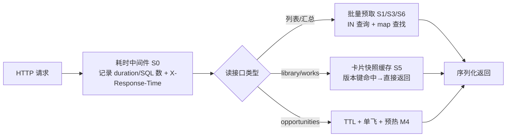
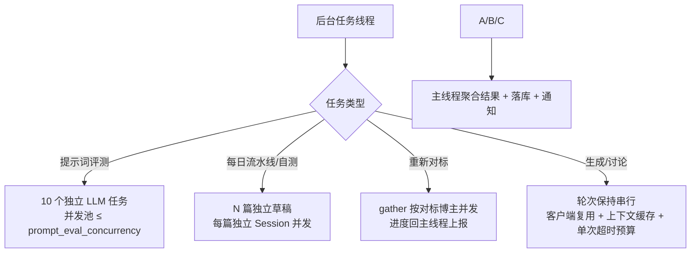
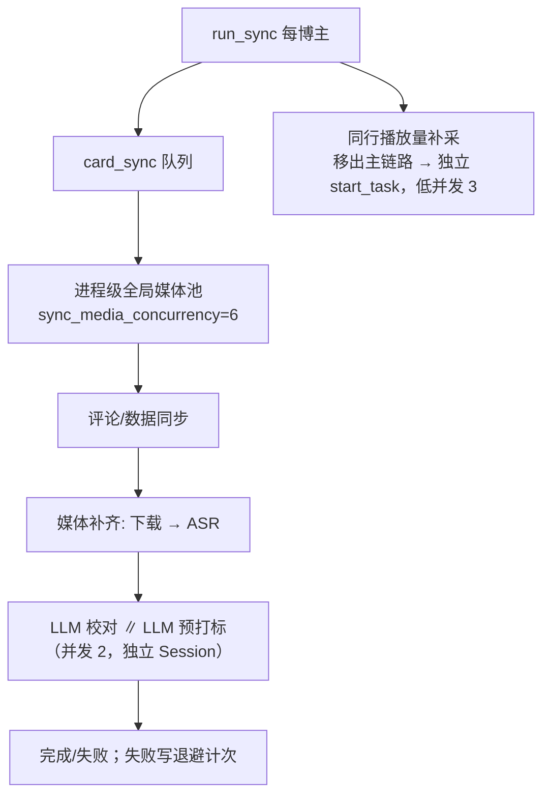
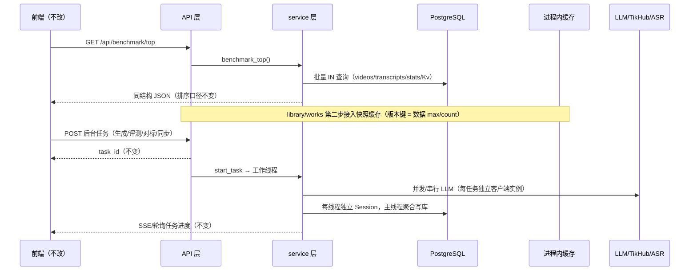

# R-240 开发设计：后端性能优化（批次 1+2）

- **对应需求**：`requirements/R-240-backend-perf-batch12.md`
- **日期**：2026-10-30
- **状态**：✅ 已按本文实现（2026-10-30，verify 全绿；实测收益见 §9）
- **审计依据**：`.tmp/audit/SUMMARY.md`（总报告）+ `api.md` / `infra.md` / `sync.md` / `ai-services.md`（四份分工审计，含 `file:line` 证据与本机实测数字）
- **分支**：`feat/r240-perf`（从 main 建）；无 worktree/独立库要求（本需求不改表、不改前端契约）

## 1. 开发背景

### 1.1 现状（实测基线，本机 `echo_dev`，数据量：videos 602 / transcripts 600 / platform_posts 1953（38MB）/ stats 7928 / comments 19387 / drafts 129 / topic_ideas 9585）

- 部署：uvicorn 单进程；160 个路由全部同步 `def`（0 async def）；后台任务 `start_task` = 每任务 1 个无上限 daemon 线程；同步 SQLAlchemy `pool_size=10/max_overflow=20`；`/health` 1.1ms。
- 慢 GET 实测：`benchmark/top` 447ms/810 SQL；`platform/creator-summary` 368ms/703 SQL（v2 未用）；`works` 210ms/1.64MB；`works/by-post` 204ms；`library` 141ms（假分页，与 limit 无关）；`douyin-review/references` 112ms/22 SQL；`persona/style` 76ms/218 SQL；`persona/phrases/suggest` 44ms/146 SQL；`opportunities` 冷 593/225ms。
- 串行 LLM/媒体实测：提示词评测 5 样本×2 版=10 次 LLM 串行；每日流水线/自测 3 篇完整双模型讨论串行（每篇 12~13 次 LLM）；重新对标逐博主串行；日更媒体每博主池 2 worker、单卡下载→ASR→LLM 校对/打标串行（10-29 日更墙钟 1,799s，6 张轻量卡排队 1,389~1,479s；17 条 failed 转写每天重试）。
- LLM 客户端：`services/llm.py:119` 每次 `with httpx.Client(...)` 新建（无连接复用）；`llm_router` 单次最坏 600s×3=1800s，chat 120s deadline 不进入单次调用；每次 AI 调用前 21 条 `app_kv` 单查；生成上下文每次重建（108 SQL/38~47ms）。
- 观测：全仓无请求耗时/慢 SQL 中间件。

### 1.2 目标与边界

目标：批次 1（S0~S8 快赢）+ 批次 2（M1~M9 并行编排）全部落地，接口内容/字段契约不变、前端零改动；用「更新前后 GET 基准 + 后台任务墙钟 + pytest」验收。边界见需求文档 §2.2（不改表、不改 async 架构、不并行真依赖、不做批次 3）。

### 1.3 复用能力（不新造轮子）

`sync_pool.gather` + `session_factory`（并发 + 每线程独立 Session 的既有范式）、`persona_profile.extract_pieces`（4 路并行+hash 缓存）、`evidence.gather_online`（多源并行+超时兜底）、`works_service.latest_stats_map`（批量预取取最新）、`opportunity._cached`（TTL 缓存）、`tikhub.py`（httpx.Client 复用先例）、`core/log.py`（结构化日志）。

## 2. 涉及的技术

| 技术/模块 | 用途 | 本次使用方式 |
|---|---|---|
| FastAPI 同步 def + anyio 线程池 | 现有请求模型 | **不变**；新增一个 ASGI/HTTP 耗时中间件（纯读） |
| SQLAlchemy 2.x 同步 ORM | 批量预取、窗口/`IN` 查询、Session 边界 | 读路径批量预取；写库一律回主线程；并发任务每线程独立 Session |
| `ThreadPoolExecutor` / `sync_pool.gather` | 并行化独立 LLM/媒体/网络任务 | 统一走 `sync_pool.gather` 或局部 executor；线程内不碰共享 Session |
| httpx | LLM/外部 HTTP 客户端 | LLM 模块级共享 Client（线程安全）+ 每次请求传 timeout；保留墙钟 deadline |
| 进程内缓存（dict + TTL） | library/works 卡片快照、生成上下文静态部分、机会缓存 | key 含数据版本号；TTL 10~20s；同步完成/保存设置后主动失效 |
| APScheduler | 后台预热 | 机会缓存按 TTL/2 周期预热 |
| pytest / ruff / mypy | 质量门禁 | 新增 `tests/test_r240_*.py`；verify 全绿 |

无新增第三方依赖（`h2` 不装，不做 HTTP/2）。

## 3. 开发流程图

### 3.1 请求路径（S0/S1/S3/S5/S6/M4）

### 3.2 后台任务并行（S2/M1/M2/M5/M6）

### 3.3 日更媒体（S7/M8/M9）

## 4. 数据流转图

## 5. 实现细节（逐项：输入 / 规则 / 阈值 / 证据 / 排序 / 降级）

> 每项均已给出实现函数、边界条件与降级路径；阈值默认值集中在前述常量 / `config.py`，可由 `.env` 覆盖。

### 批次 1（P0）

**S0 请求耗时/慢 SQL 中间件**（`app/main.py` + `app/core/log.py`，新增）
- 输入：每个 HTTP 请求（含静态资源；可选跳过 `/health`、`/covers`、`/media`、`/uploads` 以减噪）。
- 规则：`middleware("http")` 用 `time.perf_counter()` 计时；响应头 `X-Response-Time: "<ms>"`；`ms > SLOW_REQUEST_MS(500)` 时 `log.warning("慢请求 %s %s %s %.0fms sql=%d", ...)`；SQL 计数通过 `sqlalchemy.event.listen(engine, "before_cursor_execute")` 写 `contextvars.ContextVar`（每请求重置；仅 dev/`ECHO_SQL_COUNT=1` 时启用，避免额外开销）。
- 降级：中间件异常不得影响响应（`try/finally` 包住）；SQL 计数未启用时日志只记耗时。
- 证据：api/infra 报告「45 个接口中 5 个 >100ms」为基线。

**S1 benchmark/top 批量预取**（`services/benchmark.py` + `api/benchmark.py`）
- 函数：`benchmarks_top` 主线程先收集所有 bm 的 `candidates()`（UNIT 列表）；一次性构建 `video_text_map`：`SELECT v.id, v.work_id, t.corrected_text, t.transcript_text FROM videos v LEFT JOIN transcripts t ON t.video_id=v.id WHERE v.id IN (local_video_ids) OR v.work_id IN (work_ids)`（每 video 取一条 transcript，`ORDER BY transcripts.id DESC` 防 uselist=False 重复行）；`latest_stats_map(db, all_post_ids)`；`SELECT key,value FROM app_kv WHERE key IN (analysis_keys)`。
- `_unit_text(db, unit, *, video_text_map=None)` 命中 map 不查库；`target_units(..., with_text_first=True)` 中两次 `_unit_text` 调用**各算一次后传入**（用局部变量，避免 list comprehension 内重复）；`unit_payload(..., stats_map=..., analysis=...)` 增加可选参数，批量路径传 map。
- 规则：排序/去重/「前3+最新」/广告过滤语义完全保留（R-106/R-174）；空 map / 空 text 时与现状一致返回 `""` 或不展示。
- 降级：map 构建失败（SQL 异常）回退逐条查询（现有逻辑）。

**S2 prompt_eval 并行**（`services/prompt_eval.py`）
- 输入：`probes`（≤5）、候选版/当前版两份 content。
- 规则：`jobs = [(tag, i, probe) for tag, content in (("cand", candidate), ("base", base)) for i, probe in enumerate(probes)]`；`ThreadPoolExecutor(max_workers=min(settings.prompt_eval_concurrency(default 3), len(jobs)))`；每个 job **独立** `llm_router.llm_from_snapshot(route, feature)` 客户端（`RoutedLLM` 有实例状态 `used_slot/degraded`，禁止共享）；按 `(tag, i)` 回填 `outputs`，`_score_outputs` 顺序不变；异常按现有语义 `out=""`, `errors+=1`。
- 阈值：并发数 1~5（默认 3，`.env ECHO_PROMPT_EVAL_CONCURRENCY`）；单次 LLM 失败不阻断其余。
- 降级：并发池创建/提交失败 → 顺序执行（保留 `_run_version` 原函数作为串行路径）；`prompt_eval_concurrency<=1` 时走串行。

**S3 persona/style + phrases/suggest 批量化**（`api/persona.py` + `services/generation.py` + `services/persona.py`）
- `_all_texts(db)`：改 `db.query(Video).options(selectinload(Video.transcript))`（2 条 SQL 代替 1+N）；返回结构不变（`(Video, text)`）。
- `_weight_map(db, videos)`：一次 `latest_stats_map` 同款批量取每个 video 最新 `MetricsSnapshot`，返回 `video_id -> engagement`；`_weight(db, v)` 保留为兼容包装（单条场景）。
- `/persona/style`：`rows = _all_texts(db)` 后只 `sorted` 一次 `[(weighted, video, text)]`，同时派生 `weighted[:3]` 与 `candidates[:20]`（原来两个 sorted 各查一遍）；`suggest_phrase_candidates` 同样用预取 map。
- 阈值：素材数 N 任意；输出排序与内容不变。
- 降级：批量指标查询异常 → 回退逐条 `_weight`。

**S4 LLM 客户端复用 + KV 批读**（`services/llm.py`、`services/llm_router.py`、`services/model_settings.py`）
- `llm.py`：模块级 `_CLIENTS: dict[str, httpx.Client]` + `threading.Lock`；`_client_for(base_url)` 返回共享 Client（`limits=Limits(max_connections=8, max_keepalive_connections=4)`、`keepalive_expiry=120`、`timeout=None`、`trust_env=True`），`_post` 用 `client.stream(..., timeout=httpx.Timeout(connect=15, read=self.timeout_seconds, write=60, pool=30))` 传每次请求 timeout（保持现有墙钟语义：`deadline=monotonic+timeout_seconds`）；`close_all_clients()` 挂 `atexit`。
- `model_settings.py`：新增 `_kv_get_many(db, keys) -> dict[str,str]`（一次 `Kv.key.in_(keys)`）；`get_model_config`/`resolve_slots`/`generation_roles`/`feature_route`/`asr_config` 内部改用批读，并接受可选 `config` 参数复用同一份（避免同请求重复解析）；`save_*` 后清理进程内短 TTL 快照（若有）。
- `llm_router.py`：`snapshot(db)` 一次取 config 派生 slots + gen/referee（原来 20~21 条 SQL → ≤3）。
- 阈值：配置「保存即生效」语义必须保留（不做跨请求长缓存，只做单请求内复用与一次批读）。
- 降级：共享 Client 构造失败 → 每次新建（现行为）。

**S5 library/works 卡片快照缓存**（`services/library_service.py`、`services/works_service.py`；`api/library.py`/`api/works.py` 可选主动失效钩子）
- 数据版本键（便宜、有界）：`(creator_id, posts_count, max(posts.id), posts_max_updated?, videos_count, max(videos.id), works_count, stats_count)`；实际取 `SELECT count(*), max(id) FROM ...`（4~5 条轻查询，≤3ms）。
- 规则：`_CARD_CACHE: dict[key, (expire_ts, cards)]` + `threading.Lock`；TTL 默认 20s；`build_cards`/`list_works` 命中直接返回**浅拷贝**（`[dict(c) for c in cards]` 防调用方修改污染）；`page()` 的 filter/cursor/facets 仍按原逻辑在缓存结果上执行（语义不变）。同步完成/草稿合并等写路径可调用 `invalidate_cards(creator_id)`（可选，TTL 兜底已足够）。
- 降级：版本查询/缓存异常 → 直算；缓存条目上限 20 条，超限清空。

**S6 视频复盘 / 参考榜批量预取**（`services/video_review_comparison.py`、`video_review_service.py`、`video_review_topics.py`、`douyin_references.py`）
- `build_comparison`：先取 `comparison` 的 post_ids；一次 `PlatformPostStat WHERE post_id IN (...) ORDER BY stat_date` 建 `post_id -> [rows]`；一次 `DouyinPostMetric WHERE post_id IN (...)` 同法；`_stat_at/_private_at` 改为在内存中按 `publish_time+age` 的 cutoff 取最后一条（语义与逐条 `<= stat_date` 完全一致）；`SPECS` 循环纯内存。
- `low_fan_references`：`_owner_keywords(db, owner)` 提到循环外一次，`relevance_for/reference_out` 接受 `keywords` 参数（默认 None 时内部兜底）。
- `latest_review map`：一次 `SELECT post_id, ... FROM video_reviews WHERE post_id IN (...) ORDER BY id` 后每 post 取最新（或 `DISTINCT ON (post_id)`)。
- `_follower_topics`/`recommend_topics`：一次 `IN` 取 metrics/latest stat/人设关键词，循环内纯计算。
- 排序/过滤/文案输出不变；空集合返回空 dict，不抛异常。

**S7 转写失败退避**（`services/media_ensure.py`、`services/ingest.py`）
- 键：`app_kv`：`asr_fail_count:{video_id}`、`asr_retry_after:{video_id}`（值为北京时间 ISO/时间戳，与 `core.timeutil.now` 一致）；不改表。
- 规则：`import_video_task` 失败分支：计数 +1；按失败原因分类：可重试（网络/超时/5xx/轮询超时）→ `retry_after = now + min(2**count, 24) 小时`；不可重试（无语音/音频过长/额度/格式）→ 写入大退避（如 7 天）；成功则删除两个键。`media_ensure` 判断是否补齐时：若 `retry_after > now` 或 `count >= asr_max_attempts(默认 3)` → 跳过并（count>=max 时一次性）通知「该视频自动转写多次失败，可手动重试」，不再占用媒体 worker。
- 手动重试路径（用户点转写按钮）忽略退避并清零计数。
- 降级：Kv 读写异常 → 视为无退避（现行为），不阻断转写主流程。

**S8 对标准备广告判定批量化**（`services/benchmark.py`）
- `ensure_top_with_text`：候选顺序确定后，先对「缺文案需转写」的按媒体池并发补齐（复用 S7/M8 媒体工具），再对所有有文案候选**一次** `_units_are_ad(db, units, texts)`：system 同现有 `_AD_JUDGE_SYSTEM`，user 为 `[{"id": <post_id>, "title":..., "text":...(≤1500字)}...]`，输出 `{"results":[{"id":1,"is_ad":true,"reason":"..."}]}`；解析失败/LLM 异常 → 全部按 `False`（宁可不误杀，与现状一致）；命中广告的仍 `_flag_unit_ad` 落库并顺延。
- `_stats_map(db, [unit])` 循环外批量一次。
- 排序/顺延/保底 4 条语义不变。

### 批次 2（P1）

**M1 每日流水线 / 提示词自测并行生成**（`services/pipeline.py`、`api/prompts.py`）
- 输入：`candidates`（默认 3）/ `topics`（≤3）。
- 规则：每篇生成用**独立 Session**（`session_factory(db)`），`sync_pool.gather(_gen_one, candidates, workers=settings.pipeline_generate_concurrency(默认2))`；主线程聚合草稿 id 并按原顺序写 `TopicCandidate`；失败单篇不阻断（记入任务 note）；通知/邮件/`push_daily_best` 语义不变（在主线程、全部完成后执行）。
- 提示词自测：同样独立 Session + `prompt_selfcheck_concurrency(默认2)`；完成后统计 made 数，通知文案不变。
- 降级：并发度=1 时等价串行；生成异常 → 单篇失败照旧（回炉/自测失败不阻断其余）。
- 注意：生成链路内部已用独立 Session 读取人设/素材，跨线程安全；`draft_status` 每篇独立。

**M2 重新对标按博主并发**（`services/benchmark.py`）
- `rerun_benchmarks`：`gather(_run_one, bms, workers=pool_size("creator"))`，`_run_one(bm)` 用 `session_factory` 独立 Session 执行「逐账号 sync_account + ensure_top_with_text」；`on_result` 在主线程累计 `done/total` 调 `update(pct, note)`；`BudgetExceeded` 用 `cancel` 事件让后续博主快速退出；单博主失败记入 summary。
- 进度文案保持 `[i/total] 名称：...`；返回结构不变（summary/ok_count/top_with_text_total）。

**M3 同步按钮接口并行**（`services/platform_sync.py`、`api/platform.py`）
- `sync_work_posts`：`posts` 列表用 `gather(_sync_one_post_isolated, posts, workers=min(3,len(posts)))`，每个任务独立 Session（`session_factory`），完成后结果回主线程汇总；`_sync_one_post` 内部「stats → comments」是两个独立请求，**先 gather 两个只读/写库分离的子任务**（stats 写 `_write_stat`/comments 写 `_upsert_comments` 各用独立 Session，主线程等待后继续）；预算异常向上抛，保持现有错误语义。
- `sync_local_video_metrics`：对 `posts` 同样按平台并发（独立 Session），聚合逻辑保持在主线程；Cookie 策略判定在主线程做（`resolve_data_policy` 只读），并发任务只做网络+写库。
- 响应结构与 message 文案不变；写库冲突风险：每条 post 相互独立（不同 post_id），无跨行事务依赖。
- 降级：并发度=1 走串行（保留原函数）；任何子任务异常按现状记 `errors`。

**M4 opportunities 缓存预热/防击穿**（`services/opportunity.py`、`scheduler.py`）
- `_cached` 增加 `_inflight: dict[key, threading.Event]` 单飞：未命中时首个线程重算，其余线程 `event.wait(timeout=…)` 后读缓存（等待上限 10s，超时降级自己算）。
- `comment_clusters`：缓存 key 去掉 limit，内部按 `_SCAN_LIMIT`（既有 500）算全量，返回时切片；不同 limit 复用同一份。
- `scheduler.py` 增加两个低频预热 job（每 2 分钟/5 分钟或按 TTL/2）：`_warm_opportunity_caches()` best-effort，异常只记日志，不告警。
- 排序/过滤/字段不变；缓存 key 含 creator_id，账号切换按现有 TTL 失效。
- 降级：预热失败不影响请求；单飞等待超时 → 直接重算。

**M5 生成上下文缓存**（`services/generation.py`）
- 拆分：`_static_style_context(db)` = 人设/红线/画像/范本/结构/改稿样本/回退课/禁用词/对标（原 `author_style_context` 中与 topic/mode 无关部分）；`_topic_samples_block(db, topic)` + `_mode_line(mode)` 动态部分。
- 缓存 key：`(creator_id, _material_version(db), current_persona_version(db))`；`_material_version` 追加「转写正文总长度」聚合（`sum(length(corrected_text))+sum(length(transcript_text))`）兜住「正文原地编辑」盲区；进程内 dict + Lock，最多 5 条。
- `_style_profile`：先算 `_material_version`（5 条 SQL）再查缓存，命中**不再** `_all_texts(db)`；`_all_texts` 加 `selectinload(transcript)`；`_reverted_lessons` 改一次批量 `chains_with_sources(db, drafts)`。
- 输出：`author_style_context` 拼接顺序/空行与现 prompt 完全一致（有 R-228/R-233 契约与测试保护）。
- 降级：版本键查询异常 → 直算（现行为）。

**M6 LLM 超时预算 + deadline 下传**（`services/llm_router.py`、`llm.py`、`chat_service.py`、`evidence.py`）
- feature→单次超时表（秒，硬编码常量，注释标定依据）：`chat=90, correct=120, video_tags=120, persona_updates=120, persona_compare=120, ideas=30, draft_meta=90, diff=120, feedback_analysis=120, prompt_optimize=240, prompt_eval=180, benchmark=240, video_review=180, generation/debate/rework/rewrite=360, misc=120`；`llm_timeout_seconds`(600) 作为兜底上限，`min(feature, global)`。
- `build_client(slot, timeout_seconds)` 透传给 `OpenAIClient(timeout_seconds=...)`；`RoutedLLM.chat/chat_json/chat_completion` 增加可选 `timeout_seconds` 参数，`_run` 内每次 attempt 用 `min(remaining_global_deadline, feature_budget)`。
- chat：`deadline = now + agent_timeout_seconds`，每次 LLM 调用传 `timeout_seconds=max(5, deadline-now)`；工具调用前仍检查；超时后走现有「带已有数据收尾作答」。
- evidence：`picker` 软超时保留，但选文调用传 `timeout_seconds=min(45, online_pick_timeout)`，把底层线程泄漏上限从 600s 降到 45s。
- 阈值/风险：推理模型长思考可能被短预算误杀——仅对交互类（chat/ideas/draft_meta 等）启用短预算；生成/讨论保持 360s；`LLM_ERROR` 语义与降级通知保留。
- 降级：任一层不传 timeout 时沿用现有 600s（向后兼容）。

**M7 遗留同步 LLM 接口治理（不破坏契约）**（`api/drafts.py`、`services/inspiration.py`、`api/platform.py`）
- `POST /api/drafts/generate`：加 docstring 标注「遗留同步接口，前端请用 /generate-async」；LLM 调用因 M6 预算变更不再是 1800s 级；**不改返回结构**。
- `POST /api/inspiration/{id}/develop`：`refine_topic` 的 LLM 使用 `ideas` 30s 预算（M6），失败/超时回退原文（现有兜底），接口仍同步返回 `{draft_id, topic}`；不改前端。
- `POST /api/platform/topic-pool/{id}/generate`：同样标注「遗留同步接口」；其余逻辑不动。
- 说明：真正改后台任务（需前端改 toast/跳转）列入后续需求，不在 R-240 做。

**M8 媒体补齐全局池 + LLM 后处理并发**（`services/sync_pool.py`、`services/media_ensure.py`、`services/ingest.py`、`config.py`）
- `sync_pool.py` 新增进程级 `_MEDIA_EXECUTOR = ThreadPoolExecutor(max_workers=settings.sync_media_concurrency, thread_name_prefix="echo-media")` + `gather_media(fn, items, on_result)`（与 `gather` 同语义，但**共享**执行器；每 item 由调用方自建 Session）；`run_card_sync_queue` 改用 `gather_media`。多博主队列并发提交时总媒体并发 ≤ `sync_media_concurrency`（语义从「每博主」改为「进程全局」，默认 2→6，`.env.example` 注释同步更新）。
- 轻量卡优先：保持 `prio` 排序；已在本地/已转写的卡先完成（现状排序按平台；新增二级排序：`needs_media` 轻卡在前、重卡在后），仅调整队列顺序，不改变结果。
- `ingest.import_video_task`：ASR 成功落库后，「LLM 校对」与「LLM 预打标」两个互不依赖调用用 `ThreadPoolExecutor(2)` 并发，各自 `SessionLocal()` 独立 Session（校对结果写 transcript、打标写 persona 建议），任一失败按现有语义记日志/回滚该支路；主线程等待两者后收尾。
- 转写失败退避见 S7；媒体队列对退避中的卡直接跳过（计 `skipped`，不再 `errors` 激增）。
- 优雅关闭：`_MEDIA_EXECUTOR` 为 daemon 线程池（`ThreadPoolExecutor` 线程随进程退出），无需 lifespan 关闭；`close_all_clients` 同批次处理 httpx。
- 降级/回滚：`ECHO_SYNC_MEDIA_CONCURRENCY=1` 时等价串行；若上游 ASR 出现 429，运维可调小该值（文档注明）。

**M9 同行播放量补采移出主链路 + 低并发**（`platform_sync.py`、`douyin_creator_sync.py`、`services/platform/budget.py`）
- `run_daily_sync_all` 删除对 `backfill_peer_plays` 的直接调用，改为 `start_task("peer_plays_backfill", {...}, worker)`；任务内部用 `gather(workers=3)` 替代「串行 + 0.25s sleep」中的串行等待（保留 0.25s 降速逻辑在每任务内，或改为令牌桶自然限速 + 每批 2 id），失败不影响日更结论，日更 message 不再包含 peer 播放量（任务通知单独出现）。
- 去重：`find_running_task("peer_plays_backfill")` 防重复入队；`_peer_plays_fresh` 6h 复用不变。
- 该任务失败只写日志/通知，不改变日更任务状态。

## 6. 新增/修改表结构

**无。** 本需求不改任何表结构、不加列/索引/视图，因此无 Alembic revision，`docs/DATABASE.md` 表清单不变。转写退避计数/缓存版本号使用现有 `app_kv`（键值表）与进程内缓存，不落新表。

## 7. 新增/修改接口

**无新增路由、无请求/响应字段变更、无错误码变更。** 仅以下行为增强（均向后兼容）：

| 接口 | 变化 | 契约影响 |
|---|---|---|
| 所有 HTTP 响应 | 新增 `X-Response-Time` 头 | 附加头，无破坏 |
| `GET /api/benchmark/top` / `works` / `library` / `persona/style` / `persona/phrases/suggest` / `douyin-review/references` / `douyin-review/videos` / `opportunities/*` | 内部查询/缓存优化，返回内容与排序不变 | 无 |
| `POST /api/platform/works/{work_id}/sync`、`/posts/{post_id}/sync`、`/videos/{video_id}/sync` | 内部并发，响应字段与错误语义不变 | 无 |
| `POST /api/benchmark/prepare|rerun`、`POST /api/drafts/generate-async`、`POST /api/prompts/*/optimize|save`、`POST /api/pipeline/run` 等后台任务 | 内部并行，进度/结果/通知不变 | 无 |
| `GET /api/events`（SSE） | 不变 | 无 |
| `POST /api/drafts/generate`、`POST /api/inspiration/{id}/develop`、`POST /api/platform/topic-pool/{id}/generate` | 仅内部 LLM 超时预算收紧 + 注释标记遗留；返回结构不变 | 无 |

错误语义：并行子任务失败沿用「单条失败不阻断整批」；接口层异常仍按现有 HTTPException/500 语义返回。

## 8. 数据来源与原始字段明细

| 数据/行为 | 来源类型 | 原始字段/表 | 落库/使用字段 | 用途 | 更新时间 | 空值处理 |
|---|---|---|---|---|---|---|
| 对标首屏作品与文案 | 现有表 | `platform_posts(id,title,desc,publish_time,local_video_id,work_id,is_ad)`, `videos(id,work_id)`, `transcripts(corrected_text,transcript_text)`, `platform_post_stats(likes,favorites,comments,plays,stat_date)`, `app_kv(ba:*)` | 同左侧，仅合并查询 | 展示/排序/分析结果 | 同步任务写入 | 无转写→`text=""`（`has_text=false`）；无统计→0；无分析→`analysis=null` |
| 素材库/作品卡片 | 现有表 | `platform_posts`, `creator_accounts`, `works`, `videos`, `platform_post_stats` | 同左侧 | 列表卡片 | 同步/编辑时 | 空列表→`items=[]`，`next_cursor=null` |
| 人设页风格/金句 | 现有表 | `videos`, `transcripts`, `metrics_snapshots`, `persona_tags`, `app_kv` | 同左侧 | 风格画像/金句候选 | 人设/素材变更 | 无素材→空画像/空候选 |
| 视频复盘对比/参考 | 现有表 | `platform_posts`, `platform_post_stats`, `douyin_post_metrics`, `video_reviews` | 同左侧 | 指标对比/同行参考 | 复盘任务/同步 | 无指标→`state=missing` |
| 内容机会缓存 | 现有表 | `drafts`, `feedback`, `metrics_snapshots`, `platform_posts`, `topic_ideas` | 进程内缓存（不入库） | 首页机会 | 后台预热/TTL | 重算失败→保留旧缓存/直算 |
| 生成上下文 | 现有表 + 程序计算 | `persona_tags(layer,category,label,description)`, `videos`, `transcripts`, `drafts(status,script,original_script,updated_at)`, `draft_versions(source,...)`, `app_kv(ai_no_words,style_*)`, `creators(note)` | 进程内缓存（键含素材/人设版本） | 生成 system prompt | 素材/人设/反馈变化 | 各段为空时输出「（暂无）」占位（与现 prompt 一致） |
| LLM 调用 | 第三方 | DeepSeek/Kimi OpenAI 兼容接口（`choices[0].message.content`） | 不落库（除 discussion/quality 现有字段） | 生成/评审/评测 | 实时 | 空正文/超时→现有降级链 |
| TikHub / ASR / 媒体 | 第三方/本地 | TikHub 作品/统计/评论；ASR Provider 转写；本地视频文件 | `platform_posts/stats/comments/transcripts/videos` | 同步/素材补齐 | 同步任务 | 失败→现有 failed 终态 + 新增退避计数 |
| 请求耗时/慢请求 | 程序计算 | 中间件计时、SQLAlchemy 事件计数 | 日志/`X-Response-Time` | 可观测 | 实时 | 计数未启用时只记耗时 |
| 新增配置 | 作者输入 | `.env`（`ECHO_PROMPT_EVAL_CONCURRENCY`、`ECHO_PIPELINE_GENERATE_CONCURRENCY`、`ECHO_PROMPT_SELFCHECK_CONCURRENCY`、`ECHO_ASR_MAX_ATTEMPTS`、`ECHO_SYNC_MEDIA_CONCURRENCY`（语义=全局）） | `app/config.py` Settings 字段 | 并发/退避调参 | 重启生效 | 未配置→代码默认值（3/2/2/3/6） |

## 9. 实施后实测（2026-10-30，本机 echo_dev + 8000 端口重启后）

| 项 | 改前（审计基线） | 改后（本机实测） | 说明 |
|---|---|---|---|
| `GET /api/benchmark/top` | 447.5ms / 810 SQL | **27~32ms（冷 66ms）/ 7 SQL** | 输出与旧逐条路径逐字段相等（11 对标全量核对） |
| `GET /api/library?limit=20` | 141.4ms（每次全量重建） | **9~10ms 命中（首访 150ms）** | 快照缓存 TTL 20s + 版本键；page/filter/cursor/facets 语义不变 |
| `GET /api/works` | 210.3ms / 1.64MB | **9ms 命中（首访 242ms）** | 响应字段未变（字段瘦身属批次 3） |
| `GET /api/persona/style` | 76.3ms / 218 SQL | **17~21ms / 7 SQL** | |
| `GET /api/persona/phrases/suggest` | 44.5ms / 146 SQL | **6~7ms / 4 SQL** | |
| `GET /api/douyin-review/references` | 112.1ms / 22 SQL | **16~18ms / 4 SQL** | peer/low_fan 两侧均批量 |
| `GET /api/opportunities/ledger` | 冷 593.2ms | **6.5ms（预热后常驻热态）** | scheduler 每 60s 预热 + 单飞 |
| `GET /api/opportunities/attribution` | 冷 225.1ms | **4.7ms（预热后）** | |
| `build_comparison`（复盘分析） | 283 SQL / 98ms | **4 SQL / 18ms** | |
| `rerun_benchmarks`（11 对标） | 串行 ≈2.75s | **0.87s（4 worker，≈3.2×）** | |
| `X-Response-Time` 响应头 | 无 | 每请求返回（样例 25.8ms） | >500ms 慢请求写 warning 日志（含 SQL 条数） |
| 质量门禁 | — | `scripts/verify.sh` 全绿（ruff/mypy 150 文件/pytest **705 例**/前端 145 例+build/docs 一致） | 服务已重启加载新代码，`/health` 200 |

未在本机实测（无真实 LLM/同步计费调用，按仓库纪律）：提示词评测并发、流水线并发、媒体全局池/转写退避、对标准备广告判定、同步按钮并发的端到端墙钟——由新增测试与代码路径覆盖，建议在下次真实日更/评测时观察 `sync_jobs` 墙钟与任务进度。

## 10. 实施后复核与幂等修复（2026-10-30）

作者要求「检查逻辑不变、接口和数据幂等」，实施后做了独立复核（读路径/AI 编排/基础设施/写入路径四路），详见 `.tmp/audit/verify-write.md` 与 `.tmp/audit/verify-{api,ai,infra}.md`。

- **写入路径复核结论**：单卡同步、媒体补齐、同行播放量补采、转写退避与旧实现逻辑等价；同步类动作重复执行不产生重复数据（`platform_post_stats` 唯一约束 + 评论按文本 upsert + 灵感池按标题去重）；生成类接口保持旧的非幂等语义（每次新草稿，运行中去重未变）。
- **发现并修复的缺陷**：`platform_sync.pool_ideas_from_comments` 的「先 COUNT 配额再 INSERT」在 R-240 提高并发后被放大——6 并发下每日配额 10 被突破到 48、同评论重复进池 6 条（`topic_ideas` 无唯一约束）。修复：新增模块级 `_POOL_IDEAS_LOCK`，把「读配额+去重+插入+commit」串行化（单进程假设与既有 `_BUDGET_LOCK` 一致）；新增 `tests/test_r240_idempotency.py` 永久回归（6 例）。
- **附注**：预算计数曾怀疑 identity-map 旧值丢更新，实测因 SQLAlchemy identity map 弱引用会重新查库而安全，未改代码，仅加回归测试锁定。

