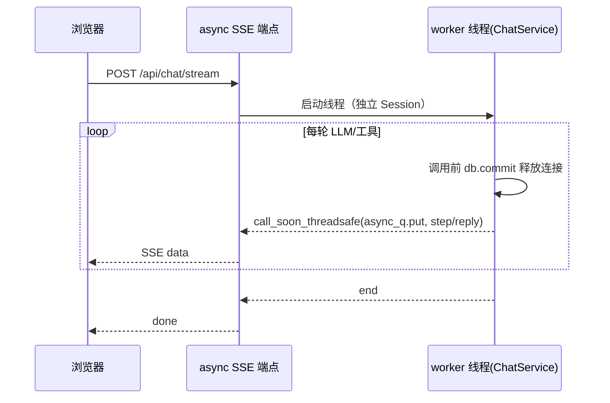

# R-241 开发设计：后端性能优化收尾（批次 3）

- **对应需求**：`requirements/R-241-backend-perf-batch3.md`
- **日期**：2026-10-30
- **状态**：✅ 已按本文实现（2026-10-30，verify 全绿；实测收益见 §9）
- **依据**：`.tmp/audit/SUMMARY.md` 批次 3（L1~L9）+ `.tmp/audit/REVIEW.md` 复核遗留；R-240 已完成
- **分支**：`feat/r241-perf`（从 main 建）；含 Alembic revision（2 列 + 1 索引）
- **契约**：前端零改动；接口字段/错误码不变；OpenAPI schema 不变

## 1. 开发背景

R-240 已完成读接口批量预取/缓存、可并行任务并行化、LLM 客户端复用与超时预算、转写退避、请求耗时中间件；实测 benchmark/top 447→~30ms、library 141→~10ms、works 210→~9ms、persona/style 76→~18ms、references 112→~17ms，长任务墙钟预期显著下降；四路独立复核确认逻辑等价、GET 幂等零写库，并修复了灵感池并发竞态、连接池容量、超时误杀等 9 处问题。

本需求处理**批次 3（结构性/契约类）**与复核遗留的 P2/P3：

1. 卡片缓存版本键盲区（视频原地编辑、同日统计原地更新靠 20s TTL）+ 过期重建无单飞 + `stats_count` 全局失效；
2. chat 流占线程与 DB 连接；
3. 后台任务无全局上限/部分入口无去重 + `background_tasks.status` 无索引；
4. 预算重复事务、B 站进度强制写、外部 HTTP 无连接复用；
5. opportunity / learning_material / station_evidence 剩余 N+1，证据选文/Fetch 无缓存；
6. 模型自检、人设合并、热点抓取、聊天工具、机会三分支仍串行；
7. 重新对标进度缺中间态等小项。

## 2. 涉及的技术

| 技术/模块 | 用途 | 本次使用方式 |
|---|---|---|
| PostgreSQL + SQLAlchemy 2.x + Alembic | 新增列/索引 | `videos.updated_at`、`platform_post_stats.updated_at`；`ix_background_tasks_status_created`；`docs/DATABASE.md` 同步 |
| FastAPI / Starlette SSE | chat 流 | 同步生成器 → `async def` 生成器 + `asyncio.Queue`（生产者仍为 daemon 线程，经 `loop.call_soon_threadsafe` 投递） |
| threading / ThreadPoolExecutor | 并行化 | 每线程独立 Session；LLM 实例不共享；全局并发上限用 `BoundedSemaphore` |
| 进程内缓存（dict+TTL/版本键） | 卡片/证据/机会 | 版本键精确 + 单飞 Event；读写锁粒度不包住重计算 |
| httpx | 外部 HTTP | 新增 `core/http.py` 按 base_url 共享 Client（线程安全），per-request timeout |
| SQL 批量 | N+1 | `IN`/`DISTINCT ON`/窗口函数/批量预取 map；只读不改写入语义 |
| pytest / ruff / mypy | 门禁 | 新增 `tests/test_r241_*.py`；verify 全绿 |

无新增第三方依赖。

## 3. 开发流程图

### 3.1 卡片读取与精确失效

```mermaid
flowchart TD
    A[GET /api/library 或 /api/works] --> B[cards_version: 4 组便宜聚合<br/>含 videos.updated_at / stats.updated_at]
    B --> C{缓存命中且版本一致?}
    C -- 是 --> D[返回浅拷贝 + filter/cursor/facets]
    C -- 否 --> E[单飞: 首个线程构建, 其余等 ≤2s]
    E --> F[构建全量卡片快照]
    F --> G[写入缓存(版本键, 值)]
    G --> D
    H[写路径: 同步/编辑/合并] --> I[ORM 自动刷新 updated_at]
    I --> B
```

### 3.2 chat 异步流



### 3.3 后台任务并发上限与去重

```mermaid
flowchart TD
    A[start_task(kind,payload)] --> B{同 kind+payload<br/>pending/running?}
    B -- 是 --> C[返回已有 task_id]
    B -- 否 --> D[插入 pending 行 + 启动线程]
    D --> E{全局信号量有空位?}
    E -- 否 --> F[线程等待(任务保持 pending 可见)]
    E -- 是 --> G[置 running → 执行 → 释放]
```

## 4. 数据流转图

```mermaid
flowchart LR
    W[写路径: 同步/编辑/合并/统计] --> DB[(PostgreSQL)]
    DB --> V[版本键聚合<br/>counts/max(id)/updated_at/stats.max(updated_at)]
    V --> Cache[卡片/证据/机会缓存]
    Cache --> R[读接口/生成链路]
    T[后台任务] --> Sem[全局并发信号量]
    T --> Dedupe[同 kind+payload 去重]
    T --> Ext[LLM/TikHub/ASR]
    Ext -.->|共享 httpx.Client| Ext
```

## 5. 实现细节（输入 / 规则 / 阈值 / 证据 / 排序 / 降级）

### 5.1 卡片精确失效与读路径收尾

- **表结构**：`videos` 新增 `updated_at`（DATETIME，非空，默认当前北京时间，`onupdate` 同）；`platform_post_stats` 新增 `updated_at`（同上）。ORM `onupdate` 由 SQLAlchemy 自动刷新；迁移中历史行回填 `now()`。
- **`cards_version`**（`works_service.py`）：posts 组（count/max(id)/max(updated_at)，按 creator enabled 账号）、videos 组（count/max(id)/max(created_at)/**max(updated_at)**，按 creator）、works 组（count/max(updated_at)）、**stats 组改为该 creator 作品集合上的 `max(PlatformPostStat.updated_at)`/count**（join platform_posts+creator_accounts 过滤；无 creator 时全量）。任一编辑/同步/合并/统计更新都会改变版本键 → 下一次请求精确失效；TTL 保留 20s 作为 fail-safe（版本查询异常/极高并发）。
- **缓存单飞**：`_CARD_CACHE`/`_WORKS_CACHE` 增加 per-key `threading.Event` inflight：未命中时首个线程构建（锁外构建），其余线程最多等 2s 读取新缓存；等待超时各自构建（fail-open）。构建异常时清除 inflight 并向上抛（调用方 fail-open 直算）。
- **`by-post`**：`api/works.py` 的 `by-post` 改为直接按 `work_id`（或单帖实例）查询其成员帖子，复用 `latest_stats_map`/账号/创作者 map，不再调用全量 `list_works`；返回结构与旧实现一致（由 `test_r241_readpath` 对照旧 commit 输出）。
- **DB 列瘦身**：`_list_works`/`_cloud_cards` 的 `PlatformPost` 查询用 `load_only(...)` 只取卡片/模板实际使用的列（id、account_id、platform、platform_post_id、title、desc、tags、is_ad、ad_price、cover_url_local、publish_time、work_id、local_video_id、raw 仅在确实被读取时保留——实施时以 `post_item/_slim_post/_post_tags` 实际字段为准，逐项核对后确定）；`detail`/`raw` 等大字段不再全量加载。
- **`creator-summary`**：4 条批量 SQL（创作者、账号、`DISTINCT ON(account_id)` 最新快照、`ROW_NUMBER()` 最近 50 帖、`DISTINCT ON(post_id)` 最新统计），Python 聚合保留原算法/输出。
- 降级：版本键查询异常 → fail-open 直算（现状）；缓存损坏（缺键）→ 视为 miss。

### 5.2 chat 流 async 化

- `api/chat.py`：`chat_stream` 改 `async def`，返回 `StreamingResponse` 的 **async 生成器**；worker 线程内用 `queue.Queue` 与 `asyncio.Queue` 经 `loop.call_soon_threadsafe` 投递事件（step/reply/error/end），生成器 `await asyncio.sleep(0.015)` 打字机；事件顺序/格式/文案与现实现逐字一致。
- `ChatService.reply`：每次 LLM/工具调用前 `db.commit()`（读事务也结束，连接归还池）；工具写操作（agent_actions.propose）沿用现有独立短 Session 语义；异常仍转 SSE error 事件。
- 兼容：非流式 `POST /api/chat` 不改。
- 降级：worker 线程异常 → 与现实现一致输出 error 事件并结束。

### 5.3 后台任务并发上限 + 自动去重 + 索引

- `tasks.start_task`：模块级 `_START_LOCK`；插入前用 `find_running_payload(kind, payload)`（同 kind + payload JSON 完全相等，pending/running）→ 命中直接返回已有 task_id（新增内部函数；现有 `find_running_task` 保持兼容）。`start_task` 增加 `dedupe: bool = True` 可选参数（保留取消入口）。
- 全局并发：模块级 `threading.BoundedSemaphore(settings.max_parallel_tasks)`（默认 8）；worker 线程启动后先 `acquire()` 再执行（等待期间任务保持 pending，前端「进行中」可见），`finally` 中 `release()`；记录等待日志。新增配置 `ECHO_MAX_PARALLEL_TASKS`。
- `background_tasks` 新增复合索引 `(status, created_at)`（`api/tasks` 轮询按 status 过滤 + created_at 排序；兼作 `find_running_task` 的 kind/status 查询补强）。`api/tasks` 列表 `limit` clamp 到 ≤200（与前端现有参数一致，行为不变）。
- 降级：信号量等待无超时（任务不丢）；`dedupe=False` 供显式重复任务使用（本次无调用方需要）。

### 5.4 写放大与 HTTP 连接复用

- `budget._charge`：持锁后单条原子 SQL：`UPDATE app_kv SET value = CAST(CAST(value AS BIGINT) + :n AS TEXT) WHERE key = :k`（行不存在则先插 0 再 UPDATE；或 `INSERT ... ON CONFLICT(key) DO UPDATE SET value = CAST(CAST(app_kv.value AS BIGINT) + :n AS TEXT)`）。仍先做一次 `ensure_budget` 预检（读）；`BudgetExceeded` 语义/消息不变；每 count 1 事务。
- `_job_progress`：新增 `force: bool | None = None` 参数；B 站补全循环每 10 条或阶段结束才 `force=True`；`_JOB_PROGRESS_FORCE_KEYWORDS` 移除「补全」（保留 完成/失败/拉取到/排队中/同步中）；最终进度由收尾 flush 保证。
- `core/http.py`（新增）：`get_client(base_url, *, timeout=None, follow_redirects=False)` 模块级 `dict[(base_url, follow_redirects), httpx.Client]` + Lock，`Limits(max_connections=16, max_keepalive_connections=8, keepalive_expiry=120)`；`close_all()` 挂 atexit；每次请求显式传 timeout。
  - `platform/base.make_client` 进程级缓存 `TikHubClient`（按 mode/base_url/api_key），`requests_used` 改为「调用前后差值计费」（现有 `_charge_requests` 已是差值模式，实施时核对）；`platform_assets` 封面/头像/短链共享 Client；`web_search`、`deepseek_search.fetch` 改用共享 Client。
- 降级：共享 Client 构造失败 → 回退每次新建（旧行为）。

### 5.5 剩余 N+1 与串行点收尾

- **opportunity**：`_weekly_pack`/`_topic_attribution`/`_ledger` 内的逐视频 `_video_engagement`→`_platform_breakdown` 改为一次批量取 `PlatformPost`（按 local_video_id/work_id `IN`）+ 一次 `PlatformPostStat` 批量（升序覆盖取最新）+ `metrics_snapshots` 批量，Python 内聚合；输出结构/排序不变。`get_content_opportunities` 三分支用线程池并发（各自 `SessionLocal()` 只读），任一分支失败返回该分支降级值（与现有 try/except 语义一致）。
- **prompt_service.learning_material**：逐视频 `_platform_breakdown` 改批量预取 map（一次 posts+stats 查询），输出文本不变。
- **station_evidence.retrieve_station**：300 视频懒加载 transcript → 一条 `Video JOIN Transcript`/`selectinload`；作者/对标素材分两批 `IN`；输出 `block/meta` 不变。
- **debate.run_debate**：`gather_online(...)` 与 `retrieve_station(...)` 并发（各独立 Session：站内检索只读用 `SessionLocal()`；联网检索写 `web_search_logs` 用其内部 Session），之后合并 evidence_block，顺序与内容不变。
- **证据缓存**：选文结果（`selected` + `block` + `log_ids`）按 `(creator_id, topic, material_hash)` 存进程内 TTL 1h 缓存（上限 32 条）；DeepSeek Fetch 结果按 URL TTL 1h 缓存（`deepseek_search.py`）。命中时跳过选文 LLM 与重复抓取；`web_search_logs` 不重复写（用已有记录 id）。素材变化（hash 变）自动 miss；无 key/失败不影响现有降级。
- **persona.merge_full**：分块合并并行（`ThreadPoolExecutor(max_workers=min(4,len(chunks)))`，每线程 `service_factory()` 新实例），轮间 barrier 保留；`merge_incremental/compare` 不变。
- **model_health.run_selfcheck**：2 槽并行（或槽内 3 探针并行）且每探针 60~90s 超时（`ThreadPoolExecutor` + `future.result(timeout)`，超时记 incompatible + 耗时）；结果结构/通知不变。
- **topic_mining**：`get_sources()` 平台抓取并发（每源独立 try/except，各自共享 httpx Client）；入库前一次查当天 `(platform,title)` 集合，内存去重后 `add_all` + 一次 commit；结果与去重口径不变。
- **chat 工具**：`chat_service` 工具 dispatch 包单线程池 + `future.result(timeout=30)`，超时返回 `{"error":"该工具超过 30s 已跳过，请基于已有数据作答"}`；只读工具可独立 Session；写操作工具（propose）仍在主 Session 执行以避免跨线程。
- **benchmark.rerun**：进度增加到「计算前3+最新…」中间态（update(55, …)），返回结构不变。
- **prompt_eval**：当某版本 `errors>0` 时在 detail 中标记 `partial=True` 并在 reason 追加「部分样本失败」，不改变评分/启用判定逻辑（可选小项，保留旧判定）。
- **M4 单飞**：等待超时降级的重算结果也写回缓存（避免持续故障时逐请求重算）。

## 6. 新增/修改表结构

| 表 | 变更 | 字段/索引定义 | 说明 |
|---|---|---|---|
| `videos` | 新增列 | `updated_at DATETIME NOT NULL DEFAULT now()`（ORM `onupdate=now`） | 卡片版本键精确感知视频原地编辑 |
| `platform_post_stats` | 新增列 | `updated_at DATETIME NOT NULL DEFAULT now()`（ORM `onupdate=now`） | 卡片版本键感知同日统计原地更新 |
| `background_tasks` | 新增索引 | `ix_background_tasks_status_created (status, created_at)` | 任务轮询/运行中查询走索引 |

Alembic revision：`r241perfindexcols`（down_revision=`r239douyincred`）；迁移中两列回填 `CURRENT_TIMESTAMP`；revision 支持 downgrade（删列/索引）。
`docs/DATABASE.md`：两张表的字段表各追加 `updated_at` 行；`background_tasks` 索引列表追加新索引；表数量不变（38 张）。

## 7. 新增/修改接口

**无新增路由；请求/响应字段、错误码、OpenAPI schema 不变。** 仅内部实现变化：

| 接口 | 变化 | 契约影响 |
|---|---|---|
| `GET /api/library`、`/api/works`、`/api/works/by-post/{id}` | 精确失效、单飞、查询列瘦身、by-post 直查 | 无 |
| `GET /api/platform/creator-summary` | 3 层 N+1 → 批量 SQL | 无 |
| `POST /api/chat/stream` | 同步生成器 → async 生成器（事件格式不变） | 无 |
| `GET /api/tasks` | 走新索引、limit clamp ≤200 | 无 |
| 所有 `start_task` 触发的接口 | 同 kind+payload 运行中去重、全局并发上限 | 无（重复点击返回已有 task_id；行为与现有 `find_running_task` 入口一致） |
| 预算/同步/窗口接口 | `_charge` 原子化、B 站进度防抖、HTTP 连接复用 | 无 |
| 后台任务结果/通知 | 自检/人设/热点/机会/评测等并发化，结果结构不变；prompt_eval 可能新增 `partial` 标记字段 | `detail` 内新增可选字段（不破坏旧读取方） |

错误语义：并发子任务单条失败不阻断整批；超时/预算异常按现有异常类型与文案返回；async 流异常转为 SSE `error` 事件。

## 8. 数据来源与原始字段明细

| 数据/行为 | 来源类型 | 原始字段/表 | 落库/使用字段 | 用途 | 更新时间 | 空值处理 |
|---|---|---|---|---|---|---|
| 卡片版本键 | 现有表 + 新增列 | `platform_posts(id,updated_at,account_id)`, `videos(id,created_at,updated_at,creator_id)`, `works(id,updated_at)`, `platform_post_stats(id,updated_at,post_id)` | 聚合值仅用于进程内缓存键（不落库） | 缓存精确失效 | ORM 写入时更新 | 无数据→0/None；查询失败→fail-open 直算 |
| 卡片数据 | 现有表 | `platform_posts`, `creator_accounts`, `works`, `videos`, `platform_post_stats` | 同左（仅加载卡片所需列） | 素材库/博主管理列表 | 同步/编辑/合并 | 空列表→`items=[]`，`next_cursor=null` |
| 任务排队/去重 | 现有表 | `background_tasks(kind,payload,status,created_at)` | 同左 | 任务调度/前端进行中 | 任务生命周期 | 无运行中→新建 |
| 预算计数 | 现有表 | `app_kv(tikhub_budget_used:YYYY-MM-DD)` | `value`（整数文本） | TikHub 日均预算护栏 | 每次外部请求 | 行不存在→按0插入；超预算→BudgetExceeded |
| chat 流事件 | 程序计算 + LLM | `chat_messages`, `agent_actions` + 工具数据 | SSE 事件（不新增落库字段） | 对话流式展示 | 实时 | 异常→error 事件 |
| 模型自检/人设合并/热点/机会/评测 | 现有表 + LLM/外部 | `app_kv`, `persona_*`, `hot_topics`, `drafts`/`metrics_snapshots`/`platform_posts`/`topic_ideas`, `ai_prompts`/`feedback` | 同现有字段 | 后台任务结果 | 任务运行时 | 单分支失败→降级/记错不阻断 |
| 站内素材检索/证据 | 现有表 + 外部检索 | `videos`/`transcripts`/`drafts`/`platform_posts`；DeepSeek/豆包搜索结果；`web_search_logs` | 证据块/引用（现有字段） | 生成/洗稿参考 | 实时（缓存1h） | 无 key/失败→静默跳过（现状） |
| 外部 HTTP | 第三方 | TikHub/搜索/ASR/封面 CDN | 现有落库字段 | 同步/搜索/转写 | 实时 | 失败→现有重试/降级语义 |
| 新增配置 | 作者输入 | `.env` `ECHO_MAX_PARALLEL_TASKS`（默认8） | `config.Settings.max_parallel_tasks` | 后台任务并发上限 | 重启生效 | 未配置→8 |

## 9. 实施后实测（2026-10-30，本机 echo_dev 只读测量 + 8000 端口冒烟）

| 项 | 改前 | 改后 |
|---|---|---|
| `GET /api/works/by-post/{id}` | 204~213ms（缓存冷态） | **5.1~10.5ms / 4~7 SQL**（始终直查） |
| `GET /api/platform/creator-summary` | 703 SQL / 364~380ms | **5 SQL / 13.6~28.4ms（≈20~25×）** |
| `GET /api/library` 冷构建 | 214ms | **113.6ms（-47%，不加载 raw）** |
| cards_version | 4 SQL / ~2.6ms | 4 SQL / warm 3.03ms（精确失效） |
| 缓存过期 6 并发 | 6 次重建 | **1 次**（单飞） |
| 卡片编辑可见性 | ≤20s TTL 陈旧 | **下一次请求即新值**（视频/同日统计） |
| opportunity 视频互动 | 逐视频 1746 SQL / 模拟 936ms | **4 SQL / 58ms**（attribution 完整路径 7 SQL） |
| `learning_material` | ≈1766 SQL | **18 SQL** |
| `weekly_pack` | 456 SQL | **23 SQL**（余量为固定小查询） |
| `retrieve_station` | ~380 查询（300 视频懒加载） | **8 SQL / 95.9ms** |
| 证据缓存/站内∥联网 | 每次串行检索+选文 LLM | 命中跳过检索+选文（1h，key 含人设）；并发实测 ~0.15s（串行 ≥0.30s） |
| 模型自检 6 探针 | 串行（1~4min） | 并行 ≤3（测试 ~0.3s 级；每探针 90s 上限） |
| B 站进度强制 flush | ~150 次/账号/轮 | **~15-18 次/轮** |
| 预算 `_charge` | ORM 读改写 | **1 条 INSERT…ON CONFLICT…RETURNING + 1 commit**（超卖兜底回滚） |
| chat 流 | 同步生成器占 anyio 线程 + DB 连接常驻 | **async 生成器**（SSE 逐字不变）+ 调用前 commit |
| 任务调度 | 无上限/无去重、纯全表扫 | 全局上限 8 + 同 kind+payload 去重 + `(status, created_at)` 索引 |
| 质量门禁 | — | `scripts/verify.sh` 全绿（ruff/mypy 151 文件/pytest 全量/前端 145+build/docs）；新增 R-241 回归 57 例 |

未在本机实测（真实 LLM/同步计费）：chat async 的线程占用需真实流量观测；自检并行 429、证据缓存命中率、B 站真实补全耗时建议下次真实日更/评测时对照日志确认。

