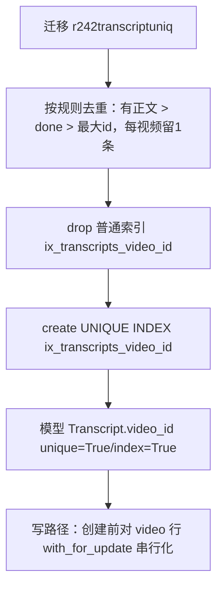
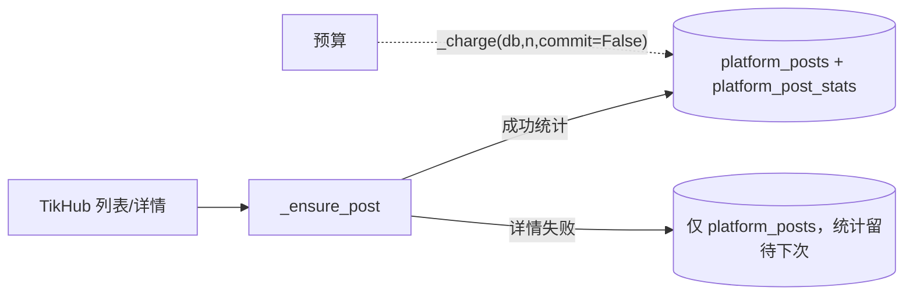

# R-242 开发设计：修复性能优化复核中发现的既有缺陷

- **对应需求**：`requirements/R-242-review-bugfixes.md`
- **日期**：2026-10-31
- **状态**：✅ 已按本文实现（2026-10-31，verify 全绿）
- **前置**：R-240/R-241 复核报告（`.tmp/audit/REVIEW.md` / `REVIEW-R241.md` / `IDEMPOTENCY-AUDIT.md`）
- **原则**：最小改动、每项配回归测试、不动无关逻辑；接口契约/前端零改动

## 1. 开发背景

复核记录 4 个既有缺陷（详见需求 §1）：转写表「文档说唯一、DB 实际非唯一且已有 5 组重复」；批量同步单条失败 `rollback()` 丢整批；无主博主时 plans 接口 500；抖音创作者同步逐请求计费写放大。本次只修这 4 项。

## 2. 涉及的技术

| 技术 | 用途 |
|---|---|
| Alembic | 新 revision：清理 transcripts 重复 + 普通索引改唯一索引 |
| SQLAlchemy ORM | `Transcript.video_id unique=True` 与 DB 对齐；批量同步写路径重构；`with_for_update` 串行化转写创建 |
| 现有预算模块 | `_charge(db, count, *, commit=True)` 增加可选 commit（批量模式不提前提交） |
| pytest | 新增 `tests/test_r242_fixes.py` 回归 |

无新增依赖、无接口变更。

## 3. 开发流程图

### 3.1 转写唯一化



### 3.2 批量同步单条失败隔离

```mermaid
flowchart TD
    A[_ensure_post(commit=False)] --> B[先拉单条统计（列表未带时）]
    B -->|成功| C[_charge(commit=False)]
    B -->|失败| D[记 warning，统计=None，不 rollback]
    C --> E[写/更新 PlatformPost + 统计]
    D --> E
    E --> F{commit?}
    F -->|True| G[db.commit]
    F -->|False| H[交给批量调用方统一 commit]
```

## 4. 数据流转图



## 5. 实现细节

### 5.1 转写稿一视频一条

- **迁移**（`alembic/versions/r242_transcript_unique.py`，revision `r242transcriptuniq`，down_revision `r241perftz`）：
  - 去重 SQL（窗口函数）：按 `video_id` 分区，保留顺序 = `corrected_text/transcript_text 非空优先` → `asr_status='done' 优先` → `id DESC`；其余行删除。
  - `DROP INDEX ix_transcripts_video_id`；`CREATE UNIQUE INDEX ix_transcripts_video_id ON transcripts(video_id)`。
  - downgrade：删唯一索引、恢复普通索引（数据清理不可逆，注释说明）。
- **模型**：`Transcript.video_id` 改 `ForeignKey("videos.id"), unique=True, index=True`（与迁移一致，避免 autogenerate 假差异）。
- **写路径并发安全**：所有「不存在才创建」的转写写入点，在判断前 `db.refresh(video, with_for_update=True)` 锁定视频行（PG 行锁），保证同视频并发创建串行：
  - `services/ingest._post_asr_llm._correct_and_store`（自动转写成功落稿）；
  - `services/ingest.import_video_task` 失败落 `asr_status=failed` 分支；
  - `api/videos.py` PATCH 手动写入 source/corrected 分支；
  - `api/works.py` 云端转本地时写 source/corrected 分支。
- 唯一约束兜底：极端并发仍冲突时，写入方捕获 `IntegrityError` → 重新读取已存在行并更新（不向用户抛 500）；本次至少覆盖 `ingest` 路径，API 手动写路径加行锁后冲突概率可忽略。
- **数据来源不变**：仍读 `transcripts` 表；读取口径 `corrected_text or transcript_text` 不变。

### 5.2 批量同步失败隔离

- `platform_sync._ensure_post` 重排为「先外部取数、后写库」：
  1. `stats = post.stats or (拉详情)`；拉详情异常（非 BudgetExceeded）→ `log.warning("单条统计获取失败（不影响作品入库）…")`，`stats=None`，**不再 `db.rollback()`**；
  2. 作品行创建/更新（原字段规则逐行保留）；
  3. `stats` 非空时 `_write_stat(..., commit=False)`；
  4. `commit=True` 时 `db.commit()`。
- `budget._charge` 增加 `*, commit: bool = True`：savepoint 成功后可选择不立即提交（批量模式把提交交给调用方统一做）；默认行为不变。
- 语义变化：单条详情失败从「整条作品回滚（实际丢数据）」改为「作品入库、统计缺失」（符合函数注释「单条失败不中断」）；预算异常仍抛出。
- 封面下载/批量预加载/进度逻辑不变。

### 5.3 无主博主 plans 空列表

- `api/douyin_review.plans`：`try: owner = service.current_owner(db) except ValueError: return {"items": []}`；其余逻辑不变（有主博主时仍走原查询分支）。
- 不改 `current_owner` 本身（其它接口依赖其「无主博主报错」语义）。

### 5.4 计费事务合并

- `douyin_creator_sync._charge_requests`：
  - `n = max(0, client.requests_used - before)`；`n<=0` 直接返回；
  - `budget = get_budget(db)`；`charge_n = min(n, max(0, budget["remaining"]))`；
  - `charge_n>0` 时 `_charge(db, charge_n)` **一次**；`charge_n<n` 时 `log.warning("预算剩余不足，仅计费 x/y 次")`；
  - 异常仍只记 warning，不覆盖主流程错误。
- 语义：净计费金额 = min(本次请求数, 剩余额度)（与旧循环累计一致），事务数从 N → 1；不改请求/重试逻辑。

## 6. 新增/修改表结构

| 表 | 变更 | 说明 |
|---|---|---|
| `transcripts` | `ix_transcripts_video_id` 由普通索引改为 **UNIQUE** 索引；迁移中清理历史重复行（5 组→5 条） | `video_id` 已有外键；不新增列 |
| 无其它表结构变更 | — | 无新表、无新列 |

Alembic revision `r242transcriptuniq`（down_revision `r241perftz`）；`docs/DATABASE.md` 同步「video_id 唯一」。

## 7. 新增/修改接口

**无新增路由、无请求/响应字段/错误码变更。** 唯一行为变化：`GET /api/douyin-review/plans` 在无主博主时由 500 改为 200 + 空列表。

## 8. 数据来源与原始字段明细

| 数据 | 来源 | 原始字段 | 落库/使用 | 说明 |
|---|---|---|---|---|
| 转写稿 | ASR Provider / 手动编辑 / 云端转本地 | `transcript_text`/`corrected_text`/`asr_status`/`asr_provider`/`asr_model` | `transcripts`（现在每 video 1 行） | 迁移去重保留规则见 §5.1；读取口径不变 |
| 平台作品/统计 | TikHub 列表 + 单条详情 | `platform_post_id/title/desc/cover/publish_time/stats` | `platform_posts` / `platform_post_stats`（同日唯一） | 详情失败时作品照常入库、统计缺失 |
| 改进计划列表 | 现有表 | `video_improvement_plans` join `video_reviews`，按当前主博主抖音账号过滤 | 只读 | 无主博主返回空 |
| 预算计数 | 现有表 | `app_kv(tikhub_budget_used:YYYY-MM-DD)` | N 次请求合并 1 次原子加 | 不超发/不丢计费语义不变 |

## 9. 实施记录与验证（2026-10-31）

- **迁移**：`r242transcriptuniq` 已在本机 dev/echo_test 应用；dev 库重复视频 5→0，`transcripts` 600→595 行，`ix_transcripts_video_id` unique=true。
- **回归测试**（`backend/tests/test_r242_fixes.py`，7 例）：唯一索引/重复插入被拒；ASR 落稿重复调用只更新一行；3 线程并发落稿只 1 行；批量同步第 2 帖详情失败 → 两帖均入库、第 1 帖有统计、无异常；单帖详情失败 → 作品仍入库；无主博主 plans 返回空列表；`_charge_requests` 7 请求=1 次计费、剩余 3 时只计 3、无增量不调用。
- **兼容性适配**：R-240 的 `test_unit_text_map_work_fallback_and_highest_transcript` 原构造「一视频多转写」用于测试取最大 id；R-242 唯一约束后该数据不可能存在，测试改为「本地视频优先 + 同 work 兜底」，并保留代码侧防御逻辑（历史脏数据已迁移清理）。
- **行为变化（均为修复）**：①重复转写不再可能；②批量同步单条详情失败从「丢整批/丢当前作品」→「作品入库、统计缺失」；③无主博主 plans 500→200 空列表；④计费事务 N→1（金额不变）。
- **验证**：`scripts/verify.sh` 全绿（ruff/mypy/pytest 全量/前端 145+build/docs）。
