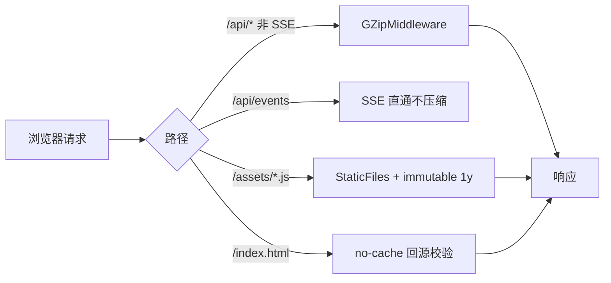
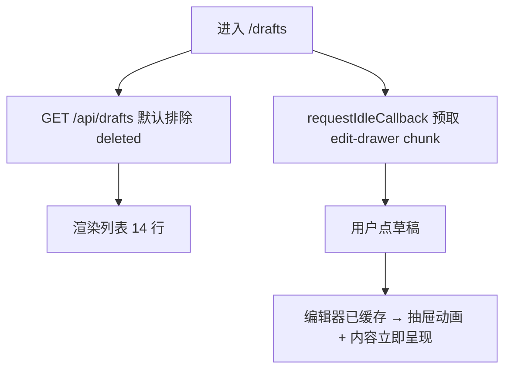

# R-243 开发设计：前端性能优化（传输/图片/首屏渲染/闪屏与组件乱动）

- **对应需求**：`requirements/R-243-frontend-perf.md`
- **日期**：2026-10-31
- **状态**：✅ 已按本文实现（2026-10-31，verify 全绿，生产构建 Playwright 复测通过）
- **审计输入**：`.tmp/audit/frontend-shell.md`（P0 TagRow/context/侧栏）、`frontend-media.md`（滚动 CLS/草稿 483KB/tiptap/每键成本）、`frontend-dashboard.md`（无 gzip/图片原图/骨架/backdrop）；实测脚本与 JSON 同目录
- **原则**：逻辑/字段/排序/动画参数全部不变；只做性能等价改造 + 传输层/缩略图；允许后端只读接口加可选瘦身参数

## 1. 开发背景

三路只读审计 + Playwright（生产构建 :8000）确认：首屏静态 740KB 无压缩、图片原图直出（对标 4.25MB/管理 4.2MB）、侧栏首帧 width 动画使四页 CLS≈0.05、「persona TagRow 组件内定义」导致 46 行重挂、草稿页首开加载 tiptap 600KB、列表 483KB（79% 已删除）、chat 66 chunk/s 全量渲染。后端已具备缩略图（`/covers?w=400` 已预热 1960 张）与 gzip 能力（未启用），属于低风险大收益项。

## 2. 涉及的技术

| 技术 | 用途 |
|---|---|
| Starlette `GZipMiddleware`（或自定义跳过 SSE） | 全站传输压缩 |
| `StaticFiles` 子类 | hashed 资源 immutable / index.html no-cache |
| FastAPI Query 参数 | `/api/drafts?include_deleted=`、`/api/works?slim=`（默认行为不变） |
| Pillow 缩略图（已有 `core/thumbs.py`） | `?w=160/400`；生成失败回退已预热 w400 |
| React 19 / TanStack Query 5 / framer-motion | 组件身份稳定、按需加载、流式批量刷新；动画参数不动 |
| Playwright + PerformanceObserver | 修复前后对比（CLS/LCP/传输字节/长任务/DOM mutation） |

## 3. 开发流程图

### 3.1 传输与图片


### 3.2 缩略图
```mermaid
flowchart TD
  A[/covers/name?w=W] --> B{thumbs/name.wW.jpg 存在?}
  B -->|是| C[返回缩略图 + Cache-Control]
  B -->|否| D[make_thumb 生成]
  D -->|成功| C
  D -->|失败| E{thumbs/name.w400.jpg 存在?}
  E -->|是| F[返回 w400 缩略图]
  E -->|否| G[回退原图]
```

### 3.3 草稿页首屏


## 4. 数据流转图

```mermaid
flowchart LR
  S[(platform_post_comments/posts 封面)] --> T[/covers 原图]
  T -->|w=400/160| U[thumbs 缓存]
  U --> V[前端卡片/时间线/头像]
  W[(drafts)] -->|默认排除 deleted| X[/api/drafts]
  X --> Y[脚本工作台列表]
  Z[(works/posts)] -->|slim=1 不含 posts 明细| AA[/api/works]
  AA --> AB[博主管理时间线]
```

## 5. 实现细节

### 5.1 后端传输层（`backend/app/main.py`、`core/thumbs.py`）
- **GZip**：`app.add_middleware(GZipMiddleware, minimum_size=1024)`；为避免 SSE 缓冲，自定义 `SkipPathGZipMiddleware`：`/api/events` 路径直接放行（或检查 `Accept`），其余走标准 gzip；验证 `text/event-stream` 仍逐条到达。
- **静态缓存**：`CachedStaticFiles(StaticFiles)`：
  - 路径以 `assets/` 开头（Vite hash 文件名）→ `Cache-Control: public, max-age=31536000, immutable`；
  - 其它（`index.html`、favicon 等）→ `Cache-Control: no-cache`（每次回源，发版即时生效）；
  - `/covers`、`/uploads`、`/media` 静态挂载 → `public, max-age=86400`（响应已带/可带）。
- **缩略图回退**：`cover_file` 在 `make_thumb` 未产出目标宽度时，依次尝试已预热 `w=400` 缩略图，再回退原图；不改变 200/404 语义与文件内容语义（仅选择更小文件）。
- **`/api/drafts`**：新增 `include_deleted: bool = False`；默认 `q.filter(Draft.status != "deleted")`。显式 `status=deleted` 或 `include_deleted=true` 时仍可查（兼容内部脚本/测试）。响应字段不变。
- **`/api/works`**：新增 `slim: bool = False`；true 时每条 item 去掉 `posts`（置空数组）并保留 `type/id/title/creator_id/cover/platforms`；默认 false 行为逐字段不变（其它调用方不受影响）。

### 5.2 前端图片与布局（`lib/covers.ts`、benchmark/creators/timeline）
- 复用 `coverThumb(url,w)`：仅对 `/covers/` 本地路径加 `?w=`（远程 URL 原样）；由 `pages/videos/types.ts` re-export 保持旧 import 兼容。
- 尺寸：素材卡 400（现状）；对标封面 400；时间线 46px→160；头像 40px→160；帖子网格 400。全部保留 `loading="lazy"`/固定 `aspect` 容器，新增 `decoding="async"`。
- 对标页徽标去掉 `backdrop-blur-sm`（`bg-black/45` 底色保留）。
- 时间线仅加图片缩略/`decoding`，动画节点与 `motion.button` 不动。

### 5.3 首屏闪屏/组件乱动
- `components/layout/sidebar.tsx`：`motion.aside` 增加 `initial={false}`（去掉首帧 width 动画；收起/展开 spring 完全保留）。
- `pages/persona/index.tsx`：把 `TagRow` 移到模块顶层，props 显式接收 `t/picking/selected/onToggle/onDecide/onEdit/onDelete`；`motion.div layout/variants/exit` 原样。父级用 `useCallback` 稳定回调（或直接传稳定 setter），避免整列表重挂。
- `components/ui/tabs.tsx`：`TabsCtx.Provider value` 用 `useMemo`（仅性能等价）。
- 骨架高度对齐真实内容：首页灵感行、对标博主区、博主管理卡片按真实高度调整（纯占位样式，无动画变化）。
- 不改 `lib/motion.ts` 页面转场（blur 淡入保留原样）。

### 5.4 素材库滚动 CLS（`pages/videos/index.tsx`、`material-card.tsx`）
- IntersectionObserver `rootMargin: '600px 0px'` → `'1200px 0px'`（提前一屏预取，减少追加与视口位移重叠；请求仍按页触发）。
- `containIntrinsicSize: 'auto 300px'` → `'auto 356px'`（实测卡片均值 356；视觉不变，稳定 scrollHeight）。
- 校验：Playwright 连续滚 10 批 CLS 从 0.237 降至 <0.02；若仍不足再评估 sticky 尾部（需视觉确认，不在本批）。

### 5.5 脚本工作台（`pages/drafts/*`、`pages/videos/edit-drawer.tsx`）
- 抽 `pages/drafts/edit-state.ts`（`DraftEditState`/`EMPTY_DRAFT`），`index.tsx` 不再静态 import 编辑器；`const DraftEditDrawer = lazy(() => import('./edit-drawer').then(m => ({default: m.DraftEditDrawer})))`，`Suspense fallback={null}`；页面挂载后 `requestIdleCallback`（不支持则 `setTimeout 1200`）预取 chunk。抽屉动画组件本身不变。
- `script-editor.tsx`：`lastEmittedRef` 记录自身 `onUpdate` 发出的 markdown；外部 value 同步 effect 先比较该 ref，命中则跳过第二次 `getMarkdown()`；AI 回填/切稿路径不变。
- `autosave.ts`：`schedule()` 仍立刻置 `dirty`，但 `draftFingerprint` 与 `storage.write` 移入 900ms 定时器回调；`flush()` 保持立即写。自动保存网络语义不变（防抖 900ms、单飞队列）。
- `drafts/edit-drawer.tsx`：关联素材下拉改用模块级 60s 缓存（`apiJson('/api/videos?limit=500')` 首次拉取）；抽屉打开时其余请求保持并行。
- `/api/drafts` 默认已排除 deleted（后端），前端无需改动。

### 5.6 视频页（`pages/videos/edit-drawer.tsx`、`pages/video-review/index.tsx`）
- 视频编辑抽屉：详情与关联草稿 `Promise.all`；转写轮询 effect 增加 `open` 条件（关闭即停、重开续）。
- 视频复盘首屏：`latest-review` 与 `references` 改 `Promise.all`（两者无数据依赖，失败互不影响）；数据与渲染顺序不变。

### 5.7 chat（`pages/chat/index.tsx`）
- 流式：累积 delta，`requestAnimationFrame`/50ms 合并 flush 一次 setState；最终仍写入完整文本（内容逐字一致）；`scroll()` 合并到每帧一次。
- 切会话：`Promise.all([history, actions])` + `loadSeq` 序号守卫丢弃过期响应；不主动清空旧消息（避免视觉跳变）。
- 消息行保持现有动画与 DOM 结构。

### 5.8 博主管理轮询（`pages/creators/index.tsx`）
- jobs 查询 `refetchInterval`：存在 running 任务时 4000ms，否则 15000ms（进行中状态展示语义不变，靠 SSE 仍可即时更新）。

## 6. 新增/修改表结构

**无表结构变更**（无新列/新表/迁移）。仅查询层新增可选过滤参数。

## 7. 新增/修改接口

| 方法/路径 | 变化 | 请求 | 响应 | 错误 |
|---|---|---|---|---|
| `GET /api/drafts` | 新增可选 `include_deleted: bool = false` | 默认不含逻辑删除草稿；`include_deleted=true` 或 `status=deleted` 可查 | 字段不变 | 不变 |
| `GET /api/works` | 新增可选 `slim: bool = false` | 默认不变；`slim=1` 每条 item 的 `posts` 为空数组（其余字段不变） | 默认逐字段不变 | 不变 |
| 所有 HTTP 响应 | 传输层 | 浏览器支持时 gzip | body 语义不变；SSE `/api/events` 不压缩 | 不变 |
| `GET /covers/{name}?w=` | 生成失败时回退 w400 缩略图 | 同前 | 仍是封面图片（更小尺寸） | 404 不变 |

## 8. 数据来源与原始字段明细

| 数据 | 来源 | 原始字段 | 落库/使用 | 说明 |
|---|---|---|---|---|
| 封面/头像 | 平台同步下载 → `data/covers/` | 原图文件 | `/covers/<name>`；`?w=` 生成 `thumbs/<name>.wW.jpg` | 仅传输尺寸变化；生成失败回退 w400/原图 |
| 草稿列表 | DB `drafts` | `id/title/script/quality/...` | `/api/drafts` | 默认 `status != deleted`，字段不变 |
| 云作品（时间线） | DB `works/platform_posts` | `id/title/cover/platforms/posts` | `/api/works?slim=1` | 时间线只用顶层字段，posts 明细为空数组，渲染行为不变（当前本就未渲染云端事件） |
| 视频复盘参考 | DB 复盘/对标 | 现有字段 | 并行 GET | 数据/顺序不变 |
| chat 流 | 后端 SSE | `delta/step/...` | 前端按帧合并 setState | 最终文本逐字一致 |

## 9. 验证方式

1. 后端：pytest（新增 gzip/静态缓存/drafts 过滤/works slim/缩略图回退测试）+ `scripts/verify.sh`。
2. 前端：`npm run lint` / `typecheck` / `test` / `build`（含在 verify.sh）。
3. 生产构建 Playwright 对比（同一探针、同数据）：四页 CLS（目标 <0.02）、首开传输（草稿页 ≤250KB；对标/管理图片 ≤1.2MB/1.5MB）、gzip header、`/api/drafts` 默认响应行数/字节、chat 4× CPU 长任务（目标 ≤2）、persona「多选」长任务（<20ms）、素材库滚动 10 批 CLS（<0.02）、各页 console 0 错误、关键截图。
4. 交互冒烟：开草稿抽屉（编辑器加载/自动保存）、聊天发一条 mock、切会话、素材库滚动、时间线/对标页图片加载。

## 10. 兼容性与回退

- gzip：SSE 跳过；`/api/events` 逐事件验证；不支持 gzip 的客户端自动返回未压缩（标准协商）。
- 静态缓存：`index.html` no-cache，发版即生效；hashed 资源内容变化文件名即变，安全。
- 接口参数均为可选、默认行为不变：其它调用方零影响。
- 缩略图回退只影响「目标宽生成失败」的环境（如写权限受限），正常生成环境行为不变。
- 每项改动可独立回退；`feat/r243-frontend-perf` 单 commit。

## 11. 实施记录与实测对比（2026-10-31）

### 11.1 落地清单

| 项 | 实现 |
|---|---|
| 传输压缩 | `main.py` 启用 `GZipMiddleware(minimum_size=1024)`；SSE 由 Starlette 默认排除（实测 `/api/events` 200、`content-type: text/event-stream`、无 `content-encoding`、15s keep-alive 正常） |
| 静态缓存 | `_CachedStaticFiles`：`assets/*` `public, max-age=31536000, immutable`；`index.html` `no-cache`；covers/uploads/media 1 天 |
| 缩略图 | `coverThumb` 抽到 `lib/covers.ts`；对标 400 / 时间线 160 / 头像 160 / 帖子 400；`/covers?w=` 生成失败回退 w400（实测本机 w160 请求返回 w400 27KB，而非 294KB 原图） |
| 侧栏闪动 | `initial={false}`；首帧 `aside` 宽度恒 216（采样 6 帧全 216） |
| persona 重挂 | `TagRow` 提升模块级 + 显式 props；动画参数原样 |
| 草稿首屏 | `edit-state.ts` 抽取 + `lazy` 抽屉 + `drawerMounted` 首次打开才挂载 + 空闲（或 1.2s）预取；实测未打开时页面渲染不等 tiptap，打开后编辑器正常挂载 |
| 草稿列表 | `/api/drafts` 默认排除 deleted（实测 483,517B→104,711B、132→14 行；gzip 30,224B） |
| 每键成本 | `script-editor` `lastEmittedRef` 去掉第二次 `getMarkdown`；autosave 指纹/localStorage 写移到防抖内（21 条测试通过） |
| 素材库滚动 | rootMargin 600→1200 + intrinsic 300→356 + 底部提示/计数改 `sticky bottom=0` 贴底栏；实测 14 次滚轮滚到 120 卡，滚动 CLS 仍 ≈0（基线 10 批 0.237） |
| chat | rAF 合并 chunk 刷新（最终文本逐字一致）+ 切会话 `Promise.all`/`loadSeq` 守卫；滚动每帧≤1、仅近底跟随 |
| 其它 | 视频复盘首屏并行；视频抽屉并行 + 轮询 open 门控；博主管理 jobs 空闲 15s/进行中 4s；`/api/works?slim=1` 时间线（1,638,521B→122,301B）；对标徽标去 backdrop-blur（90→2 层） |
| Tabs | context value `useMemo` |

### 11.2 生产构建实测对比（Playwright Chromium 1440×900，:8000）

| 页面/指标 | 修复前 | 修复后 |
|---|---|---|
| 首页传输 / CLS | 855KB / 0.047 | 301KB / 0.000 |
| 素材库传输 / CLS | 556KB / 0.055 | 471KB（图片已缩略至 425KB）/ 0.0001 |
| 视频复盘传输 / CLS | 926KB / 0.047 | 33KB / 0.000 |
| 草稿页传输 / CLS | 1,143KB / 0.047 | 257KB / 0.000（tiptap 空闲预取，不阻塞首屏） |
| 对标页传输 / 图片 | 5,370KB / 4,253KB | 1,280KB / 1,156KB（-73%） |
| 博主管理传输 / 图片 / CLS | 6,275KB / ~3.6MB / 0.056 | 949KB / 901KB / 0.0081 |
| 素材库滚动 10 批 CLS | 0.237 | ≈0（14 次滚轮 20→120 卡） |
| 各页 console 错误 | — | 0 |

### 11.3 有意行为变化（均在需求文档 §4 范围内）

- 草稿编辑器：进入页面不阻塞加载，空闲预取（用户已授权「未打开不阻塞」目标；若用户长期不点开，会额外预取约 150KB gzip 资源，换取点开秒开；如需彻底不预取可去掉 idle 回调）。
- autosave 本地副本从「每键写」改为「900ms 防抖后写」，断网极端情况最多丢 900ms 内改动（与需求 §4 口径一致）。
- 素材库底部提示/计数改为贴底常显（消除滚动时被新卡顶出视口的位移；文案/计数逻辑不变）。
- chat 向上翻历史时流式不再强制拽回底部（发送/加载仍强制滚底）。
- `/api/drafts` 默认不会返回逻辑删除草稿（可 `include_deleted=true` 或 `status=deleted` 查询）；`/api/works?slim=1`、`?w=160` 为可选参数，默认行为不变。

### 11.4 未做/后续（记录）

- `/api/benchmark/top` 的 44 条完整文案（约 280KB，占响应 92.9%）仍随首屏返回；改为展开时懒加载需新增按 unit 取文案接口（gzip 后 114KB，收益低于本批，留作后续）。
- `/api/prompts/keys` 99KB、`/api/platform/jobs` 44KB 轮询瘦身、prompts 页面按 tab 拆分/memo、`useActiveWork` context 拆分、benchmark 文案懒加载、页面转场去 blur（需作者确认动画）等列入后续性能批次。
- 本机数据目录无写权限导致任意宽度缩略图无法即时生成，已通过「回退 w400」保证收益；生产环境（有写权限）w160 会即时生成，时间线/头像进一步更小。
