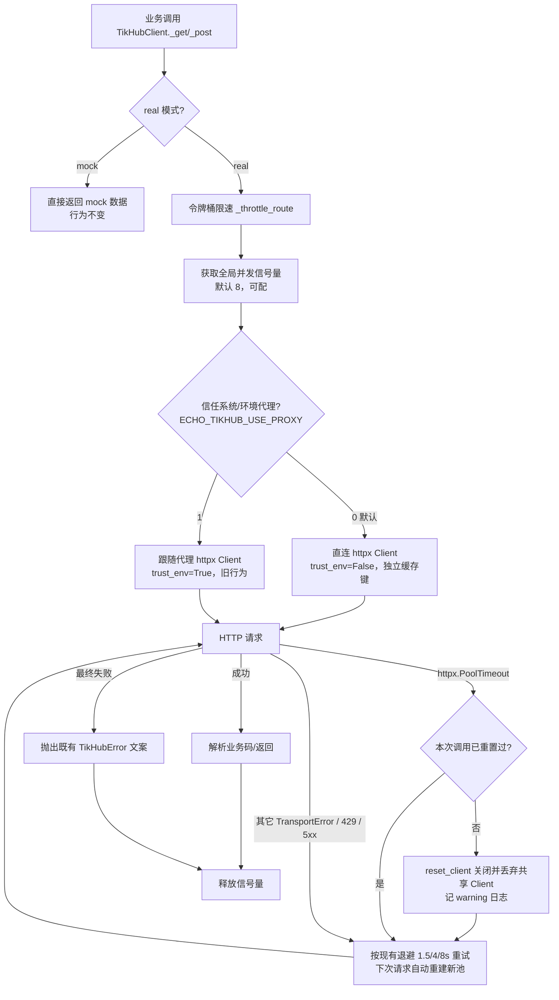
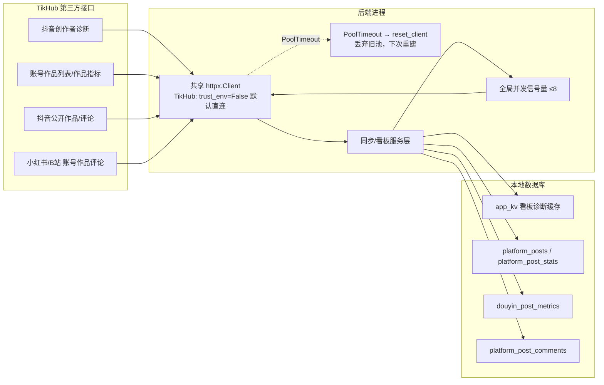

# R-246 开发设计：TikHub 请求不再因共享连接池卡死而整体失败

- **对应需求**: `requirements/R-246-tikhub-pool-stability.md`
- **日期**: 2026-11-04
- **状态**: ✅ 已按本文实现（2026-11-04，verify 全绿 + 真实联调）
- **前置**: R-241（进程级共享 httpx Client）、R-222（同步并发）、R-163（TikHub 限速/重试）
- **原则**: 最小改动、只修连接池稳定性；不改前端/表结构/接口契约/其它服务代理行为；每项配回归测试；`verify.sh` 全绿

## 1. 开发背景

TikHub 数据是看板/作品分析/博主与素材库同步的唯一数据源。2026-11-02 09:00 起，全部 TikHub 请求约 94 秒后失败：

```
TikHub 请求失败（已重试 3 次）: PoolTimeout:
```

已取证根因（见需求 §现状核对）：

1. `backend/app/core/http.py` 为所有 TikHub 请求提供**进程级共享 httpx.Client**，连接池 `max_connections=16`；
2. httpx `trust_env=True` 在 macOS 读取**系统代理**（Clash `127.0.0.1:7890`），TikHub 实际走 CONNECT 隧道；
3. 「同步 Top15」会并行拉起 12 个账号任务 × 单账号 5 并发 ≈ 峰值 60 并发；
4. httpcore 1.0.9 `TunnelHTTPConnection` 在 CONNECT 之后 TLS 升级失败时不会回收槽位：连接停在 ACTIVE、socket 已关闭、`_connected=False`、`_connect_failed=False`，池永不判关闭；
5. 16 个槽位泄漏完后连接池永久坏死，只能重启后端；
6. 泄漏与同步风暴/代理抖动相关，非 TikHub 服务端、key、Cookie 或额度问题（独立进程直连真实接口 1.77s 成功）。

本次修复三点：**TikHub 直连（去掉隧道依赖）+ 全局限并发（不再制造风暴）+ PoolTimeout 时重置共享 Client（自愈，不再需要人工重启）**。

## 2. 涉及的技术

| 技术 | 用途 |
|---|---|
| httpx 0.28.1 / httpcore 1.0.9 | 现有 HTTP 客户端；`trust_env` 控制是否读取系统/环境代理；`httpx.PoolTimeout` 作为自愈触发信号 |
| Python `threading.BoundedSemaphore` | 进程级 TikHub 并发闸门（跨线程共享） |
| `contextlib.contextmanager` | 请求槽位获取/释放封装 |
| pydantic-settings（现有 `config.py`） | 新增 `tikhub_use_proxy`、`tikhub_max_concurrency` 两个配置项 |
| pytest + monkeypatch | 自愈/并发/开关回归测试 |
| 现有 `core.log.get_logger` | 重置与失败日志 |

无新增第三方依赖、无 DB 迁移、无前端改动。

## 3. 开发流程图



## 4. 数据流转图



说明：本次不改任何落库字段与更新时机，只改「怎么连 TikHub」和「连不上时怎么恢复」；数据库数据流与 R-244/R-239 完全一致。

## 5. 实现细节

### 5.1 `backend/app/core/http.py`：Client 支持代理开关 + 可重置

**5.1.1 缓存键与签名**

```python
_CLIENTS: dict[tuple[str, bool, bool], tuple[httpx.Client, type]] = {}

def get_client(
    base_url: str = "",
    *,
    timeout: httpx.Timeout | float | None = None,
    follow_redirects: bool = False,
    trust_env: bool = True,          # 新增：是否读取系统/环境代理；默认 True 保持其它服务现状
) -> httpx.Client:
    key = ((base_url or "").rstrip("/"), bool(follow_redirects), bool(trust_env))
    ...
    client = httpx.Client(
        timeout=timeout if timeout is not None else _DEFAULT_TIMEOUT,
        follow_redirects=follow_redirects,
        limits=_DEFAULT_LIMITS,
        trust_env=trust_env,          # 新增
    )
```

- 现有调用全部不传 `trust_env` → 默认 `True`，缓存键多一位但同一调用方仍复用同一 Client（DeepSeek/联网搜索/CDN 行为不变）。
- 新增 `reset_client`：

```python
def reset_client(base_url: str = "", *, follow_redirects: bool = False, trust_env: bool = True) -> bool:
    """从缓存移除并关闭指定 Client；下次 get_client 会重建全新连接池。"""
    key = ((base_url or "").rstrip("/"), bool(follow_redirects), bool(trust_env))
    with _LOCK:
        entry = _CLIENTS.pop(key, None)
    if entry is None:
        return False
    try:
        entry[0].close()
    except Exception:  # noqa: BLE001 关闭失败不影响重建
        pass
    return True
```

- 锁外 close（避免持锁阻塞其它线程取 Client）；`close_all()` 语义不变。
- 说明：测试里 monkeypatch `httpx.Client` 的「类身份变化即丢弃」逻辑保持不变。

**5.1.2 兼容性**

- `tests/test_r241_sync_http.py::test_core_http_reuses_client_per_key` 等既有用例默认 `trust_env=True` 路径不变，仍通过。
- `test_tikhub_http_uses_shared_client` 需要同步改为 `get_client(client.base_url, follow_redirects=True, trust_env=False)`（因为 TikHub 改直连，见 5.2）。

### 5.2 `backend/app/services/platform/tikhub.py`：直连 + 并发闸门 + 自愈

**5.2.1 `_http()` 直连（默认）**

```python
def _http(self) -> httpx.Client:
    from ...core.http import get_client
    from ...config import get_settings

    return get_client(
        self.base_url,
        follow_redirects=True,
        timeout=httpx.Timeout(connect=20, read=12, write=60, pool=20),
        trust_env=bool(get_settings().tikhub_use_proxy),  # 默认 False → 直连
    )
```

- 默认不走系统/环境代理 → 不产生 CONNECT 隧道，从根上消除 `TunnelHTTPConnection` 泄漏路径。
- `ECHO_TIKHUB_USE_PROXY=1` 时回到旧行为（Redis 网络受限环境的兜底）；此时仍有泄漏风险，由 5.2.3 自愈 + 5.2.2 并发上限兜底。

**5.2.2 全局并发闸门**

模块级（与现有令牌桶并列，惰性构建，`.env` 改动需重启生效，与其它配置一致）：

```python
_SEMAPHORE: threading.BoundedSemaphore | None = None
_SEMAPHORE_LOCK = threading.Lock()

def _request_semaphore() -> threading.BoundedSemaphore:
    global _SEMAPHORE
    if _SEMAPHORE is None:
        with _SEMAPHORE_LOCK:
            if _SEMAPHORE is None:
                limit = max(1, min(64, int(get_settings().tikhub_max_concurrency or 8)))
                _SEMAPHORE = threading.BoundedSemaphore(limit)
    return _SEMAPHORE

@contextmanager
def _request_slot() -> Iterator[None]:
    sem = _request_semaphore()
    sem.acquire()
    try:
        yield
    finally:
        sem.release()
```

- 只包住**真正发 HTTP 请求**的那一行（`self._http().get/post(...)`）；重试退避 `time.sleep`、限速令牌桶等待、响应解析均在槽位外，避免占着并发额度空转。
- `_reset_limiter()`（测试专用，R-151 已存在）同时清空信号量，保证用例隔离。
- 阈值规则：默认 `8`；环境变量 `ECHO_TIKHUB_MAX_CONCURRENCY` 允许 1~64，越界/非法回退 8。
- 影响面：所有 TikHub 调用（看板/作品/同步/榜单）共用该闸门，等价于「全进程 TikHub 在途请求 ≤ 8」。

**5.2.3 PoolTimeout 自愈**

`_get` / `_post` 的 `try` 块增加对 `httpx.PoolTimeout` 的独立分支（注意 `PoolTimeout` 是 `TransportError` 子类，必须先捕获）：

```python
reset_done = False
for attempt in range(1, _MAX_ATTEMPTS + 1):
    _throttle_route(path)
    self._bump_request()
    try:
        with _request_slot():
            resp = self._http().get(url, params=params, headers=headers)
    except httpx.PoolTimeout as exc:
        last = f"{type(exc).__name__}: {exc}"
        last_exc = exc
        if not reset_done:
            reset_done = True
            from ...core.http import reset_client

            if reset_client(self.base_url, follow_redirects=True, trust_env=use_proxy):
                log.warning(
                    "TikHub 连接池 PoolTimeout，已重置共享连接池后重试（%s，第 %d/%d 次）",
                    path, attempt, _MAX_ATTEMPTS,
                )
    except httpx.TransportError as exc:  # 现有逻辑不变
        last = f"{type(exc).__name__}: {exc}"
        last_exc = exc
    else:
        ...现有成功/4xx/429/5xx 处理不变...
    if attempt < _MAX_ATTEMPTS:
        time.sleep(_RETRY_DELAYS[min(attempt - 1, len(_RETRY_DELAYS) - 1)])
```

- 触发条件：仅 `httpx.PoolTimeout`（连接池排队超时）；其它超时/连接错误维持现有重试语义。
- 上限：每次 `_get`/`_post` 调用最多重置 1 次，避免「重置-再坏-再重置」抖动；重试次数仍为 4（首次 + 3 次）。
- 降级：重置后仍失败 → 沿用现有最终错误文案与异常链（`raise TikHubError(message) from last_exc`），任务按现有逻辑失败、页面保留上次数据。
- 并发安全：`reset_client` 在锁内摘除、锁外关闭。重置瞬间其它线程的在途请求可能收到 `ReadError/RemoteProtocolError`，它们各自按现有 `TransportError` 重试；这是「用一次抖动换整体自愈」的预期代价（比永久卡死到重启好）。
- 计费：`_bump_request()` 位置不变（每次实际尝试都计一次请求），预算语义不变。

**5.2.4 日志**

| 时机 | 级别 | 内容 |
|---|---|---|
| 触发重置 | WARNING | `TikHub 连接池 PoolTimeout，已重置共享连接池后重试（<path>，第 x/4 次）` |
| 重置未命中（已被其它线程重置） | WARNING | 同上但注明「连接池已被其它线程重置」 |
| 最终失败 | ERROR（现有） | 保持现有 `TikHub 请求失败（已尝试 N 次）：<path> <last>` |

### 5.3 `backend/app/config.py` + `.env.example`

```python
# R-246：TikHub 连接池稳定性
tikhub_use_proxy: bool = False        # 是否跟随系统/环境代理（默认 False=直连），ECHO_TIKHUB_USE_PROXY
tikhub_max_concurrency: int = 8       # 全进程 TikHub 并发上限（1~64），ECHO_TIKHUB_MAX_CONCURRENCY
```

`.env.example` 增加两行（带注释，默认值即推荐值）：

```
# R-246 TikHub 连接池稳定性
ECHO_TIKHUB_USE_PROXY=0       # 0=直连（默认，推荐）；1=跟随系统/环境代理（网络受限时用）
ECHO_TIKHUB_MAX_CONCURRENCY=8 # 全进程 TikHub 并发上限（1~64）
```

### 5.4 边界/异常/降级汇总

| 场景 | 行为 |
|---|---|
| 默认直连 | `trust_env=False`，不读系统/环境代理；其它服务不受影响 |
| 网络必须走代理 | `ECHO_TIKHUB_USE_PROXY=1` 恢复旧行为；并发闸门 + 自愈兜底 |
| `PoolTimeout` 第 1 次 | 重置共享 Client，记录 warning，继续重试 |
| `PoolTimeout` 第 2~4 次 | 按现有退避重试；最终失败沿用现有文案 |
| 重置时其它线程在途请求 | 可能失败一次，各自重试（可接受降级） |
| mock 模式 | 不经过 `_get/_post` 的 real 分支，行为完全不变 |
| 并发上限配置非法 | 回退 8（1~64 之外视为非法） |
| 预算 | 语义不变：按实际发出的请求次数计（含重试尝试），失败不额外计费 |

### 5.5 测试计划

新增 `backend/tests/test_r246_tikhub_pool.py`：

1. **`test_get_client_trust_env_cache_key`**：同 base_url、`trust_env=True/False` 返回不同 Client；同参数复用；`reset_client` 返回 True 后 `get_client` 生成新对象；未知 key 返回 False。
2. **`test_pool_timeout_resets_client_and_retries`**：构造 real 模式 `TikHubClient`，monkeypatch `_http` 返回 fake Client（第 1 次 `get` 抛 `httpx.PoolTimeout`，第 2 次返回 `200 {}`）；断言最终成功、`app.core.http.reset_client` 恰好调用 1 次、第 2 次请求使用重建后的 Client。
3. **`test_pool_timeout_gives_up_after_retries`**：fake Client 始终抛 `PoolTimeout`；断言最终抛 `TikHubError`（文案含「已重试 3 次」）、`reset_client` 只调用 1 次、请求尝试次数 = 4（`requests_used` 差值）。
4. **`test_tikhub_global_concurrency_cap`**：`ECHO_TIKHUB_MAX_CONCURRENCY=2` + `get_settings.cache_clear()` + `_reset_limiter()`；fake Client 的请求内 sleep 0.2s 并记录当前在途数；6 线程并发调用 `_get`；断言峰值 ≤2、全部成功。
5. **`test_tikhub_mock_mode_unaffected`**：mock 模式 `fetch_*` 不触发 HTTP / 不取信号量，返回值结构不变。
6. **兼容性适配**：更新 `tests/test_r241_sync_http.py::test_tikhub_http_uses_shared_client` 的断言为 `trust_env=False`；其余 R-151/R-241/R-242/TikHub 相关用例必须全绿。

手工验证：
- 真实环境连续点 2 次看板「更新数据」成功、`diagnosis_at` 前进；
- 手动「同步 Top15」12 个账号全部成功、日志无 `PoolTimeout`；
- （可选，仅本地 mock 压测）并发 60 个 mock 请求后读池状态，确认连接池不长期占满。

## 6. 新增/修改表结构

**无**。本需求只改内存中的 HTTP 客户端管理与配置读取：

| 项 | 结论 |
|---|---|
| 新表 / 新列 / 新索引 | 无 |
| Alembic revision | 无 |
| `docs/DATABASE.md` | 无需修改（表数量不变） |
| 新配置持久化 | 仅 `.env` / 环境变量，不入库 |

## 7. 新增/修改接口

**无新增/修改路由，无请求/响应/错误码变化。** 仅后端内部函数签名变化：

| 文件 | 函数 | 变化 |
|---|---|---|
| `app/core/http.py` | `get_client` | 新增关键字参数 `trust_env: bool = True`（默认保持旧行为） |
| `app/core/http.py` | `reset_client` | **新增**：`(base_url="", *, follow_redirects=False, trust_env=True) -> bool`，关闭并从缓存移除 Client |
| `app/services/platform/tikhub.py` | `TikHubClient._http` | 传入 `trust_env=settings.tikhub_use_proxy`（默认直连） |
| `app/services/platform/tikhub.py` | `TikHubClient._get` / `_post` | 增加并发槽位与 PoolTimeout 自愈分支；错误文案/重试次数/退避时间不变 |
| `app/services/platform/tikhub.py` | `_reset_limiter` | 测试专用：同时重置并发信号量 |

对外行为变化（用户可感知，均为修复）：TikHub 请求不再因池卡死而 100% 失败；TikHub 默认不走系统代理（`ECHO_TIKHUB_USE_PROXY=1` 可切回）。API 响应结构、状态码、错误文案不变。

## 8. 数据来源与原始字段明细（本次不改数据源，仅记录受影响链路）

| # | 业务链路 | 第三方接口（方法 + 路径） | 原始字段（节选） | 落库/去处 | 用途 | 更新时间 | 空值处理 |
|---|---|---|---|---|---|---|---|
| 1 | 看板账号诊断（`POST /api/douyin-dashboard/overview/refresh`） | POST `/douyin/creator_v2/fetch_author_diagnosis`（body：`cookie`） | `data.data.{Interact,NewFans,PlayCnt,PlayFinishRatio,PublishActivation}` 下 `OwnValue/SimilarValue/AuthorRank/SimilarCount` | `app_kv` 键 `douyin_dashboard:overview:{account_id}` 的 `diagnosis` + `diagnosis_at` | 账号总览 5 指标、同类对比、「数据更新至」 | 手动「更新数据」或自动刷新成功时 | 诊断为空 → 保留上次诊断 + warning；Cookie 失效 → 标记 blocked 并提示重新保存 |
| 2 | 看板账号作品快照（overview 刷新内） | POST `/douyin/creator_v2/fetch_item_list`（`cookie/start_time/end_time/count/fields=metrics,review,visibility/cursor`） | `items[].id/create_time/video_info.duration/metrics.view_count/like_count/comment_count/share_count/favorite_count/bounce_rate_2s/completion_rate_5s/completion_rate/avg_view_second/homepage_visit_count/avg_view_proportion/favorite_rate/...` | `platform_posts`（标题/描述/封面/发布时间）、`platform_post_stats`（播放/点赞/收藏/分享/评论）、`douyin_post_metrics`（私有指标逐日快照） | 看板 KPI/曲线、作品分析、视频复盘 | 每次同步成功时按当日快照写 | 只更新有值字段；缺失字段保持空，页面按现有「暂无数据」展示，不估算 |
| 3 | 作品分析「更新数据」（`POST /api/douyin-dashboard/works/{id}/refresh`） | POST `/douyin/creator_v2/fetch_item_overview_data`（`cookie/ids/fields=metrics,play_info,content_analysis`）+ GET `/douyin/app/v3/fetch_video_comments`（`aweme_id/count`） | `data.items[].metrics.*`；`comments[].text/digg_count/create_time/...` | `douyin_post_metrics`、`platform_post_stats`、`platform_post_comments` | 作品分析卡片、评论热词、评论管理 | 手动/自动作品刷新（6 小时 TTL，force 强制） | 单接口失败 → 任务失败并保留上次数据；非 force 且评论 6h 内复用（现有逻辑） |
| 4 | 平台同步（账号/作品/评论） | GET `/douyin/app/v3/handler_user_profile`、`/douyin/app/v3/fetch_user_post_videos`、`/douyin/app/v3/fetch_one_video_v2`、`/douyin/app/v3/fetch_video_statistics`、`/douyin/app/v3/fetch_video_comments`；小红书 `.../get_user_info`、`get_user_posted_notes`、`get_video_note_detail`、`get_note_comments`；B站 `fetch_user_info`、`fetch_user_post_videos_v2`、`fetch_video_detail`、`fetch_video_comments` | 账号 `user.*`；作品 `aweme_list[]`/`note`/`View` 的标题/描述/封面/发布时间/`statistics`（`play_count/digg_count/collect_count/share_count/comment_count`）；评论 `text/digg_count/create_time` | `creator_accounts` 与账号快照、`platform_posts`、`platform_post_stats`、`platform_post_comments` | 博主管理、素材库、时间线 | 每日定时 06:00/17:00 + 手动同步 | 单条失败不中断同批（R-242 语义）；空值不覆盖已有数据；失败账号在同步结果中列出 |
| 5 | 预算计数（现有逻辑不变） | 程序计算（实际请求次数） | 每次真实 HTTP 尝试计 1 次（`_bump_request`） | `app_kv` 键 `tikhub_budget_used:YYYY-MM-DD` | 每日额度控制（默认 2000） | 每次请求后按线程差值统一补记（R-242） | 超预算 → 抛现有 `BudgetExceeded`，不发起新请求 |

- **配置项来源**：`ECHO_TIKHUB_USE_PROXY` / `ECHO_TIKHUB_MAX_CONCURRENCY` 来自 `.env` / 进程环境变量（程序输入），不入库、不改原始字段。
- **更新/空值口径**：与 R-244/R-239 现有实现完全一致，本次不修改任何字段映射。

## 9. 实施记录与验证（2026-11-04）

### 9.1 改动文件

| 文件 | 改动 |
|---|---|
| `backend/app/core/http.py` | `get_client` 增加 `trust_env`（默认 True，纳入缓存键）；新增 `reset_client()`（锁内摘除、锁外关闭） |
| `backend/app/services/platform/tikhub.py` | `_http()` 默认 `trust_env=False`；新增全局并发信号量 `_request_slot()`；`_get/_post` 增加 `PoolTimeout` → `_reset_shared_pool()` 自愈 + warning 日志；`_reset_limiter()` 同步清空信号量 |
| `backend/app/config.py` | 新增 `tikhub_use_proxy: bool = False`、`tikhub_max_concurrency: int = 8` |
| `.env.example` | 新增 `ECHO_TIKHUB_USE_PROXY=0`、`ECHO_TIKHUB_MAX_CONCURRENCY=8` |
| `backend/tests/test_r246_tikhub_pool.py` | 新增 6 例回归（trust_env/reset、直连开关、自愈成功/耗尽、并发上限、mock 不受影响） |
| `backend/tests/test_r241_sync_http.py` | `test_tikhub_http_uses_shared_client` 按直连口径改为 `trust_env=False` |

### 9.2 自动化验证

- 定向测试：`pytest -q tests/test_r246_tikhub_pool.py tests/test_r151_tikhub_retry.py tests/test_r241_sync_http.py` → **29 passed**。
- 全量门禁：`PYTHON=backend/.venv/bin/python scripts/verify.sh` → **门禁通过 ✔**（ruff / mypy / pytest 全量 / 前端 lint + build / 文档一致性 38 张表成对），日志 `.tmp/verify-r246-dev.log`。

### 9.3 真实联调（2026-11-04 19:43–19:49，重启后端 PID 94231 加载新代码）

| 验证项 | 结果 |
|---|---|
| 看板「更新数据」连续 3 次 | **5.20s / 3.54s / 3.19s 全部成功**（第 3 次在 Top15 同步风暴之后，说明池未被卡死；`needs_refresh=false`，`diagnosis_at` 正常前进） |
| 手动「同步 Top15」（`POST /api/platform/sync-all`） | **12/12 博主任务完成**，19:43:23→19:47:04 共约 **3 分 40 秒**；其中 10/12 全量成功，2 个账号遇 TikHub 瞬时 `HTTP 400`（**非 PoolTimeout**，11-01 已有同类历史失败，属第三方偶发问题），单独重试后 **均成功**（14/18 条作品、60/81 条评论） |
| 并发上限实测 | 同步期间后端到 `api.tikhub.io:443` 的并发连接峰值 **8**（= `ECHO_TIKHUB_MAX_CONCURRENCY` 默认值），12 个博主任务同时排队也没有超过；未超过 16 连接池 |
| 连接池泄漏 | 同步结束后进程内 TikHub 池：`max=16 / connections=8 / queued=0`，8 条连接全部 **IDLE**（`Request Count` 2~76，正常复用），**无 ACTIVE 泄漏连接、无排队** |
| 直连生效 | TikHub Client 缓存键 `('https://api.tikhub.io/api/v1', True, False)`，**mounts=0**（无代理挂载），连接目标为 `https://api.tikhub.io:443` 直连；对照 `cdn` 等其它服务仍为 `trust_env=True` + 代理 mounts，行为不变 |
| 日志/预算 | 新进程日志 **0 次 `PoolTimeout`、0 次连接池重置**；TikHub 当日用量 77 → **394/2000**（Top15 约 311 次请求，未超预算） |

### 9.4 结论

需求 §七 验收项全部满足：连接池不再被永久占死、遇池超时可自愈、TikHub 默认直连成功、并发受全局上限约束、其它服务代理行为与接口契约不变；`verify.sh` 全绿。遗留说明：TikHub 对个别账号偶发 `HTTP 400`（第三方侧抖动，历史已出现，重试可恢复）不属本需求范围，沿用现有「失败账号可单独重试」机制。
