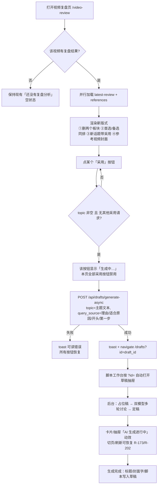

# R-247 开发设计：视频复盘页精简 + 参考视频封面 + 统一「采用」一键生成草稿

- **对应需求**: `requirements/R-247-video-review-adopt-draft.md`
- **日期**: 2026-11-04
- **状态**: 📝 设计已登记（等作者第二次「继续」后开发）
- **前置**: R-237（视频复盘/主题推荐/改进计划）、R-245（按指标优化建议）、R-244/R-172/R-174（封面缩略与 4:3 卡片口径）、R-173/R-202（草稿 AI 进行中状态与切页恢复）、R-158（脚本工作台）、R-236（Alembic 迁移机制）
- **原则**: 前端只改视频复盘页相关文件；后端只删除「改进计划」及其表/接口；草稿生成复用现有链路，不加接口；不改复盘分析/主题推荐/指标建议算法；`scripts/verify.sh` 全绿；服务保持运行。

## 1. 开发背景

视频复盘页（`frontend_v2/src/pages/video-review/index.tsx`，426 行）在 R-237/R-245 之后承载了太多内容，作者 2026-11-04 提出 4 项页面调整。代码与数据库核对结论（详见需求文档「现状核对」）：

1. 两个需要作者手填的板块（「这次准备重点改什么？」「怎样让观众愿意关注？」）把「采用主题」流程堵死——必须填 1～2 项修改才能采用，结果 118 条主题推荐 **0 条被采用**、改进计划表 **0 条**；
2. 首选卡在第 346 行、备选区在第 404 行，中间隔着原因/建议/图表，比较困难；
3. `ReferenceItem` 已含 `cover_url`（同行=本地 `/covers/*`，低粉=TikHub 远程签名 URL，库里 295 条全有），前端从未渲染；
4. 主题「采用」只写改进计划、不产出作者真正要的脚本草稿；新话题没有采用按钮；而草稿生成接口 `POST /api/drafts/generate-async` 已存在（占位稿 + 后台双模型讨论），主页/灵感随手记都在用。

因此本次：**删两个板块 → 首选与备选同排 → 参考视频补封面 → 三类主题统一「采用」直接生成草稿 → 删除从未被使用且与脚本工作台重复的「改进计划/修改效果」功能（含表/迁移）**。

## 2. 涉及的技术

| 技术 | 用途 |
|---|---|
| React 19 + TypeScript（frontend_v2） | 视频复盘页布局、封面组件、采用按钮交互；类型删除（Plan/improvement_plan/charts.plan） |
| 现有 UI/动效体系（`@/components/ui/button`、`lucide-react`、framer-motion、`@/lib/motion`） | 按钮 loading、卡片封面、页面既有淡入；不新造动效体系 |
| 现有 `apiJson` + `POST /api/drafts/generate-async` | 采用后建占位草稿 + 后台双模型讨论；跳转 `/drafts?id=` 复用脚本工作台深链 |
| `coverThumb`（`@/lib/covers`） | 本地 `/covers/*` 按宽 400 取缩略图；远程 URL 原样返回 |
| React Router `useNavigate` | 采用成功后跳转脚本工作台并带草稿 id |
| FastAPI + SQLAlchemy 2.x | 删除改进计划路由/服务/模型；`review_out` 响应清理 |
| Alembic（PostgreSQL） | 新 revision：删除 `video_improvement_plans` 表 + `video_topic_recommendations.adopted_at` 列 |
| openapi-typescript（`npm run gen:api`） | 后端重启后重新生成 `src/api/schema.d.ts`，移除 plans/adopt 路由类型 |
| pytest（后端回归）、vitest + Playwright（前端构建/浏览器点检）、`scripts/verify.sh` | 质量门禁与验收 |

无新增第三方依赖；无新接口；无新增表。

## 3. 开发流程图



## 4. 数据流转图

```mermaid
flowchart LR
    subgraph ThirdParty[第三方数据]
        T1[TikHub 抖音作品/榜单/搜索]
    end

    subgraph Backend[后端 FastAPI]
        A1[复盘分析 run_analysis]
        A2[GET /api/douyin-review/posts/{id}/latest-review]
        A3[GET /api/douyin-review/references]
        A4[POST /api/drafts/generate-async]
        A5[后台 generate_draft 任务<br/>初稿→5轮讨论→定稿]
    end

    subgraph DB[PostgreSQL]
        D1[video_reviews]
        D2[video_topic_recommendations]
        D3[video_review_findings]
        D4[platform_posts / platform_post_stats]
        D5[douyin_reference_videos]
        D6[drafts / draft_discussions]
    end

    subgraph UI[前端视频复盘页 + 脚本工作台]
        U1[首选/备选/新话题 + 参考视频封面]
        U2[采用按钮]
        U3[脚本工作台抽屉/卡片]
    end

    T1 --> A1
    A1 --> D1 & D2 & D3
    A1 -. 仅写引用.-> D4
    T1 --> D4 & D5
    D1 & D2 --> A2
    D4 & D5 --> A3
    A2 --> U1
    A3 --> U1
    U1 --> U2
    U2 --> A4
    A4 --> D6
    A4 --> A5
    A5 --> D6
    D6 --> U3

    subgraph Removed[本次删除]
        R1[[video_improvement_plans 表]]
        R2[[/adopt、/plans 接口]]
        R3[[前端修改效果图表]]
    end
```

说明：
- 复盘分析与主题推荐的数据流本次完全不变，只删除「改进计划」这条旁路（作者手填 → 计划 → 关联新视频 → 检查效果）；
- 采用按钮不再写 `video_topic_recommendations.adopted_at`、不再调 `/adopt`，改为写 `drafts` 并触发 `generate_draft` 后台任务。

## 5. 实现细节

### 5.1 前端：删除两个板块（需求 1）

文件：`frontend_v2/src/pages/video-review/index.tsx`

| 删除对象 | 具体内容 |
|---|---|
| 「怎样让观众愿意关注？」整段 JSX | `review.follower_analysis.homepage.message`、两个 `Textarea`、`保存主页信息` 按钮（原第 408 行） |
| 「这次准备重点改什么？」整段 JSX | 保留项/修改项 `Input`、`保存修改`、选择新视频 `select`、`关联新视频`、`更新检查结果`（原第 410 行） |
| 相关 state | `keptText`、`changeOne`、`changeTwo`、`linkPostId`、`bio`、`direction`（第 35～40 行） |
| `loadReview` 中回填逻辑 | `improvement_plan` 的 4 行回填 + `follower_analysis.homepage` 的 2 行回填（第 49～58 行） |
| 函数 | `savePlan`、`linkPlan`、`checkPlan`、`saveHomepage`、旧 `adopt`（第 227～286 行，`adopt` 由 5.3 新流程替换） |
| 图表 | `planItems`（第 289 行）、`PlanComparisonCharts` 渲染（第 412 行）与 import |
| import | `Input`、`Textarea`、`UserPlus`（仅上述已删代码使用）；`Check`/`Loader2` 保留（采用按钮用） |

保留：`follower_analysis` 数据本身、`PUT /api/douyin-review/homepage` 接口、复盘分析算法、`review.warnings`、`follow_ups` 板块。

### 5.2 前端：首选与备选同排（需求 2）

把原来两个独立 `<section>` 收进一个 grid 容器（位置：原首选卡处，即 `review ?` 分支顶部）：

```tsx
const backups = review.recommendations.backups
<div className={cn('grid items-start gap-4', primary && backups.length > 0 && 'lg:grid-cols-2')}>
  {/* 左列：首选（无首选时是原「暂时没有足够依据」提示卡） */}
  {primary ? (
    <section className="rounded-2xl border border-indigo-200 bg-card p-5 shadow-card dark:border-indigo-900">…原首选卡…</section>
  ) : (
    <section className="rounded-2xl border border-dashed border-border bg-card p-5">…原空提示卡…</section>
  )}
  {/* 右列：两个备选上下排列 */}
  {backups.length > 0 && (
    <section className="rounded-xl border border-border bg-card p-4">
      <h2 className="text-sm font-semibold">两个备选主题</h2>
      <div className="mt-3 space-y-3">
        {backups.map((topic, index) => (
          <div key={topic.id ?? topic.topic} className="rounded-lg border border-border p-3">…主题/理由/采用…</div>
        ))}
      </div>
    </section>
  )}
</div>
```

- 断点用 `lg`（1024px）：两列仅当**首选与备选都有**时生效；缺一侧时单列占整行，避免半列空白；
- `items-start`：两卡自然高度，不强行等高留白；
- 右侧备选内层由原 `grid md:grid-cols-2` 改为 `space-y-3`（上下排列，符合已确认方案）；
- 原第 404 行的备选 `<section>` 从页面下部删除（内容已上移）；`follow_ups` 板块保持原位置不动。

### 5.3 前端：参考视频封面（需求 3）

文件：`frontend_v2/src/pages/video-review/index.tsx`、`frontend_v2/src/pages/video-review/types.ts`

**封面组件（模块作用域，与 `judgementLabels` 同级）**

```tsx
import { coverThumb } from '@/lib/covers'

function ReferenceCover({ url }: { url?: string | null }) {
  const [failed, setFailed] = useState(false)
  const src = coverThumb(url, 400)
  return (
    <div className="relative aspect-[4/3] w-full overflow-hidden bg-muted">
      {src && !failed ? (
         setFailed(true)}
          className="absolute inset-0 h-full w-full object-cover"
        />
      ) : (
        <div className="flex h-full items-center justify-center text-xs font-semibold text-muted-foreground/60">ECHO</div>
      )}
    </div>
  )
}
```

**卡片结构**（原第 420 行 article 改为封面 + 内容两段，`p-4` 从 article 移到内容层）：

```tsx
<article key={item.id} className="overflow-hidden rounded-xl border border-border bg-card shadow-card">
  <ReferenceCover url={item.cover_url} />
  <div className="p-4">
    …原标题/徽标/作者/播放点赞评论/倍数/查看原视频…
  </div>
</article>
```

规则：
- 固定 **4:3** 框（沿用 R-172/R-174 口径，`aspect-[4/3]` + `absolute img`，图片不参与 min-content，竖版封面不会撑高卡片）；
- 本地 `/covers/*` 自动带 `?w=400` 缩略（R-243），远程低粉封面原样加载；
- 加载失败 → `onError` 切占位（ECHO），卡片高度不变、不裂图；
- 封面不可点击、无新交互；同行/低粉两个 tab 共用同一卡片结构。

### 5.4 前端：统一「采用」→ 脚本工作台 AI 生成草稿（需求 4）

**类型**（`types.ts`）

```ts
export interface NewTopic {
  topic: string
  reason: string
  fit_reason: string
  first_step: string
  evidence?: Array<Record<string, unknown>>
  target_metric?: string
}
// Review.new_topics 由内联结构改为 NewTopic[]；Topic 保持现有字段
```

**「采用」可点击的三类数据**（字段用途）

| 位置 | 数据对象 | topic | 附加 query_source 字段 |
|---|---|---|---|
| 首选卡 | `review.recommendations.primary`（Topic） | 主题文本 | `opening_line`、`reason`、`fit_reason` |
| 两个备选 | `review.recommendations.backups[]`（Topic） | 主题文本 | `reason`、`fit_reason`、`opening_line` |
| 新话题 | `review.new_topics[]`（NewTopic） | 主题文本 | `reason`、`fit_reason`、`first_step` |

**query_source 拼接规则**（程序计算，不交给 AI 编造）

```ts
function adoptQuerySource(topic: { topic: string; reason?: string; fit_reason?: string; opening_line?: string; first_step?: string }): string {
  return [topic.topic, topic.reason, topic.fit_reason, topic.opening_line, topic.first_step]
    .map((x) => (x || '').trim())
    .filter(Boolean)
    .join('\n')
}
```

- 顺序：主题 → 推荐理由 → 适合原因 → 开头第一句 → 第一步；
- 空字段自动跳过；用途仅给生成链路的联网检索当「最具体文本」（`run_debate.material`），不改变主题本身。

**交互状态与请求**

```tsx
const navigate = useNavigate()
const [adopting, setAdopting] = useState('')  // '' = 空闲；否则为被点按钮的 key

async function adoptTopic(topic: <上面三种之一>, key: string) {
  const title = (topic.topic || '').trim()
  if (!title || adopting) return   // 输入规则：主题为空不请求；已有请求进行中不重复
  setAdopting(key)
  try {
    const data = await apiJson<{ task_id: number; draft_id: number }>('/api/drafts/generate-async', {
      method: 'POST',
      body: JSON.stringify({ topic: title, query_source: adoptQuerySource(topic) })
    })
    toast.success(`已开始生成《${title}》，去脚本工作台查看`)
    navigate(`/drafts?id=${data.draft_id}`)   // 深链由脚本工作台自动打开抽屉（现有逻辑）
  } catch (error) {
    setAdopting('')
    toast.error(error instanceof Error ? error.message : '生成失败，请重试')
  }
}
```

**按钮 key 与文案**：首选 `'primary'`；备选 `'backup-${topic.id ?? index}'`；新话题 `'new-${index}'`。

**按钮渲染规则**

- 文案统一：空闲时「采用」；被点按钮显示 `Loader2` 旋转 + 「生成中…」；
- 本页三个位置所有采用按钮共用 `disabled={!!adopting}`，避免并发重复建草稿；
- 首选按钮保持 `Button`（default），备选/新话题保持 `variant="outline" size="sm"`，仅改文案与禁用逻辑；
- 成功后不重置 `adopting`（页面即将卸载，避免按钮闪回）；失败才恢复。

**非实时与恢复**：生成是后台 `generate_draft` 任务；脚本工作台列表轮询（`draftsQ.refetchInterval`）与草稿抽屉 `debate-status` 轮询已有（R-173），本次不改；`?id=` 深链打开抽屉逻辑已有（R-243/R-213），本次不改。

**边界**：主题为空 → 不发请求（当前数据不会出现）；接口 400（如「选题不能为空」）/500/网络错误 → toast 错误、按钮恢复；无主博主等业务错误由后端现有文案透出。

### 5.5 前端：清理改进计划相关代码（作者确认删除）

| 文件 | 删除内容 |
|---|---|
| `pages/video-review/types.ts` | `Plan` 接口、`Charts.plan` 字段、`Review.improvement_plan` 字段；`new_topics` 改用 `NewTopic[]` |
| `pages/video-review/charts.tsx` | `PlanComparisonCharts` 组件（第 131～140 行）；检查 `cn`/`formatMetric` 仍有其它使用（保留） |
| `pages/video-review/index.tsx` | `PlanComparisonCharts` import、`planItems`、5.1 中列出的状态/函数/JSX |
| `api/schema.d.ts` | 后端重启后 `npm run gen:api` 重新生成（删除 adopt/plans 路由与 Plan schema 类型） |

### 5.6 后端：删除改进计划功能（作者确认删除）

**5.6.1 `backend/app/api/douyin_review.py`**

- import：删除 `VideoImprovementPlan`、`PlanCheckIn`、`PlanIn`、`PlanLinkIn`、`PlanPatchIn`；
- 删除 5 个路由：`POST /recommendations/{recommendation_id}/adopt`、`PATCH /plans/{plan_id}`、`POST /plans/{plan_id}/link`、`POST /plans/{plan_id}/check`、`GET /plans`；
- 删除 `_plan()` 辅助函数（原第 262 行）；
- 保留：`find_running_task`/`start_task`（analyze、references 仍在用）、`JSONResponse`、`PlatformPost` 等其余 import。

**5.6.2 `backend/app/schemas/douyin_review.py`**

- 删除 `PlanIn`、`PlanPatchIn`、`PlanLinkIn`、`PlanCheckIn` 四个 Pydantic 模型；其余 schema（AnalyzeIn/Plan 无关的 HomepageIn 等）不动。

**5.6.3 `backend/app/services/video_review_service.py`**

- import：删除 `VideoImprovementPlan`；
- `review_out()`：删除 `plan = db.query(...)` 查询、`"improvement_plan"` 响应字段、`charts["plan"] = ...` 覆盖；
- `_EMPTY_CHARTS`：删除 `"plan": []`；
- `_topic_out()`：删除 `"adopted_at"` 输出；
- 删除函数：`plan_out()`、`adopt_topic()`、`update_plan()`、`link_plan()`、`run_plan_check()`；
- 保留 `refresh_post_by_policy()`（run_analysis 仍在用）及其它分析逻辑。

**5.6.4 其它后端文件**

| 文件 | 改动 |
|---|---|
| `app/services/video_review_comparison.py` | 删除 charts 结果里的 `"plan": []`（约第 391 行） |
| `app/models/video_review.py` | 删除 `VideoImprovementPlan` 类；删除 `VideoTopicRecommendation.adopted_at` 列 |
| `app/models/__init__.py` | 删除 `VideoImprovementPlan` 的 import 与 `__all__` 导出 |
| `app/core/task_meta.py` | 删除 `"douyin_review_plan_check": "修改效果检查"` 映射与深链条件中的该 kind |
| `backend/tests/test_r237_video_review.py` | 删除 `adopt_topic`/`link_plan`/`run_plan_check`/`VideoImprovementPlan` import 与测试尾段 adopt/link/check 断言；保留复盘分析 + 主题断言（用例重命名为 `test_analysis_generates_review_and_topics`） |
| `backend/tests/test_r242_fixes.py` | 删除「无主博主 plans 返回空列表」用例，更新模块 docstring 编号（4→3） |

### 5.7 Alembic 迁移（删表 + 删列）

新文件 `backend/alembic/versions/r247_drop_improvement_plan.py`：

- `revision = "r247dropimprove"`；`down_revision = "r244dashboard"`（当前 head，2026-11-04 核对）；
- `upgrade()`：
  1. `op.drop_table("video_improvement_plans")`（PG 删表自动删其索引与 FK 约束）；
  2. `op.drop_column("video_topic_recommendations", "adopted_at")`；
- `downgrade()`：按 R-237 迁移（`b237a9c4e801`）原定义恢复
  1. `op.add_column("video_topic_recommendations", sa.Column("adopted_at", sa.DateTime(), nullable=True))`；
  2. 重建 `video_improvement_plans`（字段与 FK 同 b237：id/review_id/source_post_id/recommendation_id/kept_text/changes/target_metrics/status/published_post_id/check_result/checked_at/created_at/updated_at）；
  3. 重建 `ix_video_improvement_source(source_post_id, created_at)`、`ix_video_improvement_published(published_post_id)` 两个索引；
- 数据影响：线上库 0 条计划、0 条 adopted_at，无数据迁移；执行前 `SELECT count(*)` 复核（开发/生产各一次）。
- 执行：`cd backend && .venv/bin/alembic upgrade head`；自测时额外 `alembic downgrade -1 && alembic upgrade head` 验证可回滚，最终保持 head。

### 5.8 `src/api/schema.d.ts` 重新生成

后端改动需重启进程才生效（当前 dev 进程未确认自动 reload）。步骤：

1. 停止 PID（`lsof -nP -iTCP:8000` 查）→ 按 README 命令重启：`cd backend && .venv/bin/python -m uvicorn app.main:app --host 0.0.0.0 --port 8000`（后台运行、日志落 `.tmp/backend-8000.log`）；
2. `curl http://127.0.0.1:8000/health` 通过后 `cd frontend_v2 && npm run gen:api`；
3. 检查 `schema.d.ts` diff 只少了 adopt/plans/Plan 相关类型（不得有其它接口漂移）。

### 5.9 测试与自测计划

**后端**
- `cd backend && .venv/bin/python -m pytest -q`（R-237/R-242 改动用例 + 全量）；
- `ruff check app tests`、`mypy app`（verify 会跑）；
- 迁移：`alembic upgrade head` → 查询 `information_schema.tables/columns` 断言无 `video_improvement_plans`、无 `adopted_at`；`alembic downgrade -1 && alembic upgrade head` 往返通过；
- OpenAPI 冒烟：`curl /openapi.json` 中无 `/recommendations/{id}/adopt`、`/plans`；`GET /api/douyin-review/posts/{id}/latest-review` 响应无 `improvement_plan`。

**前端**
- `npm run lint`、`npx vitest run`（现有 5 个用例不受影响）、`npm run build`（tsc 严格类型，能兜住删类型后的残留引用）；
- 浏览器点检（Playwright 无头 + 截图，登录 token 取 `.env` 不打印）：
  1. `/video-review`：页面 0 console error；两个板块文案不存在；首选/备选 `getBoundingClientRect().top` 相同（同一行）；宽窄视口各截一张；
  2. 参考视频卡：`article img` 数量 >0；低粉 tab 切换后同样有封面；坏图占位不改变卡片高度；
  3. 采用：点一个「采用」→ 断言出现「生成中…」且所有采用按钮 disabled → 跳转 URL 含 `/drafts?id=` → 脚本工作台抽屉自动打开、状态条显示进行中（真实接口生成 1 篇草稿，作为回归样本；如需省钱可用 Playwright route mock，但至少真实点一次）；
  4. 切页恢复：从草稿页切到其它页再回 `/drafts`，进行中卡片/状态仍在；
  5. 动效点检：按钮 loading、卡片入场、抽屉状态条无空白闪帧（R-175 口径）。

**门禁**：`scripts/verify.sh` 全绿（含文档一致性：38→37 张表、需求/设计成对）；后端 8000 health + 前端 3000 可访问。

### 5.10 边界 / 异常 / 降级汇总

| 场景 | 行为 |
|---|---|
| 主题文本为空 | 「采用」不发请求（按钮实际不会出现空主题，兜底） |
| 连续点击 / 多个采用按钮 | `adopting` 非空时全部禁用，只发一次请求 |
| generate-async 返回 400/500 或网络错误 | toast 后端文案或「生成失败，请重试」，按钮恢复 |
| 跳转后草稿生成失败 | 工作台显示「上次生成中断，可重新讨论」，不阻塞；草稿可删除 |
| 无主博主 | 后端返回可读错误 → toast；不白屏 |
| 参考封面 URL 过期/防盗链 | `onError` 占位；低粉点「更新」重新抓取续期 |
| 复盘无首选/无备选/无新话题 | 按 5.2/需求 4.3/4.5 隐藏或占整行 |
| 旧数据含 `improvement_plan` 快照 | 后端已不再返回该字段、前端类型已删除；旧 `metrics_snapshot.charts.plan` 为多余 JSON 键，读取侧忽略，无需清理 |
| Alembic 迁移失败 | 事务回滚；先 `SELECT count(*)` 确认 0 行再升级 |

## 6. 新增/修改表结构

**删除 1 张表、1 个列；无新增表/列/索引。** `docs/DATABASE.md` 表总览 38→37。

### 6.1 删除表 `video_improvement_plans`（原 R-237 建表）

| 字段 | 类型 | 原说明 |
|---|---|---|
| `id` | INTEGER | 主键 |
| `review_id` | INTEGER | 来源复盘（FK video_reviews.id，索引） |
| `source_post_id` | INTEGER | 原视频（FK platform_posts.id，索引） |
| `recommendation_id` | INTEGER | 采用的主题推荐（FK video_topic_recommendations.id，可空） |
| `kept_text` | TEXT | 本次保留的做法 |
| `changes` | TEXT | 作者确认的 1～2 项修改 JSON |
| `target_metrics` | TEXT | 主要观察指标 JSON |
| `status` | VARCHAR(20) | recorded/linked/checked |
| `published_post_id` | INTEGER | 关联的新发布视频（FK platform_posts.id，可空） |
| `check_result` | TEXT | 改善/未改善/不确定及依据 JSON |
| `checked_at` | DATETIME | 最近检查时间（可空） |
| `created_at` | DATETIME | 创建时间 |
| `updated_at` | DATETIME | 更新时间 |

索引：`ix_video_improvement_source(source_post_id, created_at)`、`ix_video_improvement_published(published_post_id)`（随表删除）。

### 6.2 删除列 `video_topic_recommendations.adopted_at`

| 字段 | 类型 | 原说明 | 删除原因 |
|---|---|---|---|
| `adopted_at` | DATETIME（可空） | 作者采用时间 | 采用改为生成草稿后不再记录采用状态；线上 0 条非空 |

### 6.3 Alembic revision

| 项 | 内容 |
|---|---|
| 文件 | `backend/alembic/versions/r247_drop_improvement_plan.py` |
| revision / down_revision | `r247dropimprove` / `r244dashboard` |
| upgrade | `drop_table("video_improvement_plans")` + `drop_column("video_topic_recommendations", "adopted_at")` |
| downgrade | 恢复列 + 按 b237 定义重建表与两个索引 |
| 数据迁移 | 无（0 行） |

## 7. 新增/修改接口

**不新增任何路由。删除 5 个路由；复用 1 个现有路由；修改 1 个响应的字段。**

### 7.1 删除的路由（后端 `/api/douyin-review`）

| 方法 | 路径 | 原用途 | 请求 | 响应 | 原错误 |
|---|---|---|---|---|---|
| POST | `/recommendations/{recommendation_id}/adopt` | 保存采用 + 改进计划 | `{kept_text, changes[], target_metrics[]}` | `{plan_id, recommendation_id, status, adopted_at}` | 404 主题不存在；400 请记录1～2项重点修改 |
| PATCH | `/plans/{plan_id}` | 修改改进计划 | `{kept_text?, changes?, target_metrics?}` | plan 对象 | 404/400 |
| POST | `/plans/{plan_id}/link` | 关联发布后的新视频 | `{published_post_id, replace}` | `{plan_id, status, published_post_id}` | 404/400/409 |
| POST | `/plans/{plan_id}/check` | 检查修改效果（后台任务） | `{refresh}` | `{task_id}` | 409 请先关联已发布视频 |
| GET | `/plans` | 改进计划列表 | `post_id?`, `limit?` | `{items: []}` | 无主博主原返回空列表（R-242） |

前端全部调用点已随 5.5 删除，无其它消费者。

### 7.2 复用的路由：`POST /api/drafts/generate-async`

| 项 | 内容 |
|---|---|
| 方法/路径 | `POST /api/drafts/generate-async` |
| 请求体 | `{"topic": string 必填（trim 后非空）, "mode"?: string（本次不传，默认空=不指定创作模式）, "query_source"?: string（本次传主题+理由等）}` |
| 校验/错误 | 400 `选题不能为空`（topic 为空）；其它服务端异常按现有错误返回 |
| 响应 | `200 {"task_id": number, "draft_id": number}`（同步建好占位草稿） |
| 副作用 | 写 `drafts`（status=draft, source=ai, creator_id=当前主博主）；启动后台 `generate_draft` 任务（初稿→双模型多轮讨论→定稿）；写 `draft_status` 进行中状态 |
| 前端后续 | `navigate('/drafts?id=' + draft_id)`，工作台深链自动打开抽屉；列表轮询显示进行中 |

### 7.3 修改的响应：`GET /api/douyin-review/posts/{post_id}/latest-review`（字段删除）

| 字段 | 变化 |
|---|---|
| `review.improvement_plan` | **删除**（原 plan 对象或 null） |
| `review.recommendations.primary/backups/follow_ups[].adopted_at` | **删除** |
| `review.charts.plan` | **删除**（原为 [] 或检查结果） |
| 其它字段 | 不变；`cover_url` 仍在 `references` 响应中（本次不改） |

前端 `types.ts` 同 commit 收敛类型；无其它前端页面消费这些字段。

## 8. 数据来源与原始字段明细

| # | 页面/功能 | 数据来源类型 | 来源明细（接口/表/作者输入/程序计算） | 原始字段 → 落库字段 | 用途 | 更新时间 | 空值处理 |
|---|---|---|---|---|---|---|---|
| 1 | 首选/备选主题卡 | 程序计算 + LLM（复盘分析时生成） | `run_analysis` → `video_topic_recommendations`；第三方依据：TikHub 作品指标/评论/低粉榜（经复盘服务读取本地表） | `topic/reason/fit_reason/outline/opening_line/target_metric/role/rank/score` → 同表 | 显示下一条拍什么、为什么适合、开头第一句 | 每次「更新数据并分析」成功后 | 无首选显示提示卡；无备选不显示；不编造主题 |
| 2 | 账号可以尝试的新话题 | 程序计算 + LLM | `recommend_topics()` 剩余候选 → `video_reviews.new_topics`（TEXT JSON） | `{topic, reason, fit_reason, evidence, first_step, target_metric}` → 原样 JSON | 3 个可尝试的新方向 + 采用生成草稿 | 同复盘分析 | 空数组 → 板块不显示 |
| 3 | 同行爆款卡片封面/字段 | 现有功能（同步落库） | TikHub 抖音公开作品 → `platform_posts`/`platform_post_stats`；`GET /api/douyin-review/references?kind=peer` 读取 | `platform_posts.cover_path`（本地封面文件）→ 响应 `cover_url`=`/covers/{cover_path}`（`cover_url_local` 计算属性）；`title/author/nickname/plays/likes/comments/video_url` | 参考视频封面 + 标题 + 数据 | 打开页面拉取（数据随手动/每日同步更新） | 无封面 → ECHO 占位；无播放 → 「暂无」 |
| 4 | 低粉爆款卡片封面/字段 | 现有功能（TikHub 榜单/搜索落库） | TikHub 低粉爆款榜/搜索 → `douyin_reference_videos`；`GET /api/douyin-review/references?kind=low_fan` 读取 | `douyin_reference_videos.cover_url`（第三方远程签名 URL）、`title/author_nickname/author_followers/plays/likes/comments/video_url/source/source_label` | 参考视频封面 + 标题 + 数据 | 打开页面拉取；点「更新」重新抓取（封面 URL 续期） | 空列表提示点更新；封面过期 → 占位 |
| 5 | 「采用」生成草稿 | 作者点击 + 现有主题文本 | 作者输入=点击行为；`topic`/`query_source` 来自第 1/2 项页面数据（非第三方新抓取） | 请求 → `drafts`（title=topic、script=占位、source=ai、creator_id=当前主博主）+ `background_tasks`（generate_draft） | 在脚本工作台生成可编辑草稿 | 点击瞬间建占位稿；讨论完成后填正文 | 主题空不发请求；失败 toast；生成中断留痕可重试 |
| 6 | 被删除的改进计划数据 | 原为作者输入 | 原 `PUT`/`POST` 保存 `kept_text/changes/target_metrics` → `video_improvement_plans` | — | — | — | 本次整表删除（线上 0 行） |

- **不新增第三方调用**：参考视频封面与主题数据都是已落库/已返回字段，本次只做前端渲染；
- **更新时机**：复盘主题随分析更新；参考视频随页面打开/点更新；草稿随点击生成；
- **空值口径**：所有缺失显示占位/隐藏，不编造封面、不显示 0 充数。

## 9. 验证与实施记录（开发完成后补充）

| 检查项 | 方法 | 结果 |
|---|---|---|
| 后端单测/静态检查 | `pytest -q`、ruff、mypy | 待实施 |
| 迁移往返 | `alembic upgrade head` / `downgrade -1` / `upgrade head`；查 information_schema | 待实施 |
| OpenAPI 路由 | `curl /openapi.json` 无 plans/adopt | 待实施 |
| 前端静态检查 | lint / vitest / build | 待实施 |
| 页面布局 | Playwright 截图 + `getBoundingClientRect` 同排断言 | 待实施 |
| 参考视频封面 | 同行/低粉 tab 截图 + 坏图占位断言 | 待实施 |
| 采用流程 | 点击→生成中→跳转→抽屉进行中；切页恢复 | 待实施 |
| 门禁 | `scripts/verify.sh` 全绿 | 待实施 |
