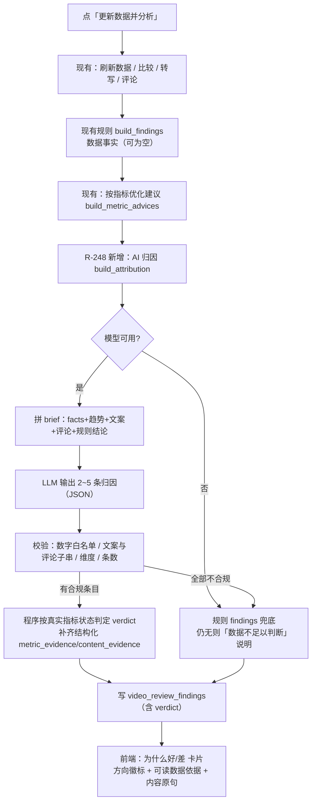
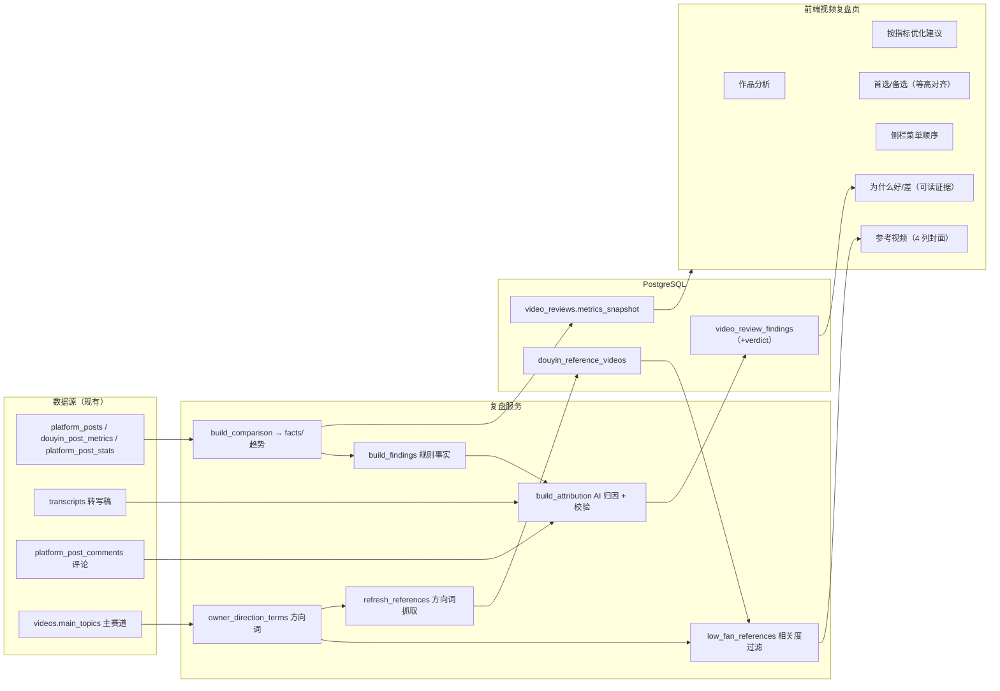

# R-248 开发设计：复盘「为什么好/差」AI 归因 + 版式对齐/顺序 + 参考视频 4 列 + 低粉爆款方向相关 + 菜单顺序

- **对应需求**: `requirements/R-248-review-attribution-layout-relevance.md`
- **日期**: 2026-11-04
- **状态**: ✅ 已按本文实现（2026-11-04，verify 全绿 + 真实归因/低粉抓取 + 浏览器点检）
- **前置**: R-237（视频复盘 findings/参考视频）、R-245（按指标优化建议的 LLM 校验范式）、R-247（首选/备选同排、参考视频封面）、R-240/R-241（复盘参考读路径性能）、R-236（Alembic）
- **原则**: 只改复盘归因链路/复盘页版式/低粉参考筛选/侧栏顺序；不新增第三方数据源、不新增 LLM 调用次数（替换原 findings 润色调用）；历史数据不自动重算、不删除；`verify.sh` 全绿。

## 1. 开发背景

R-247 之后复盘页结构为「作品分析 → 首选/备选 → 为什么好/差 → 按指标优化建议 → 图表…」。2026-11-04 作者反馈 6 个问题，现状取证见需求文档「现状核对」，根因归纳：

1. **归因缺失**：`build_findings`（规则）只在指标 `state=low/high` 时出结论，而本条 14/15 项指标 `limited`（样本 4 条），实际只产出 1 条「00:01 留存下降 15.2pp」；`enhance_findings` 提示词明确「不得增加新的原因或数值」→ 只润色、不归因；前端还把证据以原始 JSON 展示。
2. **版式**：R-247 两卡同排但高度/标题行不统一（266 vs 314px）。
3. **顺序**：首选/备选在归因与建议之前。
4. **参考视频**：3 列、封面偏大。
5. **低粉参考无关**：刷新时关键词为空 → 拉全站低粉总榜；展示侧无相关度过滤。
6. **菜单**：数据看板在素材库之前。

本次方案：**用「规则事实 + 单次 LLM 归因 + 程序判方向/校验 + 规则兜底」替换现有「规则 findings + LLM 只润色」**；其余 5 项为前端版式/顺序/筛选调整 + 低粉抓取与展示的方向过滤。

## 2. 涉及的技术

| 技术 | 用途 |
|---|---|
| Python/FastAPI + `llm_router.primary_llm("video_review")` + `budget_settings` | 单次 AI 归因调用（复用现有用途/预算，替换原 `enhance_findings` 调用） |
| 复用 R-245 `video_review_advices` 的 `_gap_text/_allowed_numbers/_sentences` | 指标差距文案、数字白名单、文案分句校验（避免重复实现） |
| SQLAlchemy + Alembic（PostgreSQL） | `video_review_findings` 新增 `verdict` 列（`r248verdict`） |
| 现有 TikHub `search_douyin_items(label_type=1)` | 「低粉爆款筛选」按方向词抓取（最多 3 个方向词/次） |
| React 19 + TS（frontend_v2） | 归因卡可读证据/方向徽标、板块重排、两卡等高对齐、参考视频 4 列、侧栏顺序 |
| Playwright + verify.sh | 浏览器点检（1440/900）、门禁 |

无新增依赖、无新增路由、无新增第三方数据源。

## 3. 开发流程图



## 4. 数据流转图



## 5. 实现细节

### 5.1 后端：AI 归因模块（新文件 `app/services/video_review_attribution.py`）

删除 `app/services/video_review_llm.py`（唯一函数 `enhance_findings` 被替换后无调用方）。

**5.1.1 输入 brief（程序计算，不含 AI 生成的任何内容）**

```python
FACT_DIMENSIONS = {
    "plays": ("plays", "cover_click_rate"),
    "engagement": ("likes", "comments", "favorites", "shares", "like_rate", "favorite_rate"),
    "completion": ("bounce_2s_rate", "finish_5s_rate", "finish_rate", "avg_play_seconds", "avg_view_proportion"),
    "followers": ("profile_visits", "follower_gain", "follower_per_1k"),
}
MAX_FINDINGS = 5
```

brief 字段：
- `video_title`；
- `transcript`（前 3000 字，校对稿优先，取自已存在的 `_transcript`）；
- `transcript_chars`（去空白字数）；
- `metrics`：`facts` 中 `value is not None` 的项，逐项 `{key,label,value,unit,baseline,percentile,state,sample_count,gap_text}`（`gap_text` 复用 R-245 `_gap_text`，如「当前完整完播率 7.4%，你自己近 30 条相近作品…（低 0.5 个百分点；样本 4 条）」）；
- `retention_drops`：观看趋势中下降最大的前 3 个点 `{time,drop}`（`reliable=False` 时不提供）；
- `comment_questions`：现有 `comment_questions()` 的 top 5 问题标题；
- `comments`：按点赞 top 20 的评论原文（用于内容引用校验）；
- `existing_findings`：规则 `build_findings` 的结论（作为线索，不强制保留）；
- `time_hints`：「前 3 秒 / 每 15~30 秒 / 结尾 10 秒」等允许出现在建议里的时间数字。

**5.1.2 LLM 输出契约（只输出 JSON）**

```json
{"findings":[
  {"dimension":"completion|plays|engagement|followers",
   "title":"一句话结论（≤300字）",
   "conclusion":"为什么：必须结合真实指标差距与文案/评论内容（2~4句）",
   "suggestion":"下一条具体怎么改（可执行动作）",
   "judgement_type":"fact|hypothesis",
   "metric_keys":["finish_rate"],
   "content_quotes":["必须原样摘录的文案或评论原句"]}
]}
```

提示词硬规则（与 R-245 同口径）：
- 2~5 条；只能使用 brief 里的数字与真实原句，不得新增数字/经历/评论/行业均值/提升幅度；
- 每条至少引用 1 个真实指标（`metric_keys`）或 1 条真实原句（`content_quotes`）；
- 内容层面的原因用「可能」表述；样本少时不得断言整体好坏；
- `dimension` 只能取 4 个白名单；`title/conclusion/suggestion` 必填。

**5.1.3 程序校验与降级（阈值/规则）**

| 校验 | 规则 | 失败处理 |
|---|---|---|
| 条数 | 1~5 条 | 丢弃多余；0 条 → 规则兜底 |
| dimension | 必须在 `FACT_DIMENSIONS` 且该维度有可用指标 | 丢弃该条 |
| `metric_keys` | 必须存在于 `facts` 且 `value is not None` | 丢弃该字段；与 `content_quotes` 同时为空则丢弃该条 |
| 数字白名单 | `title+conclusion+suggestion` 里出现的每个数字都必须在 brief JSON 的数字集合 + `time_hints` 中 | 丢弃该条 |
| 文案引用 | 每条 quote 必须是 `transcript` 或某条评论原文的子串 | 丢弃不合法 quote；全部不合法则按「无内容依据」处理 |
| 条数不足 | 合规条目 < 2 且规则 findings 非空 | 合规条目 + 规则 findings 合并，最多 5 条 |
| 全部失败/模型不可用 | — | 规则 findings 兜底；规则也为空 → 生成 1 条「数据不足以判断整体好坏」说明 |
| 合规仅 1 条且规则为空 | 验收要求归因 ≥2 条 | 追加 1 条「暂时还不能判断整体好坏」说明（不增加 LLM 调用） |

**5.1.4 程序判方向 `verdict`（不交给 AI）**

对每条合规条目，根据其 `metric_keys` 对应的真实指标状态计算：

```python
def verdict_for(metric_keys, facts) -> str:
    states = [facts[k]["state"] for k in metric_keys if k in facts and facts[k].get("value") is not None]
    if not states:
        return "unknown"                       # 只有内容依据、没有指标 → 无法判断
    if "high" in states:
        return "strength"                      # 好在哪
    if "low" in states:
        return "weak"                          # 差在哪
    if all((facts[k].get("sample_count") or 0) < 5 or facts[k].get("state") == "missing" for k in metric_keys):
        return "unknown"                       # 样本不足 → 无法判断
    return "neutral"                           # 影响有限
```

- `judgement_type`：有 `content_quotes` → `hypothesis`（结合内容推测）；无 quote 且有 metric_keys → `fact`（数据直接显示）；AI 自报值不作为最终值。
- `metric_evidence`：由程序从 facts 构造（不信 AI 写的数字），形如：
  `{"evidence_id":"metric:finish_rate","key":"finish_rate","label":"完整完播率","value":0.0744,"baseline":0.0694,"unit":"ratio","state":"limited","sample_count":4}`；
  趋势类：`{"evidence_id":"metric:trend:00:01","time":"00:01","drop":0.152}`。
- `content_evidence`：`{evidence_id:"content:quote:1", text:"...", source:"视频文案"|"评论"}`。
- `rule_key`：`attribution:{dimension}:{序号}`（≤60 字符）。

**5.1.5 规则兜底增强**

- `video_review_rules._evidence()` 增加 `unit`、`state` 字段（供前端可读展示），逻辑与阈值不变；
- 规则 findings 复用 `verdict_for` 根据其 `metric_evidence[].key` 计算 verdict；
- 规则无结论时生成兜底归因：
  - title「暂时还不能判断整体好坏」、verdict=unknown、judgement=fact；
  - conclusion 含：可比较样本数、当前与基线差异最大的两个指标（真实数字）、「样本少于 5 条」说明；
  - suggestion「继续发布并同步数据，样本 ≥5 条后重新分析，原因会更可靠」；
  - metric_evidence 用差异最大的两指标结构化证据。

**5.1.6 调用与落库（`run_analysis`）**

```python
# 原：findings, model_name, llm_warning = enhance_findings(db, findings)
findings, model_name, llm_warning = build_attribution(
    db, comparison, transcript, comments, questions, findings, post_title=post.title or ""
)
for index, finding in enumerate(findings):
    db.add(VideoReviewFinding(..., verdict=finding.get("verdict", ""), ...))

# 无转写/归因降级提示并入现有 warnings
if not transcript: warnings.append("这条视频暂无转写，暂时不能结合文案分析原因")
```

- LLM 用途 `video_review`、`target="/video-review"`、`max_tokens=budget_settings.budget_for(db, "video_review")`、`temperature=0.3`、`require=("findings",)`；**一次调用**，不新增调用次数与预算额度。
- 失败/异常：捕获后返回规则兜底 + warning（如「AI 归因暂不可用，已使用程序依据真实数据生成的原因」）。

### 5.2 后端：低粉爆款方向相关（`video_review_comparison.py` + `douyin_references.py`）

**5.2.1 方向词计算（`video_review_comparison.py`）**

```python
DIRECTION_FALLBACK = ("求职", "面试", "赚钱")
MAX_DIRECTION_TERMS = 3
GENERIC_DIRECTION_TOPICS = {"其他", "知识"}     # 泛化留存类目，不作为方向词
BROAD_MATCH_TERMS = {"赚钱"}                    # 泛化匹配词：标题里出现也不算命中
DIRECTION_SYNONYMS = {                          # 只用于「标题命中」的高信号词
    "求职": ("求职", "找工作", "招聘", "简历", "面试", "面经", "offer", "秋招", "校招", "跳槽", "转行", "职场", "背调", "求职者"),
    "面试": ("面试", "面经", "hr", "群面", "终面", "背调", "面试官", "候选人"),
    "赚钱": ("收入", "工资", "月入", "副业", "搞钱", "存钱", "存款", "理财", "薪资", "年薪", "年终奖", "涨薪"),
    "知识": ("学习", "干货", "教程"),
}

def owner_direction_terms(db, owner) -> list[str]:
    # 最近 30 条 videos.main_topics 计数；去掉「其他」→ 去掉泛化类目 → 次数降序取前 3
    # 泛化类目全被排除时回退原始词（仅知识/其他时仍可搜）；空 → DIRECTION_FALLBACK
```

- 规则：最近 30 条按 `videos.id desc`（与现有 `_owner_keywords` 取数口径一致）；方向词去重；排除 `其他/知识` 泛化类目（用「知识」搜低粉会返回科普/情感等无关内容）；不足 3 个时仅用已有词；无任何主赛道 → 兜底 3 词。
- `direction_keywords(terms)`：方向词本身（`BROAD_MATCH_TERMS` 除外）+ 高信号同义扩展 → 小写 set（标题匹配用）。
- `low_fan_references(db, owner, keyword, limit)` 改为：
  1. 取最近 300 条候选；
  2. `keyword` 参数存在时先按标题包含过滤（保持现有手动筛选能力）；
  3. 只计算**标题**命中方向词/同义扩展词数 `hits`（`row.keyword` 字段不算，避免「按词搜回来但标题跑题」混入）；`hits == 0` 的条目不返回；
  4. 排序键：`(last_seen_at, hits, relevance_for(...))` 降序（点「更新」后新抓、带新封面的优先）；返回前 `limit`；
  5. 旧的不相关库内数据不删除，仅过滤；旧行 `cover_url` 为空时 `reference_out` 回退 `raw.thumbnail`（历史指数搜索把封面放在该字段）。
- 保留 `relevance_for` / `_owner_keywords` 现有口径不变（relevance 仅用于排序分，不参与判定）。

**5.2.2 刷新抓取（`douyin_references.refresh_references`）**

| 请求 `keyword` | 抓取行为 |
|---|---|
| 非空（手填） | 保持现有：单次 `search_douyin_items(query=keyword, label_type=1, ...)` |
| 空（默认） | R-248 新逻辑：`terms = owner_direction_terms(db, owner)`，对每个词各发 1 次 `search_douyin_items(query=term, label_type=1, category_id, date_type, duration_type)`（最多 3 次）；**每个词平分名额**（`per_query = ceil(limit/词数)`，避免第一个词把 20 条占满，不足由后续词补齐），合并按 `external_post_id` 去重 |

- 每条记录 `keyword = 命中的方向词`、`source="direction_search"`、`source_label="主赛道低粉爆款"`；手工关键词路径保持 `source="index_search"`、`source_label="低粉爆款筛选"`。
- mock 模式：每个词用 `_mock_items(term)` 兜底（与现有 mock 口径一致）；按 external_id 去重后仍为 2 条。
- 统计补全（前 5 条无播放量补 `fetch_video_statistics`）、预算按实际请求差值计、warning 汇总逻辑保持现有；某方向词 0 条不报错（不新增单方向 warning），全部 0 条 → 现有「没有获取到低粉爆款视频」warning。
- 预算影响：默认路径 1 次 → 最多 3 次 TikHub 请求，仍受现有每日预算闸门保护。

### 5.3 表结构：`video_review_findings` 新增 `verdict`

- 模型：`verdict: Mapped[str] = mapped_column(String(10), default="")`；
- Alembic `backend/alembic/versions/r248_findings_verdict.py`：
  - `revision="r248verdict"`，`down_revision="r247dropimprove"`；
  - upgrade `op.add_column("video_review_findings", sa.Column("verdict", sa.String(10), nullable=False, server_default=""))`；
  - downgrade `op.drop_column(...)`；
  - 不回填历史行（默认 `''`，前端无徽标）。
- `docs/DATABASE.md`：`video_review_findings` 章节新增 `verdict` 行（`strength/weak/neutral/unknown` 或空）；表列表说明同步；表数量仍 37。
- `backend/tests/test_migrations.py` head 断言 `r247dropimprove` → `r248verdict`。

### 5.4 前端：归因卡与可读证据（`video-review/index.tsx` + `types.ts`）

- **types**：`Finding` 增加 `verdict?: 'strength'|'weak'|'neutral'|'unknown'|''`；`metric_evidence` 改为结构化类型（`key/label/value/baseline/unit/state/sample_count/time/drop`）；`content_evidence` 类型 `{evidence_id?, text?, source?}`。
- **徽标**：`verdictLabels = { strength:'好在哪', weak:'差在哪', neutral:'影响有限', unknown:'无法判断' }`；颜色：绿/琥珀/灰/灰底描边；与现有 `judgementLabels`（数据直接显示/结合内容推测/无法判断）并列展示。
- **数据依据**：不再 `<pre>JSON</pre>`，逐行可读：
  - 指标类：`完整完播率：7.4%（自己平时 6.9%，样本 4 条）`（复用 `charts.formatMetric`，`value/baseline` 缺失显示「暂无数据」）；
  - 趋势类：`00:01：留存下降 15.2 个百分点`。
- **内容依据**：原句以引用块显示，右上角小字「来源：视频文案/评论」。
- **数据充分性提示**：板块说明下方，当 `review.metrics` 里非缺失指标的最小 `sample_count < 5` 时显示一条提示：
  「部分指标可比较样本仅 N 条（较少），以下原因仅供参考，不能当成整体好坏结论」。
- 「下一条怎么改」保留现有蓝色底框；卡片仍可展开/收起（`details`）。
- 空数组 / 旧复盘（无 verdict、无结构化证据）：`verdict` 缺省不显示徽标；证据字段兼容数组内旧结构（无 label 时退化为「指标依据」文本）；不崩。

### 5.5 前端：板块顺序与两卡对齐

- **顺序**：把「为什么好/差」`section` 与「按指标优化建议」`section` 整体上移到作品分析卡之后；把「首选/备选」grid 下移到按指标建议之后；其余板块顺序不动。
- **两卡等高 + 标题行统一 + 底部对齐**：
  - grid：`grid gap-4`（去掉 `items-start`，默认 stretch）；`primary && backups.length > 0 && 'lg:grid-cols-2'` 规则不变；
  - 两卡：`flex h-full flex-col`；
  - 标题行：两卡都用同一结构/高度：左 `<div className="flex h-6 items-center gap-2 text-xs font-medium text-indigo-500"><Lightbulb/>下一条最推荐拍这个</div>`；右 `<div className="flex h-6 items-center gap-2 text-xs font-medium text-indigo-500"><Layers/>两个备选主题</div>`；
  - 左侧内容：标题/理由/适合原因/开头第一句后，按钮放 `<div className="mt-auto pt-4">`（贴卡片底部）；
  - 右侧内容：`<div className="mt-3 flex flex-1 flex-col gap-3">`，每个备选卡 `flex flex-1 flex-col`，按钮放 `mt-auto pt-3` → 两张备选卡等高、按钮对齐；
  - 单侧缺失时仍单列占整行，不做强行等高。
- 窄屏（<lg）两卡堆叠，`h-full` 不产生副作用。

### 5.6 前端：参考视频 4 列

- 网格：`className="grid gap-3 md:grid-cols-2 lg:grid-cols-3 xl:grid-cols-4"`（原 `md:2 xl:3`）。
- 封面仍 `aspect-[4/3]` 固定框 + `coverThumb(url, 400)`，卡片变窄后封面自然缩小；坏图 ECHO 占位逻辑不变。
- 低粉区域说明文案更新：「同行只来自你手动添加的对标账号；低粉爆款只显示与你主赛道相关的视频，点「更新」重新抓取。」

### 5.7 前端：侧栏菜单顺序

`components/layout/sidebar.tsx` 的 `NAV` 数组把 `数据看板` 移到 `素材库` 之后：

```ts
{ to: '/home', label: '主页', ... },
{ to: '/videos', label: '素材库', ... },
{ to: '/dashboard', label: '数据看板', ... },
{ to: '/video-review', ... },
...
```

路由、`app-shell.tsx` 标题映射、图标不变。

### 5.8 测试与自测计划

**后端**

- 新增 `backend/tests/test_r248_review_attribution.py`：
  1. `test_verdict_from_metric_states`：high→strength、low→weak、sample<5→unknown、normal→neutral、无指标→unknown；
  2. `test_attribution_validates_numbers_and_quotes`：fake LLM 返回含非法数字/非子串引用的候选 → 被丢弃；合法候选保留、verdict 由程序计算、证据由程序构造；
  3. `test_attribution_fallback_when_llm_unavailable`：无 key / 异常 → 规则 findings 保留；规则为空 → 1 条「暂时还不能判断整体好坏」且含真实样本数与指标数字；
  4. `test_analysis_saves_verdict`：`run_analysis`（mock LLM/无模型）后 `video_review_findings.verdict` 有合法值（或空串兜底不崩）。
- 低粉方向：
  5. `test_owner_direction_terms`：近 30 条 main_topics 计数排序、排除「其他」、无数据兜底；
  6. `test_low_fan_references_filters_unrelated`：构造相关/不相关行 → 只返回相关、按命中数排序；
  7. 更新 `test_r237_video_review.py`：原「关键词为空 → 低粉榜 source」用例改为方向词抓取断言（`source=direction_search`、`keyword` 为方向词、去重后仍 2 条）；手填关键词路径保留；
  8. 更新 `test_r240_readpath.py` 中 `low_fan_references` 用例的期望（方向过滤后仍保留命中项、`_owner_keywords` 只算一次的断言不变或同步调整）；
  9. `test_migrations.py` head 断言更新。
- 迁移：重启后端自动 `upgrade head`；`information_schema` 断言 `video_review_findings.verdict` 存在。

**前端**

- lint / vitest（现有 158 项不回归）/ build；
- Playwright 点检：
  1. 1440：卡片顺序断言（「为什么好/差」在「首选/备选」上方、先于「按指标优化建议」）；两卡 `top` 相同且 `height` 相同、底边相同；参考视频卡片数量/列数（4 列）；封面尺寸；
  2. 900：两卡堆叠、参考视频 2 列、无横向溢出；
  3. 展开一条归因：无原始 JSON、有可读数据依据/内容依据/方向徽标；控制台 0 error；
  4. 侧栏顺序断言（主页→素材库→数据看板→视频复盘）；
  5. 低粉 tab：刷新后列表全部命中方向词（页面/接口双查），无关内容不出现。

**真实联调**

- 调 `POST /api/douyin-review/references/refresh`（TikHub 真实请求 ≤3 次）→ 抽查保存行关键词/内容相关；
- `POST /api/douyin-review/analyze {post_id:1952, refresh:false, force:true}` 重跑一次复盘 → 检查新 findings 内容、verdict、可读证据与页面渲染（不额外刷新抖音数据）；
- `scripts/verify.sh` 全绿（ruff + mypy + pytest + 前端 lint/vitest/build + 文档一致性 37 表/需求设计成对）。

### 5.9 边界 / 异常 / 降级汇总

| 场景 | 行为 |
|---|---|
| 模型未配置/超时/异常 | 规则兜底 + warning；无规则结论时给「数据不足以判断」说明 |
| LLM 数字/引用不合规 | 丢弃该条；合规条目 <2 时与规则 findings 合并；全部失败走兜底 |
| 样本 <5 | 页面充分性提示；verdict 多为 unknown，不硬判好坏 |
| 无转写 | 只给指标类归因 + 提示补转写；内容引用为空 |
| 无评论 | 内容引用只用文案；不虚构评论 |
| 历史复盘 | 不自动重算；旧 findings 无 verdict 时前端不显示徽标、证据兼容显示 |
| 低粉刷新全部方向词 0 条 | 现有「没有获取到低粉爆款」warning，不清空旧数据 |
| 低粉展示过滤后为空 | 「当前方向下暂无低粉爆款，点『更新』获取」 |
| 旧低粉数据无关 | 不删除，展示过滤 |
| 封面坏图 | 4:3 ECHO 占位，不跳高 |
| 迁移 | 新增列有默认值，历史行安全；downgrade 可回滚 |

## 6. 新增/修改表结构

**无新增/删除表；1 张表新增 1 列。表数量仍 37。**

### 6.1 `video_review_findings` 新增字段

| 字段 | 类型 | 可空 | 默认 | 含义 |
|---|---|---|---|---|
| `verdict` | VARCHAR(10) | 否 | `''` | 归因方向（程序判定）：`strength`=好在哪 / `weak`=差在哪 / `neutral`=影响有限 / `unknown`=无法判断 / `''`=历史数据无判定 |

- 判定依据：该 finding 的 `metric_evidence[].key` 对应真实指标 `state`（high→strength、low→weak、样本<5/missing→unknown、其余 neutral）；不采用 AI 自报方向。
- 历史行不回填：页面无徽标（兼容）。

### 6.2 Alembic revision

| 项 | 内容 |
|---|---|
| 文件 | `backend/alembic/versions/r248_findings_verdict.py` |
| revision / down_revision | `r248verdict` / `r247dropimprove` |
| upgrade | `ADD COLUMN verdict VARCHAR(10) NOT NULL DEFAULT ''` |
| downgrade | `DROP COLUMN verdict` |
| 数据迁移 | 无（历史行空串） |

## 7. 新增/修改接口

**无新增/删除路由；修改 2 个现有接口的行为/响应字段。**

### 7.1 `POST /api/douyin-review/references/refresh`（行为变化）

| 项 | 内容 |
|---|---|
| 请求 | 结构不变 `{date_window, duration_type, limit, keyword?, category_id?, tags?}` |
| 行为变化 | `keyword` 为空时：不再拉低粉总榜，改为按 `owner_direction_terms`（≤3 个）逐个 `search_douyin_items(label_type=1)` 抓取并合并去重；`keyword` 非空时保持原逻辑 |
| 响应 | 结构不变 `{task_id, reused}`（任务完成后 `saved/warnings/filters` 在任务结果中） |
| 错误 | 保持现有 400/409/预算不足语义 |
| 预算 | 默认路径最多 3 次 TikHub 请求（原 1 次），受现有每日预算限制 |

### 7.2 `GET /api/douyin-review/references?kind=low_fan`（行为变化）

| 项 | 内容 |
|---|---|
| 请求 | 不变（`kind/keyword/category_id/date_days/duration_type/limit`） |
| 行为变化 | 只返回**标题**命中主博主方向词/高信号同义扩展的条目，按（最近出现→标题命中数→相关度）排序；旧行封面回退 `raw.thumbnail`；无命中返回空列表 |
| 响应 | 结构不变（`ResponseItem` 字段不变） |
| 错误 | 不变 |

### 7.3 复盘响应（字段新增，`response_model=dict`，无 OpenAPI 结构变化）

| 字段 | 变化 |
|---|---|
| `findings[].verdict` | 新增（`strength/weak/neutral/unknown/''`） |
| `findings[].metric_evidence[]` | 新增 `unit/state` 字段（新分析）；历史数据缺失时前端兼容 |
| 其它 | 不变；`improvement_plan` 已在 R-247 删除 |

前端 `src/api/schema.d.ts` 由 OpenAPI 生成、`response_model=dict` 不产生字段定义，**本次无需重生成**。

## 8. 数据来源与原始字段明细

| # | 页面/功能 | 数据来源类型 | 来源明细（接口/表/程序计算） | 原始字段 → 落库字段 | 用途 | 更新时间 | 空值处理 |
|---|---|---|---|---|---|---|---|
| 1 | 为什么好/差·事实 | 现有功能（本地同步数据） | 抖音创作者/公开接口 → `platform_posts`/`douyin_post_metrics`/`platform_post_stats` → `build_comparison()` | `value/baseline/percentile/state/sample_count/unit` → `metrics_snapshot.facts` | 归因的真实依据、verdict 判定 | 每次复盘分析 | 缺失→`missing`，不参与归因；样本<5→`limited` |
| 2 | 为什么好/差·文案 | 现有功能（本地 ASR） | `videos` → `transcripts.corrected_text/transcript_text` | 原文前 3000 字 → brief；引用子串 → `video_review_findings.content_evidence` | AI 归因的内容依据 | 分析时读取 | 无转写→只按指标，页面提示 |
| 3 | 为什么好/差·评论 | TikHub 公开评论（已落库） | `platform_post_comments.text`（按点赞 top20） | 原文 → brief / 引用校验 | AI 归因的内容依据 | 分析时读取 | 无评论→不引用 |
| 4 | 趋势流失点 | 程序计算 | `comparison.charts.retention.points` | `{time,drop}` → brief/metric_evidence | 解释开头/中段流失 | 分析时计算 | 趋势不可靠→不提供 |
| 5 | 归因结果 | AI 生成 + 程序校验（文生文） | `primary_llm("video_review")` 单次调用 | `title/conclusion/suggestion/judgement_type/verdict/metric_evidence/content_evidence/rule_key` → `video_review_findings` | 页面归因卡 | 每次分析（替换原润色调用） | 降级规则兜底；无结论→数据不足说明 |
| 6 | 主博主方向词 | 现有功能（本素材库） | `videos.main_topics`（近 30 条） | 方向词 list（程序内存） | 低粉抓取关键词、展示过滤 | 刷新/展示时计算 | 无主赛道→求职/面试/赚钱兜底 |
| 7 | 低粉爆款 | 第三方 TikHub（现有接口） | `POST /douyin/index/fetch_item_query`（`label_type=1` 低粉爆款筛选，query=方向词） | `itemId/itemTitle/cover/author/play/like/comment/share/createTime/duration` → `douyin_reference_videos`（`keyword`=方向词、`source=direction_search`） | 低粉参考列表 | 点「更新」（≤3 次请求） | 0 条→warning；封面坏图占位 |
| 8 | 侧栏菜单 | 前端静态 | `sidebar.tsx NAV` | — | 导航顺序 | 代码发布 | — |

## 9. 验证与实施记录（2026-11-04）

| 检查项 | 方法 | 结果 |
|---|---|---|
| 后端单测/静态检查 | ruff + mypy + pytest | ✅ All checks passed / 155 files / **758 passed**（基线 751 + 新增 7） |
| 迁移 | 后端重启自动 upgrade；查 information_schema | ✅ head=`r248verdict`；`video_review_findings.verdict` 存在（NOT NULL DEFAULT ''）；表仍 37 张 |
| AI 归因真实效果 | `POST /analyze {post_id:1952, refresh:false, force:true}` → latest-review | ✅ review 28：**4 条归因**（播放/互动/完播/涨粉），每条含真实指标差距 + 文案/评论原句；verdict 4 条=无法判断/影响有限（样本 4 条时不硬判好坏）；数字/引用校验通过 |
| 低粉方向真实抓取 | `POST /references/refresh` → `GET /references?kind=low_fan` | ✅ 3 次 TikHub 低粉筛选（求职/面试/赚钱各 1、每词平分名额）；保存 20 条带方向词；接口返回 20 条全部求职/面试/职场/收入相关，无猫狗/演唱会/花草 |
| 低粉封面 | 浏览器懒加载统计 | ✅ 20 条中 15 条封面加载成功（新抓的带新签名 URL）；5 条历史行 URL 过期 → ECHO 占位（点更新续期，符合设计） |
| 前端静态检查 | lint / vitest / build | ✅ 0 error（9 个既有 warning）/ **158 passed** / build 成功 |
| 页面版式/顺序 | Playwright 1440/900 + rect 断言 | ✅ 顺序 findings(750) < advices(935) < 首选/备选(2352 同排)；两卡 height 318/318、bottom 相同；参考视频 4/行、封面 199px；900 视口堆叠；0 console error |
| 归因卡展示 | 展开断言 + 截图 | ✅ 方向徽标（无法判断/影响有限）+ 判断类型；数据依据为可读文字（无 JSON `<pre>`）；内容依据带「视频文案/评论」来源；样本不足提示可见 |
| 侧栏顺序 | Playwright 导航断言 | ✅ 主页→素材库→数据看板→视频复盘→… |
| 门禁 | `scripts/verify.sh` | ✅ 全绿（37 张表 / 需求与设计成对） |

实现偏差说明：
1. 写范围外必须同步 `prompt_service.py` 的 `video_review` 提示词来源（旧 `video_review_llm.REVIEW_SYSTEM` 删除后指向新模块 `SYSTEM`，避免 ImportError）；
2. 低粉方向词在实现中排除了「其他/知识」两个泛化类目（用「知识」搜低粉会返回科普/情感），并对标题匹配使用高信号词、抓取每词平分名额、展示按最近优先；
3. 历史低粉行 `cover_url` 为空时回退 `raw.thumbnail`（部分签名 URL 已过期仍会占位）。
