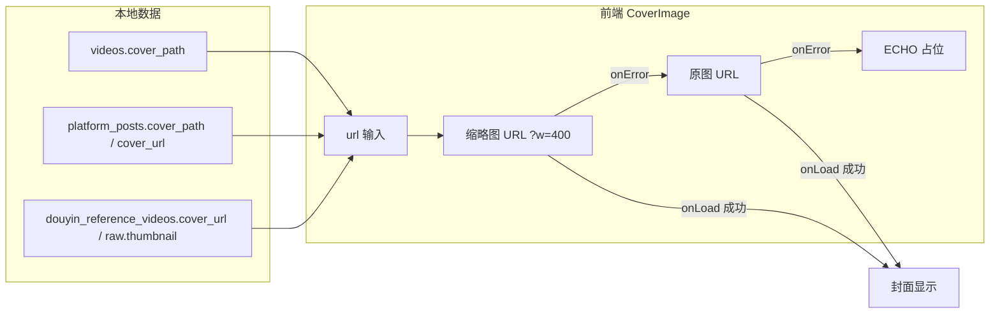

# R-249 开发设计：参考视频封面改 3:4 + 三处封面裂图统一兜底

- **对应需求**: `requirements/R-249-cover-ratio-and-broken-fix.md`
- **日期**: 2026-11-04
- **状态**: ✅ 已按本文实现（2026-11-04，verify 全绿 + Playwright 三处封面 0 裂图）；**v2（2026-11-05）**：全站封面 URL 缓存版本号 + 全部封面位接入 CoverImage
- **前置**: R-247（参考视频封面 4:3 固定框）、R-248（参考视频 4 列）、R-243（缩略图 `?w=400` 与 1 周缓存）、R-179（缩略图生成）
- **原则**: 纯前端改动；不改接口/表/缩略图服务；素材库保持 4:3，只有同行/低粉参考视频改 3:4；`verify.sh` 全绿。

## 1. 开发背景

作者 2026-11-04 反馈两点：

1. 同行爆款、低粉爆款封面比例应与**抖音主页视频（3:4 竖版）**一致；
2. 素材库、同行爆款、低粉爆款「有些封面裂开」。

代码与真实浏览器取证：

- 参考视频封面由 R-247 引入 `aspect-[4/3]`（1440 宽 265×199），与抖音主页 3:4 不符；
- 素材库 613 张封面在浏览器逐张加载 **0 失败**，但 `material-card.tsx` 的 `` 没有 onError 兜底：用户侧一旦遇到坏缩略图缓存/网络失败就会直接显示浏览器裂图；
- 同行 4/20、低粉 5/20 是**远程抖音签名 URL 已过期/403**（历史数据），只能占位（低粉点「更新」可续期）；
- `/covers/<name>?w=400` 缩略图响应 `Cache-Control: max-age=604800`：历史坏缩略图一旦被缓存，1 周内同一 URL 会持续裂图 → 需要「缩略图失败 → 换原图 URL（绕开坏缓存）→ 仍失败占位」的兜底链。

## 2. 涉及的技术

| 技术 | 用途 |
|---|---|
| React 19 + TypeScript | 新增共享 `CoverImage` 组件；素材库卡片与参考视频卡片接入 |
| `@/lib/covers` 的 `coverThumb(url, width)` | 本地 `/covers/*` 追加 `?w=400`；远程 URL 原样 |
| Tailwind `aspect-[3/4]` | 同行/低粉参考视频封面固定竖版比例 |
| vitest + @testing-library/react | `CoverImage` 兜底链回归测试（缩略→原图→占位） |
| Playwright | 三处封面真实加载 / 裂图数 / 比例点检 |

无后端/接口/表改动，无新增依赖。

## 3. 开发流程图

```mermaid
flowchart TD
    A[卡片渲染 CoverImage url] --> B{有 url?}
    B -->|否| P[渲染占位 ECHO]
    B -->|是| C{本地 /covers/*?}
    C -->|是| D[src = coverThumb(url, 400) 缩略图]
    C -->|否| E[src = 远程 url 原样]
    D --> F{加载成功?}
    E --> F
    F -->|是| G[显示封面]
    F -->|否/坏图 naturalWidth=0| H{还有原图可退?}
    H -->|是| I[src = 原图 URL 不带 ?w=]
    I --> J{加载成功?}
    J -->|是| G
    J -->|否| P
    H -->|否 远程 URL| P
```

## 4. 数据流转图



- 后端 `GET /covers/<name>?w=400` 行为不变：缩略图命中/生成失败回退原图；
- 前端兜底只在**浏览器加载失败**时发生，不改变接口和数据。

## 5. 实现细节

### 5.1 新增 `frontend_v2/src/components/ui/cover-image.tsx`

```tsx
export function CoverImage({ url, alt, width = 400, className, placeholder = null }: {...}) {
  const [original, setOriginal] = useState(false)  // false=缩略图；true=回退原图
  const [failed, setFailed] = useState(false)      // true=渲染占位

  useEffect(() => { setOriginal(false); setFailed(false) }, [url])  // 卡片复用不串图

  if (!url || failed) return <>{placeholder}</>
  const thumb = coverThumb(url, width)
  const fallbackable = thumb !== url            // 只有本地 /covers/* 才有原图可退
  const fail = () => {
    if (fallbackable && !original) setOriginal(true)  // 第一次失败 → 原图 URL（绕开坏缩略图缓存）
    else setFailed(true)                               // 第二次失败/远程 URL → 占位
  }
  return (
     { if (!event.currentTarget.naturalWidth) fail() }}  // 少数浏览器坏图只触发 load
    />
  )
}
```

规则/阈值：
- **URL 规则**：本地 `/covers/*` 首次用 `coverThumb(url, 400)`（追加 `?w=400`）；其余 URL（远程签名 URL、`/media/*`）原样使用；
- **重试次数**：最多 1 次（缩略图→原图），之后占位，不做无限重试；
- **成功判定**：`onLoad` 且 `naturalWidth > 0`；`onError` 或 `naturalWidth=0` 都视为失败；
- **占位**：由调用方传入（素材库=渐变 ECHO 卡，参考视频=灰底 ECHO），组件不关心样式；
- **重置**：`url` 变化时清零两个状态，避免虚拟列表/分页复用节点时把上一张的失败状态带到新图。

### 5.2 素材库卡片接入（`pages/videos/material-card.tsx`）

- 删除原 `` 与 `coverThumb` import；
- 改为 `<CoverImage url={item.cover_url} alt={item.title} className="h-full w-full object-cover transition-transform duration-500 ease-out group-hover:scale-[1.04]" placeholder={<原渐变 ECHO 占位>} />`；
- 外层 4:3 封面框、点击播放/编辑、hover 放大、多选框、任务角标、按钮全部不动。

### 5.3 同行/低粉参考视频（`pages/video-review/index.tsx` 的 `ReferenceCover`）

```tsx
function ReferenceCover({ url }: { url?: string | null }) {
  return (
    <div className="relative aspect-[3/4] w-full overflow-hidden bg-muted">
      <CoverImage
        url={url}
        alt="参考视频封面"
        className="absolute inset-0 h-full w-full object-cover"
        placeholder={<div className="flex h-full items-center justify-center text-xs font-semibold text-muted-foreground/60">ECHO</div>}
      />
    </div>
  )
}
```

- 比例：`aspect-[4/3]` → `aspect-[3/4]`（1440 宽 265×353，比例 0.75）；
- 移除组件内自维护的 `failed` state 与 `coverThumb` import，统一用 `CoverImage`；
- 参考视频网格断点（`md:2 / lg:3 / xl:4`）、卡片其它字段/按钮不变；卡片变高，但列数不变。

### 5.4 历史无效远程封面处理

- 同行 4/20、低粉 5/20 的远程签名 URL 已过期/403：`coverThumb` 对远程原样返回 → 加载失败 → 无原图可退 → 直接 ECHO 占位；
- 低粉点「更新」重新抓取会得到新签名 URL（已在 R-248 实现）；同行本地封面在平台同步时补下载；
- 本期不新增封面本地化下载/代理，不重抓历史同行封面。

### 5.5 测试计划

- 新增 `src/components/ui/cover-image.test.tsx`：
  1. 本地封面：首帧 `?w=400` → 触发 error 后变原图 URL → 再 error 显示占位且 img 消失；
  2. 远程封面：首帧原样 URL → error 后直接占位；
  3. 空 URL：直接占位。
- `npm run typecheck` / `npm run lint` / `npx vitest run` / `npm run build`；
- Playwright 点检：
  1. 1440/900：参考视频封面框 ratio=0.75、一行 4 个/堆叠，无横向溢出；
  2. 三处（素材库/同行/低粉）逐张加载：`complete && naturalWidth===0` 的裂图数必须 = 0；过期远程为占位；
  3. 素材库卡片交互（点击封面打开播放/编辑、hover、多选布局）无回归；三页 console error 0。

### 5.6 边界 / 异常 / 降级汇总

| 场景 | 行为 |
|---|---|
| 无封面 URL | 直接占位 |
| 本地缩略图 404/坏缓存 | 换原图 URL 重试（URL 不同，跳过旧的坏缓存） |
| 本地原图也坏 | ECHO 占位 |
| 远程封面 403/过期 | ECHO 占位（低粉点更新可续期） |
| 远程封面加载慢 | 保持 lazy 加载，不阻塞页面；超时最终由浏览器 error 触发占位 |
| 卡片列表复用节点 | `url` 变化 → 重置兜底状态，不串图 |
| 素材库交互 | 不改动外层，纯替换 `` |

### 5.7 v2：缓存版本号 + 全站封面兜底（2026-11-05 作者反馈仍见裂图）

**问题**：后端封面文件已全部校验可解码，但缩略图响应带 1 周强缓存（`max-age=604800`）。用户浏览器若在历史某次拿到过截断/半张缩略图，会把它缓存 1 周，且同一 URL 不会重新请求 → 始终显示裂图；v1 的 onError 兜底对「已缓存但能部分解码的坏图」无效（不会触发 error）。

**修复**：
1. `frontend_v2/src/lib/covers.ts` 增加 `COVER_CACHE_VERSION = '20261105a'`，`coverThumb()` 给 `/covers/*` URL 追加 `&v=<版本>`（后端忽略该参数）；版本变化 = URL 变化，浏览器重新拉取，绕过历史坏缓存。以后若再出现批量坏图缓存，递增该常量。
2. 全站封面位统一接入 `CoverImage`（缩略→原图→占位 + `naturalWidth=0` 视为失败）：
   - 已接入：素材库卡片、同行/低粉参考卡；
   - v2 新增：博主对标卡片、博主管理「近期作品」弹窗、主页时间线卡片、素材编辑抽屉封面、数据看板作品封面 `Thumb`。
3. 封面 URL 统一走 `coverThumb`（编辑抽屉原图 URL 也经 `CoverImage` 内部走 `coverThumb`，同样带版本参数）。

**验证**（Playwright 1440）：
- URL 版本参数：素材库 60/60、博主对标 35/35、视频复盘 17/17 封面均带 `v=20261105a`；
- 裂图数：三页 + 博主对标 = **0**；console error 0；
- 布局/交互：4:3 框、点击/悬停/多选、封面替换等不变。

## 6. 新增/修改表结构

**无。** 不新增表/列/索引，不需要 Alembic revision，`docs/DATABASE.md` 不变（仍 37 张表）。

## 7. 新增/修改接口

**无。** 不改任何后端路由、请求/响应、错误码；`GET /covers/<name>?w=` 行为保持不变。

## 8. 数据来源与原始字段明细

| # | 页面/功能 | 数据来源类型 | 来源明细 | 原始字段 → 展示字段 | 用途 | 更新时间 | 空值/失败处理 |
|---|---|---|---|---|---|---|---|
| 1 | 素材库卡片封面 | 本地素材文件（现有下载逻辑） | `videos.cover_path` → `/covers/<文件名>` | 文件名 → `cover_path`；前端 `cover_url="/covers/<文件名>"` | 素材卡片封面 | 上传/同步时 | 缩略失败→原图→ECHO 渐变占位 |
| 2 | 同行爆款封面 | 平台同步下载（现有） | `platform_posts.cover_path`（本地）优先，否则 `platform_posts.cover_url`（抖音远程签名） | `cover_path`/`cover_url` → `cover_url_local` | 参考视频封面 | 平台同步/手动更新 | 本地失败→原图；远程过期→ECHO 占位 |
| 3 | 低粉爆款封面 | TikHub 榜单/搜索（现有） | `douyin_reference_videos.cover_url`；空时展示层回退 `raw.thumbnail`（R-248） | 远程 URL → `cover_url` | 参考视频封面 | 点「更新」 | 过期/403→ECHO 占位；点更新续期 |
| 4 | 封面兜底 | 前端程序逻辑 | `CoverImage` 状态机 | `url → 缩略图 URL → 原图 URL → 占位` | 三处裂图兜底 | 每次加载 | 见 §5.1 |

## 9. 验证与实施记录（2026-11-04）

| 检查项 | 方法 | 结果 |
|---|---|---|
| 静态检查 | typecheck / lint / vitest / build | ✅ typecheck 0 error；lint 0 error（9 既有 warning）；vitest 全绿（新增 3 例）；build 成功 |
| 参考视频比例 | Playwright `getBoundingClientRect` | ✅ 同行/低粉封面框 265×353，ratio **0.750（3:4）**，一行 4 个 |
| 三处裂图 | 逐张加载断言 `naturalWidth===0` | ✅ 素材库 20/20 加载、0 裂图；同行 16/20 加载 + 4 占位；低粉 15/20 加载 + 5 占位；**三处裂图数 = 0** |
| 素材库交互 | 页面点检 | ✅ 4:3 框、hover/播放按钮/多选布局不变 |
| 控制台 | Playwright console/pageerror | ✅ 0 error |
| 门禁 | `scripts/verify.sh` | ✅ 全绿（后端 758 / 前端 161 / 文档 37 表 + 需求设计成对） |
| v2 缓存版本 | Playwright 检查封面 URL | ✅ 素材库/博主对标/视频复盘封面 URL 全部带 `v=20261105a`，裂图 0、console 0 error |

实现说明：素材库 613 张封面在改动前实测就能加载（0 裂图），本次修的是「失败时没有兜底」和「坏缩略图缓存无重试」；历史过期远程封面无法恢复图片，统一显示 ECHO 占位（不是裂图），低粉点「更新」可续期。
