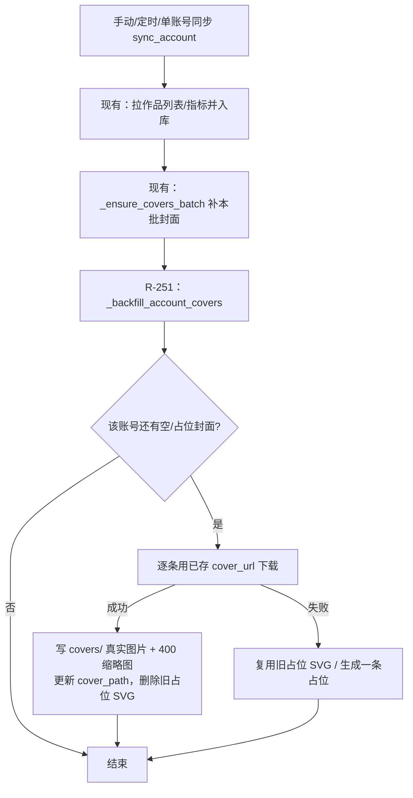
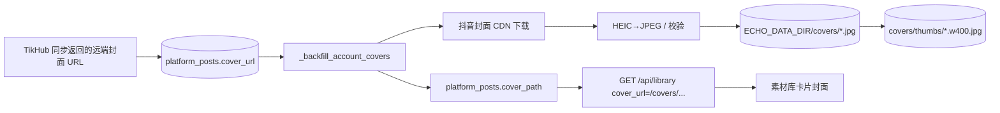

# R-251 开发设计：云端作品缺失封面自动补齐

- **对应需求**: `requirements/R-251-cloud-post-cover-backfill.md`
- **日期**: 2026-11-05
- **状态**: ✅ 已按本文实现（2026-11-04，verify 全绿 + 存量 40 条补齐 + 页面 0 ECHO）
- **前置**: R-244（云端作品同步/封面展示）、R-222（封面批量下载从事务中拆出）、R-249（前端封面兜底/缓存版本）、R-058（封面命名）
- **原则**: 只补后端封面数据与同步后自愈；不改前端/接口/表；封面 CDN 不占 TikHub 预算；`verify.sh` 全绿。

## 1. 开发背景

作者截图显示素材库按博主筛选时大量云作品没有封面（ECHO 占位）。取证：

- `platform_posts` 1998 条中 33 条 `cover_path` 为空、8 条为占位 SVG；远程 `cover_url` 为抖音签名 URL，过期后无法直接显示；
- 封面下载在 `_ensure_covers_batch()`（同步事务外）执行；下载失败/中断/后端对 `ECHO_DATA_DIR` 无写权限（实测 PermissionError）时留空；
- 现有同步只对「本次拉到的作品」补封面，历史缺失行不会自愈；
- 前端 R-249 兜底只能显示占位，不能把缺失的真实封面补回来。

## 2. 涉及的技术

| 技术 | 用途 |
|---|---|
| FastAPI / SQLAlchemy 2.x | 新增服务函数，在同步流程末尾调用 |
| 现有 `platform_assets._cover_path_for` + `_cdn_headers` + `get_client` | 下载封面、HEIC→JPEG（macOS sips）、SVG 占位、400px 缩略图 |
| `core/thumbs` | 新封面生成缩略图 |
| pytest + monkeypatch | 补齐逻辑单测（不联网） |
| Playwright | 素材库页面 0 ECHO/0 裂图点检 |

无新依赖、无新表、无新接口、无前端改动。

## 3. 开发流程图



## 4. 数据流转图



## 5. 实现细节

### 5.1 `_cover_path_for` 支持复用旧占位（`platform_assets.py`）

```python
def _cover_path_for(platform, platform_post_id, title, cover_url, *, reuse_svg: str = "") -> str:
    ...
    # 下载失败时：
    if reuse_svg and (settings.covers_dir / reuse_svg).is_file():
        return reuse_svg            # 复用已有占位，不新建 -2/-3 副本
    dest = unique_path(settings.covers_dir, stem, ".svg")
    ...
```

- 成功路径不变：下载 → `_ensure_web_image`（HEIC→JPEG）→ 写 `covers/` → 生成 400px 缩略图 → 返回文件名。

### 5.2 `_backfill_account_covers`（`platform_sync.py`）

```python
def _backfill_account_covers(db, account, *, limit=200) -> int:
    # 1) 查该账号 cover_path 为空 / NULL / 以 .svg 结尾的作品（发布时间倒序，≤200）
    # 2) 逐条 _cover_path_for(..., reuse_svg=旧占位)
    # 3) 名称变化 → 更新 cover_path；旧 .svg → 删除旧文件
    # 4) 有变化才 commit；异常逐条隔离
```

规则/阈值：
- 触发：每次 `sync_account()` 现有封面批量下载之后调用（手动同步、定时 daily/weekly、单账号同步全覆盖）；抛异常整体回滚但**不影响同步结果**（外层 try）。
- 查询范围：该账号全部历史作品（上限 200/次），避免每轮全表扫描。
- 预算：封面 CDN 直连，**不调用 TikHub**；只有已存 URL 仍有效才能补到真实封面。
- 失败：`_cover_path_for` 内部回退占位 SVG；本函数捕获单条异常继续处理下一条。
- 幂等：已是真实 jpg 的行不命中查询；重复执行不会重复下载。
- 文件清理：成功替换占位时删除旧 SVG（best-effort，删不掉不影响）。

### 5.3 同步接入（`sync_account`）

```python
_ensure_covers_batch(db, account, synced, post_data_map)
# R-251：顺带补齐该账号历史作品缺失的封面（不额外消耗 TikHub 请求；失败静默）
try:
    _backfill_account_covers(db, account)
except Exception:
    db.rollback()
```

### 5.4 存量修复

对全部账号执行一次 `_backfill_account_covers`（本次 40 条：33 空 + 8 SVG → 39 条真实封面 + 1 条保留占位）。脚本不落库到仓库（一次性运维操作）。

### 5.5 环境/部署要求

- 后端进程必须对 `ECHO_DATA_DIR`（默认 `echo_resource/`，含 `covers/`）有**写权限**；否则封面下载必然失败（R-244 已记录）。本次排查先遇到 `PermissionError`，修复权限后补齐成功。
- 无其它配置项变更。

### 5.6 测试计划

- 新增 `backend/tests/test_r251_cover_backfill.py`：
  1. 空 `cover_path` + 占位 SVG 行被补齐、真实 jpg 行不命中、`reuse_svg` 透传；
  2. 无缺失行时返回 0；
  3. `_cover_path_for` 下载失败且存在旧占位 SVG → 复用旧文件、不新建副本。
- 真实数据：全库执行补齐后用 API/Playwright 检查封面数与页面加载。
- `scripts/verify.sh` 全绿。

### 5.7 边界 / 异常 / 降级

| 场景 | 行为 |
|---|---|
| 远端 URL 有效 | 下载真实封面并生成缩略图，更新 cover_path |
| 远端 URL 失效 | 保留/生成占位 SVG（带平台+标题），不裂图 |
| 后端无目录写权限 | 单条失败静默跳过，需修权限（部署要求） |
| 同步中途重启 | 下次同步自动补齐 |
| 无 cover_url | 生成占位 SVG |
| 并发同步同一账号 | 补齐在事务外逐条处理，最坏重复下载一次；幂等 |

## 6. 新增/修改表结构

**无。** 不改 `platform_posts` 等表结构/索引，不需要 Alembic revision，`docs/DATABASE.md` 不变（37 张表）。

## 7. 新增/修改接口

**无。** 不改任何路由；`GET /api/library` 响应字段不变（只是 `cover_url` 变为可用的本地路径）。同步接口请求/响应不变。

## 8. 数据来源与原始字段明细

| # | 页面/功能 | 数据来源类型 | 来源明细 | 原始字段 → 落库字段 | 用途 | 更新时间 | 空值/失败处理 |
|---|---|---|---|---|---|---|---|
| 1 | 云作品封面 | 第三方 TikHub + CDN（现有） | 同步返回 `cover`/远程 URL → `platform_posts.cover_url` | 远端 URL → `cover_url` | 下载本地封面的来源 | 每次同步 | 为空则生成占位 |
| 2 | 本地封面文件 | 封面 CDN 下载（现有） | `_cdn_headers`（UA+抖音 Referer）GET 远端 URL | 图片字节 → `covers/<标题-封面>.jpg` | 页面封面来源 | 同步/补齐时 | 失败 → 占位 SVG |
| 3 | 封面引用 | 程序计算/落库 | `_cover_path_for` 返回值 | 文件名 → `platform_posts.cover_path` | `cover_url_local` 拼 `/covers/<path>` | 同步/补齐时 | 空 → 前端回退远程/占位 |
| 4 | 补齐触发 | 程序行为 | `sync_account` 末尾调用 | — | 历史缺失自愈 | 每次同步 | 异常隔离 |

## 9. 验证与实施记录（2026-11-04）

| 检查项 | 方法 | 结果 |
|---|---|---|
| 后端静态检查 | ruff + mypy | ✅ All checks passed / 155 files |
| 后端单测 | pytest | ✅ 新增 3 例通过，全量 761 项（758 + 3 新增）通过 |
| 存量修复 | 全部账号执行 `_backfill_account_covers` | ✅ 修复 40 条：空 33→0、占位 SVG 8→1、真实 jpg 1957→1997 |
| 截图博主数据 | API `GET /api/library?creator_id=12&limit=100` | ✅ 79/79 条封面为本地 `/covers/*`、文件全部存在 |
| 页面点检 | Playwright 1440 素材库筛选「车厘子在努力」 | ✅ 40 张可见封面全部加载、0 裂图、0 ECHO 卡片、console 0 error |
| 门禁 | `scripts/verify.sh` | ✅ 全绿（表 37 / 需求设计成对） |
