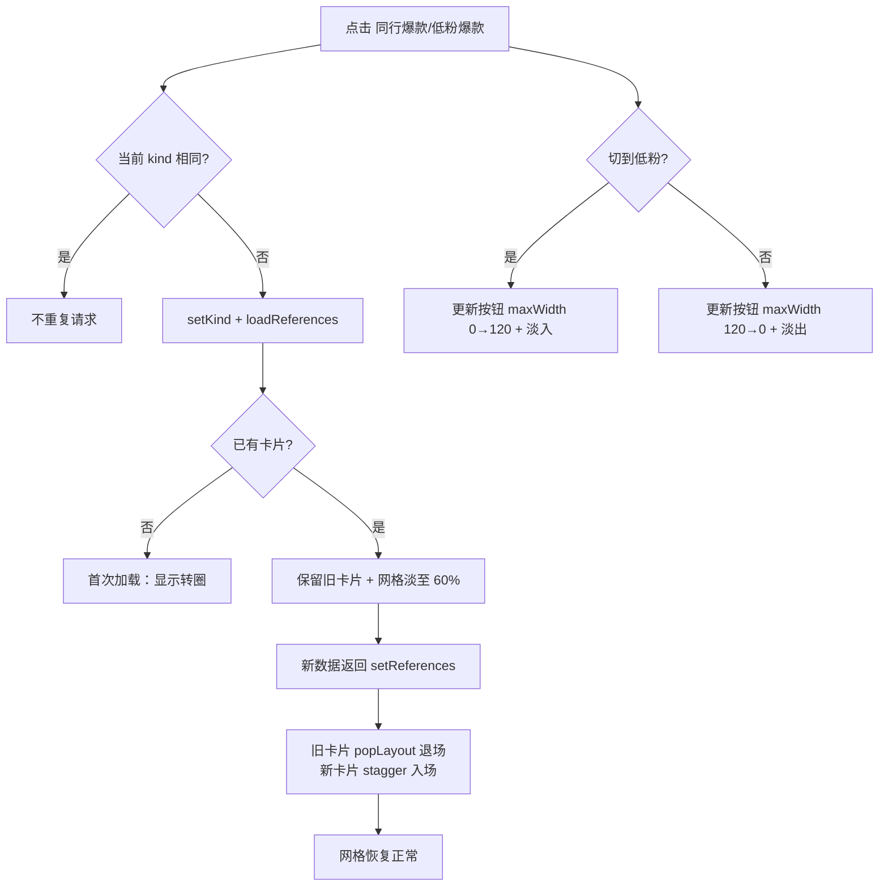
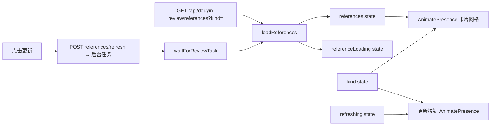

# R-252 开发设计：视频复盘参考视频切换动画 + 5 列 + 标题两行 + 更新按钮入场

- **对应需求**: `requirements/R-252-review-reference-tabs-animation.md`
- **日期**: 2026-11-05
- **状态**: ✅ 已按本文实现（2026-11-04，verify 全绿 + Playwright 点检）
- **前置**: R-247（参考视频封面）、R-248（方向过滤/4 列）、R-249（封面兜底/缓存版本）、R-175（动效规范）、R-199（列表换批 popLayout 经验）
- **原则**: 只改视频复盘页参考视频区；不改接口/数据；避免白闪与布局跳动；`verify.sh` 全绿。

## 1. 开发背景

参考视频区当前：
- 切 tab 时 `referenceLoading=true` 把整个网格换成转圈 → 旧卡消失、新卡瞬间出现，产生「一闪」；
- 「更新」按钮仅在低粉 tab 渲染，切换时 DOM 突然多一个按钮，把前两个按钮挤开；
- 网格 4 列；标题无行数限制，长标题把卡片撑高。

## 2. 涉及的技术

| 技术 | 用途 |
|---|---|
| React 19 + TypeScript | 修改 `pages/video-review/index.tsx` 的参考视频区 |
| Framer Motion `AnimatePresence` / `motion.article` | 卡片交叉入场/退场；`mode="popLayout"` 让退场卡不占位 |
| Framer Motion `motion.div` + maxWidth/opacity | 「更新」按钮平滑展开/收起 |
| Tailwind Grid / line-clamp | 5 列断点、标题两行截断 |
| Playwright rAF 采样 | 无空白帧、按钮宽度过渡、列数/截断验证 |
| scripts/verify.sh | 门禁 |

无后端/接口/表改动，无新增依赖。

## 3. 开发流程图



## 4. 数据流转图



## 5. 实现细节

### 5.1 加载策略（不闪白）

- `loadReferences` 保持原逻辑（`setReferenceLoading(true)` → 请求 → `setReferences` → `false`），**不改数据请求**；
- 渲染层：`referenceLoading && !references.length` 才显示转圈；已有卡片时继续渲染旧卡片，并给网格加 `pointer-events-none opacity-60`（`transition-opacity duration-200`）；
- 新数据返回后 `references` 更新，卡片 key（`peer:*` / `low_fan:*`）变化触发退出+入场。

### 5.2 卡片动画

```tsx
<AnimatePresence mode="popLayout">
  {references.map((item, index) => (
    <motion.article
      key={item.id}
      initial={{ opacity: 0.85, y: 8, scale: 0.99 }}
      animate={{ opacity: 1, y: 0, scale: 1 }}
      exit={{ opacity: 0, scale: 0.96 }}
      transition={{ duration: 0.26, ease: EASE_OUT_EXPO, delay: Math.min(index, 8) * 0.03 }}
      ...
```

- 入场不从 `opacity: 0` 起步（R-175：避免空白帧）；stagger 最多 8×0.03=0.24s；
- 退场 0.26s 内淡出+微缩；`popLayout` 让退场卡 absolute 不占位，新卡片立即排版，无高度跳动；
- 旧卡与新卡短暂重叠为交叉淡化（不是双份布局）。

### 5.3 更新按钮动画

```tsx
<AnimatePresence initial={false}>
  {kind === 'low_fan' && (
    <motion.div
      key="refresh-low-fan"
      initial={{ maxWidth: 0, opacity: 0 }}
      animate={{ maxWidth: 120, opacity: 1 }}
      exit={{ maxWidth: 0, opacity: 0 }}
      transition={{ duration: 0.2, ease: EASE_OUT_EXPO }}
      className="overflow-hidden"
    >
      <Button ... disabled={refreshing} ...>{refreshing ? '更新中…' : '更新'}</Button>
    </motion.div>
  )}
</AnimatePresence>
```

- 用 `maxWidth`（0↔120）而非 width auto，避免测量问题；按钮实际宽约 74px；
- 外层 `overflow-hidden` 裁切，前两个按钮随 flex 布局平滑移动；
- `refreshing` 状态：点击后转圈+禁用，任务完成/失败后复位（防重复点击）。

### 5.4 网格与标题

```tsx
<div className="grid grid-cols-1 gap-3 ... sm:grid-cols-2 md:grid-cols-3 lg:grid-cols-4 xl:grid-cols-5">
  ...
  <h3 className="line-clamp-2 min-w-0 flex-1 text-sm font-medium leading-6" title={item.title}>{item.title}</h3>
```

- 1440 内容宽约 1108px → 5 列每列约 212px，3:4 封面约 283px 高；
- `line-clamp-2` + `title` 悬停全文；`min-w-0` 保证 flex 里截断生效。

### 5.5 边界 / 降级

| 场景 | 行为 |
|---|---|
| 首次加载无数据 | 转圈（原行为） |
| 切换时旧数据保留 | 网格 60% 透明度提示加载中 |
| 请求失败 | toast；旧卡片保留；loading 复位 |
| 空列表 | 现有空态文案 |
| 快速反复切换 tab | 每次请求独立；旧响应可能覆盖新响应 → 现状不处理（请求很快），如需再加序号守卫 |
| 更新中重复点击 | disabled + `refreshing` 提前 return |
| reduced motion | Framer 默认尊重系统设置（frameloop 减弱），本次不额外处理 |

## 6. 新增/修改表结构

**无。**

## 7. 新增/修改接口

**无。** 仍使用 `GET /api/douyin-review/references` 与 `POST /api/douyin-review/references/refresh`，请求/响应不变。

## 8. 数据来源与原始字段明细

| # | 页面/功能 | 数据来源 | 原始字段 | 用途 | 更新时间 | 空值/失败 |
|---|---|---|---|---|---|---|
| 1 | 同行/低粉卡片 | 本地接口 | `id/kind/title/cover_url/author_nickname/author_followers/plays/likes/comments/video_url/verdict/verdict_evidence` | 卡片展示 | 进入/切 tab/更新后 | 空态；封面 249 兜底 |
| 2 | 更新按钮 | 前端状态 + 刷新接口 | `kind`、`refreshing` | 控制显示/动画/禁用 | 切 tab/点击 | 失败 toast |
| 3 | 加载状态 | 前端请求状态 | `referenceLoading`、`references.length` | 首次转圈 vs 保留旧卡片 | 请求时 | 失败复位 |

## 9. 验证与实施记录（2026-11-04）

| 检查项 | 方法 | 结果 |
|---|---|---|
| 5 列 / 标题两行 | Playwright 1440 测量 | ✅ 20 张呈 4×5；长标题 `clientHeight=48`（2 行）、`scrollHeight=168`（已截断），`title` 属性存在 |
| 切换无空白 | rAF 逐帧采样（切低粉再切回同行） | ✅ 切换期间卡片数最少 20、`blankFrames=0`；新卡 opacity 出现 0.04→0.10→…→1.00 中间值 |
| 更新按钮动画 | 采样按钮父容器宽度 | ✅ 0 → 57 → 74px 平滑展开；切回同行平滑收起；刷新中显示「更新中…」并禁用 |
| 低粉/同行布局 | 截图 + 行分组统计 | ✅ 两 tab 均一行 5 张；方向过滤/封面兜底正常 |
| 控制台/门禁 | Playwright + `verify.sh` | ✅ console 0 error；后端 761 / 前端 161 + build / 文档 37 表全绿 |
