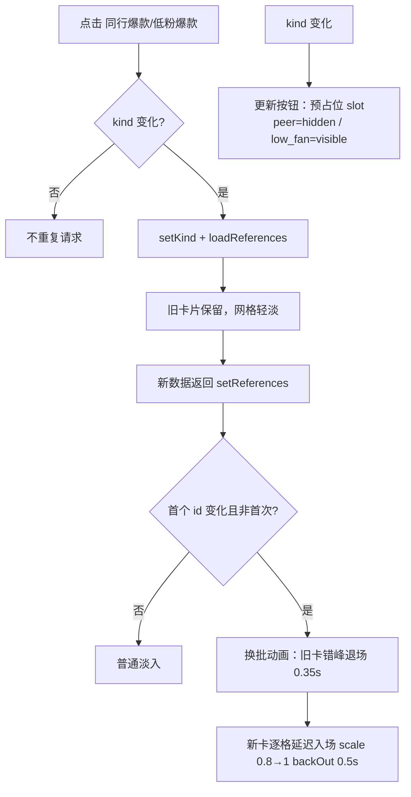
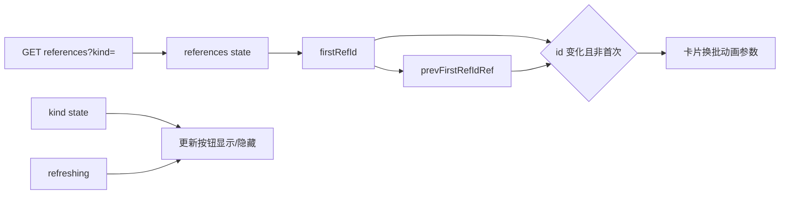

# R-253 开发设计：更新按钮固定预占位 + 参考视频切换复用素材库逐格交接动画

- **对应需求**: `requirements/R-253-review-reference-button-slot-and-replace-animation.md`
- **日期**: 2026-11-05
- **状态**: ✅ 已按本文实现（2026-11-04，verify 全绿 + Playwright 点检）
- **前置**: R-252（切 tab 交叉淡入/按钮宽度动画）、R-199（素材库换批逐格交接 `listReplace`）、R-175（动效规范）、R-247/R-248（参考视频区）
- **原则**: 只改视频复盘页参考视频区；复用素材库动画参数不搬组件；不动接口/数据；`verify.sh` 全绿。

## 1. 开发背景

R-252 中：
- 「更新」按钮用 `AnimatePresence + maxWidth 0↔120` 展开，切换时仍会挤动前两个 tab 按钮；
- 卡片切换是「淡入+上移 / 淡出」交叉动画，与素材库切博主的 R-199「逐格交接」动画不一致。

作者要求：①更新按钮固定预占位置，低粉时只是显示；②切 tab 动画改成素材库切博主那种。

## 2. 涉及的技术

| 技术 | 用途 |
|---|---|
| React 19 + TypeScript | `pages/video-review/index.tsx` |
| Framer Motion `AnimatePresence mode="popLayout"` | 旧卡退场不占位、新卡在同格入场 |
| `@/lib/motion` 的 `listReplace` | 复用素材库 R-199 的退场/入场参数（错峰、时长、fromScale、backOut） |
| Tailwind CSS | 按钮固定宽度/隐藏占位（`w-[74px]`、`invisible`） |
| Playwright rAF 采样 | 按钮 0 位移、卡片 scale/opacity 过渡验证 |
| `scripts/verify.sh` | 门禁 |

无后端/接口/表改动，无新增依赖。

## 3. 开发流程图



## 4. 数据流转图



## 5. 实现细节

### 5.1 更新按钮固定占位

```tsx
<Button
  variant="outline"
  size="sm"
  className={cn('whitespace-nowrap', kind !== 'low_fan' && 'invisible')}
  aria-hidden={kind !== 'low_fan'}
  tabIndex={kind === 'low_fan' ? 0 : -1}
  disabled={refreshing}
  onClick={() => void refreshLowFan()}
>…更新…</Button>
```

- 始终渲染 → 占用固定宽度（约 74px），同行模式隐藏但仍占位；
- 无宽度/位移动画，切 tab 时前两个按钮完全不动；
- 两个 tab 按钮加 `w-[74px] justify-center`：active（default）与 outline 变体边框差 2px，固定宽度消除切换时的 2px 抖动。

### 5.2 换批判定

```tsx
const prevFirstRefIdRef = useRef('')
const firstRefId = references[0]?.id ?? ''
const referencesReplacing = !!firstRefId && !!prevFirstRefIdRef.current && prevFirstRefIdRef.current !== firstRefId
useEffect(() => {
  if (firstRefId) prevFirstRefIdRef.current = firstRefId
}, [firstRefId])
```

- 首次加载：`prevFirstRefIdRef` 为空 → 不用换批动画（普通淡入 `opacity 0, y 14 → 1,0`，0.34s），避免首屏慢半秒；
- 切换 tab / 更新后：首个 id 变化 → 使用素材库换批动画。

### 5.3 卡片动画（复用 `listReplace`）

```tsx
const exitDelay = Math.min(index, listReplace.exit.maxItems) * listReplace.exit.stagger
const enterDelay = exitDelay + listReplace.exit.duration + listReplace.enter.breathAfterExit
const replacing = referencesReplacing && index < 40
<motion.article
  initial={replacing ? { opacity: 0, scale: listReplace.enter.fromScale } : { opacity: 0, y: 14 }}
  animate={{ opacity: 1, y: 0, scale: 1 }}
  exit={{ opacity: 0, scale: listReplace.exit.scale,
          transition: { duration: listReplace.exit.duration, delay: exitDelay, ease: 'easeOut' } }}
  transition={replacing
    ? { duration: listReplace.enter.duration, delay: enterDelay, ease: 'backOut' }
    : { duration: 0.34, ease: 'easeOut' }}
>
```

规则/阈值（来自 R-199，保持一致）：
| 参数 | 值 | 含义 |
|---|---|---|
| `exit.duration` | 0.35s | 旧卡淡出+缩到 0.94 |
| `exit.stagger` / `maxItems` | 0.035s / 16 | 每张错峰，最多 16 档后不再增加 |
| `enter.breathAfterExit` | 0.04s | 旧卡退完后的呼吸间隔 |
| `enter.fromScale` | 0.8 | 新卡起点（肉眼可见的放大过程） |
| `enter.duration` / `ease` | 0.5s / backOut | 0.8→略过 1→落回 1，全程可见 |
| 动画上限 | index<40 | 大列表性能（与素材库一致） |

- `AnimatePresence mode="popLayout"`：退场卡 absolute 不占位；新卡在原格入场；
- 网格容器不整块卸载，切换期间不会整片替换成转圈（沿用 R-252 的加载逻辑）。

### 5.4 边界 / 降级

| 场景 | 行为 |
|---|---|
| 首次加载 | 普通淡入（不做 0.8 显影，避免首屏等待） |
| 切换/更新后首 id 变化 | 逐格交接动画 |
| 更新后首 id 不变（数据未变） | 无换批动画，卡片不重排 |
| 空列表 | 空态文案 |
| 快速切换 | 请求竞态现状不额外处理 |
| 刷新中 | 更新按钮「更新中…」+ 禁用 |

## 6. 新增/修改表结构

**无。**

## 7. 新增/修改接口

**无。** 仍使用 `GET /api/douyin-review/references`、`POST /api/douyin-review/references/refresh`。

## 8. 数据来源与原始字段明细

| # | 页面/功能 | 数据来源 | 原始字段 | 用途 | 更新时间 | 空值/失败 |
|---|---|---|---|---|---|---|
| 1 | 参考视频卡片 | 本地接口 | `id/kind/title/cover_url/author_nickname/author_followers/plays/likes/comments/video_url/verdict/verdict_evidence` | 卡片展示与动画 key | 进入/切 tab/更新后 | 空态；封面 249 兜底 |
| 2 | 换批标记 | 程序计算（前端） | `references[0].id` 前后比较 | 决定是否播换批动画 | 列表变化时 | 首次不播 |
| 3 | 更新按钮 | 前端状态 + 刷新接口 | `kind`、`refreshing` | 显示/隐藏/禁用 | 切 tab/点击 | 失败 toast |

## 9. 验证与实施记录（2026-11-04）

| 检查项 | 方法 | 结果 |
|---|---|---|
| 按钮 0 位移 | Playwright 记录三按钮 x/宽度（同行→低粉→同行） | ✅ 同行 `peer 1142 / low 1224 / update 1306`（hidden）；低粉完全一致（visible）；切回一致 |
| 卡片换批动画 | rAF 采样 opacity/scale | ✅ `opacity 0.00→1.00`，`scale 0.80→1.02`（backOut 过冲），退场 0.35s + 新卡延迟入场 |
| 不整片空白 | 采样可见卡片数 | ✅ 切换期间最少可见 15 张；无长时间空白 |
| 布局/样式 | 截图 + 行分组 | ✅ 一行 5 条、标题两行、更新按钮在低粉可见 |
| 控制台/门禁 | Playwright + `verify.sh` | ✅ console 0 error；后端 761 / 前端 161 + build / 文档 37 表全绿 |
