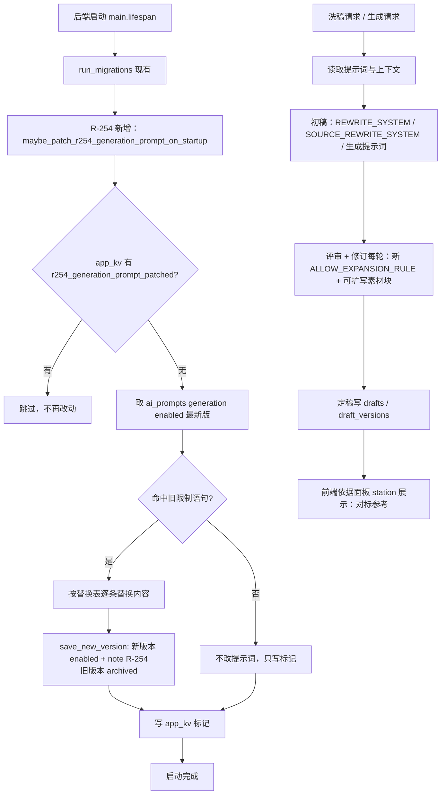
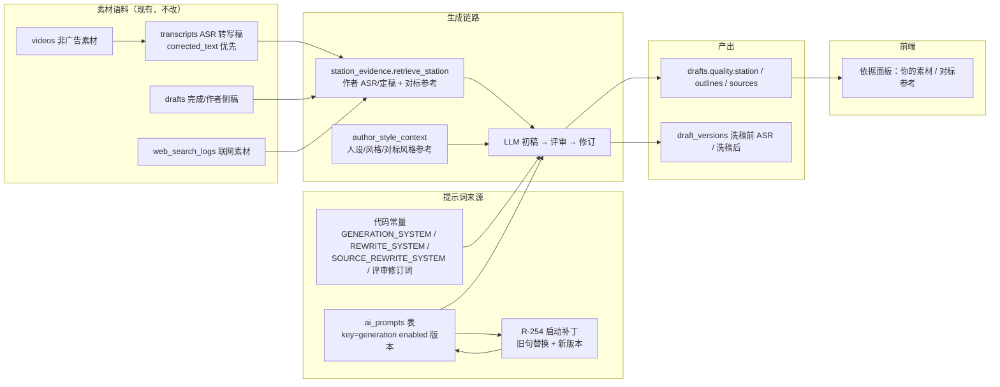

# R-254 开发设计：洗稿/生成文案放开参考素材经历归属（去除「他人经历，禁止写成你的」与反编造硬规则）

- **对应需求**: `requirements/R-254-reference-as-own-experience.md`
- **日期**: 2026-11-05
- **状态**: ✅ 已按本文实现（2026-11-05，verify 全绿 + 真实洗稿/生成冒烟 + Playwright 点检）
- **前置**: R-227（站内真实素材/参考层/证据块每轮注入）、R-228（本次放开的反编造硬规则）、R-099/R-152（洗稿原文只取 ASR 转写稿）、R-181/R-194（洗稿与生成共用作者上下文）、R-021/R-129/R-231（提示词版本管理/兜底）、R-226（Kv 标记一次性启动修复的现有范式）、D-028
- **原则**: 只改提示词文本、一处前端标签、一次性提示词版本补丁；不改表结构、不改接口、不改页面结构、不改人设红线检查；历史草稿不重跑。

## 1. 开发背景

当前「洗稿」与「生成文案（全部入口）」的提示词里有两组硬限制，本次按作者确认全部放开：

1. **经历归属限制**（R-227/R-228 边界）：
   - `generation.GENERATION_SYSTEM`：「【对标】素材只能当参考，**禁止写成你自己的经历**」；
   - `benchmark.REWRITE_SYSTEM`：同上；
   - `station_evidence.build_block`：「对标博主内容（他人，仅作参考，**禁止写成你的经历**）」；
   - `generation._static_style_context`：「对标博主风格参考（仅借鉴语气与结构，观点务必用作者自己的）」；
   - `api/drafts._compute_angles`：「参考风格（仅借鉴语气/结构，观点用你自己的）」。
2. **反编造硬规则**（R-228）：
   - `debate.NO_FABRICATION_RULE`：事实只能来自注入素材/作者上下文、**严禁替作者发明第一人称经历/数字/公司/人名**、缺素材标【需作者补充】；
   - `debate._with_evidence`：「可引用的事实素材（评审与修订**只能用这里的事实**）」；
   - 普通生成与洗稿两条链路的评审/修订 system：「有没有编造数字/人名/机构」「严禁编造数字/人名/机构」；
   - `debate.SOURCE_REWRITE_SYSTEM`：「只能用作者上下文与注入证据里已有的内容，严禁编造；缺素材就标【需作者补充】」；
   - `evidence._build_block`（联网素材块）：「只能引用以下参考里的真实事实/数据/观点……不得编造」。

作者确认：允许把参考素材里的经历/案例/数字写成作者本人第一人称，允许基于素材补全/扩写细节；保留「整篇不逐字照抄」但可偶尔沿用 1–2 句原句；保留联网引用编号/来源留痕（越界编号仍由程序过滤）；人设红线仍是硬检查；D-028（对标不进人设学习/提示词优化语料）不变。

**关键现状（已在开发前核对）**：生成文案实际读取的提示词是数据库 `ai_prompts` 中 `key='generation'`、`status='enabled'` 的版本（当前开发库为 **id=40 / version=11**，内容与旧 `GENERATION_SYSTEM` 一致，仍含旧限制）。只改代码常量不会改变现有库的生成行为，因此需要一次性数据补丁（见 5.4）。洗稿/讨论提示词是代码常量，改完即生效。

> 遗留提醒（本次不改，仅提示）：R-231 的 `prompt_service.ensure_enabled_fallback` 原本挂在 `db.py` 的 ensure 链上启动执行；R-235/R-236 重写 `db.py` 后该调用已不存在（当前只有测试调用它）。本次的补丁函数自行挂 `main.py` lifespan，不依赖该链。

## 2. 涉及的技术

| 技术 | 用途 |
|---|---|
| Python 常量模板（`generation.py` / `benchmark.py` / `debate.py` / `station_evidence.py` / `evidence.py` / `api/drafts.py`） | 改写洗稿与生成两条链路的所有提示词文本 |
| FastAPI lifespan（`main.py`）+ `threading.Thread` + `app_kv` 标记 | 一次性把 DB 中旧 generation 提示词按规则替换并另存启用版本（沿用 R-226 title_cleanup 的启动范式） |
| SQLAlchemy（`AiPrompt` / `Kv`） | 提示词版本行读取/新增/归档；一次性标记读写 |
| pytest + conftest 内存库 | 提示词文本断言、补丁幂等、站内块标签断言 |
| React 19 + TS（frontend_v2 `evidence-panel.tsx`） | 「依据」面板对标参考标签改中性文案 |
| Vitest / `scripts/verify.sh` | 前端测试与全量门禁 |

无新增依赖、无新增路由、无新表、无 Alembic schema revision。

## 3. 开发流程图



## 4. 数据流转图



## 5. 实现细节

### 5.1 提示词文本改动清单（精确到旧句 → 新句）

> 以下「旧」均为当前代码/开发库中逐字存在的原文；「新」为本次替换后的文本。除列出的句子外，其它句子与顺序保持不变。

#### 5.1.1 洗稿链路

**文件**：`backend/app/services/benchmark.py`

| 位置 | 旧 | 新 |
|---|---|---|
| `REWRITE_SYSTEM` 首句（L648-650） | `你是口播脚本代笔。只把给定素材当作**选题与信息线索**，用作者的人设口吻与表达习惯，写成作者能直接录的原创口播稿。` | `你是口播脚本代笔。把给定素材当作**可用内容**（其中的经历、案例、观点都可以用），用作者的人设口吻与表达习惯，写成作者能直接录的口播稿；素材里的经历可以写成作者本人的。` |
| `REWRITE_SYSTEM` 第 3 条（L655-657） | `优先用【站内真实素材·你的】里的真实经历/说法；……【对标】素材只能当参考，**禁止写成你自己的经历**；` | `优先用【站内真实素材】里的真实经历/说法；……【对标】素材可以直接使用，也可以把其中的经历、案例、观点写成作者本人的；` |
| `REWRITE_SYSTEM` 第 4 条（L658-659） | `4) 严禁编造具体数字/人名/机构/经历；没有可靠事实就只讲作者的判断，宁可不要数字；` | `4) 素材不够具体时，允许基于素材补全、扩写细节（包括第一人称经历、具体数字、人物/机构），写成作者能直接录的口播稿即可；` |
| `REWRITE_SYSTEM` 表达要求（L660-661） | `表达要求：不逐字抄袭，不复用原文的结构、核心比喻和句群；……` | `表达要求：整篇不逐字照抄，但可以偶尔直接沿用素材的 1-2 句原句；不复用原文的结构、核心比喻和句群；……` |
| `_rewrite_user` 素材块标题（L677） | `【参考素材·只借选题与信息线索，不借结构与措辞】` | `【参考素材·可把其中的经历/案例/观点当作可用内容（整篇不逐字照抄）】` |

**文件**：`backend/app/services/debate.py`

| 位置 | 旧 | 新 |
|---|---|---|
| `run_rewrite_debate` 评审 system（L947-950） | `“哪些地方不像作者、哪些有 AI 腔、哪些与原文结构或句子雷同照搬（参考改写要求：只借选题与信息线索，不借结构/比喻/句群，必须补作者自己的经历与判断）；**并重点检查内容质量**：……引用的联网事实是否与提供的素材一致（有没有编造数字/人名/机构/经历）、有没有「要努力/要相信自己」这类正确但没用的空话；…”` | `“哪些地方不像作者、哪些有 AI 腔、哪些与原文句子逐字照抄（参考改写要求：整篇不逐字照抄，但可以偶尔沿用素材的 1-2 句原句；素材里的经历/案例可以写成作者本人的）；**并重点检查内容质量**：有没有 2-4 条明确论点、每条是否都有具体事例/数据支撑、有没有「要努力/要相信自己」这类正确但没用的空话；…”` |
| `run_rewrite_debate` 修订 system（L955-957） | `……有可引用的联网事实就口语化引用；严禁编造数字/人名/机构/经历；删掉空话。` | `……有可引用的联网事实就口语化引用；删掉空话。`（再拼 `ALLOW_EXPANSION_RULE`，见 5.2） |

#### 5.1.2 生成文案链路

**文件**：`backend/app/services/generation.py`

| 位置 | 旧 | 新 |
|---|---|---|
| `GENERATION_SYSTEM` 第 3 条（L36-38） | `优先用【站内真实素材·你的】里的真实经历/说法；……【对标】素材只能当参考，**禁止写成你自己的经历**；` | `优先用【站内真实素材】里的真实经历/说法；……【对标】素材可以直接使用，也可以把其中的经历、案例、观点写成作者本人的；` |
| `GENERATION_SYSTEM` 第 4 条（L38-40） | `4) 严禁编造具体数字/人名/机构/经历；没有可靠事实就只讲作者的判断，宁可不要数字；论据缺素材处标【需作者补充】，不要编一个填上；` | `4) 素材不够具体时，允许基于素材补全、扩写细节（包括第一人称经历、具体数字、人物/机构），写成作者能直接录的口播稿即可；` |
| `GENERATION_SYSTEM` 结尾（L41） | `……不要套固定模板；观点必须用作者自己的。` | `……不要套固定模板；观点要按作者本人的口吻和立场表达。` |
| `_static_style_context` 对标风格参考标题（L576） | `对标博主风格参考（仅借鉴语气与结构，观点务必用作者自己的）：` | `对标博主风格参考（可借鉴语气、结构、观点）：` |

**文件**：`backend/app/services/debate.py`

| 位置 | 旧 | 新 |
|---|---|---|
| `SOURCE_REWRITE_SYSTEM`（L315-325） | `你是口播脚本代笔。只把给定素材当作**选题与信息线索**，……硬性要求：1) 不逐字抄袭，不复用原文的结构、核心比喻和句群；2) 必须补入作者自己的经历、判断或案例，观点必须用作者自己的（只能用作者上下文与注入证据里已有的内容，严禁编造；缺素材就标【需作者补充】）；3) 语言自然口语，像作者本人对着镜头说话。` | `你是口播脚本代笔。把给定素材当作**可用内容**，用作者的人设口吻与表达习惯，写成作者能直接录的口播稿。硬性要求：1) 整篇不逐字照抄，但可以偶尔直接沿用素材的 1-2 句原句；2) 可以把素材里的经历、案例、观点写成作者本人的，也可以基于素材补全、扩写细节；3) 语言自然口语，像作者本人对着镜头说话。` |
| `run_debate` 基于原文初稿 user（L461） | `【参考素材·只借选题与信息线索，不借结构与措辞】` | `【参考素材·可把其中的经历/案例/观点当作可用内容（整篇不逐字照抄）】` |
| 普通生成评审 system（L536-538） | `……有没有正确但没用的空话、有没有编造数字/人名/机构。` | `……有没有正确但没用的空话。`（另拼 `ALLOW_EXPANSION_RULE`） |
| 普通生成修订 system（L550） | `……有可引用的联网事实就口语化引用；严禁编造数字/人名/机构。` | `……有可引用的联网事实就口语化引用。`（另拼 `ALLOW_EXPANSION_RULE`） |

**文件**：`backend/app/api/drafts.py`

| 位置 | 旧 | 新 |
|---|---|---|
| `_compute_angles` 参考风格提示（L161） | `参考风格（仅借鉴语气/结构，观点用你自己的）：` | `参考风格（可借鉴语气/结构/观点）：` |

**文件**：`backend/app/services/evidence.py`

| 位置 | 旧 | 新 |
|---|---|---|
| `_build_block` 联网素材块标题（L455-458） | `【联网事实素材·生成方已按人设选文（营销内容已排除）；只能引用以下参考里的真实事实/数据/观点，必须口语化转述（不要念 URL），不得编造】` | `【联网事实素材·生成方已按人设选文（营销内容已排除）；可参考以下素材的事实/数据/观点并补充细节，口语化转述（不要念 URL）】` |

### 5.2 `NO_FABRICATION_RULE` → `ALLOW_EXPANSION_RULE`

`backend/app/services/debate.py`：

- 删除常量 `NO_FABRICATION_RULE`（L297-305）及其注释，替换为：

```python
# R-254：取代 R-228 的 NO_FABRICATION_RULE。作者确认放开：参考素材里的经历/案例/数字
# 可以写成作者本人经历，也允许基于素材补全、扩写细节；不再要求缺素材标【需作者补充】。
ALLOW_EXPANSION_RULE = (
    "\n\n内容自由度（评审与修订都必须遵守）：为了让脚本真实、具体、能直接录，"
    "允许把注入的素材（含【站内真实素材】/【对标】参考/【联网事实素材】）里的经历、案例、数字"
    "改写成作者本人视角，也允许基于素材补全、扩写第一人称经历与细节；"
    "不要再要求「这里需要作者补充真实经历」。"
)
```

- 两处引用（普通生成 L538/L551、洗稿 L951/L959）改为 `+ ALLOW_EXPANSION_RULE`。
- `_with_evidence`（L307-311）文案改为：

```python
return system + f"\n\n可参考/扩写的素材（评审与修订都可据此补全细节）：\n{evidence_block}"
```

> 保留「证据块每轮注入」机制（R-228 的核心价值之一）：初稿、每轮评审、每轮修订都能看到同一份素材，只是不再限制「只能用这里的事实」。

### 5.3 站内素材块与作者上下文标签

**文件**：`backend/app/services/station_evidence.py`

- 模块 docstring（L1-9）：`参考层（对标）：对标博主的视频转写稿——只作创作参考，**明确标注非本人经历**；` → `参考层（对标）：对标博主的视频转写稿——可作创作参考并改写为作者本人视角；`
- `build_block`（L229）：`对标博主内容（他人，仅作参考，**禁止写成你的经历**）：` → `对标博主内容（可参考，可写成作者本人的经历/观点）：`
- 其余：作者事例层标题「你的真实经历/说法（来自你发过的口播）：」「你的定稿（脚本工作台·完成）：」、检索规则（按选题 bigram 相关度、author_k=4 / bench_k=3、排除广告与空转写、corrected_text 优先）**全部不变**。

**文件**：`frontend_v2/src/components/evidence-panel.tsx`

- L192：`对标参考（他人，非你经历）：` → `对标参考：`

### 5.4 数据库 generation 提示词的一次性生效补丁（关键）

**问题**：生成文案读 DB 中 enabled 的 generation 提示词（开发库当前 v11 含旧限制），只改代码默认值不生效。

**方案**：`backend/app/services/prompt_service.py` 新增一次性启动补丁（沿用 R-226 `title_cleanup` 的 Kv 标记 + 后台线程范式），并在 `backend/app/main.py` lifespan 中调用。

```python
R254_PATCH_DONE_KEY = "r254_generation_prompt_patched"

# 旧句 → 新句（与 5.1.2 的新 GENERATION_SYSTEM 逐字一致）
R254_GENERATION_REPLACEMENTS: list[tuple[str, str]] = [
    ("【对标】素材只能当参考，**禁止写成你自己的经历**；",
     "【对标】素材可以直接使用，也可以把其中的经历、案例、观点写成作者本人的；"),
    ("4) 严禁编造具体数字/人名/机构/经历；没有可靠事实就只讲作者的判断，宁可不要数字；",
     "4) 素材不够具体时，允许基于素材补全、扩写细节（包括第一人称经历、具体数字、人物/机构），"),
    ("论据缺素材处标【需作者补充】，不要编一个填上；",
     "写成作者能直接录的口播稿即可；"),
    ("优先用【站内真实素材·你的】里的真实经历/说法",
     "优先用【站内真实素材】里的真实经历/说法"),
    ("观点必须用作者自己的。", "观点要按作者本人的口吻和立场表达。"),
]

def patch_generation_prompt_for_r254(db: Session) -> bool:
    """把 enabled 的 generation 提示词按旧句替换并另存新版本（幂等，返回是否写入新版本）。"""

def maybe_patch_r254_generation_prompt_on_startup() -> None:
    """启动时用 Kv 标记保证只跑一次（后台线程，失败下次启动重试）。"""
```

**算法（输入 / 规则 / 阈值 / 证据 / 排序 / 降级）**：

| 项 | 定义 |
|---|---|
| 输入 | `app_kv` 标记 `r254_generation_prompt_patched`；`ai_prompts` 中 `key='generation' AND status='enabled'` 的版本行（按 `version DESC` 取最新一条，即 `get_prompt` 同一口径） |
| 幂等规则 | 标记已存在 → 直接返回，不再改任何提示词；标记只在「处理完成（含未命中）」后写入，异常回滚不写 → 下次启动重试 |
| 命中阈值 | 内容中至少出现 **1 条**替换表中的旧句（精确子串匹配，区分全半角）→ 执行替换；一条都没命中 → 视为作者已手改/已是新规则，不新增版本 |
| 写入规则 | 对 enabled 内容按替换表**顺序**逐条 `str.replace(old, new)`（全部替换）；替换后内容与原文不同 → `save_new_version(db, "generation", patched, note="R-254 放开参考素材经历归属（旧版归档可回退）")`：旧 enabled 行转 `archived`（内容保留），新行 `enabled`，`version = max+1` |
| 证据/留痕 | `ai_prompts` 旧行（archived）+ 新行（enabled，note 带 R-254）→ AI 设置「提示词 → 生成脚本」版本列表可直接看到并回退；日志 `log.info("R-254 生成提示词已替换为 v{new}（v{old} 归档）")` 或 `log.info("R-254 未命中旧限制语句，跳过")` |
| 排序 | 版本号自增；读取口径不变（enabled 中 version 最大者） |
| 降级 | ①补丁线程异常：`db.rollback()` + `log.exception`，不阻断启动，标记不写，下次启动重试；②DB 无 enabled generation 行：`get_prompt` 本来回退**代码默认**（本次已改为新规则），不写版本、只写标记；③作者已手改提示词且不含旧句：不动，保留作者内容 |
| 不静默覆盖 | 只做上述精确子串替换；不整段覆盖、不重置版本历史 |

`main.py` lifespan 调用位置：`run_migrations()` 之后、`setup_scheduler()` 之前（与其它启动自愈任务并列）：

```python
from .services.prompt_service import maybe_patch_r254_generation_prompt_on_startup

maybe_patch_r254_generation_prompt_on_startup()
```

### 5.5 测试

新增 `backend/tests/test_r254_reference_as_own.py`（失败用例优先，纯逻辑、无真实 LLM）：

1. `test_generation_prompt_allows_reference_as_own`：`GENERATION_SYSTEM` 不含 `禁止写成你自己的经历` / `严禁编造`；含「允许……补全」「观点要按作者本人」。
2. `test_rewrite_prompt_allows_reference_as_own`：`REWRITE_SYSTEM` 不含旧限制；含「可以直接使用」「可以偶尔直接沿用素材的 1-2 句原句」「不逐字照抄」。
3. `test_source_rewrite_prompt`：`SOURCE_REWRITE_SYSTEM` 不含「严禁编造/需作者补充」；含 1-2 句照抄口径。
4. `test_allow_expansion_rule`：`ALLOW_EXPANSION_RULE` 含「允许」「补全」「扩写」；不含「严禁」。
5. `test_station_block_benchmark_label`：`build_block([], [{"title":"t","text":"x"}])` 输出含「对标博主内容（可参考，可写成作者本人的经历/观点）」且不含「禁止写成」。
6. `test_prompt_patch_idempotent`：建库 → 用旧内容 `save_new_version("generation", 旧内容)` → 调 `patch_generation_prompt_for_r254(db)` → 返回 True；enabled 新版本不含旧句、旧版本 archived、note 含 R-254；标记写入；再调一次返回 False 且版本数不变。
7. `test_prompt_patch_skips_clean_prompt`：enabled 内容已是新规则 → 返回 False、版本数不变。

更新 `backend/tests/test_r228_no_fabrication.py`：

- 删除 `NO_FABRICATION_RULE` 导入与「严禁替作者发明第一人称经历 / 需作者补充」断言；
- 保留「证据块每轮 critique/revise 可见」两条用例（这是仍然成立且重要的行为）；
- 文件头注释加一句：R-254 已放开反编造规则，本文件只保留证据可见性回归。

前端：`frontend_v2/src/components/evidence-panel.test.tsx` 增加断言——传入 station.benchmark 时渲染「对标参考：」、不渲染「非你经历」。

### 5.6 文档

- 本需求文档 + 本开发设计（同名成对）。
- `requirements/README.md` 索引新增 R-254 行。
- `docs/milestones.md`：M255 行 + 最后更新行。
- `docs/CHANGELOG.md`：新增 `[R-254]` 段（登记记录，标注待开发）。
- `docs/DECISIONS.md`：新增 D-046（记录「取代 R-228 反编造规则」的决策与风险，避免后续 agent 又按 R-228 改回去）。
- `docs/DATABASE.md`：**不改**（无表/列变化）。

## 6. 新增/修改表结构及逐字段描述

**无 DDL 变更、无 Alembic revision**（表数量不变，`docs/DATABASE.md` 不动）。仅产生两类**运行时数据行**：

### 6.1 `ai_prompts`（已有表）新增一行版本记录

| 字段 | 本次写入值 | 说明 |
|---|---|---|
| `id` | 自增 | 主键 |
| `key` | `generation` | 提示词功能键（生成脚本），不变 |
| `version` | 旧最大版本 + 1（开发库 v11 → v12） | `key` 内自增，唯一约束 `uq_prompt_version` |
| `content` | 旧 enabled 内容按 5.4 替换表替换后的全文 | 新规则提示词；不再含旧限制语句 |
| `status` | `enabled` | 新版本启用；旧 enabled 行改为 `archived`（内容保留可回退） |
| `note` | `R-254 放开参考素材经历归属（旧版归档可回退）` | AI 设置版本列表可见的留痕 |
| `created_at` | 应用时间（北京时间） | `core.timeutil.now` |

### 6.2 `app_kv`（已有表）新增一行一次性标记

| 字段 | 本次写入值 | 说明 |
|---|---|---|
| `key` | `r254_generation_prompt_patched` | 一次性补丁标记 |
| `value` | `1` | 存在即视为已处理（含未命中跳过），防止每次启动重复写版本 |

## 7. 新增/修改接口

**无新增/修改接口、无路径/请求/响应/错误码变化。** 受提示词变化影响的现有接口如下（行为变化只在「产出的文案内容」，结构与错误码不变）：

| 方法 | 路径 | 请求 | 响应 | 错误 | 本次变化 |
|---|---|---|---|---|---|
| POST | `/api/benchmark/rewrite` | `{title, text, key, benchmark_name, post_id?, work_id?, tags?}` | `{task_id}` | 无主博主 400；任务失败详见任务 | 洗稿初稿/评审/修订按新规则（允许写成作者本人经历） |
| POST | `/api/benchmark/rewrite-source` | `{video_id?/post_id?/work_id?}` 三选一 | `{task_id}` | 素材不存在/无文案/主博主素材 400 | 同上 |
| POST | `/api/drafts/generate-async` | `{topic, mode?, query_source?}` | `{task_id, draft_id}` | 无 topic 400 | 生成初稿/评审/修订按新规则（读取 DB 新启用版本） |
| POST | `/api/drafts/{id}/discuss`（重新讨论） | 现有 | 现有 | 现有 | 基于原文的初稿 `SOURCE_REWRITE_SYSTEM` 改为新规则 |
| POST | `/api/drafts/{id}/rework`（回炉） | 现有 | 现有 | 现有 | 同生成链路 |
| 其它生成入口（每日自动、灵感随手记、视频复盘「采用」、AI 对话生成） | 复用 `/api/drafts/generate-async` 或内部 `start_generation` | 现有 | 现有 | 现有 | 同上 |
| GET | `/api/prompts` | 现有 | 版本列表（多一条 R-254 新版本与 note） | 现有 | 提示词版本列表展示新版本 |

## 8. 数据来源与原始字段明细

| 数据项 | 来源类型 | 原始字段 | 落库/使用字段 | 用途 | 更新时间 | 空值处理 |
|---|---|---|---|---|---|---|
| 生成提示词（新规则） | 程序（代码常量 + DB 版本数据） | `generation.GENERATION_SYSTEM` / `ai_prompts.content` | `get_prompt("generation", db)` 返回 enabled 版本 | 生成初稿 system prompt | 部署后首次启动一次性替换；之后手动编辑/回退才变 | 无 enabled 行 → 回退代码默认（已为新规则）；补丁失败 → 保持旧版，下次启动重试 |
| 洗稿/原文改写提示词 | 程序（代码常量） | `benchmark.REWRITE_SYSTEM`、`debate.SOURCE_REWRITE_SYSTEM` | 同上（直接引用） | 洗稿/讨论初稿 system prompt | 代码发布即生效 | 无（常量） |
| 评审/修订提示词 | 程序（代码常量） | `debate.ALLOW_EXPANSION_RULE` + 各链路 critic/revise 文本 | 每轮 LLM messages | 每轮评审与修订 | 代码发布即生效 | 无（常量） |
| 作者事例素材（你的） | 现有库 | `videos`（非广告、当前主博主）→ `transcripts.corrected_text`（优先）/`transcript_text` | `station_evidence` 片段（≤400 字）→ prompt 站内块；元数据 → `drafts.quality.station.author` | 让脚本有作者真实经历/说法 | 生成/洗稿时实时检索 | 无转写/广告/无相关词 → 不出现该条 |
| 对标参考素材 | 现有库 | 对标博主的 `videos` → `transcripts`（同上） | `station_evidence` 片段 → prompt 对标参考块；元数据 → `drafts.quality.station.benchmark` | 参考层（R-254 起可改写成作者本人） | 生成/洗稿时实时检索 | 同上 |
| 作者定稿 | 现有库 | `drafts.status='done'` 且作者侧（`manual`/版本链含 `AUTHOR_SOURCES`）的 `script` | `station_evidence` 片段 | 事例层补充 | 生成/洗稿时实时检索 | 无完成稿 → 不出现该组 |
| 联网素材 | 现有库/第三方 | `web_search_logs` / 本次联网检索结果 | prompt 联网素材块；`drafts.quality.references/sources` | 事实/数据参考 | 生成/洗稿时检索 | 无 key/失败 → 静默为空，不阻断 |
| 对标风格参考（备注） | 现有库 | `creators.note`（对标博主备注，`kind='benchmark'`） | `generation.benchmark_context_lines()` → author_style_context | 风格参考 | 每次生成读取（静态缓存 60s） | 空备注 → 不出现该组 |
| 依据面板站内素材 | 现有库（生成时快照） | `drafts.quality.station`（JSON：author/benchmark 的 kind/title/platform/blogger） | 草稿详情 / 洗稿任务结果 → 前端 `EvidencePanel` | 让作者核对用了哪些素材 | 草稿生成/洗稿结束时写入 | 无 → 不显示站内区 |

## 9. 验证与回滚

**验证**：
1. 单测：上表 7 个用例 + 更新后的 R-228 证据可见性用例；`scripts/verify.sh` 全绿（ruff + mypy + pytest + 前端 lint/vitest/build + 文档一致性）。
2. 真实冒烟（开发库）：启动后端 → 断言 `ai_prompts` enabled generation 为新版本且不含旧句；洗稿 1 篇带具体经历的对标素材 → 检查留痕里初稿/评审/修订 system 均无旧限制；生成 1 篇（主页灵感入口）→ 同上。
3. 前端点检：草稿「依据」面板显示「对标参考」，无「他人，非你经历」；洗稿对照弹窗同样。
4. 幂等复检：重启后端一次 → 不产生新的 generation 版本（标记生效）。
5. 服务保持运行：`http://127.0.0.1:8000/health`、`http://127.0.0.1:3000` 可访问。

**回滚**：
- 提示词：AI 设置 → 提示词 → 生成脚本 → 启用旧版本（R-254 版本归档即可）；代码默认需回滚提交。
- 一次性标记：删除 `app_kv` 中 `r254_generation_prompt_patched` 后重启可重新执行补丁（若代码未回滚会再次替换）。
- 历史草稿不重跑、不回填；无数据结构变更，无需数据回滚。

## 10. 明确不做

- 不做逐字查重/内容合规检测（作者确认偶尔 1–2 句原句可接受）。
- 不改人设红线（redlines）自检与 `_self_check`。
- 不改视频复盘建议、人设提炼、AI 对话工具、复盘归因等其它功能的反编造提示词。
- 不改 D-028：对标素材仍不进人设学习语料/提示词优化语料。
- 不改草稿版本链、`original_script`、「洗稿前 ASR」语义、来源留痕字段。
- 不改页面结构、按钮、动效；除 `evidence-panel.tsx` 标签外前端零改动。
