# R-255 开发设计：全部 AI 提示词统一入库（新建中文说明注册表，运行时统一读表）

- **对应需求**: `requirements/R-255-prompt-registry.md`
- **日期**: 2026-11-05
- **状态**: ✅ 已按本文实现（2026-11-05，`scripts/verify.sh` 全绿（后端 ruff + mypy + pytest 788 用例；前端 lint + vitest 29 文件 166 用例 + build；文档一致性 38 表 / 需求与设计成对） + 接口/数据库/页面冒烟）
- **前置**: R-021（`ai_prompts` 版本库）、R-129（按 key 语料/契约/自检/评测）、R-130（人设=事实源、提示词=指令模板）、R-131（提示词降权）、R-183（创作模式）、R-208（自动优化/自动启用）、R-231（无启用版本兜底，本次接上线）、R-254（生成提示词一次性补丁范式）、D-022/D-023
- **原则**: 只做「登记 + 读表 + 页面展示」；不改任何提示词正文（`video_review` 恢复完整版除外）、不改 JSON 契约与解析、不覆盖作者已有版本、不改模型路由/预算/人设页；表缺失时自动回退代码默认，可随时回滚。

## 1. 开发背景

### 1.1 现状（开发前已核对）

- `ai_prompts` 只有 `PROMPT_META` 登记的 10 个 key（`backend/app/services/prompt_service.py:29-40`），页面可编辑、有版本/候选/评测；当前库 49 行、10 条 enabled、0 条 candidate。
- 另有 **22 条产品系统提示词 + 2 条内部自检探针**写死在代码里（盘点见需求 §4.5 与本文 §8）；它们没有 key、没有版本，页面看不到、改不了。
- 另有 **11 条程序固定输出契约**（9 条 `prompt_contract.CONTRACTS` + 2 条视频复盘内嵌契约）与 **17 条固定规则片段**、**25 条用户消息模板**，都写死在代码里。
- 启动侧：`ensure_defaults()` / `ensure_enabled_fallback()` 只在测试里被调用，`db.py` 没有 ensure 链（R-231 文档所称接线已随 R-235/R-236 重写丢失）；新增 key 目前只能手写 migration 种子。
- `video_review` 是「半残 key」：DB v1 是 R-237 migration 写的 54 字精简占位句，不等于代码里 119 字完整 `SYSTEM`；`prompt_contract` 的契约/语料/预算/评测都不含它。
- 前端不直连 LLM、无硬编码提示词（`frontend_v2/src` 124 个 TS/TSX 全量核对）。

### 1.2 本次目标

1. 新建 `ai_prompt_defs` 注册表：45 行 = 34 条系统提示词（32 产品 + 2 探针）+ 11 条契约，每条含**中文模块名 `module_label`** 与**中文用途说明 `purpose`**。
2. 运行时所有系统提示词统一走 `get_prompt(key)` 读表（`ai_prompts` enabled → `ai_prompt_defs.default_content` → 代码默认 → 空串）。
3. 启动幂等补种（登记缺失、启用版本缺失自动补 v1），并把 R-231 兜底真正接上。
4. `video_review` 一次性升级为完整版（Kv 标记幂等，旧版归档可回退）。
5. 页面「AI 设置 → 高级 → 功能提示词」改为按 14 个模块分组的清单，展示中文说明；可编辑项沿用现有版本/候选/评测能力；契约与探针只读。

### 1.3 约束

- **不覆盖现有数据**：10 个现有 key 的 enabled 正文逐字保留（`video_review` 升级除外）。
- **不改契约与解析**：`prompt_contract` 仍是契约唯一真源；表里契约是只读镜像（页面展示用），运行时不从表读。
- **不引入新依赖**、不新增页面路由、不做权限系统。
- **循环导入**：`prompt_catalog` 不得在模块级 import 业务 service（默认正文用 `importlib` 惰性解析，沿用现有 `prompt_service.default_content` 做法）。

## 2. 涉及的技术

| 技术 | 用途 |
|---|---|
| SQLAlchemy 2.x ORM（`Mapped`/`mapped_column`） | 新增 `AiPromptDef` 模型；`ai_prompts` 不变 |
| Alembic revision | 建 `ai_prompt_defs` 表 + 唯一索引；种子数据（沿用 `7a6f...` 迁移 import 应用代码的既有范式） |
| FastAPI lifespan（`main.py`） | 启动调用 `ensure_prompt_catalog()` + `maybe_upgrade_video_review_prompt()`（失败不阻断启动，只记日志） |
| `app_kv` 标记 | `video_review` 一次性升级幂等（沿用 R-226/R-254 范式） |
| FastAPI + Pydantic | `/api/prompts/*` 增加元数据字段与编辑/优化权限校验 |
| React 19 + TS + React Query + Radix Tabs | `frontend_v2/src/pages/prompts/index.tsx` 分组清单 + 只读契约区 |
| `openapi-typescript`（`npm run gen:api`） | 后端接口变更后重生成 `frontend_v2/src/api/schema.d.ts` |
| pytest + conftest 临时库 | 注册表完整性/幂等/降级/API 校验用例 |

无新增第三方依赖。

## 3. 开发流程图

```mermaid
flowchart TD
    subgraph 启动
      A[main.lifespan] --> B[run_migrations]
      B --> C[ensure_prompt_catalog]
      C --> C1{ai_prompt_defs 有该 key?}
      C1 -->|无| C2[插入元数据 + default_content]
      C1 -->|有| C3[更新元数据/默认正文镜像<br/>不动 ai_prompts]
      C2 --> C4{system 且有 enabled 版本?}
      C3 --> C4
      C4 -->|无| C5[插入 v1 enabled，note=系统默认补种]
      C4 -->|有| C6[跳过，不覆盖]
      C5 --> D[maybe_upgrade_video_review_prompt]
      C6 --> D
      D --> D1{Kv 标记已有?}
      D1 -->|有| E[启动完成]
      D1 -->|无| D2{enabled 正文=54字旧种子?}
      D2 -->|是| D3[save_new_version 完整默认版<br/>旧 v1 归档] --> D4[写标记]
      D2 -->|否| D4
    end

    subgraph 运行时
      R1[业务调用 get_prompt key] --> R2{ai_prompts 有 enabled?}
      R2 -->|有| R3[返回 enabled 正文]
      R2 -->|无| R4{ai_prompt_defs 有 default_content?}
      R4 -->|有| R5[返回 default_content]
      R4 -->|无| R6[返回代码默认常量<br/>仍无则空串 + 日志]
    end

    subgraph 页面
      P1[GET /api/prompts/keys] --> P2[按 module/sort_order 分组渲染清单]
      P2 --> P3[选中可编辑 key → 编辑/保存/优化/评测/版本]
      P2 --> P4[只读契约/探针 → 只读展示]
    end
```



## 4. 数据流转图

```mermaid
flowchart LR
    subgraph 代码默认值（种子源，不直接决定线上行为）
      S1[22 条新提示词常量<br/>debate/benchmark/pipeline/api...]
      S2[现有 10 条常量<br/>generation/persona/...]
      S3[prompt_contract.CONTRACTS<br/>9 条 + 2 条视频复盘内嵌契约]
    end
    subgraph 注册表
      D1[(ai_prompt_defs<br/>key/title/module/module_label<br/>purpose/category/editable/optimizable<br/>feature/entry/default_content/code_ref)]
    end
    subgraph 版本库
      V1[(ai_prompts<br/>key/version/content/status/note)]
    end
    S1 -->|Alembic + 启动补种| D1
    S2 -->|既有 49 行保留；default_content 镜像| D1
    S3 -->|只读镜像 default_content| D1
    D1 -->|缺 enabled 时补 v1| V1
    V1 -->|enabled 优先| G[get_prompt key]
    D1 -->|enabled 缺失时降级| G
    S1 -->|DB 不可用兜底| G
    G --> LLM[LLM 调用 messages[0].content]
    P[页面 /prompts] -->|GET /keys| D1
    P -->|POST save/enable| V1
    V1 -->|版本/候选/评测| P
```

## 5. 实现细节

### 5.1 新模块 `app/services/prompt_catalog.py`（注册表定义）

```python
@dataclass(frozen=True)
class PromptSpec:
    key: str                 # 唯一键
    title: str               # 中文名
    module: str              # 模块 code
    module_label: str        # 中文模块名
    purpose: str             # 中文用途说明（页面展示，作者要的字段）
    entry: str               # 触发入口（页面/任务/接口）
    code_ref: str            # 代码位置 file:line / 常量名
    category: str = "system"         # system | contract | probe
    editable: bool = True             # 是否页面可编辑
    optimizable: bool = False         # 是否开放 AI 优化/评测
    llm_feature: str = ""             # llm_router 功能名
    sort_order: int = 0
    default_ref: tuple[str, str] | None = None  # (模块路径, 常量名)；contract 为 prompt_contract.CONTRACTS[key]
```

- `PROMPT_SPECS: list[PromptSpec]` 45 条（§8 全表）。
- 14 个模块及顺序（`sort_order` 按下列顺序 ×100 + 模块内序号）：

| module | module_label | 条数 | keys |
|---|---|---:|---|
| `generation` | 脚本生成 | 3 | generation / debate_critic_generate / debate_revise_generate |
| `rewrite` | 对标洗稿 | 4 | rewrite_from_source / rewrite_critic / rewrite_revise / rewrite_from_benchmark |
| `benchmark` | 对标分析 | 3 | benchmark_ad_judge / benchmark_ad_judge_batch / benchmark_analyze |
| `persona` | 人设引擎 | 4 | persona_init / persona_merge / persona_updates / persona_compare |
| `material` | 素材导入 | 2 | video_tags / correct |
| `learning` | 改稿学习 | 2 | diff / feedback_insight |
| `review` | 视频复盘 | 2 | video_review / video_review_advice |
| `chat` | AI 对话 | 2 | chat / chat_create_mode |
| `ideas` | 选题灵感 | 5 | ideas_match / ideas_daily_ai / ideas_daily_best / ideas_angles / inspiration_refine |
| `opportunity` | 内容机会 | 2 | opportunity_comment_cluster / opportunity_gap |
| `evidence` | 素材检索 | 1 | evidence_pick |
| `draft_meta` | 草稿元信息 | 1 | draft_meta |
| `prompt_ops` | 提示词优化 | 1 | prompt_optimize |
| `selfcheck` | 系统自检 | 2 | selfcheck_probe_chat / selfcheck_probe_json |

- `EDITED_KEYS = {...现有 10 个 key}`：`optimizable=True` 仅这 10 个；其余系统提示词 `optimizable=False`。
- `default_content(key)`：用 `importlib.import_module(default_ref[0])` + `getattr(..., default_ref[1])` 惰性取正文；`contract` 类取 `prompt_contract.CONTRACTS[...]`；取不到返回 `""`（记录日志，不抛异常）。禁止模块级 import 业务 service。
- `PROMPT_META` 兼容：`prompt_service.PROMPT_META` 改为由 `PROMPT_SPECS` 派生 `{key: (模块路径, 常量名, title)}`，保证旧 migration（`7a6f...`）在全新库上仍能工作，且自动覆盖全部 34 条系统提示词。

### 5.2 运行时 `get_prompt(key, db=None)`

规则（按顺序，命中即返回）：

| 顺序 | 来源 | 条件 | 说明 |
|---:|---|---|---|
| 1 | `ai_prompts` | `key` 相同且 `status='enabled'` 的最新 `version` | 现有作者/AI 优化版本优先，保持不变 |
| 2 | `ai_prompt_defs.default_content` | `key` 存在、`is_active=True`、`default_content` 非空 | 表里有、版本表缺（如探针/新 key 未种版本）时兜底 |
| 3 | 代码默认常量 | `PROMPT_META` 有该 key | DB 不可用/未迁移时保持旧行为，「最坏也不变空」 |
| 4 | 空串 | 以上都无 | 记录 warning（同一 key 只记一次），不抛异常 |

实现要点：

- 沿用现有签名与「`db=None` 时自建短 Session」逻辑；有 db 的调用点一律传 db（少一次连接）。`prompt_optimize` 等已有 db 的路径直接传。
- `ai_prompt_defs` 查询按 `key` 唯一索引，单次点查（LLM 调用耗时远大于此，不加缓存，避免版本切换后读到旧值）。
- 线程安全：不持有全局 Session；每次调用自建/复用传入 Session（与现状一致）。
- `MODEL` 名称：`AiPromptDef`（`app/models/prompt.py`），`__tablename__="ai_prompt_defs"`。
- `label(key)` / `prompt_group(key)`：`label` 优先取 `PROMPT_SPECS`（与 DB 种子一致）；`prompt_group` 保持返回 `persona_engine`（module=persona）/`production`，供旧前端兼容；`/keys` 接口用 DB 值覆盖展示字段。

### 5.3 启动补种 `ensure_prompt_catalog(db)`

对 `PROMPT_SPECS` 45 条逐条处理（幂等）：

1. **查** `ai_prompt_defs` by key。
2. **无则插**：写入全部元数据 + `default_content` + `created_at/updated_at`。
3. **有则更新**：`title / module / module_label / purpose / category / editable / optimizable / llm_feature / entry / code_ref / sort_order / is_active=True / updated_at`；`default_content` 一律同步为代码当前默认（它是「代码默认基准」，不是作者内容；作者内容在 `ai_prompts`，不会被覆盖）。
4. **补启用版本**（只对 `category='system'|'probe'` 且 `editable` 或不适用）：若无 `status='enabled'` 行 → 插入 `version=1`、`content=default_content`、`status='enabled'`、`note='系统默认（R-255 统一入库补种）'`。已有 enabled **绝不重写**。可复用/接线现有 `ensure_enabled_fallback()`（R-231）。
5. 一次 `commit`；任一 key 失败 → `rollback` + 记日志，不影响其它已提交批次（按 key 独立 try 或整体回滚 + 日志，取简单：整体 try/rollback，失败下次启动重试）。
6. 调用点：`main.lifespan` 在 `run_migrations()` 之后、其他启动任务之前，`try/except` 包裹（启动不因补种失败而中断）。

**阈值/判断**：无阈值；「缺失」= 无 defs 行 / 无 enabled 行。补种数量预计：首次升级 45 行 defs + 24 条 v1（22 新 key + 2 探针；探针有版本便于统一读路径）。

**对现有测试的影响**：`test_migrations.py` 断言 `ai_prompts` 行数 10 → 改为 34（34 条系统提示词各一版；契约不版本化）；其它测试 fixture 里 `for key in PROMPT_META` 会自动覆盖全部，无需改。

### 5.4 `video_review` 一次性升级

- **输入**：`ai_prompts` 中 `key='video_review'` 的 enabled 最新行。
- **判断**：正文去空白后 == R-237 旧种子常量（54 字，`"只能依据输入证据解释视频表现和整理主题，不得创造数字、评论、经历或证据ID。输出必须符合调用方JSON契约。"`）。
- **动作（命中）**：`save_new_version(db, "video_review", default_content("video_review"), note="R-255 统一入库：video_review 恢复完整系统提示词（旧精简种子归档）")` → 新版本 enabled，旧 v1 自动 archived（页面可一键启回）。
- **动作（不命中）**：不改正文，只写标记（作者已手改/已是完整版）。
- **幂等**：`app_kv` 标记 `r255_video_review_prompt_upgraded=1`；标记存在直接跳过；失败不写标记，下次启动重试。
- **调用**：`main.lifespan` 在 `ensure_prompt_catalog` 之后同步执行（一次短事务，快速），`try/except` 包裹。
- **降级**：升级失败 → 保持旧正文，运行时行为与升级前一致（不阻塞启动）。

### 5.5 22 条新增提示词调用点改造（逐条）

通用做法：**把内联字符串常量提到模块级**（供 `PROMPT_META`/种子引用）→ 调用点改为 `get_prompt("<key>", db)` → 原先拼在 system 后的**运行时上下文保持代码拼接**（表里只存静态指令部分）。

| key | 代码位置（改造点） | 现状 | 改造 |
|---|---|---|---|
| `debate_critic_generate` | `debate.py:529-539`（`run_debate` 内局部 `critic_system`） | 内联静态串 + `ALLOW_EXPANSION_RULE` + 人设/红线/画像 + 证据 + 可选原文 | 提到模块常量 `CRITIC_SYSTEM_GENERATE`；`critic_system = get_prompt("debate_critic_generate", db) + ALLOW_EXPANSION_RULE + 动态上下文 + evidence` |
| `debate_revise_generate` | `debate.py:542-552`（局部 `revise_system`） | 内联 + `ALLOW_EXPANSION_RULE` + `style_note` + 证据 | 常量 `REVISE_SYSTEM_GENERATE`；同上拼接 |
| `rewrite_from_source` | `debate.py:314-323`（常量 `SOURCE_REWRITE_SYSTEM`），调用点 `debate.py:456` | 已有常量，直接用作 system | 调用点 `initial_system = get_prompt("rewrite_from_source", db)`；常量保留为代码默认 |
| `rewrite_critic` | `debate.py:941-950`（`run_rewrite_debate` 局部） | 内联 + `ALLOW_EXPANSION_RULE` + `author_ctx` + 证据 | 常量 `CRITIC_SYSTEM_REWRITE`；同拼接 |
| `rewrite_revise` | `debate.py:951-959`（局部） | 内联 + `ALLOW_EXPANSION_RULE` + `author_ctx` + 证据 | 常量 `REVISE_SYSTEM_REWRITE`；同拼接 |
| `rewrite_from_benchmark` | `benchmark.py:650-670`（常量 `REWRITE_SYSTEM`），调用点 `debate.py:887-905` | 常量经 `rewrite_system` 传入 | `rewrite_system = get_prompt("rewrite_from_benchmark", db)` |
| `benchmark_ad_judge` | `benchmark.py:284-291`（`_AD_JUDGE_SYSTEM`），调用点 `benchmark.py:314` | 常量 | `system = get_prompt("benchmark_ad_judge", db)` |
| `benchmark_ad_judge_batch` | `benchmark.py:290-294`（`_AD_BATCH_SYSTEM`），调用点 `benchmark.py:343` | 常量 | `system = get_prompt("benchmark_ad_judge_batch", db)` |
| `benchmark_analyze` | `benchmark.py:705`（`analyze_text` 内联），调用点同函数 | 内联单行 system | 提到常量 `ANALYZE_SYSTEM`；`system = get_prompt("benchmark_analyze", db)` |
| `feedback_insight` | `feedback_analysis.py:35-40`（`ANALYSIS_SYSTEM`），调用点 `:83` | 常量 | `system = get_prompt("feedback_insight", db)` |
| `video_review_advice` | `video_review_advices.py:30-36`（`SYSTEM`），调用点 `:302` | 常量 | `system = get_prompt("video_review_advice", db)` |
| `chat_create_mode` | `chat_service.py:511-515`（`CREATE_MODE_PROMPT`），调用点 `:547` | 常量按 mode 条件追加 | `mode == "create"` 时追加 `get_prompt("chat_create_mode", db)`（保留常量兜底由 get_prompt 完成） |
| `ideas_match` | `pipeline.py:78-84`（`_match_candidates` 局部 system），调用点 `:87` | 内联 | 常量 `MATCH_SYSTEM`；`get_prompt("ideas_match", db)` |
| `ideas_daily_ai` | `pipeline.py:212-222`（`_ai_candidate` 局部），调用点 `:226` | 内联 | 常量 `DAILY_AI_SYSTEM`；`get_prompt("ideas_daily_ai", db)` |
| `ideas_daily_best` | `pipeline.py:357-362`（`_pick_daily_best_index` 局部），调用点 `:366` | 内联 | 常量 `DAILY_BEST_SYSTEM`；`get_prompt("ideas_daily_best", db)` |
| `ideas_angles` | `api/drafts.py:151-156`（`_compute_angles` 局部），调用点 `:165` | 内联 | 常量 `ANGLES_SYSTEM`；`get_prompt("ideas_angles", db)` |
| `inspiration_refine` | `inspiration.py:9-13`（`_SYSTEM`），调用点 `:28` | 常量 | `get_prompt("inspiration_refine", db)` |
| `opportunity_comment_cluster` | `opportunity.py:245-254`（`_LLM_CLUSTER_SYSTEM`），调用点 `:291` | 常量 | `get_prompt("opportunity_comment_cluster", db)` |
| `opportunity_gap` | `opportunity.py:510-516`（`_GAP_SYSTEM`），调用点 `:559` | 常量 | `get_prompt("opportunity_gap", db)` |
| `evidence_pick` | `evidence.py:75-81`（`_PICK_SYSTEM`，含 `{min_pick}/{max_pick}` 占位），调用点 `:395` | `str.format` 注入上下限 | `get_prompt("evidence_pick", db)` 后 `.format(min_pick=lo, max_pick=hi)`；`KeyError/ValueError` → 回退代码常量 format（记录 warning） |
| `draft_meta` | `draft_meta_suggest.py:12-22`（`SUGGEST_META_SYSTEM`），调用点 `:101` | 常量 | `get_prompt("draft_meta", db)` |
| `prompt_optimize` | `prompt_service.py:42-53`（`OPT_SYSTEM`），调用点 `:451` | 常量 | `get_prompt("prompt_optimize", db)`（本函数内已有 db，直接传） |
| `selfcheck_probe_chat` / `selfcheck_probe_json` | `model_health.py:42` / `:59`（`PROBES` 字典内联 system） | 内联在 `PROBES` | 提到常量 `SELFCHECK_PROBE_CHAT_SYSTEM` / `SELFCHECK_PROBE_JSON_SYSTEM`；`run_selfcheck` 主线程预取（沿用 `prompt_key` 机制）：`PROBES` 增加 `prompt_key`，`systems[key]=get_prompt(...)` |

**现有 10 条调用点不改**（`ingest.py:81`、`chat_service.py:547`、`persona.py:420/436/518/536`、`debate.py:465`、`diff_analysis.py:99/131`、`video_review_attribution.py:338`，以及 `model_health.py` 的 `video_tags` 探针）——它们已经走 `get_prompt`，新逻辑自动生效。

**埋点/证据**：改造后在 `get_prompt` 内对「降级到代码默认/空串」记 warning（含 key、来源层级），便于排查「为什么改动没生效」。

### 5.6 契约只读镜像（11 条）

- 来源：`prompt_contract.CONTRACTS` 9 个 key + 视频复盘 2 条内嵌契约（当前在 `video_review_attribution._prompt` / `video_review_advices.build_metric_advices` 内；本次**顺带抽到 `prompt_contract.CONTRACTS["video_review"] / ["video_review_advice"]`**，文本逐字不变，供镜像展示）。
- 表里 `category='contract'`、`editable=false`、`optimizable=false`；`default_content` 由启动补种从代码同步（代码是真源；直接改 DB 会被下次启动覆盖，页面也不可编辑）。
- 运行时 `contract_for(key)` **仍读代码**（理由：契约与 `validate_candidate`/JSON 解析强绑定，页面/DB 改动会破坏解析；作者已确认「契约只读」）。
- 页面契约区只读展示，`GET /keys` 返回契约行（`category=contract`、`versions=[]`、`enabled_version=0`、`content=default_content`）。

### 5.7 API 校验规则

| 规则 | 输入 | 判断 | 结果 |
|---|---|---|---|
| 未知 key | save/enable/optimize/reject/versions/eval 的 `{key}` | `ai_prompt_defs` 无该 key | `404 {"detail":"未知提示词类别"}` |
| 只读不可编辑 | save 的 `{key}` | `category != 'system'` 或 `editable=false` | `400 {"detail":"该提示词为程序固定，不可编辑"}` |
| 只读不可启用 | enable 的 `{key}` | 同上 | `400 {"detail":"该提示词为程序固定，不可启用"}` |
| 未开放优化 | optimize 的 `{key}` | `optimizable=false` | `400 {"detail":"该提示词暂未开放 AI 优化"}` |
| 正文为空 | save body `content` | 去空白后为空 | 保持现状（允许保存空串？→ 本次加校验：`400 {"detail":"提示词正文不能为空"}`，避免把正在用的功能清空） |
| 版本不存在 | enable/reject/eval 的 `{version}` | 查不到行 | 现有逻辑：enable 404「版本不存在」；reject 404；eval 404 |

> 说明：现有 `ensure_defaults` / `ensure_enabled_fallback` 保留（测试与迁移在用），启动链路改为调用 `ensure_prompt_catalog`（内部复用 `ensure_enabled_fallback` 的补启用逻辑）。

### 5.8 前端实现（`frontend_v2/src/pages/prompts/index.tsx`）

1. **数据**：继续只用一个 `GET /api/prompts/keys`（React Query key `['prompts','keys']`）；接口新增字段：`title/module/module_label/purpose/category/editable/optimizable/llm_feature/entry/code_ref/sort_order`。
2. **清单渲染**：`items.filter(category!=='contract')` 按 `module` 分组、组内按 `sort_order`；渲染为「模块标题 + 提示词行按钮」；行内展示 `title`、`module_label`、`purpose`（`line-clamp-1` + `title` 悬停全文）、类型徽章、`enabled_version`、`has_candidate`。
3. **选中详情**：保留现有卡片结构（当前启用/候选/版本效果/历史版本），补充标题区：`title` + `module_label` + 类型 + 完整 `purpose` + `entry`；`editable=false` 时文本域 `readOnly`、隐藏保存/优化；`optimizable=false` 时隐藏「AI 优化」与评测相关按钮（候选卡片也不出现，因为不会产生候选）。
4. **只读契约区**：`items.filter(category==='contract')`，`<details>` 折叠展示每条 `title/purpose/default_content`。
5. **空/失败**：见需求 §4.2；接口失败保留旧缓存（React Query 默认 `keepPreviousData` 需显式设置或 `placeholderData`）。
6. **类型**：更新本地 `PromptItem` 接口；后端接口合并后运行 `npm run gen:api` 更新 `src/api/schema.d.ts`（需要后端 8000 运行）；若生成失败手改对应类型即可（页面只用局部接口）。
7. **不做新动效**：沿用现有 hover/按下反馈与卡片样式，移动端清单纵向排列（`flex-col`/`grid-cols-1`）。

### 5.9 兼容与回滚

| 场景 | 行为 |
|---|---|
| 旧前端 + 新后端 | 接口只增字段、旧字段（label/group/content/versions/eval）全部保留 → 正常 |
| 新前端 + 旧后端 | 新字段为 `undefined` → 页面降级为「按 key 平铺 + 无中文说明」，不报错（前端用可选链 + 默认值） |
| 新后端 + 旧库（未执行 migration） | `run_migrations` 会执行 Alembic → 表自动创建；启动补种写入 defs 与缺失 v1；现有 ai_prompts 不动 |
| 代码回滚（去掉新代码，表还在） | 旧代码不读 `ai_prompt_defs`；`ai_prompts` 中新增的 24 条 v1 行不影响旧逻辑（旧代码不按它们取提示词）→ 行为等同升级前 |
| `video_review` 升级回退 | 旧 v1 archived，页面「历史版本」可一键启用回退；或直接 `enable v1` 接口 |
| 启动补种失败 | 记日志、不影响启动；下次启动重试；运行时按降级链回退代码默认 |

### 5.10 测试计划

**新增 `backend/tests/test_r255_prompt_registry.py`**：

1. 注册表完整性：`PROMPT_SPECS` 45 条（34 system/probe + 11 contract）；key 唯一；每条 `title/module_label/purpose/code_ref` 非空且 `purpose` 含中文；`default_content` 非空（契约与探针也非空）。
2. `get_prompt` 降级：无 DB 行 → 返回代码默认；defs 有 default、无版本 → 返回 default；有 enabled → 返回 enabled（含作者改过的内容优先）。
3. `ensure_prompt_catalog` 幂等：空库执行两次 → defs 45 行、系统 v1 各一条（无重复）；已有 enabled 内容不被覆盖；metadata 更新不产生新版本。
4. 契约只读：`editable=false/optimizable=false`；`contract_for` 文本与 defs.default_content 一致（镜像无漂移）。
5. `video_review` 升级：旧 54 字种子 → 新版本为完整默认、旧版 archived、标记写入；二次执行不变；已手改的正文不动。
6. API：`GET /api/prompts/keys` 返回 45 行且含中文字段；保存契约 key → 400；优化非 optimizable key → 400；未知 key → 404；保存新 key → 版本 +1 且启用。
7. 读表生效（mock LLM）：修改某新增 key 的 enabled 正文后，调用对应服务（如 `pipeline._pick_daily_best_index` 或 `feedback_analysis.analyze`，mock LLM）断言 `messages[0]["content"]` 为新正文。
8. 现有能力回归：`test_r129_prompt_optimize` / `test_r208_prompt_auto` / `test_r231_prompt_version_guard` / `test_r130_r131_data_side` / `test_r143_budget_settings` / `test_r147_chat_agent` 全绿（fixture 种子改为 `ensure_prompt_catalog` 或 `PROMPT_META` 自动覆盖）。
9. `test_migrations.py`：空库 upgrade 后 `ai_prompts` 行数 34、`ai_prompt_defs` 行数 45、head=`r255promptdefs`。

**前端**：`npm run lint` + `npx vitest run` + `npm run build`（分组/只读渲染可加轻量 vitest，至少保证构建通过）。

**验收冒烟**：后端 8000 / 前端 3000 加载最新代码；`GET /api/prompts/keys` 抽查 45 行；页面打开「AI 设置 → 高级」清单可见 14 个模块、契约区只读、无 console error；改一条新增提示词保存后调用对应功能确认生效（可 mock）。

## 6. 新增/修改表结构及逐字段描述

### 6.1 新表 `ai_prompt_defs`（AI 提示词注册表）

Alembic revision：`r255promptdefs`（`down_revision = "r248verdict"`，即当前 head）。

| 字段 | 类型 | 可空 | 默认 | 说明 |
|---|---|---|---|---|
| `id` | INTEGER | 否 | 自增主键 | |
| `key` | VARCHAR(64) | 否 | | 唯一键；现有 10 个沿用，新增按功能命名（如 `rewrite_critic`） |
| `title` | VARCHAR(80) | 否 | `''` | 中文名 |
| `module` | VARCHAR(40) | 否 | `''` | 模块 code |
| `module_label` | VARCHAR(40) | 否 | `''` | 中文模块名 |
| `purpose` | TEXT | 否 | `''` | 中文用途说明（用于哪个模块功能、干什么用的、输入→输出） |
| `category` | VARCHAR(20) | 否 | `'system'` | `system` / `contract` / `probe` |
| `editable` | BOOLEAN | 否 | `true` | 页面可编辑 |
| `optimizable` | BOOLEAN | 否 | `false` | 可 AI 优化/评测 |
| `llm_feature` | VARCHAR(40) | 否 | `''` | 模型路由功能名（`llm_router.FEATURE_LABELS`） |
| `entry` | TEXT | 否 | `''` | 触发入口说明 |
| `default_content` | TEXT | 否 | `''` | 代码默认正文（种子/恢复默认基准） |
| `code_ref` | TEXT | 否 | `''` | 代码位置 |
| `sort_order` | INTEGER | 否 | `0` | 展示顺序 |
| `is_active` | BOOLEAN | 否 | `true` | 是否启用 |
| `created_at` | DATETIME | 否 | 当前时间（北京） | 复用 `core.timeutil.now` |
| `updated_at` | DATETIME | 否 | 当前时间（北京） | 更新时程序刷新 |

**索引/约束**：`UniqueConstraint("key", name="uq_prompt_def_key")`；`ix_ai_prompt_defs_key`（唯一索引由 unique 约束产生或显式建）；`ix_ai_prompt_defs_module`（module）。

**模型**：`backend/app/models/prompt.py` 新增 `AiPromptDef`（不动 `AiPrompt` / `PromptEval`）。`docs/DATABASE.md` 同步新增章节（表总览数量 +1）。

> 只读视图边界：`ai_prompt_defs` 含提示词正文与内部说明，**不加入** `app/core/analytics_views.py` 的对话可查视图（与 `ai_prompts` 同边界）。

### 6.2 现有表

- `ai_prompts`：**结构不变**；升级后新增 24 行 v1（22 条新产品提示词 + 2 条探针），已有 49 行不动。
- `prompt_evals`：结构不变。
- `app_kv`：新增一个一次性标记 `r255_video_review_prompt_upgraded`。

### 6.3 迁移内容

1. `create_table("ai_prompt_defs", ...)` + 索引/唯一约束。
2. 种子：`from app.services.prompt_catalog import PROMPT_SPECS, default_content` 遍历 45 条 `insert`（`created_at/updated_at=sa.func.now()`），`INSERT ... WHERE NOT EXISTS` 幂等（沿用 `b237...` 风格）。
3. `ai_prompts` 补 v1：对 `category in ('system','probe')` 且 `is_active` 的 key，若表中无任何行 → insert v1 enabled（note 同 §5.3）；已有不动。
4. `downgrade()`：仅 `drop_table("ai_prompt_defs")`（`ai_prompts` 中新增 v1 行保留不删——回滚代码后旧逻辑不读它们，删除反而有误删作者编辑的风险）。

## 7. 新增/修改接口

### 7.1 `GET /api/prompts/keys`（修改响应）

- **方法/路径**：`GET /api/prompts/keys`
- **请求**：无参数。
- **响应**：`list[dict]`，45 行（34 系统 + 11 契约），按 `sort_order` 升序。每条字段：

| 字段 | 类型 | 说明 |
|---|---|---|
| `key` | str | 唯一键 |
| `title` / `label` | str | 中文名（`label` 保留旧字段，值同 `title`） |
| `module` / `module_label` | str | 模块 code / 中文模块名 |
| `purpose` | str | 中文用途说明 |
| `category` | str | system/probe/contract |
| `editable` / `optimizable` | bool | 页面可编辑 / 可优化 |
| `llm_feature` / `entry` / `code_ref` | str | 路由功能名 / 入口 / 代码位置 |
| `sort_order` | int | 展示顺序 |
| `group` | str | 旧字段：`persona_engine`（module=persona）/`production` |
| `enabled_version` | int | 当前启用版本（契约/无版本为 0） |
| `content` | str | 当前启用正文；无版本时为 `default_content` |
| `has_candidate` / `candidate_version` / `candidate_content` / `candidate_note` | | 现有语义不变 |
| `eval` | object\|null | 现有语义不变（评测摘要） |
| `effect` | list | 现有语义不变（当前仅 generation） |
| `versions` | list | 现有语义不变（最近 30 版；契约/探针为空） |

- **错误**：500 仅数据库异常。
- **示例（节选）**：`{"key":"rewrite_critic","title":"洗稿讨论-评审","module":"rewrite","module_label":"对标洗稿","purpose":"对照作者完整上下文与原文，挑出不像作者、AI 腔、逐字照抄与内容质量问题…","category":"system","editable":true,"optimizable":false,"llm_feature":"generation","entry":"对标洗稿双模型讨论（/api/benchmark/rewrite）","enabled_version":1,"has_candidate":false,...}`

### 7.2 `POST /api/prompts/{key}/save`（修改校验）

- **请求**：`{"content": "新正文"}`。
- **校验**：key 必须在 defs 且 `category=='system' && editable`；`content` 去空白非空。
- **响应**：`{"id","key","version","content","status":"enabled","note","created_at"}`（保存 = 另存新版本并启用，旧 enabled 归档；generation 额外触发金样本自测任务，现有语义不变）。
- **错误**：`404 未知提示词类别`；`400 该提示词为程序固定，不可编辑`；`400 提示词正文不能为空`。

### 7.3 `POST /api/prompts/{key}/enable`（修改校验）

- **请求**：`{"version": 3}`。
- **校验**：key 在 defs 且 `category=='system' && editable`；版本存在。
- **响应**：版本行（同现有）。
- **错误**：`404 未知提示词类别` / `404 版本不存在` / `400 该提示词为程序固定，不可启用`。

### 7.4 `POST /api/prompts/{key}/optimize`（修改校验）

- **请求**：`{"material": ""}`。
- **校验**：key 在 defs 且 `optimizable=true`；已有同 key 优化任务 → 返回现有 task_id（语义不变）。
- **响应**：`{"task_id": 123}`。
- **错误**：`404 未知提示词类别`；`400 该提示词暂未开放 AI 优化`。

### 7.5 其它接口（不修改契约）

- `GET /api/prompts/{key}/versions`：不变（契约/探针 key 返回空列表；未知 key 返回空列表，保持现状）。
- `POST /api/prompts/{key}/candidates/{version}/reject`：不变。
- `POST /api/prompts/{key}/eval/rerun`：不变（仅对已支持评测的 key 有意义）。
- `POST /api/prompts/optimize-rules`：不变（`RULE_KEYS` 仍 3 个）。

## 8. 数据来源与原始字段明细

### 8.1 系统提示词 34 条（逐条）

> 字段：`default_content` 来源 = 代码常量（`模块.常量`）；`llm_feature`；`entry`（触发入口）；`module/module_label`；`editable/optimizable`；种子后 `ai_prompts` 处理。
> 现有 10 条标「已有」，升级时只补 defs 镜像、不动版本；其余 24 条（22 产品 + 2 探针）由迁移/启动补 v1。

| key | 中文名 | module | default_content 来源 | llm_feature | entry（触发入口） | editable | optimizable | 版本处理 |
|---|---|---|---|---|---|---|---|---|
| `generation` | 生成脚本 | generation | `generation.GENERATION_SYSTEM` | generation | 工作台/回炉/每日生成/金样本自测（经双模型讨论） | 是 | 是（已有） | 已有，不动 |
| `debate_critic_generate` | 讨论-评审（生成链） | generation | `debate.CRITIC_SYSTEM_GENERATE`（新提常量） | generation | 双模型讨论 `run_debate` 每轮 | 是 | 否 | 新增 v1 |
| `debate_revise_generate` | 讨论-修订（生成链） | generation | `debate.REVISE_SYSTEM_GENERATE`（新提常量） | generation | 双模型讨论 `run_debate` 每轮 + 红线收口 | 是 | 否 | 新增 v1 |
| `rewrite_from_source` | 基于原文改写 | rewrite | `debate.SOURCE_REWRITE_SYSTEM` | generation | 草稿「基于原文讨论」首轮 | 是 | 否 | 新增 v1 |
| `rewrite_critic` | 洗稿讨论-评审 | rewrite | `debate.CRITIC_SYSTEM_REWRITE`（新提常量） | generation | 对标洗稿讨论每轮 | 是 | 否 | 新增 v1 |
| `rewrite_revise` | 洗稿讨论-修订 | rewrite | `debate.REVISE_SYSTEM_REWRITE`（新提常量） | generation | 对标洗稿讨论每轮 | 是 | 否 | 新增 v1 |
| `rewrite_from_benchmark` | 对标洗稿初稿 | rewrite | `benchmark.REWRITE_SYSTEM` | generation | 对标洗稿首轮（benchmark_rewrite 任务） | 是 | 否 | 新增 v1 |
| `benchmark_ad_judge` | 对标广告判定（单条） | benchmark | `benchmark._AD_JUDGE_SYSTEM` | benchmark | 对标候选广告过滤 | 是 | 否 | 新增 v1 |
| `benchmark_ad_judge_batch` | 对标广告判定（批量） | benchmark | `benchmark._AD_BATCH_SYSTEM` | benchmark | 对标候选批量广告过滤 | 是 | 否 | 新增 v1 |
| `benchmark_analyze` | 对标「我能不能讲」 | benchmark | `benchmark.ANALYZE_SYSTEM`（新提常量） | benchmark | `/api/benchmark/analyze` | 是 | 否 | 新增 v1 |
| `persona_init` | 人设逐篇提取 | persona | `persona.PERSONA_INIT_SYSTEM` | persona_init | 人设 init/rebuild/recheck/导入自动 | 是 | 是（已有） | 已有，不动 |
| `persona_merge` | 人设归纳合并 | persona | `persona.PERSONA_MERGE_SYSTEM` | persona_merge | 人设合并（init/rebuild/recheck） | 是 | 是（已有） | 已有，不动 |
| `persona_updates` | 人设增量合并 | persona | `persona.PERSONA_UPDATES_SYSTEM` | persona_updates | 人设 recheck/导入自动 | 是 | 是（已有） | 已有，不动 |
| `persona_compare` | 人设差异复核 | persona | `persona.PERSONA_COMPARE_SYSTEM` | persona_compare | 增量 vs 全量对齐校验 | 是 | 是（已有） | 已有，不动 |
| `video_tags` | 视频预打标 | material | `persona.VIDEO_TAGS_SYSTEM` | video_tags | 导入流水线转写后预打标 | 是 | 是（已有） | 已有，不动 |
| `correct` | 转写校对 | material | `ingest.CORRECT_SYSTEM` | correct | 导入流水线 ASR 成功后校对 | 是 | 是（已有） | 已有，不动 |
| `diff` | 改稿差异学习 | learning | `diff_analysis.DIFF_SYSTEM` | diff | 草稿修改/定稿后差异分析任务 | 是 | 是（已有） | 已有，不动 |
| `feedback_insight` | 稿件反馈复盘 | learning | `feedback_analysis.ANALYSIS_SYSTEM` | feedback_analysis | 草稿状态→完成/不采用后反馈分析任务 | 是 | 否 | 新增 v1 |
| `video_review` | 视频复盘归因 | review | `video_review_attribution.SYSTEM` | video_review | 视频复盘分析任务 | 是 | 是（已有，但语料/契约缺失，保持现状） | 已有 v1（54 字）→ 一次性升级为完整版 |
| `video_review_advice` | 视频按指标优化建议 | review | `video_review_advices.SYSTEM` | video_review | 视频复盘分析任务（归因之前） | 是 | 否 | 新增 v1 |
| `chat` | AI 对话主提示词 | chat | `chat_service.SYSTEM_PROMPT` | chat | `/api/chat`、`/api/chat/stream` | 是 | 是（已有） | 已有，不动 |
| `chat_create_mode` | 创作共创模式段 | chat | `chat_service.CREATE_MODE_PROMPT` | chat | 对话创作模式（mode=create）追加 | 是 | 否 | 新增 v1 |
| `ideas_match` | 热点×人设选题匹配 | ideas | `pipeline.MATCH_SYSTEM`（新提常量） | ideas | 每日流水线候选匹配兜底 | 是 | 否 | 新增 v1 |
| `ideas_daily_ai` | 每日 AI 建议选题 | ideas | `pipeline.DAILY_AI_SYSTEM`（新提常量） | ideas | 每日流水线 AI 选题槽 | 是 | 否 | 新增 v1 |
| `ideas_daily_best` | 今日最佳选题评选 | ideas | `pipeline.DAILY_BEST_SYSTEM`（新提常量） | ideas | 每日「今日最佳」推送 | 是 | 否 | 新增 v1 |
| `ideas_angles` | 选题 3 个切入角度 | ideas | `api.drafts.ANGLES_SYSTEM`（新提常量） | ideas | `/api/drafts/angles` | 是 | 否 | 新增 v1 |
| `inspiration_refine` | 随手记提炼选题 | ideas | `inspiration._SYSTEM` | ideas | `/api/inspiration/{note_id}/develop` | 是 | 否 | 新增 v1 |
| `opportunity_comment_cluster` | 观众提问榜聚类 | opportunity | `opportunity._LLM_CLUSTER_SYSTEM` | ideas | `/api/opportunities/comments`、定时任务 | 是 | 否 | 新增 v1 |
| `opportunity_gap` | 缺口选题 | opportunity | `opportunity._GAP_SYSTEM` | ideas | `/api/opportunities/gap`、定时任务、对话工具 | 是 | 否 | 新增 v1 |
| `evidence_pick` | 联网参考选文 | evidence | `evidence._PICK_SYSTEM`（含 `{min_pick}/{max_pick}`） | generation | 生成/洗稿的证据层（选文） | 是 | 否 | 新增 v1 |
| `draft_meta` | 标题封面标签生成 | draft_meta | `draft_meta_suggest.SUGGEST_META_SYSTEM` | draft_meta | `/api/drafts/{id}/suggest-meta` | 是 | 否 | 新增 v1 |
| `prompt_optimize` | 提示词优化器 | prompt_ops | `prompt_service.OPT_SYSTEM` | prompt_optimize | 提示词优化后台任务 | 是 | 否 | 新增 v1 |
| `selfcheck_probe_chat` | 自检-文本对话探针 | selfcheck | `model_health.SELFCHECK_PROBE_CHAT_SYSTEM`（新提常量） | （无，直连槽位） | 模型兼容性自检 | 否 | 否 | 新增 v1（只读） |
| `selfcheck_probe_json` | 自检-JSON 输出探针 | selfcheck | `model_health.SELFCHECK_PROBE_JSON_SYSTEM`（新提常量） | （无） | 模型兼容性自检 | 否 | 否 | 新增 v1（只读） |

### 8.2 契约 11 条（只读）

| key | 中文名 | default_content 来源 | 用途 |
|---|---|---|---|
| `generation.contract` | 生成脚本契约 | `prompt_contract.CONTRACTS["generation"]` | 固定 `title/cover_text/script/shells` |
| `video_tags.contract` | 视频预打标契约 | `CONTRACTS["video_tags"]` | 固定 `main_topics/is_ad/tags` |
| `correct.contract` | 转写校对契约 | `CONTRACTS["correct"]` | 纯文本输出 |
| `diff.contract` | 改稿差异契约 | `CONTRACTS["diff"]` | 固定 `suggestions[]` |
| `persona_init.contract` | 人设逐篇提取契约 | `CONTRACTS["persona_init"]` | 固定 tags/redlines |
| `persona_merge.contract` | 人设归纳合并契约 | `CONTRACTS["persona_merge"]` | 固定四层 JSON |
| `persona_updates.contract` | 人设增量合并契约 | `CONTRACTS["persona_updates"]` | 固定四层 JSON |
| `persona_compare.contract` | 人设差异复核契约 | `CONTRACTS["persona_compare"]` | 固定 score/reason |
| `chat.contract` | AI 对话契约 | `CONTRACTS["chat"]` | 简体中文/写操作先同意 |
| `video_review.contract` | 视频复盘归因契约 | `CONTRACTS["video_review"]`（新增，从 `_prompt()` 抽出，逐字不变） | 固定 findings 字段 |
| `video_review_advice.contract` | 视频建议契约 | `CONTRACTS["video_review_advice"]`（新增，从 `build_metric_advices` 抽出，逐字不变） | 固定 advices 字段 |

数据来源类型：全部为**程序固定契约**（不是第三方接口、不是作者输入）；更新时机=代码变更后下次启动同步镜像；空值处理=`CONTRACTS` 缺失时 `default_content=""` 且页面不展示该行（理论上不会缺）。

### 8.3 不入表内容（只记录来源，供追溯）

| 类别 | 数量 | 来源示例 | 为什么不入表 |
|---|---:|---|---|
| 固定规则/片段 | 17 | `chat_service.TOOL_DATA_RULES`、`debate.ALLOW_EXPANSION_RULE`、`generation.CREATION_MODES/_mode_line`、`diff_analysis.ATTRIBUTION_RULES`、`feedback_analysis._ATTRIBUTION`、`chat_service.TOOLS`、`chat_sql` 说明、`prompt_contract.CONTEXT_NOTES/REQUIRED_MARKERS/BUDGETS` | 与代码控制流/解析/权限强绑定，是「程序逻辑」不是可编辑指令；R-130/R-146 明确要求程序固定 |
| 用户消息模板 | 25 | `generation.author_style_context/generation_user_message`、`debate` 各类 user、`benchmark._rewrite_user`、`pipeline` 3 处 user、`draft_meta_suggest` user、`prompt_service.optimize` user、`prompt_eval._probes`、`video_review_*` 任务要求、`opportunity`/`evidence` user | 运行时数据组装，需占位符引擎才能表驱动；R-130 约定「像作者」靠数据侧 |
| 运行时上下文/数据块 | ~8 | 人设档案/红线/金句/风格画像/禁用词/风格范本/对标备注（`persona_tags`/`app_kv`/`creators.note`）、站内素材块（`station_evidence`）、联网证据块（`evidence`）、对话 schema 卡片（`analytics_views`） | 来自 DB 实时数据，不是固定指令；页面已在人设页维护 |

**数据来源与原始字段（不入表部分）**：

| 数据 | 存储/来源 | 注入到哪些提示词 | 更新时间 | 空值处理 |
|---|---|---|---|---|
| 人设标签/红线/金句 | `persona_tags`（status=confirmed） | generation/洗稿 user；评审/修订 system | 人设页确认后实时 | 无则写「（无）」 |
| 风格画像 | 运行时统计（不落库，`core/style_profile`） | generation user；优化语料 | 每次统计 | 失败跳过 |
| 禁用词 | `app_kv.ai_no_words` | generation user | 人设页保存 | `[]`=关闭 |
| 风格范本 | `app_kv.style_anchor_video_ids` | generation user | 人设页保存 | 无则跳过 |
| 对标备注 | `creators.note`（kind=benchmark） | generation user；洗稿 user | 博主管理页 | 空则跳过 |
| 站内素材块 | `videos`+`transcripts` 检索结果 | 生成/洗稿 system（证据块） | 每次请求 | 空则不加块 |
| 联网证据块 | `web_search_logs`/检索结果 | 生成/洗稿 system（证据块） | 每次请求 | 空则不加块 |
| 对话 schema 卡片 | `core/analytics_views.schema_card`（inspect 列名） | chat system 末尾 | 进程内缓存 | 取不到返回 `""` |

## 9. 实施计划（M256）

| 步骤 | 内容 | 验证方式 |
|---|---|---|
| M256-1 | `models/prompt.py` 新增 `AiPromptDef`；`prompt_catalog.py`（45 条 specs + 惰性 default_content）；Alembic `r255promptdefs`（建表+种子+补 v1） | `alembic upgrade head` 空库/旧库；表行数 45；pytest 迁移用例 |
| M256-2 | `prompt_service`：`PROMPT_META` 派生、`get_prompt` 三级降级、`ensure_prompt_catalog`、`ensure_enabled_fallback` 接线、`video_review` 升级；`main.py` lifespan 调用 | 单测：降级/幂等/升级；启动日志 |
| M256-3 | 22 条新提示词调用点改造（§5.5）+ 契约抽取 2 条到 `prompt_contract` | 单测：每个调用点使用 `get_prompt`；mock LLM 断言 system 内容 |
| M256-4 | `/api/prompts/*` 元数据与校验；`docs/DATABASE.md` 新表章节 | 接口测试：45 行、400/404、保存生效 |
| M256-5 | 前端清单/只读契约/详情改造；`npm run gen:api`；lint/build/vitest | 页面点检 + console 0 error |
| M256-6 | 测试补齐、旧用例适配、`scripts/verify.sh` 全绿；接口冒烟；文档同步（README/milestones/CHANGELOG） | verify 全绿 + 冒烟记录 |

**估时**：约 1.5~2 个工作日（后端 1 天 + 前端 0.5 天 + 测试/联调 0.5 天）。

## 10. 风险与降级

| 风险 | 触发条件 | 降级/处理 |
|---|---|---|
| 读表失败 | DB 连接/查询异常 | 逐级回退 default/代码常量；记 warning；业务不中断 |
| 补种覆盖作者内容 | 逻辑 bug | 代码只补缺失、只更新 defs 元数据/默认基准；`ai_prompts` 仅缺 enabled 时插入；测试覆盖「已有 enabled 不改」 |
| 迁移种子与代码漂移 | 后续改代码默认但未升级 | 启动补种每次同步 `default_content`；契约同步；测试断言契约镜像一致 |
| 调用点漏改 | 22 处中漏一处 | §5.5 逐条清单 + `grep` 残留检查（提交前 `grep -n "SYSTEM\\|PROMPT"` 人工核对）+ mock LLM 断言 |
| 页面改造破坏旧交互 | 前端 | 保留旧字段与旧卡片；新字段可选；build + vitest 门禁 |
| 新增 key 无版本导致「v0」 | 启动补种未跑（如测试环境） | `get_prompt` 直接读 defs；页面 `enabled_version=0` 时显示「默认版（未入库版本）」并提示重启后端补种 |
| 误改契约 | 直接 SQL 改 DB | 启动镜像覆盖回代码；页面只读；接口 400 |

## 11. 实施记录（2026-11-05）

按本文 M256-1~6 全部落地，与设计一致；实测偏差与补充：

1. **§5.1 注册表**：45 条 `PROMPT_SPECS`（32 system + 2 probe + 11 contract）落在 `app/services/prompt_catalog.py`；`PROMPT_META` 由注册表派生 34 条（兼容旧 migration / 测试）。`module` 14 个、中文 `module_label` 与 `purpose` 全量填写。
2. **§5.2 读表**：`get_prompt` 三级降级实现；`ai_prompt_defs` 表未迁移时查询异常被吞并回退代码默认（旧库/回滚安全）。
3. **§5.3 补种**：`ensure_prompt_catalog` 实测首次登记 45、补启用版本 34；第二次全 0（幂等）；已有作者版本内容/版本号不变。启动入口挂在 `main.lifespan`（`init_prompt_registry_on_startup`，异常不阻断启动）。
4. **§5.4 video_review 升级**：开发库 v1（54 字 R-237 种子）→ v2（119 字完整版）已归档旧版；Kv `r255_video_review_prompt_upgraded` 写入；二次启动不重复。
5. **§5.5 调用点**：22 条全部改为 `get_prompt`；`chat_create_mode` 额外把「分隔空行」从常量移到调用点拼接（常量/DB 存干净正文，最终 system 文本与升级前逐字一致，解决 `save_new_version` strip 首尾空白导致的拼接差异）。
6. **§5.6 契约镜像**：`CONTRACTS` 由 9 条扩到 11 条（`video_review` / `video_review_advice`，从内嵌 user 文本逐字抽出）；调用点用 `contract_for(...) + "\n"` 原位拼回，最终 user 文本逐字不变。
7. **§5.7 API**：`/keys` 45 行；`save/enable/optimize` 注册表校验按设计返回 404/400；契约与探针只读。
8. **§5.8 前端**：按设计实现分组清单 + 只读契约 + 只读详情 + 空/失败态；新增 4 个 vitest 用例；`schema.d.ts` 已用 `npm run gen:api` 重生成。
9. **测试**：`test_r255_prompt_registry.py` 21 用例；`test_migrations.py` 期望值更新为 `ai_prompts=34`、`ai_prompt_defs=45`、head=`r255promptdefs`；全量后端 788 用例通过。
10. **遗留（不在本需求范围）**：`video_review` 仍保持 `optimizable=true` 但素材/评测契约未补齐，点 AI 优化仍会报「样本不足」（与升级前一致）；新增 22 条已按设计 `optimizable=false`，后续可按 R-129 机制逐条开放。
