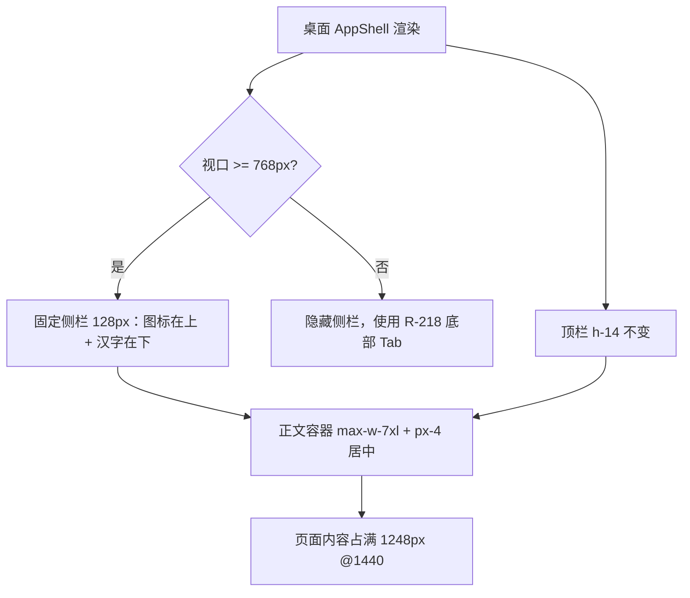
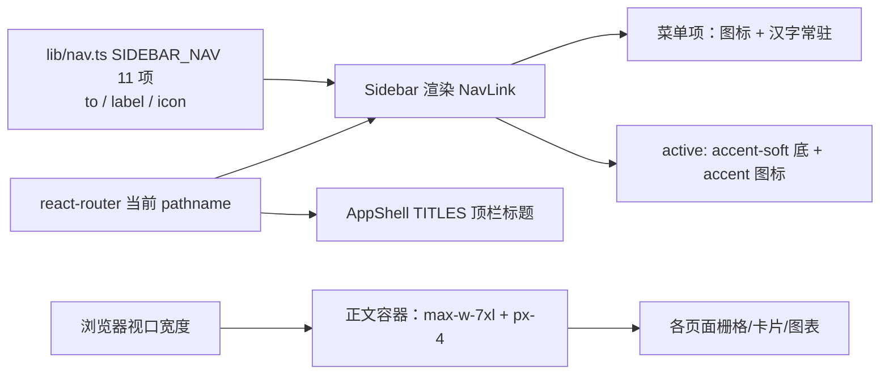

# R-256 开发设计：左侧菜单改固定 128px「图标 + 汉字」竖排，正文左右留白减半

- **对应需求**: `requirements/R-256-sidebar-rail-and-content-width.md`
- **日期**: 2026-11-09
- **状态**: ✅ 已按本文实现（2026-11-09，verify 全绿 + Playwright 1440/1280/1920 + 移动端 390 点检）
- **前置**: R-218（移动端底部 Tab；`<md` 隐藏侧栏）、R-243（侧栏首帧 CLS：`initial={false}` 宽度动画）、R-248（侧栏顺序）
- **原则**: 只改前端两个布局文件；导航数据、路由、图标、顺序不变；移动端不变；不动接口/表；`verify.sh` 全绿。

## 1. 开发背景

作者 2026-11-09 提出三点：

1. 左边菜单取消展开功能，收缩的菜单宽度宽一倍；
2. 每个菜单下面展示菜单的汉字；
3. 菜单右侧所有功能两边的间隔空白占比太多，间隔缩小一倍提供给正文。

代码取证（改前，1440×950 实测）：

| 项 | 改前实测 | 说明 |
|---|---|---|
| 侧栏 | 展开 216px / 收起 64px，底部「收起/展开」按钮切换 | `sidebar.tsx` 的 `motion.aside` 宽度 spring 动画 |
| 收起形态 | 仅图标 16px + Tooltip 悬停显示汉字 | 汉字不常驻 |
| 主内容容器 | `mx-auto w-full max-w-6xl px-4 py-6 md:px-6` | 最大 1152，两侧内边距 24 |
| 1440 下正文 | 左右各空 36（auto margin）+ 24（padding）= **60px**，内容宽 **1104px** | 正文偏窄 |

「宽一倍」按原收起态 64px 计算 → 固定 128px；菜单汉字改常驻竖排，正好需要这 128px 的宽度。第 3 点把左右空白 60px 减半到约 32px。

## 2. 涉及的技术

| 技术 | 用途 |
|---|---|
| React 19 + TypeScript | `components/layout/sidebar.tsx`、`app-shell.tsx` |
| Tailwind CSS v4 | `w-32`（128px）、`max-w-7xl`（1280px）、`px-4`（16px）、竖排 `flex-col` |
| Framer Motion `layoutId` | 保留激活项高亮底色在切页时平滑移动的动效 |
| Lucide React | 菜单图标（不变） |
| Playwright | 三档视口宽度/汉字齐全/留白/无横向滚动/0 console error 点检 |
| `scripts/verify.sh` | 质量门禁（lint + vitest + build + 文档一致性） |

无新增依赖，无后端/接口/表改动。

## 3. 开发流程图

## 4. 数据流转图

没有新增数据、请求或存储：菜单与页面内容的来源、刷新时机均不变，本次只改布局计算。

## 5. 实现细节

### 5.1 侧栏（`frontend_v2/src/components/layout/sidebar.tsx`）

- 删除 `collapsed` / `onToggle` props 与底部切换按钮（同时删除 `PanelLeftClose`、`PanelLeftOpen` 图标与 `Tooltip` 相关导入，避免无效导入）。
- 根节点由 `motion.aside`（`animate={{ width: collapsed ? 64 : 216 }}`）改为静态 `<aside>`：`hidden h-full w-32 shrink-0 flex-col border-r border-border bg-card/60 backdrop-blur md:flex`。
  - **固定宽度**：`w-32` = 128px（原收起态 64px 的一倍），`shrink-0` 防被正文挤压；不再是动画宽度，故也不存在首帧跳动（R-243 的 `initial={false}` 诉求被静态宽度取代）。
- 品牌区：`h-14`、`justify-center`，保持 32px 圆角图标居中（不再有 `echo` 文字与 64px 时的左对齐差异）。
- 菜单项：`flex flex-col items-center gap-1 rounded-md px-1 py-2 text-[11px] leading-none whitespace-nowrap`，即**图标在上、汉字在下**、水平居中、不换行；最短「主页」2 字、最长「脚本工作台」5 字（11px 下约 55px < 104px 可用宽），不截断。
- 激活态：沿用原 `motion.span layoutId="nav-active"`（`accent-soft` 底）铺满整项，图标 `text-accent`；悬停 `hover:bg-muted hover:text-foreground`。
- 列表容器仍为 `flex-1 space-y-0.5 overflow-y-auto px-2 py-2`：矮窗口时菜单区内部滚动，不撑高页面。
- 尺寸核算（950 高视口）：顶栏 56 + 菜单区 894；单项 47px（py 8×2 + 图标 16 + gap 4 + 汉字 11）→ 11×47 + 10×2 + 16 = **553px**，无需滚动。

### 5.2 正文容器（`frontend_v2/src/components/layout/app-shell.tsx`）

- 删除 `collapsed` state 与 `<Sidebar collapsed onToggle />` 传参，改为 `<Sidebar />`。
- 正文包装层 class：`mx-auto w-full max-w-6xl px-4 py-6 md:px-6` → `mx-auto w-full max-w-7xl px-4 py-6`。
  - `max-w-6xl`（1152px）→ `max-w-7xl`（1280px）；
  - 桌面内边距 `md:px-6`（24px）→ 沿用 `px-4`（16px）；
  - 垂直 `py-6`、页面转场动画容器、滚动容器 `main`、顶栏结构均不动。
- 留白核算（可见空白 = 居中 auto margin + 内边距）：

| 视口 | 改前 | 改后 | 内容宽变化 |
|---|---|---|---|
| 1440 | (1440−216−1152)/2=36 + 24 = **60px**，内容 1104 | (1440−128−1280)/2=16 + 16 = **32px**，内容 **1248** | +144px |
| 1280 | 0 + 24 = **24px**（未触顶），内容 1016 | 0 + 16 = **16px**，内容 **1120** | +104px |
| 1920 | 276 + 24 = **300px**，内容 1104 | 256 + 16 = **272px**，内容 **1248** | +144px |

  > 说明：1440 是作者常用视口（仓库既有截图均为 1440×950），左右空白 60→32 即「缩小一倍」；超宽屏保留 1280 上限避免长文本/图表过度拉伸，但正文绝对值仍比改前宽 144px。

### 5.3 边界与降级

- **<768px**：侧栏 `hidden`，完全由 R-218 底部 Tab 接管；正文 `px-4` 未变（移动端本来就没有侧栏，第 3 点不涉及）。
- **页面自身最大宽**：仅「灵感随手记」页内容自带 `max-w-2xl`，属于该页阅读列宽设计，本次不动；其余页面铺满新正文宽度。
- **不改**：导航 11 项与顺序、图标、路由、页面级栅格列数、后端/接口/表；不引入新依赖。

## 6. 新增/修改表结构

无。未新增/修改任何数据库表、列、索引或迁移。

## 7. 新增/修改接口

无。未新增/修改后端 HTTP 接口、请求参数或响应字段；`scripts/verify.sh` 文档一致性检查预期不变（38 表）。

## 8. 数据来源与原始字段明细

| 展示项 | 来源 | 原始字段 | 落库字段 | 用途 | 更新时间 | 空值处理 |
|---|---|---|---|---|---|---|
| 菜单汉字/图标/路径 | 前端代码 `lib/nav.ts` `SIDEBAR_NAV`（作者 2026-09-30 定型的 11 项） | `to` / `label` / `icon` | 不落库 | 渲染侧栏菜单与激活态 | 随前端发布 | 常量数组，无空值；缺 `icon` 时 TS 编译报错 |
| 当前激活菜单 | 浏览器当前路由 `useLocation().pathname`（`NavLink` 精确匹配） | `pathname` | 不落库 | 高亮底色与图标色 | 每次路由切换 | 路由不在菜单内时无高亮 |
| 顶栏页面标题 | `app-shell.tsx` `TITLES` 映射 + 当前路由 | `pathname` / `TITLES` | 不落库 | 顶栏标题 | 每次路由切换 | 未收录路由回退显示 `echo` |
| 正文宽度 | 浏览器视口宽度 + CSS 布局常量（侧栏 128、最大 1280、内边距 16） | `innerWidth` | 不落库 | 计算正文可用宽度 | 窗口尺寸变化实时重算 | 非数据项，无空值 |

## 9. 实现与验收记录（2026-11-09）

- **改动文件**：`frontend_v2/src/components/layout/sidebar.tsx`、`frontend_v2/src/components/layout/app-shell.tsx`。
- **Playwright 实测**（登录后 1440×950 / 1280×800 / 1920×1000，页面 `/videos`）：
  - 侧栏宽 **128px**、`display:flex`（≥768）、底部无按钮；11 项汉字依次为「主页/素材库/数据看板/视频复盘/脚本工作台/灵感随手记/博主对标/博主管理/人设档案/AI 设置/AI 对话」，单项 47px；
  - 1440：正文容器 left 144 / 宽 1280 / 左右空白 16+16=32px；内容宽 1248；1280：左右各 16px、内容 1120；1920：内容仍 1248（比改前 +144）；
  - 1440/1280/1920 与移动端 390 均 0 console error、无横向滚动条；移动端侧栏 `display:none`（底部 Tab 正常）；
  - 11 项菜单逐项点击：路由与预期一致（`#/home`…`#/chat`）、`aria-current="page"` 高亮项与所点菜单一致、高亮底色块尺寸 111×47、0 console error；
  - 各主要页面（主页/数据看板/素材库/视频复盘/脚本工作台/灵感/AI 设置）截图点检无布局错位。
- **门禁**：`scripts/verify.sh` 全绿（后端 ruff/mypy/pytest、前端 lint/vitest/build、文档一致性）。
