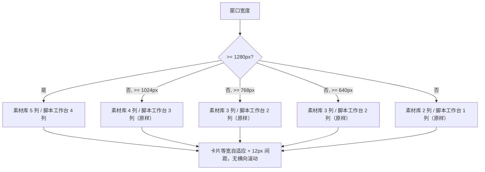
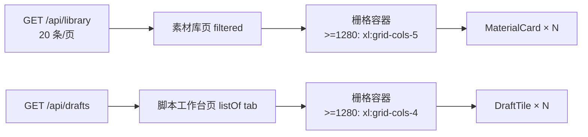

# R-257 开发设计：素材库卡片一行 5 个 + 脚本工作台一行 4 个

- **对应需求**: `requirements/R-257-library-and-drafts-grid-columns.md`
- **日期**: 2026-11-09
- **状态**: ✅ 已按本文实现（2026-11-09，verify 全绿 + Playwright 七档宽度点检）
- **前置**: R-256（正文取消最大宽度上限后正文变宽，卡片有空间加密）、R-243（骨架屏与真卡同尺寸）、R-218（移动端断点）、R-250（草稿删除重排动画）
- **原则**: 只改两个列表容器的栅格列数（含骨架屏）；卡片组件/数据/交互/接口/后端不动；小屏断点不倒退；`verify.sh` 全绿。

## 1. 开发背景

R-256 把正文两侧空白收窄、并在 v3 取消正文最大宽度后，宽屏正文可用宽度明显变大：

| 视口 | 正文可用宽（R-256 后） | 素材库 4 列时单卡宽 | 草稿 3 列时单卡宽 |
|---|---|---|---|
| 1440 | 1323px | 约 320px | 约 430px |
| 1920 | 1803px | 约 440px | 约 590px |

作者因此提出两点：

1. 素材库卡片改为一行 5 个；
2. 脚本工作台改为一行 4 个。

改前代码位置（Tailwind 栅格）：

- `frontend_v2/src/pages/videos/index.tsx` 两处（真实卡片墙 + 加载骨架屏）：`grid grid-cols-2 gap-3 sm:grid-cols-3 lg:grid-cols-4`；
- `frontend_v2/src/pages/drafts/index.tsx` 两处（加载骨架屏 + 真实草稿卡列表）：`grid gap-3 sm:grid-cols-2 lg:grid-cols-3`。

## 2. 涉及的技术

| 技术 | 用途 |
|---|---|
| React 19 + TypeScript | 两个页面组件（只改 className） |
| Tailwind CSS v4 栅格 | `xl:` 断点（1280px）下把列数改为 5 / 4；`sm`/`lg` 断点保持原列数 |
| `AnimatePresence mode="popLayout"` | 既有列表入场/删除动画，列数变化不涉及动画参数 |
| Playwright | 七档宽度逐档统计「每行几张 + 单卡尺寸 + 是否横向滚动」 |
| `scripts/verify.sh` | 门禁（lint + vitest + build + 文档一致性） |

无新增依赖，无后端/接口/表改动。

## 3. 开发流程图

## 4. 数据流转图

数据来源、字段、排序、分页、动画均不变，本次只改列表容器的 CSS 列数。

## 5. 实现细节

### 5.1 素材库（`frontend_v2/src/pages/videos/index.tsx`）

- 加载骨架屏（第 594 行附近）与真实卡片墙（第 613 行附近）两处 class 同步修改：
  - `grid grid-cols-2 gap-3 sm:grid-cols-3 lg:grid-cols-4`
  - → `grid grid-cols-2 gap-3 sm:grid-cols-3 lg:grid-cols-4 xl:grid-cols-5`
- 列数规则：<768px 2 列、768~1023px 3 列、1024~1279px 4 列、**≥1280px 5 列**；间距仍 `gap-3`（12px）。
- 每页 20 条不变：1440 下 5 列 × 4 行正好一页；触底加载追加与 R-243 的滚动锚点逻辑不变。
- 卡片组件 `MaterialCard`（4:3 封面、标题两行、平台徽标、点赞/播放、标签、操作行、hover 播放、多选、同步、删除）零改动。

### 5.2 脚本工作台（`frontend_v2/src/pages/drafts/index.tsx`）

- 加载骨架屏（第 401 行附近）与真实草稿卡列表（第 411 行附近）两处 class 同步修改：
  - `grid gap-3 sm:grid-cols-2 lg:grid-cols-3`
  - → `grid gap-3 sm:grid-cols-2 lg:grid-cols-3 xl:grid-cols-4`
- 列数规则：<768px 1 列、768~1023px 2 列、1024~1279px 3 列、**≥1280px 4 列**；间距 `gap-3` 不变。
- `DraftTile` 组件、tab 切换、删除确认与 R-250 的 `layout="position"` 重排动画零改动。

### 5.3 实测（Playwright，登录后真实数据）

| 视口 | 素材库每行 | 素材库单卡宽 | 脚本工作台每行 | 草稿单卡宽 |
|---|---|---|---|---|
| 2560 | **5** | 479px | **4** | 602px |
| 1920 | **5** | 351px | **4** | 442px |
| 1440 | **5** | 255px | **4** | 322px |
| 1280 | **5** | 223px | **4** | 282px |
| 1024 | 4（原样） | 218px | 3（原样） | 294px |
| 768 | 3（原样） | — | 2（原样） | — |
| 390 | 2（原样） | — | 1（原样） | — |

- 七档宽度均无横向滚动条、0 console error；
- 列数由浏览器 `gridTemplateColumns` 计算值核对（1280 起素材库 5 轨、草稿 4 轨）。

### 5.4 边界与降级

- **超宽屏**：不设列数上限（作者要求固定每行个数），2560 下仍为 5 列/4 列；
- **断点选择 1280（`xl`）**：1024~1279px 保持原列数，避免 1024 窄屏强行 5 列导致单卡仅约 170px；
- **骨架屏**：与真实列表同一套 class，加载完成不跳版（R-243 约束）；
- **不改**：卡片字段/交互、筛选/分页、其它页面列数、接口、后端、数据库。

## 6. 新增/修改表结构

无。未新增/修改数据库表、列、索引或迁移。

## 7. 新增/修改接口

无。未新增/修改后端 HTTP 接口、请求参数或响应字段；素材库仍用 `GET /api/library`、脚本工作台仍用 `GET /api/drafts`，分页与筛选参数不变。

## 8. 数据来源与原始字段明细

| 展示项 | 来源 | 原始字段 | 落库字段 | 用途 | 更新时间 | 空值处理 |
|---|---|---|---|---|---|---|
| 素材库卡片 | 现有 `GET /api/library`（后端聚合本地素材与云端作品） | 既有列表项字段（封面、标题、平台、点赞/播放、标签、绑定关系等） | 既有表字段，本次不读写新字段 | 渲染卡片内容 | 进入/筛选/触底加载时 | 既有逻辑：无封面走 CoverImage 占位；空列表显示占位文案 |
| 草稿卡 | 现有 `GET /api/drafts` | 既有草稿字段（标题、来源、模型、占比、状态、反馈等） | 既有表字段，本次不读写新字段 | 渲染草稿卡内容 | 进入/切 tab/新建/删除时 | 既有逻辑：无标题显示「（无标题）」；空 tab 显示占位 |
| 每行列数 | 浏览器视口宽度 + Tailwind 断点（sm 640 / lg 1024 / xl 1280） | `innerWidth` | 不落库 | 决定栅格列数 | 窗口尺寸变化实时重算 | 非数据项，无空值 |
| 卡片宽高 | CSS Grid 等宽分配 + 12px 间距，封面 4:3（素材卡） | — | 不落库 | 布局 | 随列数与容器宽度实时计算 | 非数据项，无空值 |

## 9. 实现与验收记录（2026-11-09）

- **改动文件**：`frontend_v2/src/pages/videos/index.tsx`（两处栅格）、`frontend_v2/src/pages/drafts/index.tsx`（两处栅格）。
- **Playwright**：2560/1920/1440/1280/1024/768/390 七档实测列数、单卡宽度、无横向滚动、0 console error（见 §5.3）；1440 截图点检素材库一行 5 张、脚本工作台一行 4 张，卡片内容/按钮无溢出。
- **门禁**：`scripts/verify.sh` 全绿（后端 ruff/mypy/pytest、前端 lint/vitest/build、文档一致性）。
