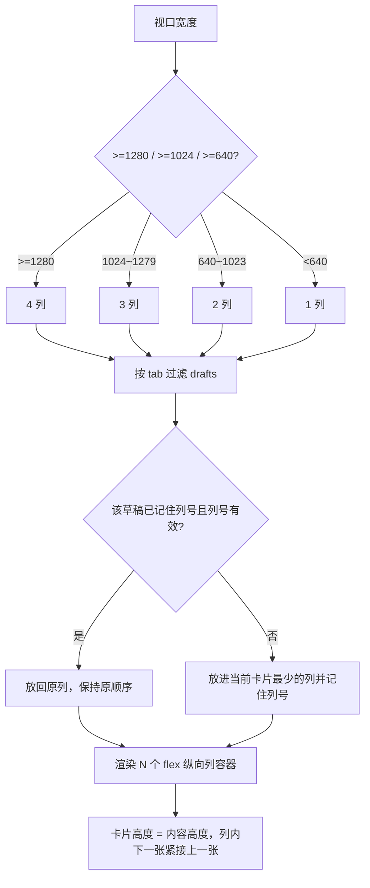

# R-258 开发设计：脚本工作台卡片改小红书式瀑布流（内容高度 + 多列错落 + 标题两行）

- **对应需求**: `requirements/R-258-drafts-waterfall.md`
- **日期**: 2026-11-09
- **状态**: ✅ 已按本文实现（2026-11-09，verify 全绿 + Playwright 六档视口点检）
- **前置**: R-257（脚本工作台一行 4 个）、R-250（删除后剩余卡片平滑重排 `layout="position"`，本次必须保持）、R-218（移动端断点）、R-211（卡内记反馈展开）
- **原则**: 只改脚本工作台的列表排版与分列逻辑（含骨架屏）；卡片组件内容/交互不动；其他页面/接口/后端/表不动；`verify.sh` 全绿。

## 1. 开发背景

R-257 把脚本工作台改为 4 列 CSS Grid 后出现「同一行卡片等高」的问题：Grid 默认 `align-items: stretch`，一行里最高的卡片决定整行高度，其余卡片被拉高并在底部留白。作者截图反馈「右边卡片因为左边卡片变高了，但不需要」，并给出小红书瀑布流参考图，要求卡片错落、标题最多两行。

改前实测（1440 宽、4 列、`main div.grid > article`）：

| 行 | 卡片高度 | 自然高度（内容决定） |
|---|---|---|
| 第 1 行 | 全部 216px | 196~216px |
| 第 2 行 | 全部 **327px** | 196 / 306px 等（含 AI 讨论中断提示的卡 306~327px，其余约 196~216px，多出约 111px 空白） |
| 第 3 行 | 全部 216px | 147~216px |

候选方案与取舍：

| 方案 | 问题 |
|---|---|
| CSS Grid + `items-start` | 卡片按内容高，但行仍对齐：同一行矮卡下方留白、下一行从最高卡底部开始，不是真正瀑布流 |
| CSS 多列（`columns-*` + `break-inside-avoid`） | 视觉上是瀑布流，但浏览器按高度均衡列，**任何增删都会重排所有列**。实测删除 1 张草稿后剩余 11 张里有 8 张瞬间换列（单帧最大位移 404px），破坏 R-250 的平滑重排 |
| 第三方瀑布流库 | 新增依赖、与现有 Framer 动画/`AnimatePresence` 集成成本高，违背「不盲目加依赖」 |
| **固定列容器 + 前端分配（采用）** | 列数由断点决定，每篇草稿的列号按「tab + 草稿 id」记住；删除/改状态时只有同列卡片上移，`layout="position"` 平滑重排保留；新增卡片放进最短列 |

## 2. 涉及的技术

| 技术 | 用途 |
|---|---|
| React 19（`useRef` + `useMemo`） | 分列结果缓存：按草稿 id 记住列号，列表增删时保持稳定 |
| `@/hooks/use-media-query` 的 `useMediaQuery` | 读断点决定列数（1/2/3/4 列）；R-258 起在 hook 注释里登记该例外 |
| Tailwind CSS | 列容器 `flex min-w-0 flex-1 flex-col gap-3`，外层 `flex items-start gap-3`；卡片保持 `p-4` |
| Framer Motion | 保留卡片入场 stagger（`draftTileVariants`）、`AnimatePresence mode="popLayout"` 退场、`layout="position"` 平滑重排 |
| Playwright | 六档视口列数/卡片高度/标题行数/删除位移/无横向滚动/0 console error 点检 |
| `scripts/verify.sh` | 门禁（lint + vitest + build + 文档一致性） |

无新增依赖，无后端/接口/表改动。

## 3. 开发流程图



## 4. 数据流转图

```mermaid
flowchart LR
    API[GET /api/drafts?limit=500<br/>按 updated_at 倒序] --> Q[React Query 缓存]
    Q --> D[drafts]
    D --> T[按 status 分 tab]
    T --> A[useDraftColumns<br/>列号 Map: tab -> id -> 列]
    A --> C[每列 Draft[]（保持时间倒序）]
    C --> R[列容器渲染 DraftTile]
    R --> V[卡片高度由内容决定]
    V --> H[列高 = 本列卡片高度和 + 12px 间距]
```

- 数据来源、字段、排序、分页、tab 过滤规则均不变；
- 只新增「草稿 → 列号」的前端内存映射（不落库、不请求接口）。

## 5. 实现细节

### 5.1 列数（断点与 R-257 一致）

`useColumnCount()`：`xl(≥1280)` → 4，`lg(≥1024)` → 3，`sm(≥640)` → 2，否则 1。移动端 1 列，与原来一致。

### 5.2 分列规则（`useDraftColumns`）

- **输入**：全部草稿 `drafts`（接口一次返回 ≤500 条，含所有 status）+ 当前列数 `count`。
- **记忆结构**：`useRef<{ count, col: Record<Status, Map<draftId, 列号>> }>`，按 tab 分别记忆（同一篇草稿在不同 tab 互不影响）；列数变化时清空重新分配。
- **规则（每个 tab 独立执行）**：
  1. 统计该 tab 中「已有有效列号」的卡片数量 `sizes[列]`；
  2. 按列表顺序扫描：已有有效列号的直接保留；没有的（新草稿/列数变化后）放入 `sizes` 最小的列（并列取靠左），并记住列号、`sizes[列]++`；
  3. 再按列表顺序把卡片推入各自列数组 → 每列内部保持「最新在上」。
- **效果**：12 条草稿在 4 列下 3/3/3/3；7 条废稿 2/2/2/1；4 条完成 1/1/1/1；删除/改状态不触发重新分配（其余卡片列号不变）。
- **阈值/边界**：列号 ≥ 当前列数视为无效（窗口变窄后重分配）；`count` 变化才清空记忆；空 tab 不渲染列（走既有空状态）。

### 5.3 列表与骨架屏渲染

- 真实列表：外层 `flex items-start gap-3`，内部固定 `count` 个 `flex min-w-0 flex-1 flex-col gap-3` 列容器；每列一个 `AnimatePresence mode="popLayout"` 包 `DraftTile`。
- 骨架屏：同样的列容器结构，每列渲染 `max(2, ceil(6/列数))` 个 `h-36` 骨架（1440 下 4 列 × 2 = 8 个），保持列宽与真卡一致，加载完不横向跳版。
- 入场动画保持原参数（每列内按 index stagger ≤12 项）；删除卡原地淡出（0.16s），同列下方卡片用 `layout="position"`（0.26s）平滑上移。

### 5.4 卡片高度与标题

- 卡片根 `motion.article` 的 `class` 去掉 `min-h-10` 只保留标题 `line-clamp-2`：1 行标题不再强制占两行高度；卡片高度完全由内容决定。
- 卡片根不再需要 `mb-3 / break-inside-avoid`（列容器 `gap-3` 控制间距）。
- 标题：`line-clamp-2`（既有），超过两行省略；字号 14px、行高 `leading-snug` 不变。

### 5.5 为什么不用 CSS `columns`

实测：CSS 多列在删除 1 张卡片后触发浏览器重新均衡，剩余 11 张中 8 张瞬间换列（单帧位移最大 **404px**），与 R-250「删除后剩余卡片平滑重排、不飞行」冲突；且卡内「记反馈」展开变高也会引起整墙重排。改为固定列容器 + 稳定分列后，删除只让同列卡片上移（实测其余卡片左坐标不变），`layout="position"` 的平滑重排得以保留。

## 6. 新增/修改表结构

无。未新增/修改数据库表、列、索引或迁移；列号只存在前端内存。

## 7. 新增/修改接口

无。继续使用 `GET /api/drafts?limit=500` 与既有 `PATCH /api/drafts/{id}`（状态）、删除确认逻辑不变；请求/响应字段均未改。

## 8. 数据来源与原始字段明细

| 展示项 | 来源 | 原始字段 | 落库字段 | 用途 | 更新时间 | 空值处理 |
|---|---|---|---|---|---|---|
| 草稿卡列表 | 现有 `GET /api/drafts?limit=500` | 既有列表项字段（`id/title/status/updated_at/quality/performance/debate` 等） | 既有 `drafts` 表字段，本次不读写新字段 | 渲染卡片 | 进入/切 tab/增删改后 | 空 tab 显示占位；无标题显示「（无标题）」 |
| 所属 tab | 父组件按 `status` 前端过滤 | `status`（draft/used/done/archived/deleted） | `drafts.status` | 分 tab 与分列 | 状态变化后刷新 | `deleted` 不在列表返回 |
| 卡片列号 | 前端 `useDraftColumns` 计算 | `id`（稳定）+ 当前 tab + 当前列数 | 不落库 | 决定卡片在第几列 | 新草稿/列数变化时分配 | 无空值；列数变化重建 |
| 列数 | 浏览器视口宽度 + 断点（640/1024/1280） | `innerWidth` / `matchMedia` | 不落库 | 决定列容器数量 | 窗口尺寸变化实时重算 | 非数据项，无空值 |
| 标题行数 | 前端 CSS `line-clamp-2` + 文本长度 | `title` | 不落库 | 最多 2 行省略 | 随数据 | 空标题显示「（无标题）」 |

## 9. 实现与验收记录（2026-11-09）

- **改动文件**：`frontend_v2/src/pages/drafts/index.tsx`、`frontend_v2/src/hooks/use-media-query.ts`（注释登记 R-258 例外）。
- **Playwright 六档实测**（登录后真实数据 12 条草稿）：
  - 列数：1440/1920/1280 → 4 列（3/3/3/3），1024 → 3 列（4/4/4），768 → 2 列（6/6），390 → 1 列（12）；均无横向滚动；
  - 1440 卡片高度实测出现 **147 / 195 / 196 / 215 / 306px** 多种值（改前同一行全部 216/327/216），错落生效；
  - 标题：12 张卡全部 `line-clamp: 2`，标题元素高度 19px（1 行）或 39px（2 行），无超过 2 行；
  - 删除（网络 mock，不改真实数据）：删 1 张后 11 张数量对应列从 3/3/3/3 → 2/3/3/3，**其余卡片左坐标全部不变**（无换列），被删卡原地 opacity 1→0（0.16s），同列下方卡片随后上移；0 console error；
  - 记反馈展开：第一张卡 196→298px、所在列高 741→843px，其它列不受影响；
  - tab 切换：待制作空状态、完成 1/1/1/1、废稿 2/2/2/1、草稿 3/3/3/3，均 0 console error；
  - 窗口缩放 1440→1920→1280→1024→768→390：列数 4/4/4/3/2/1 实时切换并重新均衡。
- **门禁**：`scripts/verify.sh` 全绿（后端 ruff/mypy/pytest、前端 lint/vitest/build、文档一致性）。
