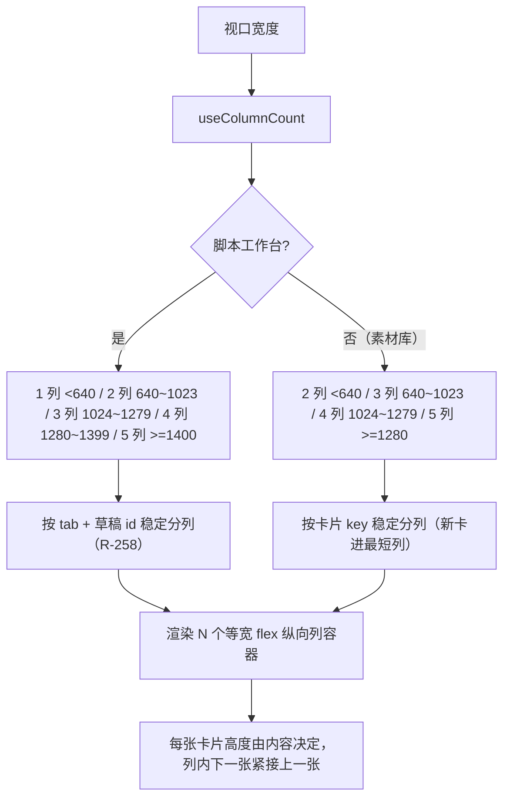
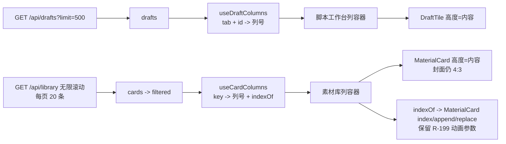

# R-259 开发设计：脚本工作台宽度自适应（最多 5 列）+ 素材库改瀑布流（等宽、内容高度）

- **对应需求**: `requirements/R-259-drafts-width-and-library-waterfall.md`
- **日期**: 2026-11-09
- **状态**: ✅ 已按本文实现（2026-11-09，verify 全绿 + Playwright 六档视口点检）
- **前置**: R-258（脚本工作台瀑布流分列机制，本次复用并放宽列数）、R-257（两页断点）、R-250（删除平滑重排）、R-199（素材库换批逐格交接）、R-249（素材库封面 4:3）、R-243（骨架屏/无限滚动）
- **原则**: 只改两页列表排版（含骨架屏）与列数；素材库封面比例/卡片内容/筛选/分页/交互不变；其它页面/接口/后端/表不动；`verify.sh` 全绿。

## 1. 开发背景

作者 2026-11-09 补充两点（原文见需求）：

1. 脚本工作台卡片**宽度不固定**，一行**最多 5 个**；
2. 素材库卡片**宽度固定**，**高度改成不固定**（像脚本工作台那样瀑布流）。

改前实测（1440×1000）：

| 页面 | 改前 | 问题 |
|---|---|---|
| 脚本工作台 | R-258 瀑布流，但 ≥1280 固定 4 列（单卡 322px） | 宽屏上卡片偏宽、一屏看得少；宽度不随宽度档位继续放宽 |
| 素材库 | CSS Grid `grid-cols-2 sm:3 lg:4 xl:5`，标题 `min-h-9` 强制两行高 | Grid 默认 `align-items: stretch`：同一行卡片全部等高（1440 下四行高度 339 / 356 / 360 / 360px），矮卡底部空白；没有错落感 |

素材库卡片高度天然差异来源：标题 1 行 vs 2 行（约 18px）、标签行有无（约 20px）、操作行/角标等；封面仍固定 4:3（R-249 作者确认口径，本次不改封面比例）。

## 2. 涉及的技术

| 技术 | 用途 |
|---|---|
| React 19（`useRef` + `useMemo`） | 素材库分列记忆：按卡片 `key` 记住列号，追加/删除不换列 |
| `@/hooks/use-media-query` 的 `useMediaQuery` | 读断点决定列数（草稿 1~5 列，素材库 2~5 列）；R-258/R-259 已在 hook 注释登记例外 |
| Tailwind CSS | 列容器 `flex min-w-0 flex-1 flex-col gap-3`；外层 `flex items-start gap-3` |
| Framer Motion | 保留素材库 R-199 换批逐格交接（`AnimatePresence mode="popLayout"` + 卡片 `index/replace/append`）与 R-250 平滑重排 |
| Playwright | 六档视口列数/卡片高度/追加稳定性/交互回归/无滚动/0 console error 点检 |
| `scripts/verify.sh` | 门禁（lint + vitest + build + 文档一致性） |

无新增依赖，无后端/接口/表改动。

## 3. 开发流程图

## 4. 数据流转图

- 数据来源、接口、分页、筛选、排序全部不变；
- 新增的只是前端内存中的「卡片 → 列号」映射与 `indexOf` 索引，不落库、不请求接口。

## 5. 实现细节

### 5.1 脚本工作台列数（`pages/drafts/index.tsx`）

`useColumnCount()` 增加第 5 档：`≥1400px` → 5，其余不变（`<640` 1 / `640` 2 / `1024` 3 / `1280` 4）。分列逻辑（`useDraftColumns`）与瀑布流渲染保持 R-258 实现不变，列数变化时自动重分配。

| 视口 | 列数 | 单卡宽度（实测） |
|---|---|---|
| 1920 | 5 | 351px |
| 1440 | 5 | 255px |
| 1280 | 4 | 282px |
| 1024 | 3 | 294px |
| 390 | 1 | 358px |

- 「宽度不固定」= 卡片宽度由列数均分（不写死像素），窗口变宽卡片变宽；最多 5 列不再增加。
- 12 条草稿在 5 列下 3/3/2/2/2（按最短列分配），错落与标题两行、删除稳定分列均沿用 R-258。

### 5.2 素材库列数与分列（`pages/videos/index.tsx`）

- 新增 `useColumnCount()`：`≥1280` 5 / `≥1024` 4 / `≥640` 3 / 否则 2（与改前 Grid 断点完全一致，宽度固定等宽）。
- 新增 `useCardColumns(cards, count)`：
  - **输入**：`filtered`（当前已加载的全部卡片，接口顺序）；
  - **记忆**：`useRef<{ count, col: Map<card.key, 列号> }>`；列数变化时清空；
  - **分配规则**：先统计已有有效列号的卡片数 `sizes`；新出现的卡片（首屏/追加批次/筛选后新 key）放入 `sizes` 最小的列（并列取靠左），并记住列号；再按接口顺序把卡片推入各列（列内保持时间倒序）；
  - **清理**：每次重算只保留当前列表里存在的 key，避免筛选历史越积越多；
  - **输出**：`columns: CardItem[][]` + `indexOf: Map<key, 全局序号>`，后者用于还原 `MaterialCard` 的 `index`（入场 stagger/换批延迟）与 `append`（`index >= firstPageLen`，后续批次轻淡入）。
- **新增卡片不换列**：滚到底追加 20 条时，已有卡片列号不变（实测 20/20 不变），新卡按最短列填到各列底部；删除/批量删除同理，其余卡片只在列内上移。
- **换一批（R-199）**：整体换筛选/换博主时列表 key 全变，旧卡照常走 0.35s 淡出+缩到 0.94 的错峰退场，新卡按「退场延迟 + 呼吸量」逐格显影入场；`replaced`/`index` 参数保持原样传入。

### 5.3 渲染结构

- 真实列表：`
` + N 个 `flex min-w-0 flex-1 flex-col gap-3` 列容器，每列一个 `AnimatePresence mode="popLayout"` 包 `MaterialCard`（卡片 `forwardRef` 到根节点，popLayout 量测退场卡所需，R-199 回归用例仍覆盖）。
- 骨架屏：同样的列容器结构，素材库每列 `ceil(20/列数)` 个骨架（5 列时 4 个/列），保持列宽一致，加载完不横向跳版。

### 5.4 卡片高度与标题（`pages/videos/material-card.tsx`）

- 去掉标题 `min-h-9`（不再强制两行高度），仍保留 `line-clamp-2`：1 行标题的卡片更矮，2 行标题更高，瀑布流参差更自然；
- 封面仍 `aspect-[4/3]`、`object-cover`（R-249 口径不变）；卡片根节点仍保留 `content-visibility: auto` + `contain-intrinsic-size: auto 356px`（不屏外渲染，性能口径不变）。

### 5.5 边界与降级

- 空列表：素材库显示「没有匹配的素材」占位，不渲染列；
- 加载中：骨架按列数渲染；
- 窗口缩放：列数变化时重新分列（一次重排，可接受）；同列宽内宽度随窗口连续变化；
- CSS 多列仍不采用：追加/删除会触发浏览器均衡、整墙换列（R-258 已实测 1 张删除导致 8 张瞬间换列），与 R-199/R-250 冲突。

## 6. 新增/修改表结构

无。未新增/修改数据库表、列、索引或迁移；列号只存在前端内存。

## 7. 新增/修改接口

无。校验所涉接口仍为：`GET /api/drafts?limit=500`（草稿列表）、`GET /api/library?...`（素材库无限滚动分页）、`PATCH /api/drafts/{id}`（草稿状态）、既有素材删除/同步/批量接口；请求与响应字段均未改。

## 8. 数据来源与原始字段明细

| 展示项 | 来源 | 原始字段 | 落库字段 | 用途 | 更新时间 | 空值处理 |
|---|---|---|---|---|---|---|
| 脚本工作台草稿卡 | 现有 `GET /api/drafts?limit=500` | 既有草稿字段（id/title/status/updated_at/quality/performance/debate 等） | 既有 `drafts` 表字段，本次不读写新字段 | 渲染草稿卡、按 tab 过滤 | 进入/切 tab/增删改后 | 空 tab 占位；无标题显示「（无标题）」 |
| 素材库卡片 | 现有 `GET /api/library` 分页 | 既有卡片字段（key/title/cover_url/platforms/tags/date/status/is_ad/merged/cloudPosts 等） | 既有表字段，本次不读写新字段 | 渲染素材卡 | 进入/筛选/查询/触底加载 | 无封面走 CoverImage 兜底；空列表占位 |
| 素材库列号 | 前端 `useCardColumns` 计算 | `key`（稳定）+ 当前列数 | 不落库 | 决定卡片在第几列 | 新卡出现/列数变化时分配 | 非数据项，无空值 |
| 列数 | 浏览器视口宽度 + 断点（640/1024/1280/1400） | `innerWidth` / `matchMedia` | 不落库 | 决定列容器数量 | 窗口尺寸变化实时重算 | 非数据项，无空值 |
| 卡片高度 | 前端内容布局（封面 4:3 + 标题行数 + 标签 + 操作行） | 卡片字段内容 | 不落库 | 瀑布流列高、错落 | 随数据/窗口 | 非数据项，无空值 |

## 9. 实现与验收记录（2026-11-09）

- **改动文件**：`frontend_v2/src/pages/drafts/index.tsx`（列数 +1 档）、`frontend_v2/src/pages/videos/index.tsx`（瀑布流分列/骨架/渲染）、`frontend_v2/src/pages/videos/material-card.tsx`（标题去掉 min-h-9）、`frontend_v2/src/hooks/use-media-query.ts`（注释登记 R-258/R-259 例外）。
- **Playwright 实测**（登录后真实数据）：
  - 脚本工作台：1920/1440 → 5 列（单卡 351/255px，12 条 3/3/2/2/2）；1280 → 4 列（282px）；1024 → 3 列（294px）；390 → 1 列；均无横向滚动、0 console error；
  - 素材库：1920/1440/1280 → 5 列（20 条 4/4/4/4/4）、1024 → 4 列（5/5/5/5）、768 → 3 列（7/7/6）、390 → 2 列（10/10）；1440 卡片高度出现 321/338/342px 多档（改前同行为 339/356/360/360 全等）；均无横向滚动、0 console error；
  - 无限滚动：滚到底加载 20→40 条，已有 20 张卡 **0 张换列**（左坐标全部不变），新卡追加到各列底部；
  - 换一批：设「≥点赞 2000」后查询，20 张卡全部参与退场/入场动画（逐帧最多 20 张处于动画态），最终 20 张，0 console error；清空筛选查询恢复；
  - 交互回归：多选/批量条出现与取消、点标题打开编辑抽屉、hover 播放层、筛选查询均正常；
  - 骨架屏按列数渲染，加载完不横向跳版。
- **门禁**：`scripts/verify.sh` 全绿（后端 ruff/mypy/pytest、前端 lint/vitest/build、文档一致性）。
