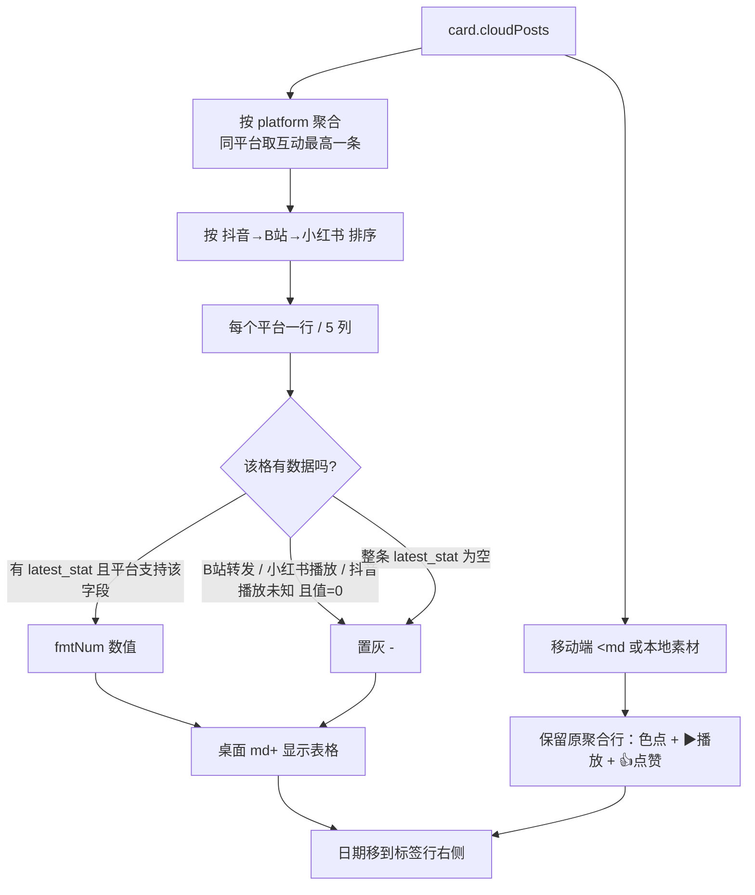

# R-260 开发设计：素材库卡片逐平台指标（播放/点赞/收藏/评论/转发，缺数据置灰「-」）

- **对应需求**: `requirements/R-260-card-platform-stats.md`
- **日期**: 2026-11-09
- **状态**: ✅ 已按本文实现（2026-11-09，verify 全绿 + Playwright 五档视口点检 + 4 条新增单测）
- **前置**: R-179（素材库卡片）、R-259（素材库瀑布流，卡片高度自适应）、R-199（换批动画）、R-218（移动端）、R-244/R-249（封面口径）
- **原则**: 纯前端展示改动；数据全部来自现有 `GET /api/library`；不改后端/接口/表；不改卡片其它区域与交互；`verify.sh` 全绿。

## 1. 开发背景

素材库卡片信息区原来只有一行聚合数据：平台色点 + 最大播放量 + 最大点赞 + 日期，看不出**每个平台**各自的 5 项指标。现有接口 `cloudPosts[].latest_stat` 已经按平台返回 `plays/likes/favorites/comments/shares` 与 `plays_known`，前端此前未使用。

按作者要求（附截图，红框圈出该聚合行）：卡片内逐平台展示「播放量、点赞、收藏、评论、转发」；未发布平台不显示行；接口没有的字段置灰「-」。

真实数据取证（开发库，2026-11-09）：

| 平台 | 作品数 | 有统计 | 播放为 0 | 转发为 0 | 结论 |
|---|---|---|---|---|---|
| 抖音 | 1139 | 1139 | 600（公开接口不可信，`plays_known=false`） | 179（其余 960 有值） | 5 项均可展示；播放量按 `plays_known` 区分未知 |
| B站 | 477 | 477 | 0 | **477（全部）** | 转发接口拿不到 → 置灰「-」 |
| 小红书 | 408 | 408 | **405（仅 3 条有值）** | 291（117 条有值） | 播放量接口拿不到 → 置灰「-」 |

> 结论与作者举例一致：B站转发量、小红书播放量是接口缺口，前端不做假数据，统一置灰「-」；个别确实有值（>0）的作品仍照常展示数字。

## 2. 涉及的技术

| 技术 | 用途 |
|---|---|
| React 19 `useMemo` | 卡片内把 `cloudPosts` 按平台聚合成指标行（同一平台多条取互动最高） |
| TypeScript | `LatestStat` 类型、指标 key 联合类型（`plays/likes/favorites/comments/shares`） |
| Tailwind CSS | 6 列小表（平台列 `w-12` + 5 个 `flex-1` 右对齐列）；`text-[10px]`（桌面）与 `text-xs`（移动端聚合行） |
| `fmtNum` / `platformName` / `PLATFORM_DOT` | 数值缩写（1.8w/1.2k）、平台中文名、平台色点（沿用 R-226 口径） |
| vitest + @testing-library/react | 指标表/置灰/未发布平台不出现/无统计整行「-」4 条单测（`aria-label` 定位单元格） |
| Playwright | 1280/1440/1920/768/390 真实数据点检：数值、置灰、无溢出、0 console error |

无新增依赖；无后端/接口/表改动。

## 3. 开发流程图



## 4. 数据流转图

```mermaid
flowchart LR
    API[GET /api/library<br/>cloudPosts[].latest_stat] --> C[CardItem.cloudPosts]
    C --> G[groupByPlatform<br/>platform -> LatestStat]
    G --> R[statRows: platform + stat]
    R --> M[metricText platform, stat, key]
    M --> T[桌面指标表]
    R --> A[移动端聚合行<br/>沿用 max(plays/likes)]
    T --> DOM
    A --> DOM
```

- 数据来源、字段、更新时机不变；没有新增请求、没有落库；
- 「是否发布」直接来自 `cloudPosts`（合并作品每个平台一条成员），未发布平台天然没有成员。

## 5. 实现细节

### 5.1 常量与可用性矩阵（`pages/videos/material-card.tsx`）

```ts
const METRIC_COLS = [
  { key: 'plays', label: '播放' },
  { key: 'likes', label: '点赞' },
  { key: 'favorites', label: '收藏' },
  { key: 'comments', label: '评论' },
  { key: 'shares', label: '转发' }
] as const
const PLATFORM_ORDER = ['douyin', 'bilibili', 'xiaohongshu']
/** 接口缺口：B站无转发、小红书无播放量；有值（>0）仍展示 */
const MISSING_METRICS = { bilibili: ['shares'], xiaohongshu: ['plays'] }
```

`metricText(platform, stat, key)` 判定（输入 → 规则 → 输出）：

| 输入 | 规则 | 输出 |
|---|---|---|
| `stat` 为空（该平台还没同步到数据） | 直接返回 | `null` → 灰色「-」 |
| 平台在该指标的 `MISSING_METRICS` 中 | 值 >0 → `fmtNum`；否则 `null` | 「-」或数字 |
| `key='plays'` 且平台=抖音 且 `plays_known=false` 且值=0 | 视为未知 | `null` → 灰色「-」 |
| 其余 | `fmtNum(Number(value || 0))` | 数字（真实 0 显示「0」） |

### 5.2 按平台聚合成行

- 遍历 `item.cloudPosts`，按 `platform` 归组；同平台多条（历史脏数据/手动合并）取互动分最高的一条：`score = likes + favorites + comments + shares`（全空为 -1）；
- 按 `PLATFORM_ORDER` 排序（不在列表的平台排最后，保持插入顺序）；
- 未发布平台没有 `cloudPost` → 不会出现在 `statRows`，**不渲染行**（满足「没有发布视频就不展示对应行」）。

### 5.3 渲染结构

- **桌面（≥768px）**：仅在 `statRows.length > 0` 时渲染表格：
  - 表头：`flex`，平台列 `w-12` 留空，后面 5 个 `flex-1 text-right` 显示「播放/点赞/收藏/评论/转发」（`text-[10px] text-muted-foreground/60`）；
  - 数据行：平台色点 + 平台名（`w-12`）+ 5 个 `flex-1 text-right` 数值；缺数据格 `text-muted-foreground/40` 灰色「-」，正常格 `text-foreground/80`；
  - 每个指标格加 `aria-label="平台+指标"`（如 `B站转发`）供测试/无障碍定位。
- **移动端（<768px）或没有云端统计**：保留原聚合行（平台色点 Tooltip + `▶ max(plays)` + `👍 max(likes)`），不渲染表格。
- **日期**：从原聚合行移到标签行最右侧（`ml-auto`），无标签时该行只显示日期；标签行现在恒渲染（之前仅在有标签时渲染）。

### 5.4 尺寸与溢出

| 卡片场景 | 卡片内容宽 | 平台列 | 每指标列 | 结果 |
|---|---|---|---|---|
| 1920 视口 5 列 | ~325px | 48px | ~55px | 数字/表头均不溢出 |
| 1440 视口 5 列 | ~231px | 48px | ~36.6px | 「201w」「1.2k」均放得下 |
| 1280 视口 5 列 | ~199px | 48px | ~30.2px | 放得下 |
| 768 平板 3 列 | ~185px | 48px | ~27.4px | 实测无溢出（`right` 未超出卡片内边距） |
| 390 手机 2 列 | ~149px | — | — | 表格隐藏，走聚合行 |

### 5.5 边界与降级

- `latest_stat` 为空 → 该行 5 格全部灰色「-」（行仍显示，表示已发布、暂无数据）；
- 本地素材（`cloudPosts` 为空）→ 不渲染表格，聚合行保持原样；
- 换批/追加/删除/选择模式/编辑抽屉/播放等交互不受影响（只改信息区内部 DOM）；
- 后续某平台补齐字段：只需从 `MISSING_METRICS` 里删除对应项，无需改渲染逻辑。

## 6. 新增/修改表结构

无。未新增/修改数据库表、列、索引或迁移。

## 7. 新增/修改接口

无。继续使用 `GET /api/library` 既有响应；`cloudPosts[].latest_stat` 的既有字段 `plays/likes/favorites/comments/shares/plays_known/plays_source` 全部已在接口中返回，本次未新增或修改字段。

## 8. 数据来源与原始字段明细

| 展示项 | 来源 | 原始字段 | 落库字段 | 用途 | 更新时间 | 空值处理 |
|---|---|---|---|---|---|---|
| 平台行是否存在 | `GET /api/library` → `cloudPosts` | `cloudPosts[].platform` | `platform_posts.platform` | 决定展示哪些平台行 | 随卡片（同步/筛选/追加） | 无成员 → 不显示该行 |
| 播放量 | `cloudPosts[].latest_stat` | `plays` + `plays_known` + `plays_source` | `platform_post_stats.plays/source` | 播放列 | 平台数据同步（卡片缓存 20s） | 抖音 `plays_known=false` 且 0 → 「-」；B站正常；小红书接口缺口 → 「-」 |
| 点赞/收藏/评论 | 同上 | `likes` / `favorites` / `comments` | `platform_post_stats.*` | 对应列 | 同上 | 有统计则显示（真实 0 显示 0）；无统计整行「-」 |
| 转发 | 同上 | `shares` | `platform_post_stats.shares` | 转发列 | 同上 | B站接口不返回 → 「-」；其他平台正常 |
| 日期 | `CardItem.date` | 作品 `publish_time` | `platform_posts.publish_time` / `videos.*` | 卡片底部日期 | 随卡片 | 空 → 不显示 |
| 平台名/色点 | 前端常量 | `PLATFORM_NAME` / `PLATFORM_DOT` | 不落库 | 行标识 | 随前端 | 未知平台回退原字符串/灰点 |

## 9. 实现与验收记录（2026-11-09）

- **改动文件**：`frontend_v2/src/pages/videos/material-card.tsx`、`frontend_v2/src/pages/videos/material-card.test.tsx`。
- **单元测试（新增 4 条，共 8 条全过）**：
  1. 三平台逐行 5 项指标正确；B站「转发」=灰色「-」、小红书「播放」=灰色「-」；抖音 1.8w、B站 1.2k、小红书点赞 5；
  2. 只发布抖音的卡不出现 B站/小红书行；
  3. 平台已发布但 `latest_stat=null` → 该行 5 格全灰「-」；
  4. 抖音 `plays_known=false` 且播放 0 → 「-」，其余指标正常。
- **Playwright 实测（真实数据，登录后 `/videos`）**：
  - 1440：三平台卡显示 3 行，抖音 `1.8w / 388 / 60 / 26 / 42`、B站 `1.2k / 16 / 7 / 8 / -`、小红书 `- / 5 / 1 / 3 / 0`；日期在标签行右侧；卡片高度随内容变高（瀑布流正常）；
  - 1920 / 1280 数值与置灰一致，无横向滚动、0 console error；
  - 768：表格正常显示、单元格未溢出（`right` 未超出卡片内边距）；
  - 390：表格隐藏、保留原聚合行（▶播放/👍点赞）、无横向滚动；
  - 素材库筛选/查询/加载更多/多选/编辑抽屉不受影响。
- **门禁**：`scripts/verify.sh` 全绿（后端 ruff/mypy/pytest、前端 lint/vitest/build、文档一致性）。
