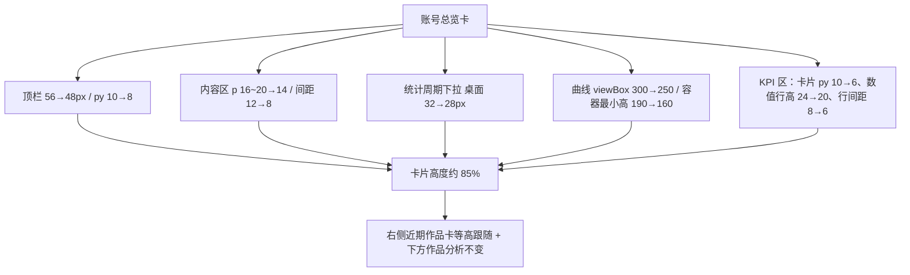
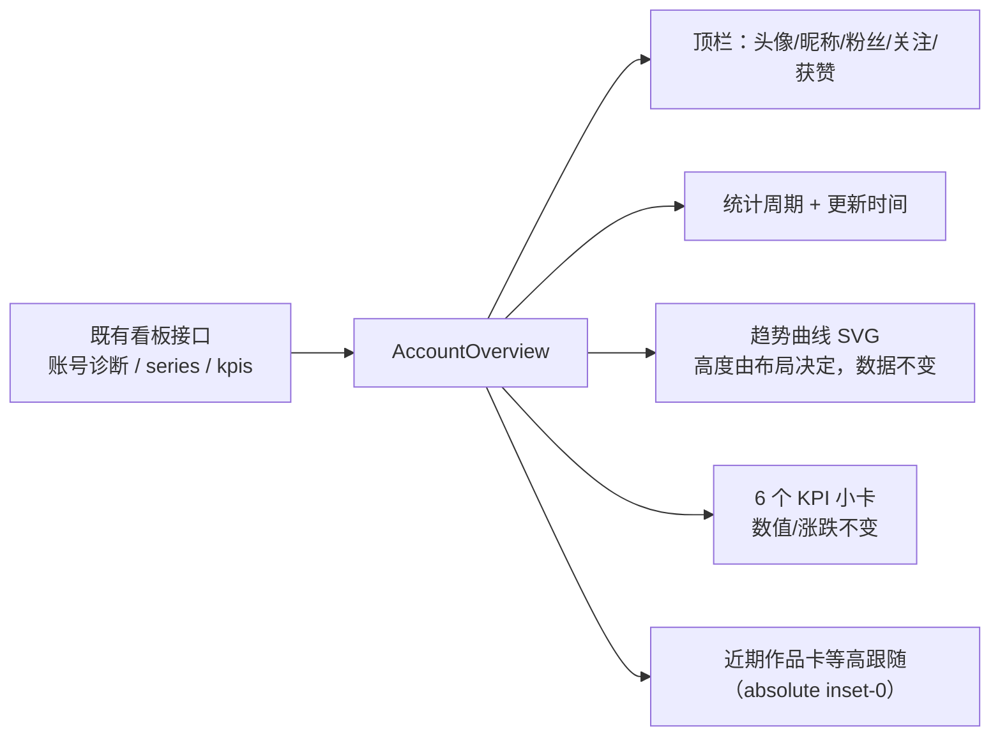

# R-261 开发设计：数据看板「账号总览」卡高度压缩 15%

- **对应需求**: `requirements/R-261-dashboard-account-height.md`
- **日期**: 2026-11-09
- **状态**: ✅ 已按本文实现（2026-11-09，verify 全绿 + Playwright 六档视口点检）
- **前置**: R-244（账号总览 / 作品分析卡片）、R-259（全站正文变宽后看板卡片同步变宽）、R-218（移动端）
- **原则**: 只改 `pages/dashboard/index.tsx` 里 AccountOverview 与其 KPI 小卡的纵向尺寸；不改数据、交互、接口、表；不改其它卡片结构；`verify.sh` 全绿。

## 1. 开发背景

作者要求「数据看板的账号数据这块的高度减少百分之15%」。该块 = 数据看板首屏左侧的 `AccountOverview` 卡（头像/昵称/粉丝/关注/获赞 + 统计周期 + 趋势曲线 + 6 个 KPI + 更新数据）。

改前实测（`main section`）：

| 视口 | 卡片高度 | 顶栏 | 内容区 | 曲线渲染高 | KPI 区 |
|---|---|---|---|---|---|
| 1440×1000 | **415px** | 56 | 357 | 255（543 宽 × 300/640） | 242（3 行 × 75 + 2×8） |
| 1920×1080 | **515px** | 56 | 457 | 355（756 宽 × 300/640） | 242 |
| 1280×1000 | 384px | 56 | 326 | 221（472 × 300/640） | 242 |
| 1024×1000 | 392px | 64 | 326 | 190（容器最小高） | 242 |

高度构成：`header + 上下内边距 + 统计周期行 + 间距 + max(曲线列, KPI 区) + 上下内边距`。曲线按卡片宽度等比缩放（viewBox 宽 640、高 300），宽屏比窄屏更高，因此必须同时压缩曲线与 KPI 两块才能在各档都达到约 -15%。

## 2. 涉及的技术

| 技术 | 用途 |
|---|---|
| React 19 + TypeScript | `pages/dashboard/index.tsx`（只改 className / 曲线高度 props） |
| Tailwind CSS | `min-h-*`、`p-*`、`space-y-*`、`py-*`、`leading-*`、`gap-y-*` 尺寸调整 |
| 内联 SVG `TrendLine`（viewBox 300 → 250） | 曲线渲染高度等比下降（不改曲线数据/交互/动画） |
| Playwright | 六档视口实测卡片高度变化比例、内容不裁切、无横向滚动、0 console error |

无新增依赖；无后端/接口/表改动；无新增测试（纯样式调整，既有 charts/dashboard 单测继续通过）。

## 3. 开发流程图

## 4. 数据流转图

只有布局尺寸变化，数据来源、字段、更新时机全部不变。

## 5. 实现细节

### 5.1 顶部账号栏

- `min-h-[56px]` → `min-h-[48px]`；`py-2.5` → `py-2`（8px）；
- 头像仍 36px（不缩小），实际顶栏高度 = max(48, 36 + 16) = **52px**（改前 56px，-4px）；
- 昵称/粉丝/关注/获赞、更新数据按钮的字号与结构不变。

### 5.2 内容区与统计周期行

- 内容容器：`space-y-3 p-4 sm:p-5` → `space-y-2 p-3.5`（上下内边距 20→14，模块间距 12→8）；
- 统计周期下拉桌面高度 `md:h-8`（32px）→ `md:h-7`（28px）；移动端仍 `h-11`（44px 触控高度，R-218）；
- 统计周期行高 32 → 28px。

### 5.3 趋势曲线

- `CrossfadeTrendLine` 的 `height`（SVG viewBox 高度）300 → **250**：曲线渲染高度 = 列宽 × height / 640，1440 下 548×250/640 ≈ **214px**（原 255，-16%）；
- 曲线容器 `min-h-[190px]` → `min-h-[140px]`（曲线被宽度压得比 140px 还矮时用该最小高度，窄屏/手机同比 -15%）；
- 曲线数据、坐标轴、hover 切换、入场动画（R-244）全部不变。

### 5.4 KPI 小卡

| 项 | 改前 | 改后 | 来源 |
|---|---|---|---|
| 卡片上下内边距 | `py-2.5`（10px） | `py-1.5`（6px） | `KpiCardView` |
| 数值行高 | `leading-6`（24px） | `leading-5`（20px） | 同上 |
| 两行 KPI 间距 | `gap-y-2`（8px） | `gap-y-1.5`（6px） | KPI 栅格 |
| 单卡高度 | 75px | **63px** | 实测 |
| KPI 区高度 | 242px | **202px** | 3×63 + 2×6 |

指标名（10px）/数值（18px）/涨跌（10px）字号、悬浮切换曲线、点击激活逻辑均不变。

### 5.5 高度核算（实测）

| 视口 | 改前 | 改后 | 变化 | 构成（改后） |
|---|---|---|---|---|
| 1920×1080 | 515 | **435** | **-15.5%** | 52 + 14 + 28 + 8 + (298+19) + 14 |
| 1440×1000 | 415 | **352** | **-15.2%** | 52 + 14 + 28 + 8 + (214+19) + 14 |
| 1280×1000 | 384 | **324** | **-15.6%** | 52 + 14 + 28 + 8 + (186+19) + 14 |
| 1024×1000 | 392 | **328** | **-16.3%** | 顶栏 60（内容换行）+ 14 + 28 + 8 + max(140+19, 202) + 14 |
| 768（单列堆叠） | 708 | **601** | **-15.1%** | 曲线 241 + KPI 202 纵向堆叠 |
| 390（手机） | 674 | **572** | **-15.1%** | 曲线用最小高 140 + KPI 210 纵向堆叠 |

> 右侧「近期作品」卡沿用原 `lg:absolute lg:inset-0` 的等高设计，跟随行高一起变矮（列表内部滚动不变），因此整行一起减少约 15%。下方「作品分析」卡不在本次改动范围。

### 5.6 边界与降级

- 内容不裁切：所有容器均为自适应高度，只缩小内边距/行高/曲线 viewBox，未设固定总高或 `overflow: hidden`；
- 窄屏（<1024px）：曲线与 KPI 纵向堆叠，尺寸同步缩小，仍无横向滚动；
- 统计周期切换/KPI 切换曲线会触发布局重绘，尺寸不变（宽度不变，仅曲线重绘）；
- 不改「更新数据」按钮尺寸、近期作品列表内容、作品分析卡结构。

## 6. 新增/修改表结构

无。

## 7. 新增/修改接口

无。看板接口 `GET /api/dashboard/...`（既有）请求与响应字段均未改。

## 8. 数据来源与原始字段明细

| 展示项 | 来源 | 原始字段 | 落库字段 | 用途 | 更新时间 | 空值处理 |
|---|---|---|---|---|---|---|
| 账号信息 | 既有看板接口（TikHub 诊断 + 本地账号） | `account.nickname/avatar/followers/following/likes_total` | `creator_accounts` 画像快照等既有字段 | 顶部账号栏 | 打开/更新数据 | 缺失显示「—」/未绑定占位 |
| 统计周期 | 页面本地状态 | `periodDays`（7/14/30/90） | 不落库 | 切换曲线/KPI 口径 | 用户切换 | 默认 7 |
| 趋势曲线 | 既有看板接口 | `series[metric].points[].date/value` | 既有每日快照表 | 绘制曲线 | 打开/切周期/更新 | 有效点 <2 显示空文案 |
| 6 个 KPI | 既有看板接口 | `kpis[].label/value/delta` | 既有快照/诊断数据 | KPI 小卡 | 同上 | 缺数据显示「暂无数据」 |
| 近期作品 | 既有 `GET /api/works` | 作品列表字段 | 既有表 | 右侧列表（等高跟随） | 打开/滚动加载 | 既有加载/错误态 |

本次不改任何数据字段，只有布局尺寸变化。

## 9. 实现与验收记录（2026-11-09）

- **改动文件**：`frontend_v2/src/pages/dashboard/index.tsx`（8 处尺寸调整：顶栏 min-h/py、内容区 p/space-y、统计周期下拉高度、曲线 height/容器 min-h、KPI 栅格 gap-y、KPI 卡 py、KPI 数值 leading）。
- **Playwright 实测**（登录后 `/dashboard`）：
  - 账号总览卡高度：1440 **415→352（-15.2%）**、1920 **515→435（-15.5%）**、1280 **384→324（-15.6%）**、1024 **392→328（-16.3%）**、768 **708→601（-15.1%）**、390 **674→572（-15.1%）**；KPI 单卡 75→63、KPI 区 242→202；
  - 页面无横向滚动、0 console error；右侧近期作品卡与账号卡仍等高（同高 352/435/324）；下方作品分析卡、tab、图表不受影响；
  - 移动端 390 单列堆叠正常、无横向滚动；768 平板堆叠正常；
  - 顶栏账号信息、统计周期、更新时间、6 个 KPI、更新按钮均完整显示，无裁切；曲线与轴刻度正常。
- **门禁**：`scripts/verify.sh` 全绿（后端 ruff/mypy/pytest、前端 lint/vitest/build、文档一致性）。
