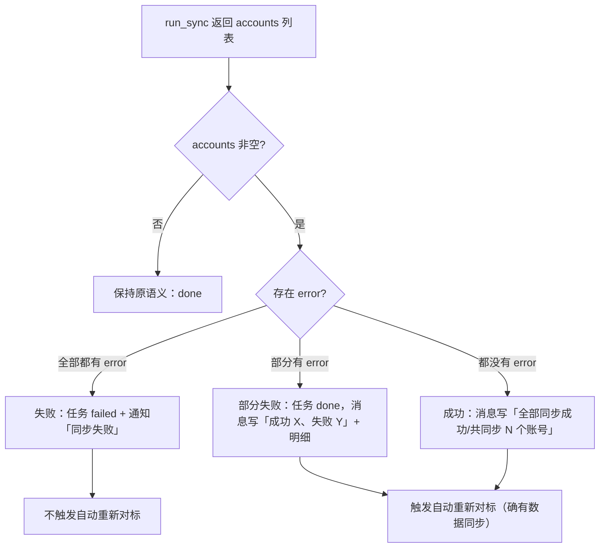

# R-262 开发设计：同步任务按真实成功/失败统计（通知不再误报「已同步」）

- **对应需求**: `requirements/R-262-sync-result-reporting.md`
- **日期**: 2026-11-10
- **状态**: ✅ 已按本文实现（2026-11-10，verify 全绿 + 11 条同步相关单测通过）
- **前置**: R-162（同步所有博主队列化）、R-109（每日两轮同步）、R-163（并发消费者 `run_all_top15_sync`）、R-133（任务失败/通知）、R-246（TikHub 稳定性）
- **原则**: 只改同步「结果判定 / 汇总文案 / 任务成败」；TikHub 调用、预算、数据写入、接口、表、前端不动；`verify.sh` 全绿。

## 1. 开发背景

实际现象（2026-11-10）：

- TikHub 账户余额 `0.0008`、免费额度 `0`，所有接口返回 **HTTP 402**；
- 数据库 15 个账号 `sync_status=failed`，`sync_message` 均为 402；
- 但 20:27 的通知仍写「平台数据同步完成：全量同步：共 12 个博主，已同步 12 个（并发 4）；已自动触发「重新对标」」，20:29 还触发了「重新对标完成」——与实际全部失败矛盾。

根因（代码取证）：

| 链路 | 代码 | 问题 |
|---|---|---|
| 单账号同步 `run_sync` | `_sync_one_acc` 捕获异常 → 写 `acc.sync_status=failed` 并 `return {"error": ...}` | 不抛异常，上层不知道失败 |
| 全量同步 `run_all_top15_sync._one` | 调 `run_sync(...)`；只要不抛异常就 `return {"status": "done"}` | **全部账号 402 也计为 done**，`synced` 累加；`if synced:` 还触发了重新对标 |
| 全量同步汇总文案 | `已同步 {synced} 个` | 把失败算成功 |
| 每日同步 `run_daily_sync_all` | `accounts = [...]`；文案 `共同步 {len(accounts)} 个账号`；无条件 `maybe_start_benchmark_rerun` | 失败账号也计入「共同步」；全失败仍触发重新对标、任务仍算完成 |
| 手动单账号同步 `_start_sync` | 直接 `return run_sync(...)`，任务运行器见到正常返回就标 done | 全失败时通知标题仍是「平台数据同步完成」 |

任务运行器（`app/tasks.py`）的规则：任务函数**正常返回 → done 并写完成通知；抛异常 → failed 并写失败通知**。因此「准确上报」= 在任务函数里检查账号结果，全失败时主动抛错。

## 2. 涉及的技术

| 技术 | 用途 |
|---|---|
| Python 3.14 + SQLAlchemy Session | `backend/app/services/platform_sync.py`（两条汇总路径）、`backend/app/api/platform.py`（手动同步任务函数） |
| 既有任务运行器 `app/tasks.py` | 通过「抛异常 → failed + 失败通知」表达真实失败（不改运行器） |
| 既有通知 `_notify()` | 完成通知取 `result["message"]`；失败通知取异常文本（截断 200 字），结构不变 |
| pytest + monkeypatch | 6 条新单测覆盖：全量全失败/部分失败/外层任务抛错、每日部分失败/全失败、单账号全失败 |

无新增依赖；无表/接口/前端改动。

## 3. 开发流程图



## 4. 数据流转图

```mermaid
flowchart LR
    RS[run_sync<br/>accounts[{platform, posts, error?}]] --> C{分类}
    C -->|全部 error| F1[status=failed<br/>_fail_creator_task / raise]
    C -->|部分 error| P1[status=partial]
    C -->|无 error| D1[status=done]
    F1 --> M[汇总 message<br/>成功 X / 部分失败 Y / 失败 Z + 明细]
    P1 --> M
    D1 --> M
    M --> N[_notify<br/>notifications 表]
    D1 --> R[maybe_start_benchmark_rerun]
    P1 --> R
    F1 -.全部失败.-> X[不触发 rerun]
```

数据来源不变：只用 `run_sync` 已经返回的 `accounts[].error`（失败原因来自 TikHub 返回的异常文本，如 HTTP 402）。

## 5. 实现细节

### 5.1 全量同步（`run_all_top15_sync`，`services/platform_sync.py`）

- `_one` 现在保存 `sync_res = run_sync(...)`，并在标记 done 前检查：
  - `acc_rows` = `sync_res["accounts"]` 中的 dict；
  - `acc_errors` = 带 `error` 的项；
  - `acc_rows` 非空且全部带 error → 调 `_fail_creator_task(..., "同步失败：平台：原因")` 并返回 `{"status": "failed", "reason": ...}`；
  - 部分 error → 标记该博主任务 done，但返回 `{"status": "partial", "reason": ...}`；
  - 无 error → 原 `done`。
- 汇总：
  - `done_rows` / `partial_rows` / `failed_rows` 分别计数；
  - `synced = done + partial`（只代表真有数据同步成功的博主）；
  - 全部成功：`全量同步：共 N 个博主，全部同步成功（并发 W）`；
  - 有失败/部分失败：`全量同步：共 N 个博主，成功 X、部分失败 Y、失败 Z（并发 W）；失败：…；部分失败：…`（各最多 5 条，超出「等 N 个」）；
  - 自动重新对标：`if synced:` 才调用（原逻辑同条件，但 `synced` 口径已修正）。
- 返回结构补充 `done` / `partial` 计数；`failed` 仍为字符串列表（每条 `名字(原因)`）。

### 5.2 全量同步外层任务（`all_top15_worker`）

- 调用 `run_all_top15_sync` 后：若 `synced == 0` 且存在失败 → `raise RuntimeError(result["message"])`；
- 任务运行器据此把后台任务标记 `failed`、写「平台数据同步失败」通知，并广播 SSE；
- 部分失败不抛错（任务完成，但消息/明细如实说明）。

### 5.3 每日同步（`run_daily_sync_all`）

- 先汇总 `accounts`：`ok_accounts`（无 error）/ `err_accounts`（有 error）；
- `nothing_synced = accounts 非空 且 ok_accounts 为空 且 creator_sync["synced"] == 0`；
- 自动重新对标：`nothing_synced` → `"no_sync"` 不调用；否则保持原调用；
- 文案：
  - 无失败：`每日同步完成：主博主 + N 个对标，共同步 X 个账号，更新作品 P，采集评论 C…`（与改前一致）；
  - 有失败：`每日同步完成：…成功 X、失败 Y 个账号…；失败账号：平台(原因)、…（最多 3 个 + 等 N 个）`；
  - `nothing_synced`：`每日同步失败：主博主 + N 个对标，Y 个账号全部同步失败…` 并 `raise RuntimeError(msg)` → 任务失败/失败通知；
- 返回结构补充 `ok_accounts` / `failed_accounts` 计数（不改既有字段）。

### 5.4 手动单账号/单博主同步（`api/platform.py:_start_sync`）

- 任务函数拿到 `run_sync` 结果后检查 `accounts`：非空且全部有 `error` → `raise RuntimeError(result["message"])`；
- 其它情况原样返回（有成功账号时仍然 done，消息里的「失败账号」保留）。

### 5.5 阈值与降级

- 失败明细条数：全量同步每类最多 5 条 + 「等 N 个」；每日同步最多 3 条 + 「等 N 个」；
- 失败通知文本沿用任务运行器 200 字截断，超长时至少保留「失败 + 数量 + 前几个原因」；
- 无账号/全部禁用（入队阶段跳过）不参与「全部失败」判定，沿用既有跳过提示；
- `BudgetExceeded` 语义不变（取消后续 + 任务失败）。

## 6. 新增/修改表结构

无。未新增/修改表、列、索引或迁移；`background_tasks.result` 里仅多返回 `done/partial/ok_accounts/failed_accounts` 等统计字段（JSON，不涉及表结构）。

## 7. 新增/修改接口

无。`POST /api/platform/sync`、`POST /api/platform/sync-all`、调度器 `platform_sync` 任务的请求/响应契约均未改；仅任务完成后的通知文案与任务成败状态更准确。

## 8. 数据来源与原始字段明细

| 展示项 | 来源 | 原始字段 | 落库字段 | 用途 | 更新时间 | 空值处理 |
|---|---|---|---|---|---|---|
| 每账号同步结果 | `run_sync` 返回 `accounts[]` | `account_id/platform/posts/comments/error`（error 来自 TikHub 异常文本） | 既有 `creator_accounts.sync_status/sync_message`（run_sync 内已写） | 判定成功/失败、拼通知明细 | 同步结束时 | 无 error = 成功；空 accounts = 无账号可同步（不判失败） |
| 博主级任务状态 | `background_tasks` | `status/progress/error/note` | 既有表 | 前端进行中/失败展示 | 任务运行器写 | 全失败 → failed |
| 完成通知 | 任务返回值 `message` | 本文拼装的成功/失败计数与明细 | 既有 `notifications.message` | 通知中心展示 | 任务结束时 | 失败通知走异常文本（截断 200 字） |
| 自动重新对标 | `maybe_start_benchmark_rerun(refetch=False)` | 仅在有成功同步时调用 | 既有任务/同步记录 | 基于新数据重算 | 同步结束后 | 无成功 → 不调用 |

## 9. 实现与验收记录（2026-11-10）

- **改动文件**：
  - `backend/app/services/platform_sync.py`：`run_all_top15_sync`（账号结果分类 + 汇总口径 + 重新对标条件 + 返回结构）、`all_top15_worker`（全失败抛错）、`run_daily_sync_all`（账号成功/失败统计、文案、全失败抛错、重新对标条件）；
  - `backend/app/api/platform.py`：`_start_sync` 任务函数（全账号失败抛错）；
  - `backend/tests/test_r162_sync_all_queue.py` / `backend/tests/test_r109_daily_sync.py`：新增 6 条测试。
- **测试**：
  - `test_r162_sync_all_queue.py` 6 条全过（原 3 + 新增 3：全量全失败不算已同步且任务 failed、部分失败记 partial、外层 worker 全失败抛错）；
  - `test_r109_daily_sync.py` 5 条全过（原 2 + 新增 3：日更成功/失败计数与明细、日更全失败抛错且不触发 rerun、手动单账号全失败抛错）；
  - `ruff check app tests` 通过、`mypy app` 通过；`scripts/verify.sh` 全绿（后端全量 pytest + 前端 lint/vitest/build + 文档一致性）。
- **真实联调（2026-11-10 20:42，新代码已重启加载）**：TikHub 余额恢复后实际触发一次 `POST /api/platform/sync-all`（task 10868）——12/12 博主全部同步成功，`platform_posts` 更新 224 条、`platform_post_stats` 更新 227 条，后台任务 done；通知「平台数据同步完成：全量同步：共 12 个博主，全部同步成功（并发 4）；已自动触发「重新对标」」与真实结果一致（同场景旧代码 20:27 误报「已同步 12 个」，当时实际全 402 失败）。失败路径由 6 条单测覆盖（无需再消耗 TikHub 额度制造 402）。

- **行为对照（修复后）**：

| 场景 | 修复前通知 | 修复后 |
|---|---|---|
| 全量同步、全部账号 402 | 「平台数据同步完成：…已同步 12 个…；已自动触发重新对标」 | 任务 failed →「平台数据同步失败：全量同步：共 12 个博主，成功 0、部分失败 0、失败 12…」；不触发重新对标 |
| 全量同步、部分失败 | 「已同步 12 个」（失败账号未体现） | 「…成功 9、部分失败 2、失败 1…；失败：…；部分失败：…」，有成功才触发重新对标 |
| 每日同步、全部账号 402 | 「每日同步完成：…共同步 6 个账号…」 | 任务 failed →「平台数据同步失败：每日同步失败：…6 个账号全部同步失败…」；不触发重新对标 |
| 每日同步、部分失败 | 「共同步 6 个账号」（失败也计入） | 「成功 4、失败 2 个账号…；失败账号：…」 |
| 手动单账号全失败 | 「平台数据同步完成：…失败账号：…」 | 「平台数据同步失败：…」 |
