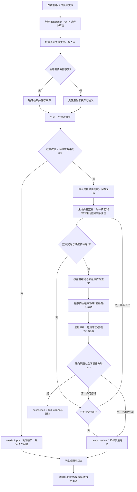
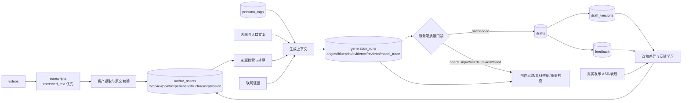

# R-263 开发设计：以作者内容资产为核心的生成文案重建

- **对应需求**：`requirements/R-263-author-generation-rebuild.md`
- **日期**：2026-11-13
- **状态**：开发中：实现与迁移已完成，真实 ASR 全量重建、20 主题真实验收和作者盲评进行中
- **排期**：M264
- **范围**：普通生成文案的全部入口、作者 ASR 资产化、质量门禁、反馈学习、旧实现清理；不重建对标洗稿
- **核心原则**：先证据与思考，后正文；宁可明确缺信息，也不生成通用废话；新链路一次性替换，不保留新旧算法开关

## 1. 开发背景

### 1.1 当前问题不是「提示词不够长」

现有链路为：检索若干 ASR 片段与联网材料 → 生成方写初稿 → 评审方/生成方执行固定轮次互评 → 只按红线和少量风格指标判断通过。它把更多注意力放在「有没有论点、像不像口吻、有没有口头禅」，没有先验证：

1. 用户真正目标是什么；
2. 达成目标有哪些不可违反的条件；
3. 结论由哪些证据推出；
4. 建议在该场景是否可执行；
5. 开头承诺是否被正文兑现。

因此继续追加「请更有逻辑、请更像作者」的提示词不能解决根因。需要把生成拆成有输入、有输出、有门禁的不同阶段。

### 1.2 ASR 没有被转成可复用的作者知识

当前 71 篇可用 ASR 的确参与了生成，但参与方式主要是「统计风格 + 每次临时检索文本」。最近每篇约注入 3.3k～3.5k 字，且包含多篇 ASR 开头和重复片段。这种方式存在四个问题：

- 文章开头不一定包含与主题相关的观点或经历；
- 检索片段没有明确的事实/观点/经历类型，模型容易误用；
- 没有稳定的原文证据引用，无法验证第一人称经历和数字；
- 作者改稿与反馈没有统一映射回可复用资产。

本设计不训练模型，而是在现有 PostgreSQL 中建立轻量、可追溯的作者资产层，并在每次生成时按主题检索。

### 1.3 质量状态也必须重建

现状中 `rounds_done=0` 仍可能 `passed=true`，模型全失败还会留下固定三点式 mock。新系统必须由服务端根据真实阶段和最终评审计算质量状态，不能直接采用模型或旧流程给出的 `passed`。

### 1.4 删除边界已做初步依赖核对

- `draft_discussions` 同时服务普通生成、基于原文讨论、洗稿与版本回退归因，**不能整表删除**。
- `debate.py` 同时含普通生成 `run_debate` 与洗稿 `run_rewrite_debate`，**不能整文件直接删除**。
- `generation.py` 除普通生成外，还被人设、提示词、洗稿复用 `_all_texts/_engagement_map/author_style_context` 等函数，需先迁移共享函数。
- `station_evidence.py` 当前由 `debate.py` 调用，洗稿仍需使用，保留。
- `ai_prompts/ai_prompt_defs/prompt_evals` 为多模块共享表，只清理普通生成旧 key 和运行时引用，不能整表删除。
- 截至设计时，没有确认一张「只服务旧普通生成、可直接删除」的现有物理表。因此本次不是为凑删除数量而误删共享表；新增资产与运行表后，若进一步盘点发现独占废表，必须按本文迁移门禁删除。

## 2. 涉及的技术

| 技术 | 用途 | 本次选择理由 |
|---|---|---|
| Python + FastAPI | 新生成接口、草稿详情、后台任务 | 沿用项目分层与任务体系 |
| SQLAlchemy 2 + PostgreSQL | 作者资产、生成运行、证据与状态 | 数据量小，无需新增向量数据库 |
| Alembic | 新表、persona 证据字段、数据迁移与确认的废表删除 | 禁止启动时临时建表补列 |
| 现有 `TfidfIndex` | ASR 资产初筛与主题相关度计算 | 复用现有能力，避免引入基础设施 |
| 现有 `llm_router` | 角度、蓝图、写作、独立评审与真实模型留痕 | 沿用模型配置、超时和降级，记录实际模型 |
| 现有 `evidence/web_search_logs` | 外部事实检索、来源留痕 | 外部事实不冒充作者经历 |
| 现有 `background_tasks + SSE + draft_status` | 阶段进度、失败、切页刷新恢复 | 不新增任务框架 |
| Pydantic/JSON Schema 校验 + 程序证据校验 | 阶段输出契约、证据 ID、数字、状态门禁 | 模型只给候选，程序决定能否通过 |
| 现有草稿版本与反馈 | 作者改稿学习、版本回退、发布反馈 | 保留有效历史，不重复建设 |
| React/TypeScript + 现有 Drawer/动效 | 创作思路、依据、质量折叠区与真实阶段 | 不新增一级菜单，不增加必选步骤 |
| pytest + Vitest + 真实模型验收集 | 常识、事实、门禁、迁移、交互与作者盲评 | 模型自评分不能代替验收 |

## 3. 开发流程图



**说明**：图中的「最多 2 次」是针对明确问题的修订，不是旧版固定 N 轮互评；修订后必须重新执行完整质量门禁。

## 4. 数据流转图



## 5. 实现细节

### 5.1 模块划分

新增或调整为以下单一职责模块，不建立五套资产服务：

| 模块 | 职责 |
|---|---|
| `services/author_assets.py` | 五类资产的统一提取、校验、去重、检索、排序、增量更新 |
| `services/generation_pipeline.py` | 角度→蓝图→写作→评审→门禁的唯一普通生成编排 |
| `services/generation_validators.py` | JSON 契约、证据归属、数字、必要阶段、状态与分数校验 |
| `services/generation_feedback.py` | 作者改稿/状态/发布反馈转候选资产；不自动篡改人设 |
| `services/author_style.py` | 从旧 `generation.py` 迁出的共享人设与风格上下文，供洗稿等现有模块使用，行为不变 |
| `services/rewrite_debate.py` | 从旧 `debate.py` 迁出的洗稿与历史原文讨论能力，保持洗稿行为不变 |
| `services/discussion_service.py` | `draft_discussions` 的共享读写、模型标签、回退归因 |
| `services/draft_flow.py` | 普通生成入队与洗稿讨论入队分别调用新/旧所属服务，不做旧算法包装 |

路由仍保持薄层，业务判断在服务层完成。

### 5.2 作者资产提取

#### 输入

- 当前主博主、非广告、存在可用转写的 `Video + Transcript`；正文优先 `corrected_text`，为空用 `transcript_text`。
- 作者本次输入与明确补充的信息。
- 作者确认后的草稿定稿、文本反馈、状态流转和真实发布内容。
- 对标 ASR 不进入主博主资产，继续遵守 D-028。

#### 五类资产契约

| 类型 `asset_kind` | 提取内容 | 必须包含的上下文 | 禁止 |
|---|---|---|---|
| `fact` | 作者身份、稳定情况、偏好、已发生事实 | 适用时间、条件、原文证据 | 把普遍知识冒充作者事实 |
| `viewpoint` | 作者判断、理由、边界、例外 | 议题、结论、成立条件、反例 | 只摘一句口号而丢掉条件 |
| `experience` | 事件、目标、行动、结果、复盘 | 时间/场景（未知就标未知）、结果是否明确 | 补写原文没有的数字和结果 |
| `structure` | 开头承诺、推进顺序、转折、收尾方式 | 适用主题、为什么有效、证据篇目 | 固定三点式模板 |
| `expression` | 句长节奏、称呼、比喻、情绪变化 | 示例、适用范围、频次 | 把口头禅数量当作者感 |

#### 证据规则

每条资产至少有一个 `evidence_ref`：

```json
{
  "video_id": 123,
  "transcript_id": 456,
  "start_char": 120,
  "end_char": 168,
  "quote": "必须与原文该区间逐字一致的内容"
}
```

- 程序按 `start_char/end_char` 取原文并与 `quote` 比较；不一致则拒绝该资产，不让模型自证。
- 聚合型结构/表达资产可引用多篇 ASR，但至少 2 篇；样本不足时标 `candidate`，不作为强规则。
- 原文没有的时间、数字、人物和结果保持未知，不补齐。
- `content_hash = SHA256(creator_id + asset_kind + 规范化 content)`；同一作者同一类型下去重。
- 新证据出现时合并 `evidence_refs`、更新频次与 `updated_at`；意思冲突时不静默覆盖，旧资产归档或保留不同适用条件。

#### 更新频率

- 新 ASR/校对完成：逐篇提取事实、观点、经历和候选表达，立即进入后台任务。
- 每新增 5 篇可用 ASR，或首次全量建设完成后：聚合更新结构与表达资产。
- 作者定稿/反馈：只生成候选学习资产；完成或真实发布后才提高权重。
- 初次 71 篇 ASR 由部署后的后台重建任务处理，**Alembic 不调用外部 LLM**。建设期间显示真实任务进度；生成只能使用已完成资产和本次输入，缺口明显时返回 `needs_input`，不得用 mock 填充。

### 5.3 资产检索与排序

1. 查询当前主博主 `status=active` 的资产，候选状态只用于诊断，不进入事实依据。
2. 以「选题 + 入口具体文本」为查询，用现有 TF-IDF 对事实/观点/经历初筛 Top 40；结构与表达另取近期高确认资产各最多 2 条，不强行匹配无关主题。
3. 对每个候选计算 0～100 分：

```text
score = 100 × (
  0.45 × topic_relevance
+ 0.25 × evidence_strength
+ 0.20 × author_confirmation
+ 0.10 × normalized_performance
)
```

- `topic_relevance`：本批候选 TF-IDF 余弦相似度归一化到 0～1；低于原始相似度 0.08 的事实/观点/经历不进入生成。
- `evidence_strength`：原文区间校验通过且只有单篇证据为 0.8；两篇及以上独立作者证据为 1.0；无有效证据为 0 并淘汰。
- `author_confirmation`：真实发布 ASR=1.0，作者完成定稿=0.9，普通 ASR=0.8；候选资产不参与。
- `normalized_performance`：同主博主、同平台内按 `log1p(互动量)` 归一化；无数据为 0.4，避免没有指标就被判为差。表现只占 10%，不能推翻事实与相关性。
4. 同义重复资产只保留分数最高的一条，其余作为补充证据；最终最多注入 12 条主题资产、2 条结构、2 条表达，按分数降序。
5. 每次实际使用的资产 ID、证据版本、分数与排序理由写入 `generation_runs.evidence_json`，不能只保存拼接后的长文本。

### 5.4 角度生成与「允许不写」

模型基于选题、作者资产、人设和必要的外部证据生成最多 3 个角度，每个角度必须返回：

```json
{
  "angle_id": "a1",
  "title": "切入标题",
  "audience": "具体受众",
  "promise": "唯一核心承诺",
  "hook": "开头问题/冲突/结果",
  "reasoning": ["推理步骤"],
  "required_asset_ids": [1, 2],
  "author_fit": 0,
  "evidence_fit": 0,
  "audience_value": 0,
  "distinctiveness": 0,
  "risk": "可能夸大或缺证据之处"
}
```

四项分数各 0～25，总分 100。默认选择总分最高者，**低于 65 分不可选**。同时执行硬校验：

- 核心事实角度至少有 1 条相关作者资产或可靠外部证据；个人经历角度必须有作者 `experience` 资产。
- `required_asset_ids` 必须真实存在、属于当前主博主且已被本次检索选中。
- 三个角度只有换标题、承诺相同，按重复角度删除。
- 标题承诺超出证据、需要虚构经历、建议明显不可行，直接淘汰，不进入评分补偿。
- 全部不合格：`status=needs_input`，保存拒绝原因，不进入正文；最多提出 3 个会改变结论的问题。

### 5.5 内容蓝图

蓝图是正文前的强约束，字段如下：

```json
{
  "goal": "观众看完要理解/做到什么",
  "audience": "谁适用，谁不适用",
  "core_promise": "唯一核心承诺",
  "hook": {"text": "开头", "payoff": "正文何处兑现"},
  "reasoning_steps": [
    {
      "claim": "本步结论",
      "claim_type": "author_experience/external_fact/inference/opinion",
      "evidence_ids": [1],
      "inference": "证据为什么能支持结论",
      "limitations": "边界或反例"
    }
  ],
  "actions": [
    {"precondition": "适用前提", "action": "具体行动", "expected_result": "不超证据的结果"}
  ],
  "ending": "如何回扣承诺"
}
```

程序门禁：

- `core_promise` 只能一个；`hook.payoff` 非空且必须映射到具体推理步骤或行动。
- 每个事实/经历步骤必须有证据；纯观点可无外部证据，但必须标为 `opinion`，不能伪装成事实。
- 每个建议必须有 `precondition/action/expected_result`，缺一项就退回。
- 推理不能只写「交给 AI 判断」；`inference` 必须说明证据与结论的关系。
- 所有证据 ID 均通过归属、状态和原文校验。

常识评审另外回答：

1. 真实目标是什么？若按建议行动，目标对象是否到达了必要位置/状态？
2. 是否把「距离近、成本低、通常如此」等单一因素误当成唯一决策依据？
3. 是否存在一个简单反例让结论不成立？存在时是否补了边界？
4. 建议中的动作是否能由目标对象实际执行？

蓝图必须把真实目标转成明确的 `goal/precondition/action`，并检查必要对象是否到场或达到必要状态；目标变化时允许结论变化。任何生活案例都只用于说明这一通用规则，不单独硬编码答案。

### 5.6 作者化写作与事实溯源

写作模型只接收：最佳角度、已验证蓝图、选中资产及原文、结构与表达经验、人设与红线、必要外部证据。输出：

```json
{
  "title": "标题",
  "cover_text": "封面字",
  "script": "正文",
  "shells": {"douyin": "", "bilibili": "", "xiaohongshu": ""},
  "claims": [
    {"text": "正文中的事实性表述", "type": "author_experience", "evidence_ids": [1]}
  ]
}
```

硬规则：

- `author_experience` 只能引用主博主 `experience/fact` 或作者本次输入；外部和对标素材不能变成作者第一人称。
- `external_fact` 必须有外部来源 ID；正文可口语转述，不念 URL，来源在依据区展示。
- `inference` 必须能回到蓝图推理步骤；证据不足时降低结论强度。
- 数字通过程序抽取后与证据原文白名单核对；计算得出的数字必须保存算式和输入值，否则拒绝。中文数字、百分比、金额、日期和约数均纳入检查，不能只过滤阿拉伯数字。
- 正文有第一人称经历却未在 `claims` 声明，或声明类型与证据不符，评审失败。
- 标题、封面和开头中的结果、身份、数字也纳入同一校验，不能只审正文中间段落。
- 不强制 2～4 个论点，不强制口头禅，不设置固定三段式。

### 5.7 三维评审与真实质量门禁

每次正文后必须有一次完整评审。评审使用当前配置的评审槽位，记录实际出结果模型；即使生成/评审配置为同一模型，也必须以独立评审提示与输入实际执行，不能省略。

| 维度 | 输入与检查 | 通过规则 |
|---|---|---|
| 逻辑与事实 | 目标、前提、每步推理、反例、行动可行性、经历/数字/因果证据、开头兑现 | 全部为硬项；任何关键错误不通过 |
| 吸引力 | 开头具体性、核心矛盾、信息增量、节奏、结尾兑现，是否标题党 | 1～5 分，≥4；标题党直接不通过 |
| 作者感 | 作者观点是否一致、结构与表达是否自然、是否像通用 AI、是否机械模仿 | 1～5 分，≥4；红线直接不通过 |

修订规则：

- 只把失败项、对应原句和证据交给生成方修订，不进行无目标的全篇互夸/互改。
- 最多 2 次修订；每次修订后重新执行全部硬检查和三维评审，防止修一个地方引入另一个事实错误。
- 评审模型异常/空输出/JSON 不合法：`failed`，保留现场，显示「质量检查未完成」。
- 修订后仍有内容问题：`needs_review`，可查看正文和问题，但不标质量通过，不进入今日最佳。
- 无合格角度：`needs_input`；无正文模板。
- 成功状态只由程序计算：

```text
quality_passed =
  status == succeeded
  AND asset/angle/blueprint/writing/review 阶段均有完成记录
  AND final_review 存在且属于最终正文哈希
  AND revision_count >= 0 且实际写作次数 >= 1
  AND 所有硬项通过
  AND attraction_score >= 4
  AND author_score >= 4
  AND mock == false（新链路根本不存在 mock 分支）
```

`rounds_done=0` 不再是可通过的含糊概念；新记录保存 `write_count/review_count/revision_count`，最终正文哈希变化后旧评审自动失效。

### 5.8 反馈学习

| 信号 | 学习内容 | 权重与限制 |
|---|---|---|
| 真实发布 ASR | 最终实际表达、结构、事实与经历 | 最强；逐字证据校验后进入 active |
| AI 原稿→作者完成定稿 | 删除、重排、补充、替换的表达与结构 | 完成状态确认后进入学习；差异必须真实存在 |
| 作者文本评价 | 明确喜欢/避免的具体问题 | 提取候选规则，需证据，不改稳定事实 |
| archived/deleted（非纯手写） | 不采用的方向与问题 | 负反馈；不能单凭删除推断人设变化 |
| 播放/互动/涨粉 | 同类资产的辅助排序 | 最多 10% 权重；考虑平台和样本量，不改事实 |
| 回退到作者旧版 | 对 AI 改法的否定 | 保留现有版本归因，映射到本次运行反馈 |

已确认 `persona_tags` 不因一次自动学习被覆盖；需变更时沿用现有人设确认机制。

### 5.9 页面与状态实现

- 不修改一级导航数据，不新增菜单。
- 主页原来先调 `/angles` 再选的流程改为直接 `/generate-async`；系统默认最佳角度，减少一步。
- 草稿生成中沿用现有卡片和顶栏任务状态，阶段映射为 `assets/angles/blueprint/writing/review`；采用真实阶段，不做按时间递增的假百分比。
- 草稿抽屉新增三个默认折叠区：「创作思路」「素材依据」「质量检查」。内容与动效复用现有 Drawer、Tabs、Accordion，不为新面板整页跳转。
- 新普通生成不再显示「双模型讨论第 N 轮」；历史讨论和洗稿仍使用原讨论 UI。
- 备选角度放在「创作思路」中，点击「用此角度重新生成」调用 rework 并传 `angle_id`，原版本先快照。
- `needs_input/needs_review/failed` 使用不同文案和图标；无内容时不展示空白编辑器为成功稿。
- 所有新交互保留进入/退出动效；切页/刷新通过任务 ID 与 run ID 恢复，不出现空白闪帧。
- AI 设置中的「讨论轮次」改名为「洗稿讨论轮次」，普通生成不再读取；不删除洗稿配置。

### 5.10 提示词与模型

新增注册 key：`author_asset_extract`、`author_angle`、`author_blueprint`、`author_write`、`author_review`、`author_revise`、`author_edit_learn`。

- 统一进入 `ai_prompt_defs/ai_prompts`，含中文用途说明；运行时使用 `get_prompt`。
- 初版 `optimizable=false`，避免旧自动优化把硬约束再次改没；版本正文仍可手动管理和回滚。
- 角度、蓝图、写作使用生成方；评审使用评审方；资产提取复用现有 `persona_updates` 功能路由，实际模型均写入 `model_trace_json`。
- 沿用现有功能超时与 token 预算，优先复用 `ideas/debate_initial/rewrite/debate_critique/debate_revise` 对应预算，不新增一套预算页面。
- 正常一次生成约 4 次 LLM（角度、蓝图、写作、评审），每次针对修订增加 2 次，最多 8 次；资产提取在 ASR 入库时异步进行，不在每次生成重复全量学习。

## 6. 新增/修改表结构

只新增两张统一表，不为五类资产建五张物理表。JSON 字段继续使用项目现有 TEXT + JSON 约定，时间统一北京时间。

### 6.1 新增 `author_assets`

| 字段 | 类型 | 可空/默认 | 逐字段说明 |
|---|---|---|---|
| `id` | INTEGER PK | 否 | 资产 ID，生成证据引用此 ID |
| `creator_id` | INTEGER FK→creators.id | 否，索引 | 资产归属主博主，严格隔离对标 |
| `asset_kind` | VARCHAR(20) | 否，索引 | `fact/viewpoint/experience/structure/expression` |
| `source_kind` | VARCHAR(20) | 否 | `asr/author_input/draft_edit/feedback/published` |
| `source_id` | VARCHAR(80) | 否，默认 `''` | 主要来源标识，如 `video:123`；聚合资产为空 |
| `content` | TEXT | 否 | 一条原子资产正文，不存整篇 ASR |
| `context_json` | TEXT | 否，默认 `{}` | 议题、适用条件、时间、受众、例外、结构说明 |
| `evidence_refs` | TEXT | 否，默认 `[]` | 原文 video/transcript/字符区间/逐字 quote，或作者输入/草稿版本引用 |
| `content_hash` | VARCHAR(64) | 否 | 规范化内容 SHA256，用于幂等去重 |
| `quality_score` | FLOAT | 否，默认 0 | 证据与确认程度评分，不含本次主题相关度 |
| `usage_stats` | TEXT | 否，默认 `{}` | 使用次数、完成、不采用、回退、表现辅助统计 |
| `status` | VARCHAR(20) | 否，默认 `candidate` | `candidate/active/archived`；只有 active 进入正式生成 |
| `last_used_at` | DATETIME | 是 | 最近被生成引用时间 |
| `created_at` | DATETIME | 否，当前时间 | 创建时间 |
| `updated_at` | DATETIME | 否，当前时间 | 证据合并、状态或内容更新时间 |

约束与索引：

- `uq_author_asset_hash (creator_id, asset_kind, content_hash)` 唯一。
- `ix_author_assets_creator_kind_status (creator_id, asset_kind, status)`。
- `ix_author_assets_creator_status (creator_id, status)`。

### 6.2 新增 `generation_runs`

| 字段 | 类型 | 可空/默认 | 逐字段说明 |
|---|---|---|---|
| `id` | INTEGER PK | 否 | 一次生成运行 ID |
| `creator_id` | INTEGER FK→creators.id | 否，索引 | 当前主博主 |
| `draft_id` | INTEGER FK→drafts.id | 是，索引 | 关联进行中/结果草稿；失败现场也可关联 |
| `topic` | TEXT | 否 | 原始选题 |
| `input_context` | TEXT | 否，默认 `{}` | 入口类型、query_source、作者补充，不含旧创作模式 |
| `status` | VARCHAR(20) | 否，索引 | `queued/running/needs_input/needs_review/succeeded/failed/legacy` |
| `stage` | VARCHAR(20) | 否，默认 `queued` | `assets/angles/blueprint/writing/review/done` 等真实阶段 |
| `angles_json` | TEXT | 否，默认 `[]` | 候选角度、分项分数、拒绝原因 |
| `selected_angle_json` | TEXT | 否，默认 `{}` | 本次实际选择角度及选择方式 |
| `blueprint_json` | TEXT | 否，默认 `{}` | 核心承诺、推理、行动前提、开头兑现 |
| `evidence_json` | TEXT | 否，默认 `{}` | 使用资产 ID、排序分、原文证据、外部来源 |
| `draft_json` | TEXT | 否，默认 `{}` | 标题、封面、正文、平台文案与 claims |
| `reviews_json` | TEXT | 否，默认 `[]` | 每次三维评审、正文哈希、硬项与评分 |
| `attempts_json` | TEXT | 否，默认 `{}` | 阶段时间、write/review/revision 次数、失败与修订记录；legacy 时也存迁移留痕 |
| `model_trace_json` | TEXT | 否，默认 `{}` | 每阶段配置模型、实际模型、降级、提示词版本 |
| `final_script_hash` | VARCHAR(64) | 否，默认 `''` | 最终正文哈希，防止旧评审套用到新正文 |
| `quality_passed` | BOOLEAN | 否，默认 false | 只能由服务端门禁置 true |
| `error` | TEXT | 否，默认 `''` | 失败/待补信息原因，不暴露密钥 |
| `created_at` | DATETIME | 否，当前时间 | 创建时间 |
| `updated_at` | DATETIME | 否，当前时间 | 阶段与结果更新时间 |

索引：`ix_generation_runs_draft_id_id (draft_id, id)`、`ix_generation_runs_creator_status (creator_id, status)`。允许一稿多次运行，最新记录为当前生成过程；不新增 `drafts.latest_run_id`，避免循环外键。

### 6.3 修改 `persona_tags`

新增两列，不新建重复人设表：

| 字段 | 类型 | 默认 | 说明 |
|---|---|---|---|
| `evidence_refs` | TEXT | `[]` | 与作者资产相同的可追溯原文引用；原 `evidence` 短句继续保留用于兼容展示 |
| `conditions_json` | TEXT | `{}` | 该人设成立的议题、场景、时间、例外，防止单条素材泛化 |

已有证据能逐字定位到主博主 ASR 时补 `evidence_refs`；无法定位的保留原 `evidence` 并标记 `legacy_unresolved=true`，不得伪造引用。

### 6.4 保留、迁移与删除的表

| 对象 | 处理 | 原因 |
|---|---|---|
| `videos/transcripts` | 保留 | ASR 原始事实源 |
| `persona_tags/persona_checks` | 保留并补证据字段 | 稳定身份、立场、红线仍必要 |
| `drafts/draft_versions/feedback` | 保留 | 有效草稿、改稿和反馈，不重建 |
| `draft_discussions` | **保留表，迁移后删除其中确认属于旧普通生成的行** | 洗稿、历史原文讨论和回退归因仍使用 |
| `ai_prompts/ai_prompt_defs` | 保留共享表；旧普通生成 key 停用并归档版本 | 多模块共享，保留历史审计但不提供旧算法入口 |
| `prompt_evals` | 保留共享表；普通生成旧评测不再参与新门禁 | 其他提示词仍使用 |
| `station_evidence` 相关数据与表 | 保留 | 洗稿继续调用 |
| 新发现的独占废表 | 备份、迁移、计数核对后 Alembic DROP | 满足作者「废弃表全部删掉」且不误删 |

按当前盘点，结构迁移后是「38 张现有表 + 2 张新表」，没有为凑数删除共享表；最终数量以开发时完整依赖审计和 `docs/DATABASE.md` 为准。

## 7. 新增/修改接口

### 7.1 `POST /api/drafts/generate-async`（修改）

所有普通生成入口继续调用此路径，内部完全替换为新链路。

请求：

```json
{"topic": "我要洗车，洗车店距离我50米，我开车还是走路？", "query_source": "可选的入口具体文本"}
```

- 删除普通生成的 `mode` 参数及四种创作模式注入；洗稿参数不受影响。
- 响应：`{"task_id": 1001, "draft_id": 88, "run_id": 301}`。
- 选题去空白后为空：400「选题不能为空」。
- 同一草稿已有运行中任务：409，返回现有 `task_id/run_id`，防止重复扣费。
- 入队后内容失败通过 run/task 状态呈现，不把 HTTP 200 当内容质量成功。

### 7.2 `GET /api/drafts/{draft_id}/generation-runs/latest`（新增）

返回最新运行：

```json
{
  "run_id": 301,
  "draft_id": 88,
  "status": "succeeded",
  "stage": "done",
  "topic": "……",
  "selected_angle": {},
  "angles": [],
  "blueprint": {},
  "evidence": {"author_assets": [], "online_sources": []},
  "review": {"logic_passed": true, "attraction_score": 4, "author_score": 4, "issues": []},
  "quality_passed": true,
  "models": {},
  "error": "",
  "updated_at": "2026-11-13T19:00:00+08:00"
}
```

- `legacy` 运行只返回历史留痕，并明确 `quality_passed=false`、`legacy_unverified=true`，不能把旧 `passed` 直接当新门禁结果。
- 404：草稿不存在；403：非当前主博主草稿；404：从未生成时无 run（前端显示「暂无创作过程」）。

### 7.3 `POST /api/drafts/{draft_id}/rework`（修改）

请求可选：

```json
{"angle_id": "a2"}
```

- 无 body 表示重新完整运行；有 `angle_id` 表示从该稿最新 run 的备选角度重建蓝图与正文。
- 覆盖前调用现有版本快照；作者手动修改未保存时由前端先保存并提示。
- 响应 `{"task_id": 1002, "run_id": 302, "message": "已提交重新生成"}`。
- 400：草稿无可重跑选题；403：越权；404：草稿/run/angle 不存在；409：正在生成；422：angle 不属于该 run。

### 7.4 删除与保留的旧接口

| 接口 | 处理 |
|---|---|
| `POST /api/drafts/generate` | 删除同步旧生成入口；前端与内部调用全部改异步，不写兼容包装 |
| `POST /api/drafts/angles` | 删除；角度进入新 run，去掉固定模板角度降级 |
| `GET /api/drafts/{id}/debate-status` | 保留路径以复用任务状态，返回新 `phase`，不再返回虚构轮次；洗稿仍返回真实轮次 |
| `POST /api/drafts/{id}/discuss` | 仅为洗稿/历史原文讨论保留；新普通生成入口不再展示该按钮，误调用返回 409 并提示用重新生成 |
| `GET /api/drafts/{id}/discussions` | 保留，供洗稿与历史讨论；新普通生成过程从 latest run 读取 |
| 每日流水线、AI 对话、灵感、视频复盘 | 路径尽量不变，服务调用改唯一新链路，禁止继续调用 `generate_draft/run_debate` |

## 8. 数据来源与原始字段明细

| 数据 | 来源类型与原始字段 | 落库字段 | 用途 | 更新时间 | 空值处理 |
|---|---|---|---|---|---|
| 主博主身份 | 现有 `creators.id/kind/is_current/name` | 两张新表 `creator_id` | 数据隔离 | 主博主切换时 | 无当前主博主：400 提示先选择 |
| ASR 原文 | 现有 `videos.id/creator_id/is_ad/title`、`transcripts.id/video_id/corrected_text/transcript_text` | `author_assets.content/evidence_refs/source_id` | 事实、观点、经历、结构、表达 | 新转写/校对后 | 两者均空跳过；corrected 优先；广告跳过 |
| 原文位置 | 程序对选中 ASR 字符串计算字符区间 | `evidence_refs[].start_char/end_char/quote` | 逐字验证 | 提取时 | 不一致拒绝资产 |
| 人设 | `persona_tags.label/description/category/layer/evidence/frequency/confirm_strength/source/status/version` | 原表及新 `evidence_refs/conditions_json` | 稳定身份、立场、边界、红线 | 人设确认/更新 | 只读 confirmed 当前版本；无人设不编造 |
| 作者输入 | 请求 `topic/query_source`、补充信息 | `generation_runs.topic/input_context`，必要时资产化 | 当前场景约束 | 每次生成 | topic 空 400；query_source 空不影响 |
| 外部事实 | 现有联网结果标题、正文、URL、来源 ID | `evidence_json.online_sources`、现有 `web_search_logs` | 外部事实与案例 | 主题需要时 | 无可靠来源则降低结论或不生成 |
| 角度 | LLM 输出 + 程序评分/校验 | `angles_json/selected_angle_json` | 确定唯一承诺 | 每次运行 | 全不合格 needs_input |
| 蓝图 | LLM 输出 + 证据/常识门禁 | `blueprint_json` | 写作前思考 | 角度确定后 | 校验失败针对修订或 needs_review |
| 正文与主张 | LLM 输出标题/封面/script/shells/claims | `draft_json`；成功后写 `drafts` | 可录文案与溯源 | 写作/修订后 | 缺正文失败，不用 mock |
| 质量 | 程序检查 + 独立三维评审 | `reviews_json/final_script_hash/quality_passed` | 真实质量状态 | 每次正文后 | 未执行/失败均 false |
| 模型与提示词 | `llm_router` 实际 used slot/vendor/model、提示词版本 | `model_trace_json` | 审计与排障 | 每次调用 | 未知字段为空，不冒充配置模型为实际模型 |
| 作者改稿 | `draft_versions` 的 AI/作者版本正文、source、时间 | 新资产及 `usage_stats` | 学习最终写法 | 定稿/完成/回退 | 无差异不学习；纯手写按现有规则 |
| 作者反馈 | `feedback.comment/insight`、drafts.status | 候选资产及 `usage_stats` | 避免重复问题 | 状态流转 | 空文本只记录行为，不虚构心得 |
| 发布表现 | 现有 drafts.performance、平台指标、真实发布 ASR | `usage_stats`、新发布资产 | 辅助排序与学习最终作品 | 发布回填 | 无指标按 0.4 中性值，不推断质量差 |

## 9. 老代码与数据清理方案

### 9.1 三张清单

#### A. 确定删除（新链路验收后同一变更内完成）

- 旧 `services/generation.py` 中普通生成、`GENERATION_SYSTEM`、`generation_user_message`、固定 mock、`generate_draft`；共享函数先按 9.2 迁出后删除整文件。
- 旧 `debate.py` 中 `run_debate/run_debate_draft`、普通生成评审/修订、`ALLOW_EXPANSION_RULE` 及普通生成质量计算；共享/洗稿函数迁出后删除旧文件。
- `draft_flow.debate_task`、旧占位稿生成、`start_rework` 的旧调用。
- `api/drafts.py` 的 `_rework_task`、同步 `/generate`、`_compute_angles/_angles_task` 和固定三个角度兜底。
- 普通生成 `mode/CREATION_MODES`、固定 2～4 论点契约、旧 `passed=not issues`、旧讨论轮次 UI。
- 前端普通生成的讨论状态、旧角度弹窗、旧质量字段读取和「0 轮也通过」展示。
- 被替换提示词 key：`generation`、`generation.contract`、`debate_critic_generate`、`debate_revise_generate`、`ideas_angles` 的运行时注册与调用；历史版本归档，不再可选中启用。

#### B. 迁移后删除

- 非洗稿草稿的旧普通生成 `draft_discussions` 行：先复制到 `status=legacy` 的 `generation_runs.attempts_json`，核对行数与摘要，再删原行。
- 旧普通生成的 `app_kv` 状态键与无效任务映射：先确认没有被洗稿复用，再删除。
- 旧前端生成任务恢复字段和普通生成提示词自测专用分支。
- 全仓依赖审计新发现的独占废表/列：先备份与迁移，再 Alembic 删除；不得顺手删除仍被历史查询使用的字段。

#### C. 共享保留

- `run_rewrite_debate` 及洗稿评审/修订、站内/联网证据、`draft_discussions` 表与历史讨论接口。
- 人设、ASR、草稿、版本、反馈、发布、提示词共享表与模型路由。
- `mark_latest_run_reverted`、纯手写判定和版本差异分析。
- `station_evidence.py` 继续服务洗稿；新普通生成使用资产检索，不重复调用旧片段拼接。

### 9.2 共享代码迁移，不是兼容包装

- 将 `_all_texts/_weight_map/_engagement_map/_style_anchor_ids/_persona_context/_style_profile_lines/_style_samples/author_style_context` 等仍被洗稿、人设、提示词使用的函数迁到 `author_style.py`，更新真实调用点，保持洗稿输入文本不变。
- 将 `run_rewrite_debate`、基于原文的历史讨论及其共享辅助迁到 `rewrite_debate.py`；将讨论留痕与 `model_label/mark_latest_run_reverted` 迁到 `discussion_service.py`。
- 不在新服务中保留 `generate_draft()` 或 `run_debate()` 同名壳再偷偷走旧逻辑；旧名称从运行代码消失。
- 洗稿继续使用原有 ASR 上下文与 `station_evidence`，不顺带改成新资产链路，控制本次范围。

### 9.3 数据迁移顺序

1. **备份**：开发/部署库执行 PostgreSQL 逻辑备份，记录文件、时间、库版本和表计数；备份未成功不得迁移。
2. **预检**：检查 Alembic 当前 head、当前主博主、草稿/讨论归属分类，输出迁移计划；异常分类保留原数据，不猜。
3. **结构迁移**：创建两张新表与 persona 新列，更新 `docs/DATABASE.md`。
4. **历史普通生成留痕迁移**：`source_ref.kind=benchmark` 明确判为洗稿并保留；非 benchmark 的旧普通生成讨论复制为 legacy run。无法明确分类的行保留，宁可多留也不能误删。
5. **提示词迁移**：新增新 key；旧 key 从有效注册中移除、版本归档，保证没有运行调用后再清理注册项。
6. **普通生成旧讨论行删除**：按迁移映射逐行核对，保证迁移 JSON 可读、数量一致、抽样正文一致。
7. **切换调用**：所有普通生成入口一次切到新链路；不开放新旧开关。
8. **删除运行时代码**：完成 9.1 A/B，更新导航与 AI 设置。
9. **资产后台重建**：迁移后逐篇提取 ASR，记录成功/失败；失败可重试，原始 ASR 不变。
10. **删除确认废表**：仅对完整依赖审计确认无引用的表执行 Alembic DROP；共享表绝不整表删。
11. **全仓引用检查**：搜索旧函数、类、路由、key、状态字段与表名；历史需求文档可以保留事实记录，运行代码不得引用。
12. **回滚**：代码回滚只恢复代码，不自动恢复已删数据；数据回滚使用备份和迁移逆操作。迁移未达到验证门槛时不得进入删除步骤。

### 9.4 历史结果口径

- 历史 `drafts.quality` 不删除，作为旧版审计数据；前端标为「旧版结果，未按新质量门禁验证」。
- 旧 `passed=true` 不迁移成新 `quality_passed=true`；legacy run 一律 `quality_passed=false`，防止误推荐。
- 历史有效正文、版本与作者反馈原样保留，不因为旧质量算法不可信而删稿。

## 10. 实施步骤与验证方式

| 步骤 | 实施内容 | 本步验证 |
|---|---|---|
| 1 | Alembic 新表/列、模型、备份与迁移工具 | 空库 upgrade、旧库迁移、回滚、计数与抽样一致 |
| 2 | 作者资产提取、证据校验、去重、检索排序 | 71 篇 ASR 重建；无越界引用；对标 0 条进入主博主资产 |
| 3 | 角度与蓝图、无合格角度停止 | 通用目标约束与常识反例；无证据个人经历角度被拒 |
| 4 | 写作、事实溯源、三维评审、真实门禁 | 虚构经历/数字/因果、未评审、模型失败、正文改后旧评审均失败 |
| 5 | 全部普通生成入口切换、任务恢复 | 手动/灵感/视频复盘/AI 对话/每日/回炉同链路；无 mock |
| 6 | 草稿抽屉创作思路/依据/质量区 | 默认不增加步骤；换角度保留版本；移动端与动效点检 |
| 7 | 反馈学习 | 完成/不采用/回退/发布 ASR 映射正确，不自动改人设 |
| 8 | 共享代码迁移与旧实现删除 | 全仓旧引用为 0；洗稿与历史讨论回归 |
| 9 | 20 主题真实验收与作者盲评 | 硬门槛为 0 错误；作者三项平均 ≥4/5 |
| 10 | 全量验证与服务恢复 | `scripts/verify.sh` 全绿、接口冒烟、3000/8000 最新代码可访问 |

## 11. 测试设计

### 11.1 单元与契约测试

- 资产：五类提取、原文区间逐字校验、跨博主隔离、广告过滤、幂等去重、冲突不覆盖、增量更新。
- 检索：相关度阈值、各分项权重、无指标中性值、数量上限、使用证据完整落库。
- 角度：65 分门槛、重复角度、缺证据、个人经历无资产、无合格角度不调用写作。
- 蓝图：唯一承诺、建议前提、证据类型、hook payoff、真实目标与物理条件约束。
- 事实：作者经历归属、外部来源、数字白名单、计算算式、中文数字、标题与封面同审。
- 门禁：未执行评审、评审异常、0 次写作、修订超 2 次、正文哈希改变、评分 3.9、mock 不存在、legacy 均不通过。
- API：400/403/404/409/422、运行中防重、越权、备选角度归属、版本快照。
- 迁移：备份前置、行数一致、抽样内容一致、未知分类不删、共享表保留、空库/旧库 Alembic。

### 11.2 洗稿回归

- `run_rewrite_debate` 原输入输出、讨论留痕、实际模型、原文对照、版本与标签行为不变。
- `author_style_context` 迁移前后相同输入文本一致。
- `station_evidence` 仍服务洗稿；普通生成不再调用旧拼接。
- 历史讨论列表、回退归因、纯手写判定通过既有测试。

### 11.3 真实质量验收集

固定 20 个多领域主题，每篇检查真实目标、对象、关键前提、物理条件和建议可执行性。每篇保存选题、角度、蓝图、正文、证据、评审和模型，自动检查硬项后交作者盲评。测试失败必须归类为资产、角度、逻辑、事实、吸引力、作者感或状态问题，修复后重跑整组，不能只挑成功案例。洗车仅为说明案例，不另设固定对照或专门答案规则。

### 11.4 前端与交付

- Vitest 覆盖阶段、空态、失败、待补信息、未执行评审、历史 legacy、换角度。
- 浏览器点检桌面与移动端：折叠区、换角度、重新生成、切页刷新恢复、无空白闪帧。
- `scripts/verify.sh` 全绿后才算开发完成；当前文档阶段不宣称已运行全量验证。

## 12. 验收证据与交付边界

开发完成时必须提供：

1. 数据库备份与迁移报告（表计数、迁移行数、抽样、未分类保留数、删除清单）。
2. ASR 资产建设报告（总篇数、成功/失败、五类资产数、无效证据拒绝数、对标隔离检查）。
3. 20 主题真实生成报告与作者盲评结果，不能用模型评分替代作者评分。
4. 全仓旧引用检查、洗稿回归、后端/前端测试和 `verify.sh` 结果。
5. 关键页面点检与 3000/8000 服务状态。
6. `docs/DATABASE.md`、需求索引、里程碑与变更记录同步。

只有以上内容全部完成，才把 R-263 状态改为「已完成」。当前仅完成需求与设计登记，下一步必须等待作者再次回复「继续」。
