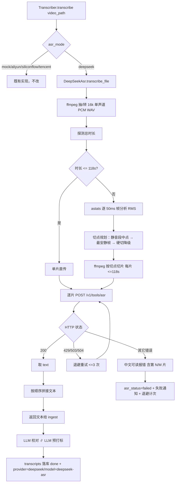
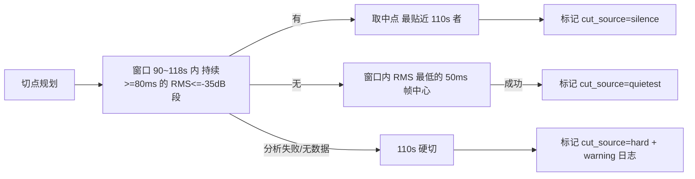
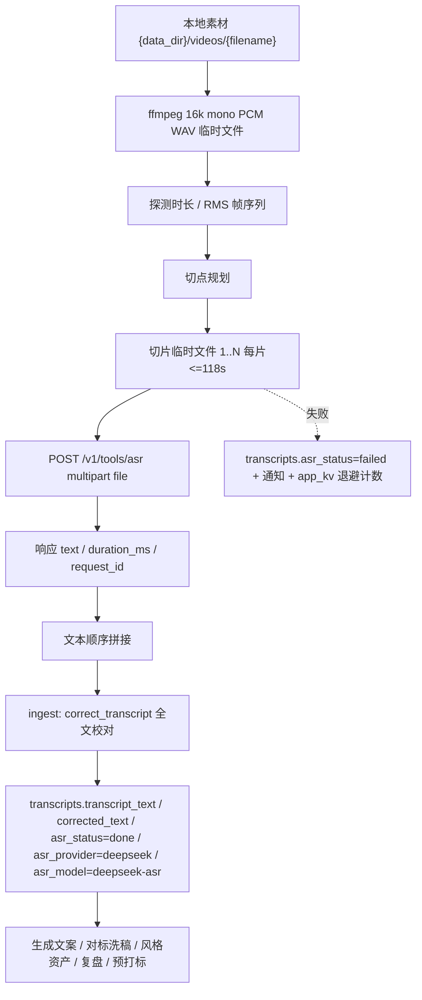
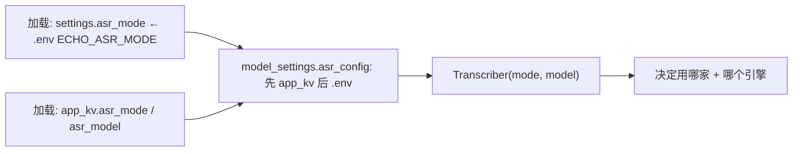

# R-264 开发设计：接入 DeepSeek 语音识别（ASR）并设为默认

- **对应需求**：`requirements/R-264-deepseek-asr-default.md`
- **日期**：2026-11-19
- **状态**：✅ 已实现（2026-11-19，verify 全绿；真实联调与 A/B 实测见 §10）
- **排期**：M265
- **范围**：新增第 5 个 ASR 服务商 `deepseek`；长音频静音优先切点分片；默认服务商切换；不改表结构、不改其它四家实现、不改「ASR → LLM 校对 → LLM 预打标」主链路

## 1. 开发背景

### 1.1 为什么要新增一家，而不是替换

现有 4 家实现各有明确场景与历史原因（R-108 硅基流动免费、R-200 腾讯大模型2.0），作者随时可能通过「AI 设置」切换，且历史 `transcripts.asr_provider` 需要保持可追溯。本需求只**新增** `deepseek` 分支并改默认值，不删除、不改写其它分支，避免影响已有测试与历史数据。

### 1.2 真正的技术难点是协议限制，不是调用

DeepSeek 官方限制：单请求**音频最长 120 秒、最大 8 MiB**，仅接受 16-bit PCM WAV 或 Ogg Opus，不支持流式，不返回时间戳/分段。项目素材中位数 2.8 分钟、均值 4.28 分钟，**66.3%（461/695 条）超过 120 秒，占音频总时长 90%**。因此：

- 不分片 → 只能截前 120 秒（仅覆盖 41% 语音内容，丢失 59%/29.3 小时），不可接受；
- 硬切分片 → 切点落在字中间会丢字/错字，且后置 LLM 校对救不回丢失的音。

结论：必须分片，且分片策略必须「切在停顿上」。

### 1.3 现状隐患：运行时配置覆盖 `.env`

`model_settings.asr_config()` 先读 `app_kv`，读不到才回退 `.env`。当前 DB 里是 `asr_mode=tencent`，`.env` 写的是 `siliconflow`。**默认切 DeepSeek 必须同时更新两处**，否则改了 `.env` 也不生效。这一点在实现与验收中都要显式处理。

## 2. 涉及的技术

| 技术 | 用途 | 本次选择理由 |
|---|---|---|
| FastAPI + SQLAlchemy | 设置读写、转写路由、落库 | 沿用现有分层与 `app_kv` 运行时配置机制 |
| httpx | `POST /v1/tools/asr` multipart 上传 | 项目已有依赖，硅基流动同类实现可参考 |
| imageio-ffmpeg（现有 `media_tools`） | 抽/转 16k 单声道 PCM WAV、切片 | 复用现有能力，不新增系统依赖 |
| ffmpeg `asetnsamples + astats + ametadata` | 逐 50ms 帧输出 RMS 音量（切点证据） | 单次解码即得全部切点依据；实测约 139 倍速 |
| ffmpeg `silencedetect`（可选校验） | 交叉验证静音判定 | 仅开发期抽样验证，不作为运行时依赖 |
| 现有 `Transcriber` 路由 | 按 `asr_mode` 分发 | 不改调用方，5 家统一入口 |
| 现有失败通知/退避（R-240 S7/R-094） | 转写失败可读原因、自动重试 3 次 | 不新增任务框架 |
| 现有 LLM 校对（`correct_transcript`） | 分片拼接后的全文标点/病句修正 | 弥补片间标点上下文差异 |
| Pydantic 配置校验 + 白名单 | 新配置项、服务商/模型合法性 | 沿用 `config.normalize_mode`、`model_settings` 校验 |
| pytest + mock httpx | 离线单测 | 沿用 `test_siliconflow_asr.py` / `test_tencent_asr.py` 模式 |

## 3. 开发流程图

### 3.1 转写主流程



### 3.2 失败与降级决策



## 4. 数据流转图

### 4.1 音频 → 文本 → 落库 → 下游消费



### 4.2 配置流（为什么必须改两处）



## 5. 实现细节

### 5.1 配置项（`backend/app/config.py`）

| 字段 | 默认值 | 来源 | 说明 |
|---|---|---|---|
| `asr_mode` | `mock` | `ECHO_ASR_MODE` | 白名单新增 `deepseek`（`_ALLOWED` 与注释同步） |
| `deepseek_asr_url` | `https://api.deepseek.com/v1/tools/asr` | `ECHO_DEEPSEEK_ASR_URL` | 独立 URL，避免 `deepseek_base_url` 是否带 `/v1` 的歧义 |
| `deepseek_asr_chunk_seconds` | `110` | `ECHO_DEEPSEEK_ASR_CHUNK_SECONDS` | 目标片长；钳制区间 `[60, 118]` |
| `deepseek_asr_chunk_max_seconds` | `118` | `ECHO_DEEPSEEK_ASR_CHUNK_MAX_SECONDS` | 单片硬上限；必须 `< 120`，超配时钳到 118 |
| `deepseek_asr_max_request_mb` | `8` | `ECHO_DEEPSEEK_ASR_MAX_REQUEST_MB` | 上传前校验；超限报错 |
| `deepseek_asr_max_total_seconds` | `7200` | `ECHO_DEEPSEEK_ASR_MAX_TOTAL_SECONDS` | 素材超过 2 小时直接报错，防账单跑飞 |
| `deepseek_asr_retries` | `3` | `ECHO_DEEPSEEK_ASR_RETRIES` | 429/503/504 重试次数（不含首次） |

复用现有 `deepseek_api_key`（`ECHO_DEEPSEEK_API_KEY`），不新增密钥字段。

### 5.2 音频规范化（复用 + 小改 `services/media_tools.py`）

- 复用 `extract_audio_to_wav(path)`：任意视频/音频 → 临时 16k 单声道 `pcm_s16le` WAV，调用方删除；
- DeepSeek 不接受 mp3/m4a，因此**纯音频也要走这个函数**（现值硅基流动会直传原始音频，DeepSeek 分支不直传）；
- 输出体积：118s × 16000 × 2B ≈ 3.8 MB < 8 MiB，格式与大小均满足。

### 5.3 RMS 帧分析（新增 `media_tools.audio_rms_frames(path, frame_ms=50)`）

**输入**：16k 单声道 WAV 路径。

**命令**：

```bash
ffmpeg -hide_banner -nostats -i <wav> -vn -ac 1 -ar 16000 \
  -af "asetnsamples=800,astats=metadata=1:reset=1,ametadata=print:key=lavfi.astats.Overall.RMS_level:file=-" \
  -f null -
```

- `asetnsamples=800` = 16000 × 0.05，即 50ms 一帧；
- `ametadata=print:file=-` 写 stdout，逐帧输出 `pts_time` 与 `lavfi.astats.Overall.RMS_level`（dB，可能为 `-inf`）。

**解析规则**：按出现顺序配对 `pts_time:<float>` 与下一行 `RMS_level=<float|-inf>`，`-inf` 记为 `-inf`（视为绝对静音，候选优先级最高）。

**输出**：`list[tuple[float, float]]`（帧起始时间秒、RMS dB）。

**失败降级**：命令失败/解析为空/帧数 < 2 → 返回空列表，调用方走硬切并记 warning（不阻断转写）。

**性能证据**：实测 168 秒素材解析 9254 帧、耗时约 1.2 秒（ffmpeg 报 139x），对单条转写耗时可忽略。

### 5.4 切点规划（`deepseek_asr._plan_cuts`，纯函数便于单测）

**输入**：`duration`（秒）、`frames`（RMS 帧序列）、`chunk_seconds=110`、`max_seconds=118`、`min_chunk=60`。

**规则（按顺序）**：

1. `if duration <= max_seconds` → 返回空切点（单片直传）。
2. 从 `start=0` 起贪心：
   - 若 `duration - start <= max_seconds` → 最后一片到结尾，结束；
   - 窗口 `W = [start + min_chunk, start + max_seconds]`（保证片长 ∈ [60,118]）；
   - **候选 A（静音段）**：找出 `W` 内所有连续帧满足 `rms <= -35dB` 且**持续 ≥80ms（≥2 帧）**的静音段；候选点 = 静音段中点；按 `|候选点 - (start + 110)|` 升序、同分取更长静音段；取第一个候选，`cut_source=silence`；
   - **候选 B（最安静点）**：A 无候选时，取 `W` 内 `rms` 最小的一帧，切在该帧中心（`pts_time + 0.025`），`cut_source=quietest`；
   - **候选 C（硬切降级）**：`frames` 为空（分析失败）时切在 `start + 110`，`cut_source=hard`，`log.warning`；
   - `start = 切点`，继续下一片。
3. 返回 `[(start, end, cut_source), ...]`，并断言每片长度 `<= max_seconds`、片与片首尾相接不重叠、总长等于 `duration`（±1 帧）。

**阈值依据**：

| 参数 | 取值 | 依据 |
|---|---|---|
| 静音阈值 | `-35dB` | 实测 30 条 >2 分钟素材：`-35dB/≥80ms` 在 [90,118] 窗口命中 90%，优于 `-32dB/≥120ms`（80%）与更严格阈值（60%）；更宽松阈值反而降低命中率 |
| 静音最短时长 | `80ms` | 中文音节间停顿通常 80~300ms；<80ms 多为塞音闭塞，切进去有截辅音风险 |
| 搜索窗口下界 | `start+60s` | 允许在长停顿处提前切；片数为 `ceil(duration/60)` 上界，最坏也只多 1 倍请求 |
| 目标片长 | `110s` | 距 120s 硬限制留 10s 余量；118s 为绝对上限 |
| 兜底切点 | 最安静帧中心 | 实测 168s 素材窗口内最低 RMS -47dB（窗口语音中位数 -24dB），落在明显停顿上 |
| 最终降级 | 硬切 110s | 只在音频分析失败时发生；记 warning，便于事后发现并人工重转 |

**可观测性**：每片记录 `index/total/start/end/cut_source`（`log.info`）；建议汇总一行 `deepseek_asr cuts: n=3 sources=silence,silence,quietest total=257.4s`，验收时可直接 grep。

### 5.5 分片与请求（新增 `services/deepseek_asr.py`）

```python
class DeepSeekAsr:
    def transcribe_file(self, video_path) -> str:
        # 1) 校验文件存在 -> 抽/转 wav（临时，finally 删除）
        # 2) duration = probe_duration_seconds(wav)
        #    超 max_total_seconds -> TranscriptionError 明确报错
        # 3) frames = audio_rms_frames(wav)（失败 -> 空列表）
        # 4) cuts = _plan_cuts(...)（单片时 cuts 为 [(0, duration, "single")]）
        # 5) for seg in cuts: 切片临时文件 -> _post_segment -> text；size>8MiB 直接报错
        # 6) 拼接非空文本；全空 -> "识别结果为空（DeepSeek：未识别到有效语音）"
```

**请求**：

```
POST {deepseek_asr_url}
Authorization: Bearer {deepseek_api_key}
Content-Type: multipart/form-data
file=@chunk_00.wav (audio/wav)
```

- 不带 model 字段（接口无模型参数）；
- `httpx` 超时：connect 15s、write 120s、read 180s、pool 15s；
- 逐片**串行**调用（50 并发上限远未触及；串行便于失败定位与文本顺序）；
- 临时切片文件在 `finally` 中删除（成功/失败都删）。

**错误映射**（`_error_message(status, body, index, total)`）：

| HTTP | 处理 | 用户可见文案 |
|---|---|---|
| 200 | 解析 `text` | — |
| 429 | 退避重试（`deepseek_asr_retries` 次，间隔 2s/5s/10s） | 重试耗尽：「DeepSeek 限流（第 N/M 片），已重试 3 次」 |
| 503 / 504 | 同上 | 「DeepSeek 服务繁忙/识别超时（第 N/M 片），已重试 3 次」 |
| 400 | 立即失败 | 「DeepSeek 转写失败（第 N/M 片）：音频格式或请求字段不合法（{body[:120]}）」 |
| 401 / 403 | 立即失败 | 「DeepSeek 鉴权失败，请检查 .env 的 ECHO_DEEPSEEK_API_KEY」 |
| 408 | 立即失败 | 「音频上传超时（第 N/M 片），请重试」 |
| 413 | 立即失败 | 「第 N/M 片音频超过 DeepSeek 8MiB 限制」 |
| 其它 4xx/5xx | 立即失败 | 「DeepSeek 转写失败（HTTP {code}，第 N/M 片）：{body[:300]}」 |

网络异常（`httpx.HTTPError`）按「可重试」处理，同样退避 3 次；耗尽后报「DeepSeek 转写调用失败（第 N/M 片）：{exc}」。

### 5.6 文本拼接规则（`_join_texts`）

**输入**：按顺序的片文本列表（每片已 `strip()`）。

**规则**：

1. 跳过空串（静音片可能返回空）；
2. 相邻两段拼接时：若**前段末字符是 ASCII 字母/数字**且**后段首字符是 ASCII 字母/数字**，中间补 1 个空格（英文单词不被粘连）；否则直接相连（中文不加分隔符）；
3. **不补标点、不改写**：标点与断句由现有 `correct_transcript`（LLM 全文校对）统一处理，`transcript_text` 保留 ASR 原样；
4. 全部为空 → `TranscriptionError("识别结果为空（DeepSeek：未识别到有效语音）")`。

**为什么不重叠切片**：按秒计费，重叠会重复计费且需要文本去重（ASR 对同一重叠段可能给出不同文本，去重不可靠）；静音切点已把「截字」风险压到最低，故不引入重叠。

### 5.7 路由与落库

- `services/transcription.py`：`mode == "deepseek"` → 延迟导入 `DeepSeekAsr(settings=self.settings)` → `transcribe_file(path)`；未知模式仍报 `未知 asr_mode`。
- `services/model_settings.py`：
  - `ASR_MODES["deepseek"] = "DeepSeek 语音识别"`；
  - `ASR_DEEPSEEK_MODELS = ["deepseek-asr"]`、`ASR_DEEPSEEK_DEFAULT = "deepseek-asr"`；
  - `default_asr_model("deepseek")` 返回 `deepseek-asr`；`_coerce_asr_model` 对 `deepseek` 强制 `deepseek-asr`；
  - `save_model_config` 校验：`asr_mode == "deepseek"` 时要求 `settings.deepseek_api_key` 非空，否则 `ModelConfigError("选择 DeepSeek ASR 前请先在 .env 配置 ECHO_DEEPSEEK_API_KEY")`；`asr_model` 为空时自动补 `deepseek-asr`。
- `services/ingest.py`：两处 `asr_model` 落库白名单由 `("siliconflow", "tencent")` 扩为 `("siliconflow", "tencent", "deepseek")`（成功路径 `_post_asr_llm` 与失败路径各一处）。
- `api/settings.py`：`_models_payload` 的 `asr` 对象新增 `"deepseek_models": model_settings.ASR_DEEPSEEK_MODELS`。

### 5.8 前端交互（`frontend_v2/src/pages/prompts/index.tsx`）

- `ModelsPayload` 类型：`asr` 增加 `deepseek_models: string[]`；
- `changeAsrMode` 默认值表增加 `deepseek: models?.asr.deepseek_models[0] || 'deepseek-asr'`；
- JSX：沿用现有 `(asrMode === 'siliconflow' || asrMode === 'tencent')` 的入场块逻辑，新增 `deepseek` 分支——**不渲染模型下拉**，改为 `motion.span`（`key="deepseek"`、`softIn` 动效）显示「自动识别语种（无模型参数）· 按音频时长计费」；与硅基/腾讯切模型时行为一致，不产生空白闪帧；
- 保存请求体不变（`asr_mode` + `asr_model`），无需新增字段；
- `pages/videos/edit-drawer.tsx`：来源映射表补 `deepseek: 'DeepSeek'`。

### 5.9 默认切换与回滚（运维步骤，非代码）

1. 实现完成、真实联调通过后：
   - `.env`：`ECHO_ASR_MODE=deepseek`；
   - 通过设置页保存或 `PUT /api/settings/models` 写入 `app_kv`：`asr_mode=deepseek`、`asr_model=deepseek-asr`；
2. 验证：`GET /api/settings/models` 的 `asr.mode == "deepseek"`，且新转写任务 `transcripts.asr_provider == "deepseek"`；
3. 回滚：设置页切回腾讯（`asr_mode=tencent`、`asr_model=16k_zh_en_2.0`）或硅基流动，**无需重启、无需改代码**；
4. `.env.example` 的 ASR 注释补 `deepseek` 选项与新增配置项（示例值仍用 `mock`，避免无 Key 的新环境直接调外部接口）。

### 5.10 测试矩阵（`backend/tests/test_deepseek_asr.py`，实际 23 例）

| # | 用例 | 断言 |
|---|---|---|
| 1 | 缺 key | `TranscriptionError` 文案含 `ECHO_DEEPSEEK_API_KEY` |
| 2 | ≤118s 单片 | 只发 1 次请求；URL/`Bearer`/`multipart file` 正确；无 model 字段 |
| 3 | 300s 素材 | 切 3 片；请求顺序与文本顺序一致；每片 ≤118s |
| 4 | 静音切点 | 构造 RMS 帧：窗口内 0.2s 静音段 → 切点=静音段中点，`cut_source=silence` |
| 5 | 无静音 → 最安静点 | 切点=窗口最低 RMS 帧中心，`cut_source=quietest` |
| 6 | RMS 分析失败 | 硬切 110s + warning，不中断；`cut_source=hard` |
| 7 | 单片超 8MiB | 明确报错（临时把上限调小构造） |
| 8 | 429 → 重试成功 | 调用次数 = 重试次数+1，结果文本正确（`time.sleep` 打桩） |
| 9 | 429 重试耗尽 | 文案含「已重试 N 次」「第 N/M 片」 |
| 10 | 401 | 文案「DeepSeek 鉴权失败」 |
| 11 | 400 | 文案含「第 N/M 片」与 body 摘要 |
| 12 | 全片空文本 | 「识别结果为空（DeepSeek：未识别到有效语音）」 |
| 13 | 临时文件清理 | 抽出的 WAV 与全部切片在成功/失败后均不存在 |
| 14 | Transcriber 路由 | `mode=deepseek` 走到 `DeepSeekAsr` |
| 15 | 设置校验 | 无 key 保存 400 且不改库；有 key 保存后 `asr_model=deepseek-asr`；`GET` 含 `deepseek_models` |
| 16 | 落库 | `transcripts.asr_provider=deepseek`、`asr_model=deepseek-asr`（复用 r139 测试模式） |
| 17 | 超过 2 小时 | 明确报错，不发请求 |

## 6. 新增/修改表结构

**本次无新增/修改表与列，不需要 Alembic revision。**

沿用 `transcripts` 表（与本次相关的字段）：

| 字段 | 类型 | 本次含义/取值 | 写入时机 | 空值处理 |
|---|---|---|---|---|
| `video_id` | int, UNIQUE | 关联素材 | 落库时 | 必填 |
| `transcript_text` | text | DeepSeek 拼接后的 ASR 原文 | 转写成功 | 失败不写 |
| `corrected_text` | text | 现有 LLM 全文校对稿 | 校对成功后 | 校对失败 → 任务失败、不落原文（现状） |
| `asr_status` | varchar | `done` / `failed` | 成功/失败 | — |
| `asr_provider` | varchar | 本次新增取值 `deepseek` | 成功/失败都写 | 历史数据保持原值 |
| `asr_model` | varchar | `deepseek-asr` | 成功/失败都写 | 其它家沿用各自值 |

## 7. 新增/修改接口

### 7.1 内部接口（不改路由，仅响应字段增加）

`GET /api/settings/models`（既有）响应 `asr` 对象：

```json
{
  "asr": {
    "mode": "deepseek",
    "model": "deepseek-asr",
    "options": {
      "aliyun": "阿里云 FileTrans",
      "siliconflow": "硅基流动",
      "tencent": "腾讯云录音文件识别",
      "deepseek": "DeepSeek 语音识别",
      "mock": "模拟（不调用真实 ASR）"
    },
    "siliconflow_models": ["Qwen/Qwen3-ASR-1.7B", "FunAudioLLM/SenseVoiceSmall"],
    "tencent_models": ["16k_zh_en_2.0", "16k_zh_en", "16k_zh"],
    "deepseek_models": ["deepseek-asr"]
  }
}
```

`PUT /api/settings/models`（既有）请求体 `asr_mode` / `asr_model` 取值扩展：

- 成功 200：`{"message": "已保存"}`（沿用现值，以代码为准）；
- 400：`asr_mode` 非法 / `asr_mode=deepseek` 但 `.env` 未配 Key（错误文案见 §5.7）。

**接口错误码表**：

| 场景 | HTTP | detail |
|---|---|---|
| 服务商非法 | 400 | `ASR 服务商不受支持：xxx；可选：aliyun/siliconflow/tencent/deepseek/mock` |
| 选 DeepSeek 但无 Key | 400 | `选择 DeepSeek ASR 前请先在 .env 配置 ECHO_DEEPSEEK_API_KEY` |
| 模型非法（其它家） | 400 | 沿用现有各自校验文案 |

### 7.2 外部接口（DeepSeek）

| 项 | 内容 |
|---|---|
| 方法/地址 | `POST https://api.deepseek.com/v1/tools/asr` |
| 鉴权 | `Authorization: Bearer <ECHO_DEEPSEEK_API_KEY>` |
| 请求体 | `multipart/form-data`，`file` 字段：16-bit PCM WAV（8k/16k/22.05k/24k/32k/44.1k/48kHz，单/双声道取左）或 Ogg Opus |
| 限制 | 单文件 ≤8 MiB；时长 ≤120s；上传需 10 分钟内完成；账号并发 ≤50；不支持流式 |
| 成功响应 | `200 {"request_id": "...", "text": "...", "duration_ms": 3200}` |
| 错误 | `400` 格式/字段不合法；`408` 上传超时；`413` 超 8MiB；`429` 并发超限；`503` 服务繁忙；`504` 识别超时 |
| 计费 | 按音频时长（秒），不足 1 秒按 1 秒；刊例 0.78 元/小时，限时 5 折 0.39 元/小时 |

### 7.3 内部 `Transcriber` 契约（不变）

`Transcriber(settings, mode="deepseek", model="deepseek-asr").transcribe(path) -> str`；抛 `TranscriptionError`（可读中文）。调用方（`ingest.py`）不感知具体服务商。

## 8. 数据来源与原始字段明细

| 数据项 | 来源 | 原始字段/格式 | 落库字段 | 用途 | 更新时机 | 空值/异常处理 |
|---|---|---|---|---|---|---|
| 本地素材文件 | 本机磁盘 | `videos.filename` → `{data_dir}/videos/{filename}` | 不落库（原始输入） | 转写输入 | 素材入库/下载时 | 文件不存在 → 「视频不存在」报错 |
| 时长 | ffmpeg 探测输出 | `Duration: HH:MM:SS.ss` | 不落库（仅内存） | 判断是否分片、片数、2 小时上限 | 每次转写 | 探测失败 → 报「无法读取媒体时长」 |
| 音量帧序列 | ffmpeg `astats` 元数据 | `pts_time` + `lavfi.astats.Overall.RMS_level`（dB，50ms/帧） | 不落库（仅内存） | 静音/最安静点切点选择 | 每次长素材转写 | 空/解析失败 → 硬切 + warning |
| 切点与片数 | 程序计算 | `(start, end, cut_source)` | 不落库（仅日志） | 切片、验收排查 | 每次长素材转写 | 无候选 → 硬切 110s |
| 转写文本 | DeepSeek 响应 | `text`（字符串） | `transcripts.transcript_text` | 生成/洗稿/风格资产/复盘/预打标的原文 | 转写成功时 | 单空片跳过；全空 → failed「识别结果为空」 |
| 校对稿 | 现有 LLM `correct_transcript` | 模型输出 | `transcripts.corrected_text` | 页面展示优先、下游消费优先 | 转写成功后 | 失败 → 任务失败，不落原文（现状不变） |
| 音频时长（返回） | DeepSeek 响应 | `duration_ms` | 不落库 | 仅日志（累计校验是否与本地时长一致） | 每次分片请求 | 缺失 → 忽略 |
| 请求 ID | DeepSeek 响应 | `request_id` | 不落库 | 仅日志（排查 DeepSeek 侧问题） | 每次分片请求 | 缺失 → 忽略 |
| 服务商/模型 | 运行时配置 | `app_kv.asr_mode/asr_model`，回退 `.env ECHO_ASR_MODE` | `transcripts.asr_provider/asr_model` | 来源可追溯、页面标签 | 每次转写写入；设置保存时更新配置 | `asr_mode` 非法 → 保存 400；`asr_model` 空 → 自动补 `deepseek-asr` |
| API Key / URL | `.env` | `ECHO_DEEPSEEK_API_KEY` / `ECHO_DEEPSEEK_ASR_URL` | 不落库 | 鉴权与请求地址 | 进程启动加载（改后需重启后端） | 缺 Key → 保存 400 + 转写明确报错；URL 空 → 用默认值 |
| 转写状态 | 程序 | `done` / `failed` | `transcripts.asr_status` | 页面状态、自动重试判断 | 每次转写结束 | 失败原因写通知与 `app_kv` 退避键（现状机制） |

## 9. 实施步骤与文档更新清单（2026-11-19 已全部执行）

1. 后端：`config.py` → `media_tools`（RMS 帧 + 切片辅助）→ 新增 `deepseek_asr.py` → `transcription.py` 路由 → `model_settings.py` → `api/settings.py` → `ingest.py` 两处白名单；
2. 前端：`prompts/index.tsx`（类型/默认值/DeepSeek 分支）→ `videos/edit-drawer.tsx` 来源标签 → `npm run gen:api` 重生成 `schema.d.ts`；
3. 测试：新增 `backend/tests/test_deepseek_asr.py`（≥12 例）；补充/调整 `test_r138_model_settings.py`（新服务商校验）；
4. 文档：`docs/ARCHITECTURE.md` 外部服务表加 DeepSeek ASR 行、`docs/DECISIONS.md` 新增 D-049（分片策略 + 不自动切服务商 + Key 只放 .env）、`docs/CHANGELOG.md`、`docs/milestones.md`（M265 状态推进）、`requirements/README.md` 状态推进、`.env.example`；
5. 验收：`scripts/verify.sh` 全绿 → 真实联调 2 条（≤120s / >120s）→ A/B 10 条对比腾讯 → 切换默认（`.env` + `app_kv`）→ 页面点检（设置页选项/保存生效、编辑页来源标签）→ 回滚演练 → 服务保持运行；
6. 合并：`feat/r264` 分支、按仓库纪律一个需求一个 commit（`feat(R-264): ...`），verify 全绿后合并 `main` 并 push。

## 10. 实测结果（2026-11-19）

- **真实联调**：98.8s 素材 → 1 片 605 字 5.5s；244.9s 素材 → 3 片（切点 110.3s / 220.0s，来源均为 `silence`；尾部 `tail`）1453 字 12.5s，文本完整无重复。
- **A/B 10 条（含 3 条 >120s）vs 腾讯大模型2.0**：7 条字数差 ≤1.0%；长素材（分片）0.1%/0.2%/1.8%，相似度 0.927~0.945；离群 704（20.5%）为背景音乐英文歌词被 DeepSeek 转出、719（5.9%）为数字写法差异，均非漏句；DeepSeek 5.2~16.5s 快于腾讯 16.1~17.3s。
- **切点观测**：日志 `deepseek_asr plan: ... sources=silence,silence` 与逐片 `segment i/n ... source=` 可直接 grep；实测无 `hard`。
- **设置页（Playwright 1440）**：选中 DeepSeek → 说明入场、无模型下拉 → 保存 toast → 刷新仍为 DeepSeek，0 console error。
- **默认切换**：`.env` `ECHO_ASR_MODE=deepseek` + `app_kv` `asr_mode=deepseek`/`asr_model=deepseek-asr`；`GET /api/settings/asr` 返回 `{mode: deepseek, model: deepseek-asr}`；运行态 `Transcriber` 真实出稿 1453 字。
- **verify**：`scripts/verify.sh` 全绿（后端 pytest 含新增 23 例、前端 174 例 + build、文档 40 表一致）。
