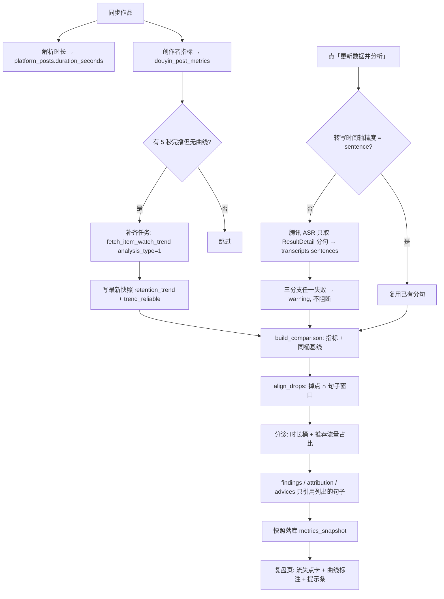
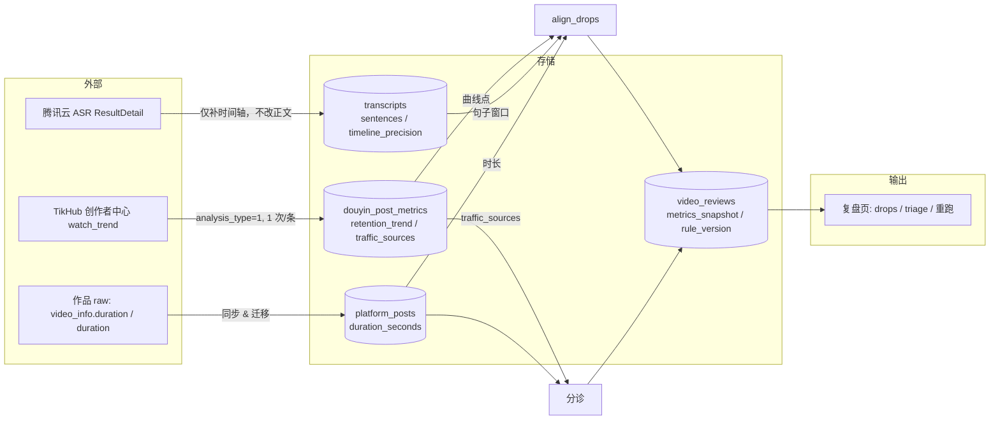

# R-265 开发设计：视频复盘接入句子时间轴、留存曲线与分诊

- **对应需求**：`requirements/R-265-retention-timeline-diagnosis.md`
- **日期**：2026-11-19
- **状态**：设计完成，待开发
- **排期**：M266
- **范围**：转写分句时间轴、留存曲线补齐、句级流失对齐、时长/流量分诊、复盘页呈现与重跑；不改生成侧、不引入 agent 框架

## 1. 开发背景

### 1.1 现状链路

```text
同步作品 → douyin_post_metrics（5s/2s/完播/平均播放 + 可选曲线）
复盘     → build_comparison（自己近 30 条同题中位数）
         → build_findings / build_attribution / build_metric_advices（只能引用文本，不能引用时间）
页面     → 曲线图只标「最大掉点」，其余一切建议都是通用话术
```

### 1.2 三个数据缺口（已查库确认，2026-11-19）

| 缺口 | 证据 | 后果 |
|---|---|---|
| 曲线几乎没拉 | 主博主 259 条有 5 秒完播，仅 4 条有曲线；全库 720 条快照只有 6 条 | 复盘不知道第几秒掉 |
| 转写没有时间轴 | 728 条全是纯文本；`has_timed_transcript` 硬编码 `False` | 知道第几秒也指不到句子 |
| 基线不分场景 | `build_comparison` 只按标题/话题相似度取前 10 条，`_state` 用「3 个百分点」绝对阈值 | 长视频与短视频、低推荐与高推荐直接比，噪声当结论 |

### 1.3 为什么不用 agent 解决

生成侧与复盘侧的瓶颈都是「没有可验证的标签」，不是「编排能力不足」。本设计先把信号补上；agent 类方案（多步自评、自动改稿）留到 R-266，等有了「开头 → 5 秒完播」样本再评估。

## 2. 涉及的技术

| 技术 | 用途 | 选择理由 |
|---|---|---|
| 现有 `Transcriber` 五种 ASR | 产出分句时间轴 | 腾讯/阿里云已返回毫秒时间戳，只是被丢弃；不换服务商、不加依赖 |
| SQLAlchemy 2 + PostgreSQL | `transcripts.sentences`、`platform_posts.duration_seconds` | 与现有一致；JSON 继续用 TEXT 存 |
| Alembic | 加列 + 存量时长回填 | 项目强制用迁移，不在启动时建表补列 |
| 现有 `background_tasks` + SSE + 通知 | 曲线补齐、复盘内时间轴补齐 | 复用 R-202 进行中规范，不新增任务框架 |
| 现有 TikHub 客户端 + 预算 | 拉曲线、按次计费 | 复用 `_charge` 原子扣减，防超发 |
| 现有规则/归因/建议三段 | 引用流失点句子 | 不新增 LLM 环节，只在输入里加结构化证据 |
| React + framer-motion | 流失点卡、曲线标注、提示条 | 沿用现有动效与 reduce-motion 规则 |

## 3. 开发流程图



## 4. 数据流转图



## 5. 实现细节

### 5.1 转写能力分层（新增 `transcripts` 三列）

**输入**：视频文件路径 + 当前 ASR 配置。

**能力矩阵**：

| 服务商 | 分句时间戳 | `timeline_precision` | `sentences` 内容 |
|---|---|---|---|
| 腾讯 | `ResultDetail[].BeginTime/EndTime`（毫秒） | `sentence` | 每句一条 `{start_ms,end_ms,text}` |
| 阿里云 | `Result.Sentences[].BeginTime/EndTime`（毫秒） | `sentence` | 同上 |
| DeepSeek | 无（只有整段 `text` + `duration_ms`） | `chunk` | 每个分片一条 `{start_ms,end_ms,text}`，窗口来自 `_plan_cuts` |
| 硅基流动 / mock | 无 | `none` | `[]` |

**改造方式**：`Transcriber` 新增 `transcribe_detailed(video_path) -> TranscriptResult`，`TranscriptResult(text, sentences, source, precision)`；原 `transcribe()` 保持返回 `str`（内部调用新方法），所有既有调用点零改动。

**腾讯解析（落地修正）**：实测大模型引擎（`16k_zh_en_2.0`）只有把 `ResTextFormat` 设为 **1** 才返回 `ResultDetail`（原实现用 0，只有带 `[起,止]` 标记的整段 `Result`）；且 `ResultDetail` 的 `FinalSentence` 是**整段**（93 秒视频只有 2 段，时间字段是 `StartMs/EndMs`），逐句时间必须借 `Words[].OffsetStartMs/OffsetEndMs`（相对该段起点）：

1. 段落取 `StartMs/EndMs`（兼容老引擎 `BeginTime/EndTime`），缺时间戳整段跳过；
2. `FinalSentence` 按中文标点切句；
3. 每句在「词序列拼接文本」里定位，用首/末词偏移换算毫秒（`段落起点 + 词偏移`）；
4. 定位不到（标点/数字写法差异）→ 按字数比例在该段区间内分摊；
5. 结果做单调性与区间钳制，保证 `start ≤ end` 且不越出该段。

若 `ResultDetail` 为空但 `Result` 文本含 `[起,止]` 时间标记，按行解析（保留现有 `_TIMESTAMP_RE` 兜底）。

**阿里云解析**：`result["Result"]["Sentences"]` 逐项取 `Text` + `BeginTime` + `EndTime`。

**DeepSeek**：`transcribe_file` 内已有 `cuts = _plan_cuts(...)` 与 `texts`，按片顺序组 `{start_ms: int(start*1000), end_ms: int(end*1000), text}`。精度标 `chunk`，**不用于句子引用**。

**落库**：`ingest.import_video_task` 调 `transcriber.transcribe_detailed(path)`，把 `TranscriptResult` 随 `asr` 一起传给 `_post_asr_llm(db, video_id, text, asr, timeline=result)`；`_correct_and_store` 的三处写入（新建 `Transcript(...)`、已有行更新、`IntegrityError` 兜底重读后再更新）都必须写 `sentences` / `timeline_source` / `timeline_precision`，避免并发兜底路径漏字段。`asr_status=done` 但 `sentences=[]` 是合法状态（精度 `none`）。

**空值/异常**：解析失败不抛错，落 `sentences=[]` + `precision="none"`，日志 `timeline_parse_failed`；正文照常落库。

### 5.2 复盘内补齐句子时间轴（新增 `services/transcript_timeline.py`）

**触发**：`run_analysis` 在 `refresh` 与媒体补齐之后、`build_comparison` 之前。

**注意**：不能复用 `import_video_task`——它在 `video.transcript.transcript_text` 已有内容时会直接跳过转写，永远不会补时间轴。本模块直接调 `TencentAsr.transcribe_file()` 并只保留 `ResultDetail` 分句（文本丢弃），与既有转写任务互不影响。

**输入**：`post.local_video_id` → `videos.filename` → 本地文件路径。

**规则**（按顺序短路）：

1. `transcript.timeline_precision == "sentence"` → 复用，跳过；
2. 无本地视频、文件不存在、无转写文本 → 跳过，warning「本条没有本地视频，无法补句子时间轴」；
3. 取时间轴服务商：`ECHO_TIMELINE_ASR_MODE`（默认 `tencent`）；服务商 = 当前 ASR 且本身支持 sentence → 直接复用；不支持则调用指定服务商；
4. 失败（未配置密钥、任务超时、SDK 异常）→ 捕获 `TranscriptionError`，**只写 warning**，复盘继续。

**写入**：只更新 `transcripts.sentences` / `timeline_source` / `timeline_precision`，**不触碰** `transcript_text`、`corrected_text`、`asr_status`、`asr_provider`。

**耗时**：单条约 30~60 秒（腾讯轮询 5~15 秒间隔）；`update(45, "补齐句子时间轴")` 阶段可见。

**成本控制**：同一视频只补一次（`timeline_precision=sentence` 后不再补）；不批量预跑。

### 5.3 留存曲线补齐（新增 `services/retention_backfill.py`）

**计划（plan）**：

```sql
SELECT p.id, p.title, p.publish_time
FROM platform_posts p
JOIN creator_accounts a ON a.id = p.account_id
JOIN douyin_post_metrics m ON m.post_id = p.id
WHERE a.creator_id = :owner_id AND a.platform = 'douyin'
  AND m.finish_5s_rate IS NOT NULL
  AND NOT EXISTS (
    SELECT 1 FROM douyin_post_metrics m2
    WHERE m2.post_id = p.id AND m2.retention_trend NOT IN ('[]','')
  )
ORDER BY p.publish_time DESC NULLS LAST
LIMIT :limit
```

- 默认 `limit=300`（覆盖主博主 255 条缺曲线）；
- `scope=recent` 时增加 `p.publish_time >= now() - interval '7 days'`（每日增量用）。

**执行（worker）**：逐条

1. `resolve_data_policy(db, account)` 判源，被 block → 全部停止，任务 failed + 原因；
2. `fetch_douyin_watch_trend(item_id, analysis_type=1)` → `_trend()` 取 current + similar；
3. **只写该作品最新快照行**（`ORDER BY snapshot_date DESC, captured_at DESC LIMIT 1`）：`retention_trend` 覆盖写；`similar_author_trend` 是 `{"retention": [...], "bounce": [...]}` 结构，**只覆盖 `retention` 键、保留已有 `bounce`**；`trend_reliable = plays >= 200 and 有点`；
4. `_charge(db, 1)`；超预算 → `BudgetExceeded` → 停止并写「已完成 X 条，今日额度不足」；
5. 每 0.2 秒节流，进度 `update(i/total*100, f"补齐曲线 {i}/{total}")`；
6. 单条异常（无 cookie / 接口业务错）→ 记入失败列表，继续下一条；失败明细最多保留 20 条，通知里取前 5 条。

**结束**：任务 done（全部成功）或 partial（有失败但成功 ≥1），通知文案「留存曲线补齐完成：成功 X、失败 Y」。

**每日增量**：`scheduler` 新增 `_retention_backfill_job`，每天 09:10 执行 `scope=recent`；失败走 `_alert`。

**预算**：255 次一次性请求；当日默认额度 2000，历史日均用量 700~1050，按剩余额度截断。

### 5.4 句级流失对齐（新增 `services/video_review_timeline.py`）

**函数**：`align_drops(points, sentences, precision, plays, reliable, duration_seconds) -> (drops, reason)`

**输入**

| 参数 | 来源 | 说明 |
|---|---|---|
| `points` | `charts.retention.points` | `[{time_seconds, time_label, current}]`，由 `retention_trend` 解析 |
| `sentences` | `transcripts.sentences` | `[{start_ms,end_ms,text}]` |
| `precision` | `transcripts.timeline_precision` | 只有 `sentence` 才匹配句子 |
| `plays` | `platform_post_stats.plays` | 可靠性门槛 |
| `reliable` | `douyin_post_metrics.trend_reliable` | 已有字段 |
| `duration_seconds` | `platform_posts.duration_seconds` | 分类用 |

**可靠性门禁（先判，不满足直接空结果）**

1. `reliable` 为 false → `reason="unreliable"`；
2. 有效点数 `< 5` → `reason="few_points"`；
3. `plays` 为空或 `< 200` → `reason="low_plays"`。

**掉点判定（逐相邻点）**

- `drop = v_i − v_{i+1}`；`rel = drop / max(v_i, 1e-6)`；
- 命中条件：**`drop ≥ 0.05` 且 `rel ≥ 0.08`**（两者同时满足）；
- 说明：只用绝对差会被「起点 0.9」的陡降放大，只用相对差会把「0.02→0.01」这种噪声也算成掉点，因此两条都要过。
- **首点跳过（落地修正）**：曲线第 0 秒恒为 1，它到第一个点的跌幅就是「2 秒内跳出」，已由 `bounce_2s_rate` 指标覆盖；不跳过的话 `00:00–00:02` 永远排第一，把真正的中段流失挤掉。

**合并**

- 序号相邻（`i` 与 `i+1`）且都命中 → 合并为一段，区间 `[t_i, t_{i+2}]`，跌幅 `v_i − v_{i+2}`（不累加，避免重复计算）；
- 单段跨度上限 2 个间隔（曲线 2 秒间隔时即 ≤4 秒）。

**排序与去重**

- 按合并后跌幅降序；
- 取前 **3** 条；
- 同一句子只归属一条（按重叠面积最大者），被占用后后续不再分配该句。

**句子匹配**

- 句子窗口加 ±0.5 秒容差：`[start_ms/1000 − 0.5, end_ms/1000 + 0.5]`；
- 与掉点区间求交集长度，取交集最大且 `> 0` 的句子；
- 无交集 → 句子为空，`confidence="window"`。

**分类标签**

- `end_seconds ≤ 10` → `hook`（开头）；
- `duration_seconds` 存在且 `start_seconds ≥ 0.8 × duration` → `tail`（结尾）；
- 其余 → `body`（中段）。

**降级**

| 情况 | 输出 |
|---|---|
| `precision=chunk` | 句子为空，`confidence="window"` |
| `precision=none` | 句子为空，`confidence="none"` |
| 无 `duration_seconds` | 不分类（`category=""`），不影响其它字段 |

**输出**

```json
{
  "start_seconds": 4, "end_seconds": 6, "time_label": "00:04–00:06",
  "drop": 0.124, "drop_ratio": 0.31,
  "category": "hook", "confidence": "sentence",
  "sentence": {"text": "……", "start_ms": 4200, "end_ms": 6900}
}
```

**接入点（落地修正）**：掉点计算挪到 `video_review_service.run_analysis`（需要转写行，`build_comparison` 不加载转写），由 `_apply_timeline()` 写入 `charts.retention.drops` / `timeline_precision` / `has_timed_transcript`；`_charts()` 只放 `drops: []` 占位与 `reliable/plays`（不变）。

**规则引擎**：`video_review_rules.build_findings` 的 `trend_drop` 分支改读 `charts.retention.drops[0]`：

- 原有条件（`drop ≥ 0.05`、`drop > median×2`）**由新算法取代**，不再重复计算；
- 有新句子 → `content_evidence` 追加 `{evidence_id:"content:drop:1", text:<句子>, source:"视频转写（00:04–00:06）"}`，`judgement_type="fact"`；
- 无句子 → 沿用现有文案「没有逐秒转写时，只能先检查内容，不能直接认定某句台词导致离开」，句子级措辞不出现。

### 5.5 分诊（时长 + 流量来源）

**时长**

- 解析优先级：`platform_posts.duration_seconds` → `raw.item.video_info.duration`（毫秒字符串）→ `raw.duration`（毫秒）→ 本地视频 `probe_duration_seconds`（写回列）；
- 桶：`<30` / `30-60` / `60-120` / `>120`；
- 基线分层：`build_comparison` 先在同桶候选里取中位数；同桶有效样本 `< 5` → 退回全量候选，并在 `comparison["baseline_note"]` 写「同类样本不足，已退回全部同题作品（N 条）」。

**流量来源**

- `traffic_sources`（已存 `[{name,value,ratio,keys}]`）求 `recommended_ratio = Σ ratio where name 含「推荐」或 keys 含 "homepage_hot"`；
- 无数据 → `level="unknown"`；
- `recommended_ratio < 0.5` → `level="limited"`，`note="推荐流量占比 X%，低于一半；完播/留存偏低不能单独归因于文案"`；
- 否则 `level="normal"`。

**时长提示**

- `duration_seconds > 120` 且 `finish_5s_rate` 不是 low 且 `finish_rate` 是 low → `note="时长 X 秒，长视频完播天然更低，建议同时看平均播放占比"`。

**对结论的影响**

- `level="limited"`：所有 `dimension="completion"` 的 finding，`judgement_type` 强制从 `fact` 改为 `hypothesis`，`suggestion` 末尾追加「本条推荐流量占比偏低，先排除流量结构影响再改文案」；
- `review.warnings` 追加一条提示（去重，最多一条）；
- **不删除**任何指标证据，只降级结论强度。

**输出**（随 `metrics_snapshot` 落库）：

```json
"triage": {
  "duration_seconds": 85, "duration_bucket": "60-120", "duration_known": true,
  "traffic": {"recommended_ratio": 0.43, "level": "limited"},
  "notes": ["推荐流量占比 43%，低于一半；完播/留存偏低不能单独归因于文案"]
}
```

### 5.6 结论与建议的引用约束

**归因**（`video_review_attribution`）：

- `_brief()` 的 `retention_drops` 增加 `sentence` 字段（仅句子级）；
- `_valid_candidates()` 的引用白名单增加 `drop_sentences`（本复盘流失点句子的原文）；
- 校验顺序不变：必须是 `transcript` 子串 **或** 评论子串 **或** 流失点句子原文，三者之一。

**建议**（`video_review_advices`）：

- `_brief()` 增加 `retention_drops`（含句子）；
- `_valid_candidates()` 的 `copy_refs` 校验同样接受流失点句子原文；
- 提示词不再新增规则（现有「只引用输入里的原句、不许编造数字」已覆盖）。

**为什么放宽到「句子原文」**：`transcripts.sentences` 来自 ASR 原始分句，`corrected_text` 经过 LLM 校对后可能与原句有标点/个别字差异，严格子串校验会把正确引用判失败。放宽范围仅限「本条复盘已计算的流失点句子」，不扩大到任意文本。

### 5.7 前端呈现

**类型**（`pages/video-review/types.ts`）

```ts
export interface RetentionDrop {
  start_seconds: number; end_seconds: number; time_label: string
  drop: number; drop_ratio: number
  category: '' | 'hook' | 'body' | 'tail'
  confidence: 'sentence' | 'window' | 'none'
  sentence?: { text: string; start_ms: number; end_ms: number } | null
}
// Charts.retention 增加：drops?: RetentionDrop[]; timeline_precision?: string
// Charts 增加：triage?: { duration_seconds?: number|null; duration_bucket?: string; duration_known?: boolean;
//                          traffic?: { recommended_ratio?: number|null; level?: 'normal'|'limited'|'unknown' }; notes?: string[] }
// Review 增加：rule_version?: string; rule_version_stale?: boolean
```

**曲线**（`charts.tsx::WatchTrendChart`）

- 由「只标最大掉点」改为标 `drops` 全部（最多 3 个）：`var(--warning)` 实心圆 + 竖虚线 + 秒数标签；
- `title`/悬浮内容追加句子（有则显示前 40 字）；
- 无 `drops` 或空数组 → 维持现状（只画线）。

**新板块「留存流失点」**（`index.tsx`，位置在「为什么好/差」之后）

- 每条一行：`00:04–00:06` + `下降 12.4 个百分点（相对 31%）` + 标签（开头/中段/结尾）+ 置信度；
- 有句子 → 下一行引用块显示原句，`text-sm`，最多 3 行省略，可展开；
- 无句子 → 显示「本条没有句子时间轴，只能定位到时间点」；
- 无曲线 → 不渲染；不可靠 → 空态「这条的播放量/曲线点数不足，先不做流失点定位」；
- 入场：`opacity 0.9→1 + y 4→0`，0.2s，`stagger 0.04s`；`prefers-reduced-motion` 直接显示。

**分诊条**

- 信息行：`这条 85 秒 · 推荐流量 43% · 搜索 12%`，缺失项写「时长未知 / 流量来源未知」；
- `level=limited` → 中性提示条（非红色）：「推荐流量偏低，这条的完播/留存不能单独归因于文案」；
- 时长提示同位置第二条。

**重跑**

- 头部按钮区：`rule_version_stale` 为 true 时显示「用新口径重跑」；
- 点击 → `POST /api/douyin-review/analyze {post_id, force:true}` → 沿用现有任务轮询与进行中状态；按钮转圈禁用；
- 完成后刷新到新 review，旧 review 不删除。

**数据看板补齐入口**（`pages/dashboard/index.tsx`）

- 「更新数据」旁次要按钮「补齐留存曲线 · 待补 N 条」；N 来自 `GET /api/douyin-dashboard/retention/coverage`；
- 点击 → `POST /retention/backfill`；进行中按钮文案「补齐中 X/Y」，进度走全局顶栏任务指示器（R-202）；
- 待补 0 → 置灰。

## 6. 表结构与字段

### 6.1 `transcripts`（+3 列）

| 字段 | 类型 | 可空 | 默认 | 说明 |
|---|---|---|---|---|
| `sentences` | TEXT | 否 | `[]` | 分句时间轴 JSON：`[{"start_ms":0,"end_ms":2480,"text":"..."}]`；`chunk` 精度时为分片窗口 |
| `timeline_source` | VARCHAR(20) | 否 | `""` | `tencent` / `aliyun` / `deepseek` / `""` |
| `timeline_precision` | VARCHAR(20) | 否 | `none` | `sentence` / `chunk` / `none` |

### 6.2 `platform_posts`（+1 列）

| 字段 | 类型 | 可空 | 默认 | 说明 |
|---|---|---|---|---|
| `duration_seconds` | INTEGER | 是 | — | 作品时长（秒）；同步时从 `raw` 解析，缺失回填时为 NULL |

### 6.3 迁移

- Alembic revision `r265timeline`，`down_revision="r263authorprompt2"`；
- 加列（3+1）；
- 数据回填：遍历 `platform_posts`（2093 条），按 5.5 的优先级解析 `raw` 写 `duration_seconds`；解析失败保持 NULL；
- 不新增表，表总数保持 40；同步更新 `docs/DATABASE.md`。

## 7. 接口

### 7.1 `GET /api/douyin-dashboard/retention/coverage`

- 鉴权：沿用全局 API 依赖；无请求参数；
- 响应 `200`：

```json
{"total": 259, "covered": 4, "pending": 255}
```

- 错误：`400` 无主博主 / 未绑定抖音账号（`detail` 中文）。

### 7.2 `POST /api/douyin-dashboard/retention/backfill`

- 请求：

```json
{"scope": "missing", "limit": 300}
```

  `scope`: `missing`（默认）/ `recent`；`limit`: 1~1000，默认 300；
- 响应 `202`：`{"task_id": 123, "pending": 255, "reused": false}`；已有同 kind 任务在跑 → `reused: true` + 原 `task_id`；
- `pending=0` → `200`：`{"task_id": null, "pending": 0, "reused": false}`；
- 错误：`400` 无主博主/抖音账号/账号数据源被停用（中文原因）；`409` 计划阶段即超预算（`BudgetExceeded`）。

### 7.3 `GET /api/douyin-review/reviews/{review_id}`（扩展，不新增路由）

新增返回字段：

```json
{
  "rule_version": "2",
  "rule_version_stale": false,
  "charts": {
    "retention": {
      "points": [ ... ],
      "reliable": true,
      "plays": 15234,
      "has_timed_transcript": true,
      "timeline_precision": "sentence",
      "drops": [ { "start_seconds": 4, "end_seconds": 6, "time_label": "00:04–00:06",
                   "drop": 0.124, "drop_ratio": 0.31, "category": "hook",
                   "confidence": "sentence",
                   "sentence": {"text": "……", "start_ms": 4200, "end_ms": 6900} } ]
    },
    "triage": { "duration_seconds": 85, "duration_bucket": "60-120", "duration_known": true,
                "traffic": {"recommended_ratio": 0.43, "level": "limited"}, "notes": ["…"] }
  }
}
```

历史快照没有 `drops` / `triage` → 返回空数组 / `null`，前端按空态渲染；`rule_version_stale` 由服务端比较 `review.rule_version != RULE_VERSION` 计算。

### 7.4 `POST /api/douyin-review/analyze`（行为扩展，契约不变）

- 请求/响应不变；
- 新增内部步骤：`update(45, "补齐句子时间轴")`；
- 新增 warning（不影响 `status` 之外的行为）：时间轴补齐失败时写「本条没有句子时间轴，只能指出时间点（原因：…）」。

## 8. 数据来源与原始字段明细

| 数据项 | 来源类型 | 原始字段 | 落库字段 | 用途 | 更新时间 | 空值处理 |
|---|---|---|---|---|---|---|
| 留存曲线点 | 第三方接口 TikHub | `/douyin/creator_v2/fetch_item_watch_trend` → `data.analysis_trend.current_item[].key/value` | `douyin_post_metrics.retention_trend` | 掉点判定 | 复盘刷新 / 手动补齐 / 每日增量 | 空 → `reliable=false`，不做句子归因 |
| 同类作者曲线 | 同上 | `data.analysis_trend.similar_author[].value` | `douyin_post_metrics.similar_author_trend` | 图表虚线 | 同上 | 空 → 虚线不画 |
| 分句时间轴 | 第三方接口 腾讯云 | `ResultDetail[].FinalSentence` / `BeginTime` / `EndTime` | `transcripts.sentences` / `timeline_source` / `timeline_precision` | 句子匹配 | 复盘时按需补齐 | 补失败 → warning，句子为空 |
| 分片窗口（DeepSeek） | 程序计算 | `_plan_cuts` 返回的 `(start,end)` | `transcripts.sentences`（`precision=chunk`） | 仅标注精度 | 转写时 | 同上 |
| 时长 | 第三方接口原始 JSON | `raw.item.video_info.duration`（毫秒字符串）或 `raw.duration`（毫秒） | `platform_posts.duration_seconds` | 分桶与分诊 | 同步时 / 迁移回填 | 空 → `duration_known=false`，不分桶 |
| 时长（兜底） | 程序计算 | 本地视频 `ffprobe` 时长 | 同上 | 同上 | 复盘时若仍为空 | 失败 → 保持 NULL |
| 流量来源占比 | 第三方接口 TikHub | `/douyin/creator_v2/fetch_item_play_source` | `douyin_post_metrics.traffic_sources`（已有） | 分诊 | 作品数据刷新 | 空 → `level=unknown`，不提示 |
| 5 秒/2 秒/完播/平均播放 | 第三方接口 TikHub | `item.metrics.*` | `douyin_post_metrics.*`（已有） | 指标对比 | 作品数据刷新 | 空 → 该指标不参与 |
| 播放量 | 第三方接口 TikHub | 公开接口 `statistics.play_count` | `platform_post_stats.plays` | 可靠性门槛 | 同步 | 空 → `low_plays` 降级 |
| 复盘口径版本 | 程序常量 | `RULE_VERSION` | `video_reviews.rule_version` | 判断是否需重跑 | 生成复盘时 | 旧值 → 显示重跑按钮 |

## 9. 迁移与兼容

1. **老复盘**：`metrics_snapshot` 里没有 `drops` / `triage`，读取侧按空态处理；不批量重写历史 JSON；
2. **老转写**：728 条 `timeline_precision` 默认 `none`，不重转；复盘时按需补；
3. **老作品**：`duration_seconds` 由迁移回填，解析失败保持 NULL，复盘显示「时长未知」；
4. **指纹**：`RULE_VERSION` 1→2，`fingerprint_for` 已包含它 → 同数据下新复盘不会被旧指纹复用；
5. **图表缓存**：`charts` 随 review 快照走，不涉及列表缓存；
6. **图表空态**：`_EMPTY_CHARTS` 增加 `drops: []`、`triage: None`、`timeline_precision: "none"`，避免前端 undefined。

## 10. 测试计划

### 后端（pytest）

| 文件 | 用例 |
|---|---|
| `test_r265_timeline_align.py` | 阈值边界（4.9pp 不命中 / 5.0pp 命中；相对 7.9% 不命中 / 8.0% 命中）；相邻合并；top3 截断；一句只出现一次；`precision=chunk/none` 不给句子；`low_plays` / `few_points` / `unreliable` 三种降级；分类 hook/body/tail |
| `test_r265_transcript_sentences.py` | 腾讯 `ResultDetail` 解析（含缺时间戳项跳过）；阿里云 `Sentences` 解析；DeepSeek 分片窗口；解析失败落 `none` 不抛错；`transcribe()` 仍返回字符串 |
| `test_r265_duration_triage.py` | 时长三种 raw 形态 + 兜底；四个桶；同桶样本 <5 退回全量并写 baseline_note；推荐占比 49%/50%/51%；无流量数据 → unknown；长视频提示触发条件 |
| `test_r265_backfill.py` | plan 数量与排序；`scope=recent` 过滤；预算不足停止并写已完成数；单条失败不中断；重复任务复用；通知文案成功/失败计数 |
| `test_r265_review_integration.py` | 有句子 → findings 带 `content:drop:` 证据；分诊 limited → completion 结论降为 hypothesis；旧快照读取不崩（空 drops）；`rule_version_stale` 计算 |

### 前端（vitest）

| 文件 | 用例 |
|---|---|
| `charts.test.tsx` | 有 drops 时标 3 个点；无 drops 维持原样；句子悬浮内容；空态文案 |
| `drop-card.test.tsx`（新建） | 有句子/无句子/不可靠三种渲染；标签映射 |
| `triage.test.tsx`（可并入 index 测试） | 提示条只在 limited 出现；时长未知不显示 |

### 端到端

- `scripts/verify.sh` 全绿；
- 真实冒烟：补齐 3 条 → 复盘 1952 → 核对流失点句子与音频时间；
- Playwright 1440 / 1280 / 390：流失点卡、曲线标注、提示条、重跑按钮；0 console error、0 横向滚动；
- 非实时恢复：补齐任务进行中切页再回，进度仍在。

## 11. 成本、风险与回滚

**成本**

- TikHub：255 次一次性（当日额度 2000，按剩余截断）；每日增量通常 ≤5 次；
- 腾讯 ASR：每次复盘首次补时间轴 1 次识别（约 1~3 分钟音频），之后复用；
- 无新增三方服务、无新增依赖。

**风险与对策**

| 风险 | 对策 |
|---|---|
| 腾讯未配置/额度耗尽 | 捕获后可读错误 → warning，复盘继续，句子级结论缺失 |
| 曲线接口对老作品不返回 | 记为失败明细，不重试风暴；同一作品只试 1 次 |
| 句子匹配错位（ASR 文本与校对稿差异） | 只放宽「本条流失点句子」引用；匹配不上一律不指认 |
| 低推荐作品被误判 | 分诊降级为 hypothesis + 提示条；不删证据 |
| 时长回填错误（毫秒/秒混用） | 统一按 `>1000` 视为毫秒；单测覆盖两种形态 |
| 补齐任务占用预算影响日更 | 任务串行、0.2s 节流、按剩余额度截断；日更优先（先跑日更再补） |

**回滚**

- 加列为向后兼容（默认值齐全），回滚只需停止调用新逻辑；
- `RULE_VERSION` 回退到 1 会让旧复盘重新“不过期”，但新快照字段仍兼容；
- 不删除任何历史数据。

## 12. 实施顺序（一个需求，四个批次）

| 批次 | 内容 | 验证 |
|---|---|---|
| A | 迁移 + 时长解析/回填 + 分桶基线 | `pytest test_r265_duration_triage` + 看板冒烟 |
| B | 转写分句时间轴 + 复盘内补齐 | `test_r265_transcript_sentences` + 真实转写 1 条 |
| C | 曲线补齐任务 + 接口 + 看板入口 | `test_r265_backfill` + 真实补 3 条 |
| D | 对齐算法 + 分诊接线 + 前端呈现 + 重跑 | `test_r265_timeline_align` / `test_r265_review_integration` + Playwright |

每批次完成即跑 `scripts/verify.sh`；全部完成后合并 `feat/r265` 到 `main`。

## 13. 实现记录（与设计的差异）

| 项 | 设计 | 实际实现 | 原因 |
|---|---|---|---|
| 腾讯分句 | `ResTextFormat` 默认，取 `BeginTime/EndTime` | `ResTextFormat=1`，取 `StartMs/EndMs` + `Words[]` 词偏移换算 | 实测默认格式不返回 `ResultDetail`；大模型引擎一段可跨 60 秒，只有词偏移能还原句级时间 |
| 首点掉点 | 参与判定 | 曲线第 0 秒（恒为 1）那一对间隔跳过 | 该跌幅等价于 2 秒跳出率，已有指标覆盖，否则永远排第一 |
| drops 计算位置 | `video_review_comparison._charts()` | `video_review_service.run_analysis` → `_apply_timeline()` | `build_comparison` 不加载转写，句子匹配需要 `transcripts.sentences` |
| `chunk` 置信度 | `window` | `window`（与设计一致） | — |
| 时间轴补齐 | 复用转写任务 | 独立 `transcript_timeline.ensure_sentences` | `import_video_task` 见到已有正文会直接跳过，永远补不到存量 |
| 分诊降级 | 在生成结论时处理 | `video_review_rules.apply_triage()` 在归因后统一降级 | 规则与 AI 两条来源都能覆盖，可单测 |

真实联调（2026-11-19）：3 条作品补曲线成功（任务 13798，3/3，约 4 秒）；作品 2050（93 秒）重跑复盘后 `timeline_precision=sentence`、掉点 `00:01–00:03 下降 24.3 个百分点` 命中首句原文；页面 1440/390 无横向滚动、0 console error。

## 14. 追加记录（2026-11-19，曲线补齐实况）

真实对 252 条缺曲线作品跑补齐后发现：**平台只对部分作品返回观看趋势**——259 条里仅 16 条有数据，其余请求返回 `code=200` 但没有 `data.analysis_trend`。原实现把空响应当普通失败，会在每次手动补齐时重复请求 243 次，白烧 TikHub 额度。

已改为：

- 空响应写 `app_kv trend_empty:{post_id}`（7 天有效），`plan_post_ids` 排除；
- `coverage` 增加 `unsupported` 字段，展示 covered / pending / unsupported 三档；
- 补齐任务把「平台无数据」与「调用失败」分开计数，全是平台无数据时任务判 done 并提示「平台未提供 N 条」，不再报失败；
- 验收口径改为「平台返回趋势的作品 100% 入库」，不再承诺历史全量覆盖。
