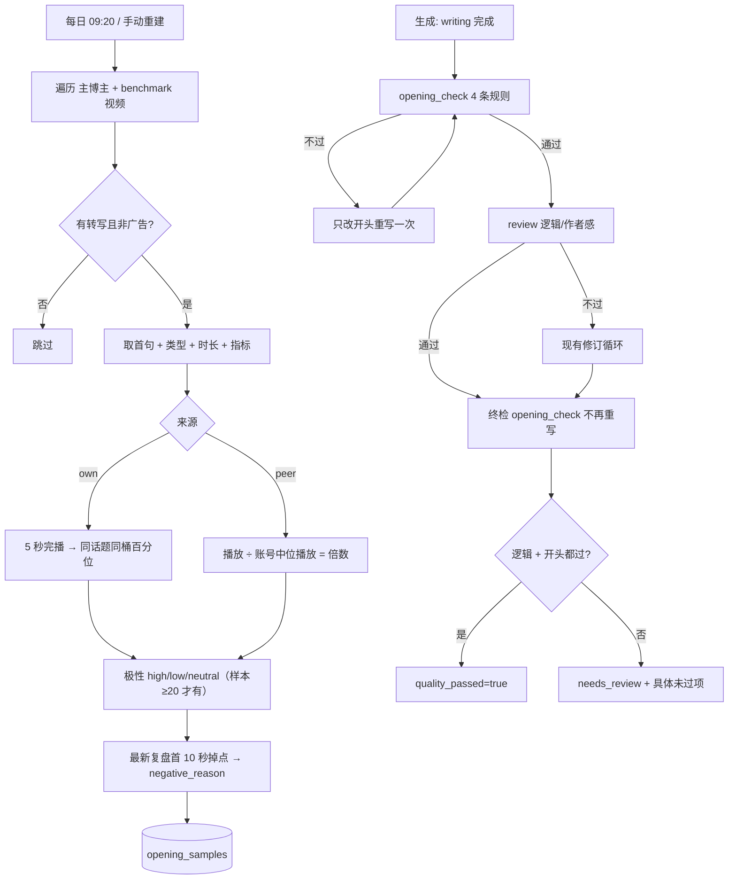
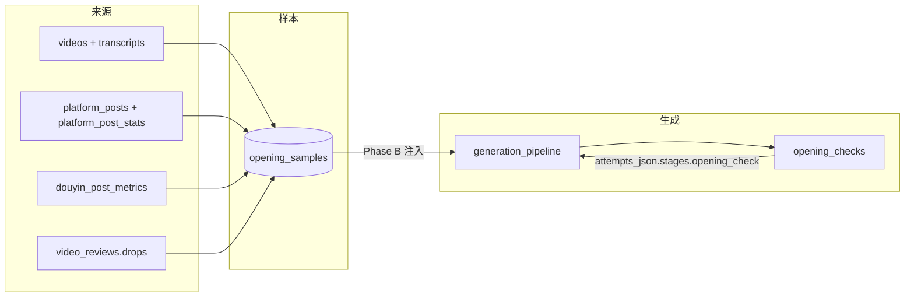

# R-266 开发设计：用「开头 × 真实留人」样本改造生成，取代 LLM 吸引力自评

- **对应需求**：`requirements/R-266-opening-evidence-loop.md`
- **日期**：2026-11-19
- **状态**：设计完成，Phase A 待开发
- **排期**：M267
- **范围**：开头样本库、程序化开头检查、质量门禁调整、样本注入与防照抄、复盘反例回流；不做稿→片归因链
- **分阶段**：Phase A（离线可测：1 表 + 构建 + 检查器 + 门禁）→ Phase B（注入 + 反例 + 真实生成验证，需等 R-263 资产重建完成）

## 1. 开发背景

### 1.1 现状

```text
writing → review（LLM 自评 attraction/author） → 通过条件含 attraction ≥ 4 → 程序门禁也要求 attraction ≥ 4
```

查库结果：130 次生成 0 成功；通过评审的样本 `attraction_score=4` 仍然被 `logic_passed=false` 拒掉——**吸引力分从未成为拦截原因**，也没有证据说明它预测留人。

R-265 之后有了「首句/句子 → 5 秒完播 / 留存掉点」的真实标签：主博主 78 条作品可用、同行 644 条视频有转写。本期把这些变成生成可用的证据。

### 1.2 为什么不直接改提示词

提示词无法回答三个问题：这条开头好不好、凭什么说好、和作者自己平时的水平比如何。必须先把「样本 + 规则 + 证据」建起来。

## 2. 涉及的技术

| 技术 | 用途 | 理由 |
|---|---|---|
| SQLAlchemy 2 + PostgreSQL | 新表 `opening_samples` | 结构化样本 + 指标，便于统计与复算 |
| Alembic | `r266openings` 建表 | 项目强制迁移 |
| 现有 `TfidfIndex` | 主题 ↔ 样本相关度 | 与作者资产检索同源，不引入向量库 |
| 现有 `generation_pipeline` | 开头检查阶段与门禁 | 不新建生成链路 |
| 现有 `background_tasks` | 样本重建任务 | 复用 R-202 进行中规范 |
| 现有 `video_reviews.charts.retention.drops` | 反例来源 | R-265 已产出 |
| `difflib.SequenceMatcher` | 防照抄重叠检测 | 标准库，O(n·m) 可接受（≤200 字） |

## 3. 开发流程图



## 4. 数据流转图



## 5. 实现细节

### 5.1 首句提取与开头类型（纯函数，`services/opening_sample.py`）

**输入**：`transcripts.corrected_text or transcript_text`。

**首句**：按 `[。！？!?…\n]` 切第一段；去首尾空白；超过 120 字截断并保留省略号；空文本不入库。

**类型判定（顺序判定，先命中先定）**：

| 类型 | 规则 |
|---|---|
| `background` | 去掉空白后以「大家好 / 我是 / 今天想 / 最近 / 先介绍 / 这一期 / hello / 哈喽」开头 |
| `question` | 首句以 `？/?` 结尾，或含「为什么/怎么/如何/是不是/能不能/有没有」 |
| `number` | 含 `\d` 或「万/块/元/岁/天/份/次/个月/年/小时/分钟」 |
| `result` | 含「结果/最后/拿到/赚了/过了/成了/面过/涨了/降了/亏了」 |
| `statement` | 其余 |

`background` 优先于 `number`：避免「大家好，今天聊 3 个方法」被归成数字型。

### 5.2 相对分与极性

**自己的样本**

1. 候选集：主博主 `videos` + 转写非空 + `is_ad=false` + 关联 `platform_posts` 的 `douyin_post_metrics.finish_5s_rate` 非空；同一视频有多条帖子时取「最新且带指标」的那条（不是盲目取最新）。
2. 分层：先按 `(main_topics 主类, duration_bucket)` 分组；组内 <5 条 → 退回「同主类」；仍 <5 → 退回全账号样本。`baseline_note` 记录实际用的层与样本数。
3. `rank_score` = 该条 5 秒完播在所用层内的百分位（0~100，同值取平均位次）。
4. 极性（仅当该创作者 own 样本 ≥20）：`≥75` → `high`，`≤25` → `low`，其余 `neutral`；样本 <20 时 `polarity=""`，页面/注入不得出现「高留人」字样。

**同行的样本**

1. 候选集：`creators.kind='benchmark'` 的 `videos` + 转写非空 + 关联帖子有公开播放（644 条有转写，其中 253 条有播放）。
2. `rank_score` = 该条播放 ÷ 该账号样本播放中位数（保留 2 位）；中位数为 0 → 该样本不入库。
3. 极性：`≥2.0` → `high`；`0.5~2.0` → `neutral`；**不设 `low`**（公开播放受粉丝基数影响，不能当负例）。
4. `baseline_note` 固定写「同行公开播放，非留人数据」。

### 5.3 反例回流

对每个样本，查该视频最新一条 `video_reviews` 的 `charts.retention.drops`：

- 取 `end_seconds ≤ 10` 的第一条掉点；
- `negative_reason = "00:04–00:06 掉 12.4 个百分点"`；
- 无复盘/无掉点/掉点在中段 → `negative_reason=""`。

**阈值理由**：只取前 10 秒，是因为本期只解决「开头」；中段掉点属于结构问题，不能拿来做开头反例。

### 5.4 开头检查器（`services/opening_checks.py`）

**输入**：`script`（全文）、`payload`（蓝图 `hook.payoff`）。

**窗口**：前 70 个非标点字符（按 3.5 字/秒 × 20 秒估算，口播稿通用）。

| 规则码 | 判定 | 证据字段 |
|---|---|---|
| `first_too_long` | 首句去标点后长度 >25 | `first_chars` |
| `no_specific` | 前 70 字没有命中任何「具体性」信号 | `hits: []` |
| `banned_opener` | 前 70 字以黑名单词起手（同 5.1 的 background 词表） | `opener` |
| `late_payoff` | `hook.payoff` 归一化后在正文首次出现的字符位置 ÷ 正文长度 >0.30 | `payoff_ratio` |

**具体性信号**（命中 1 项即通过）：数字 `\d`、金额/单位词、结果词、冲突词（却/反而/居然/偏偏/崩/翻车/后悔/被拒/卡壳/没人/裁了/凉了）。

**边界**：

- `payoff` 为空 → 跳过 `late_payoff`（不算通过也不算失败，记录 `skipped`）；
- 正文为空 → 全部规则记为未通过（`empty_script`）；
- 规则命中顺序固定，`issues` 按固定顺序输出，便于前端稳定展示。

**输出**：

```json
{"passed": false,
 "issues": [{"rule": "first_too_long", "detail": "首句 34 字（上限 25）", "fix": "压到 25 字内，先给结论"}],
 "metrics": {"first_chars": 34, "window_chars": 70, "hits": [], "payoff_ratio": 0.42}}
```

### 5.5 接入生成链路（`generation_pipeline`）

**阶段位置**：`writing` 完成 → `opening_check`（可重写一次）→ `review` → 现有修订循环 → **终检**（只检查，不重写）。

1. 首次检查不通过 → 调写手一次，prompt key `author_opening_fix`（新注册项），user 只给：原开头 + 未过项 + 蓝图 hook + 约束「只能改开头及紧邻 1~2 句，正文其余逐字不变」；
2. 重写后重新检查，`attempts["opening_rewrites"] += 1`（上限 1 次）；
3. 结果写 `_complete_stage(run, "opening_check", {"passed", "issues", "metrics", "rewritten"})`；
4. 修订循环结束后再跑一次检查（`rewritten=false`）覆盖该 stage，作为最终门禁依据；
5. **正文未被改动校验**：重写返回的 `script` 去掉开头段落后必须与原文剩余部分完全一致，否则不采用重写结果（防止模型偷偷改正文）。

**review 通过条件变化**：

```python
passed_review = logic_passed and not hard_issues and author_score >= 4   # 移除 attraction_score
# 最终放行还需 opening_check.passed
```

**程序门禁（`compute_quality_passed`）**：

- 移除 `attraction_score >= 4`；
- 新增 `stages["opening_check"].status == "completed"` 且 `detail.passed is True`；
- 其余不变。

**草稿质量 JSON**：`_sync_draft` 增加 `opening_check`（passed/issues/metrics），页面在「质量检查」区展示一行；不新增页面。

### 5.6 样本注入（Phase B，`services/opening_injection.py`）

**触发条件**（全部满足）：

1. own 样本 ≥20 条；
2. 主题与样本的最高 TF-IDF 余弦 ≥0.15（`TfidfIndex` + 与资产检索相同的 cosine 计算）；
3. 若本次资产里有 `experience` 类型证据（第一人称经历主题）→ 只注入 own，不注入 peer；
4. 若本次是「纯经历、无外部事实」且 own 高留人样本 <3 条 → 放弃注入（宁缺毋滥）。

**选择（上限 11 条）**：

| 组 | 条数 | 条件 |
|---|---|---|
| own high | 5 | `polarity=high`，按 `rank_score` 降序 |
| own low | 3 | `polarity=low`，按 `rank_score` 升序 |
| peer high | 3 | `polarity=high`，按 `rank_score` 降序 |

同一条样本不重复出现在两组。

**注入格式**（追加到写手 user prompt 的 `开头参考` 段，不进系统提示词）：

```text
【开头参考·自己·5 秒完播 52%（你自己平时 40%）】「……」
【开头反例·自己·5 秒完播 18%】「……」
【开头参考·同行·播放 3.2 倍于该账号中位（公开数据）】「……」
规则：只借结构与节奏，不得连续照抄 8 字以上；同行内容不得写成你自己的经历。
```

**不注入**：不提示、不占位；运行记录 `attempts["injection"] = {"injected": false, "reason": "..."}`。

### 5.7 防照抄

**检测**：`difflib.SequenceMatcher(None, opening_text, sample_text, autojunk=False).find_longest_match(0, len(a), 0, len(b)).size`。

- `≥8` → 判不通过（`opening_sample_overlap`），触发一次开头重写（复用 5.5 的重写通道，重写时把「与样本重合 X 字」作为未过项）；
- 二次仍 `≥8` → `needs_review`，草稿 quality 记录重合样本 id 与片段；
- `≤7` → 通过。

**为什么 8 字**：中文口播短句里 8 字连续重合已足以构成「照抄观感」；7 字以内多为通用表达（如「很多人以为」），不能过度约束。

## 6. 表结构

### 6.1 新表 `opening_samples`（+1 → 表总数 41）

| 字段 | 类型 | 可空 | 默认 | 说明 |
|---|---|---|---|---|
| `id` | INTEGER | 否 | 自增 | 主键 |
| `creator_id` | INTEGER | 否 | — | 归属创作者（主博主或 benchmark 同行） |
| `source_kind` | VARCHAR(20) | 否 | — | `own` / `peer` |
| `video_id` | INTEGER | 否 | — | 本地视频；一条视频一条样本 |
| `post_id` | INTEGER | 是 | — | 关联云端帖子（取指标用） |
| `platform` | VARCHAR(20) | 否 | `douyin` | 目前只做抖音 |
| `text` | TEXT | 否 | — | 首句（≤120 字） |
| `chars` | INTEGER | 否 | 0 | 首句去标点字数 |
| `hook_type` | VARCHAR(20) | 否 | `statement` | background/question/number/result/statement |
| `finish_5s_rate` | FLOAT | 是 | — | 仅 own 有 |
| `bounce_2s_rate` | FLOAT | 是 | — | 仅 own 有 |
| `plays` | INTEGER | 是 | — | 公开播放 |
| `likes` | INTEGER | 是 | — | 公开点赞 |
| `duration_seconds` | INTEGER | 是 | — | 时长（分桶用） |
| `published_at` | DATETIME | 是 | — | 发布时间 |
| `rank_score` | FLOAT | 否 | 0 | own=百分位 0~100；peer=播放倍数 |
| `polarity` | VARCHAR(20) | 否 | `""` | high/low/neutral/空 |
| `baseline_note` | VARCHAR(200) | 否 | `""` | 用的哪层基线/「同行公开播放，非留人数据」 |
| `negative_reason` | VARCHAR(200) | 否 | `""` | 前 10 秒掉点描述（来自复盘） |
| `created_at` | DATETIME | 否 | 当前时间 | — |
| `updated_at` | DATETIME | 否 | 当前时间 | 重建时刷新 |

**约束/索引**：`UNIQUE(video_id, source_kind)`；`INDEX(creator_id, source_kind, polarity)`；`INDEX(source_kind, rank_score)`。

### 6.2 迁移

- Alembic revision `r266openings`，`down_revision="r265timeline"`；
- 只建表，不回填（回填由任务执行，避免迁移里做几百次 LLM/查询）；
- 同步 `docs/DATABASE.md`（表总览 40→41，新增章节）。

## 7. 接口

### 7.1 `GET /api/opening-samples/coverage`

- 响应 `200`：

```json
{"own": 66, "peer": 215, "own_high": 17, "own_low": 19, "peer_high": 45,
 "built_at": "2026-11-19T09:20:11", "samples_enough": true}
```

- `samples_enough` = own ≥20。
- 错误：`400` 无主博主。

### 7.2 `POST /api/opening-samples/rebuild`

- 请求：`{"scope": "all" | "own" | "peer"}`，默认 `all`；
- 响应 `202`：`{"task_id": 15234, "reused": false}`；同 kind 运行中 → `reused: true`；
- 错误：`400` 无主博主 / 无 benchmark 账号（peer 范围时）；`409` 已有任务且非复用。

### 7.3 生成链路（不改接口）

- `POST /api/drafts/generate-async` 等入口契约不变；
- 草稿 `quality` 增加字段（向后兼容）：

```json
{"opening_check": {"passed": true, "issues": [], "metrics": {}, "rewritten": true},
 "injection": {"injected": true, "own_high": 5, "own_low": 3, "peer_high": 3}}
```

## 8. 数据来源与原始字段明细

| 数据项 | 来源 | 原始字段 | 落库字段 | 用途 | 更新时机 | 空值处理 |
|---|---|---|---|---|---|---|
| 首句文本 | 本地 `transcripts` | `corrected_text` 优先，否则 `transcript_text` | `opening_samples.text` | 样本/注入 | 重建任务 | 空 → 不入库 |
| 开头类型 | 程序计算 | 上一条文本 | `hook_type` | 分组统计 | 重建任务 | 规则兜底 `statement` |
| 5 秒完播 | TikHub 创作者中心 | `douyin_post_metrics.finish_5s_rate` | `finish_5s_rate` | own 排序 | 重建任务 | 空 → 该视频不入 own 样本 |
| 2 秒跳出 | 同上 | `bounce_2s_rate` | `bounce_2s_rate` | 展示/参考 | 同上 | 空 → 保持 NULL |
| 公开播放/点赞 | 公开接口 | `platform_post_stats.plays/likes` | `plays/likes` | peer 排序 | 重建任务 | 播放 0 → 不入 peer 样本 |
| 时长 | R-265 列 | `platform_posts.duration_seconds` | `duration_seconds` | 分桶 | 重建任务 | 空 → 不分桶，用全账号层 |
| 话题 | 本地 `videos.main_topics` | JSON 数组首个 | 分层键（不落库） | 分层 | 重建任务 | 空 → 归「未分类」 |
| 掉点反例 | R-265 复盘快照 | `charts.retention.drops[]` | `negative_reason` | 反例 | 重建任务 | 无 → 空串 |
| 相关性 | 程序计算 | 主题 text + 样本 text | 运行记录 | 注入开关 | 生成时 | 无样本 → 不注入 |

## 9. 迁移与兼容

1. 新表只增不改，老数据零影响；
2. 门禁变更会让历史 `quality_passed=true` 的草稿与新口径不一致 → 只影响新生成，不回写历史；
3. `attraction_score` 从门禁移除后，`_review_shape` 与页面字段保留，仅不再参与判定；
4. Phase A/B 之间：Phase A 上线后样本表为空也不影响生成（检查器不依赖样本）；Phase B 注入按条件跳过；
5. 任务中断：重建任务可重入（upsert 唯一键），不归档旧样本（与 R-263 资产重建不同，避免重启丢数据）。

## 10. 测试计划

### 后端

| 文件 | 用例 |
|---|---|
| `test_r266_opening_sample.py` | 首句切分（含省略号/换行/超长截断）；5 种类型判定优先级；分层退回（同桶→同话题→全账号）；百分位同值平均位次；peer 倍数与中位数为 0；样本 <20 极性为空 |
| `test_r266_opening_checks.py` | 4 条规则各自命中/不命中；70 字窗口边界；`payoff` 缺失跳过；空正文全失败；`issues` 顺序稳定 |
| `test_r266_quality_gate.py` | 吸引力 5 分 + 开头不过 → 不通过；吸引力 3 分 + 逻辑与开头都过 → 通过；`opening_check` 未执行 → 不通过 |
| `test_r266_injection.py` | 相关度 0.14/0.16；样本 19/21；纯经历不注入 peer；上限 11 条与去重；不注入时写 reason |
| `test_r266_overlap.py` | 连续重合 8 字命中、7 字不命中；中文标点不参与匹配；重写后仍重合 → needs_review |
| `test_r266_opening_fix.py` | 只改开头时正文其余部分不变；模型偷改正文 → 采用原稿并记 warning；重写上限 1 次 |

### 前端

- 草稿质量区新增一行「开头检查」：通过 / 未通过（列出未过项）；无数据不显示。
- 不新增页面与一级菜单。

### 验收运行

- Phase A：构建任务跑完 → `coverage` 返回 own ≥70、peer ≥500；抽 10 条人工核对首句与类型。
- Phase B：真实生成 3 篇（含 1 篇纯经历主题），核对注入条数、重合检测与质量状态。

## 11. 成本、风险与回滚

**成本**

- 重建任务：纯 DB + 文本计算，无 LLM 调用；644 + 78 条量级，分钟级。
- 生成：Phase A 不增加 LLM 调用；仅开头不过时多 1 次「只改开头」调用（上限 1 次/篇）。
- Phase B 注入增加 prompt 约 300~600 字，单次成本增加可忽略。

**风险**

| 风险 | 对策 |
|---|---|
| 78 条自己的样本过少，排序不稳 | <20 不排序；≥20 也标注样本数与层；不承诺「高留人」因果 |
| 同行播放受粉丝基数影响 | 用账号内播放倍数；只做正向参考，不设 low |
| 开头检查误杀（如故意长句铺垫） | 重写一次即放行到评审；二次不过才 `needs_review`，且页面可读未过项 |
| 模型偷改正文 | 重写结果做「去开头后逐字比对」，不一致则不采用 |
| 注入导致同质化 | 上限 11 条 + 相关度门槛 + 8 字重合检测 + 纯经历主题不注入 peer |

**回滚**

- 删表 + 回退 `r266openings` 即可（无外键被其它表引用）；
- 门禁回滚：恢复 `attraction_score >= 4` 条件，移除 `opening_check` 要求；
- 注入回滚：`injected=false` 常量关闭即可，不影响其它链路。

## 12. 实施顺序

| 批次 | 内容 | 前置 | 验证 |
|---|---|---|---|
| A1 | `opening_samples` 表 + 构建服务 + 重建任务 + 每日 09:20 + coverage 接口 | 无 | 单测 + 真实构建（own/peer 数量） |
| A2 | `opening_checks` + 生成接入（检查/单次重写/终检）+ 门禁调整 + 草稿质量字段 | A1（可并行） | 单测 + 一次真实生成 |
| B1 | 样本注入 + 相关度门槛 + 注入格式 | A1/A2 + R-263 资产重建完成 | 注入单测 + 真实生成 3 篇 |
| B2 | 防照抄重叠检测 + 复盘反例注入 | B1 | 重合单测 + 真实生成 |
