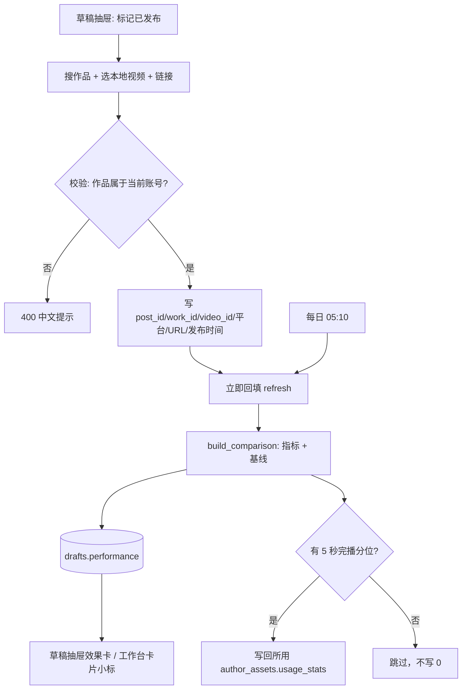
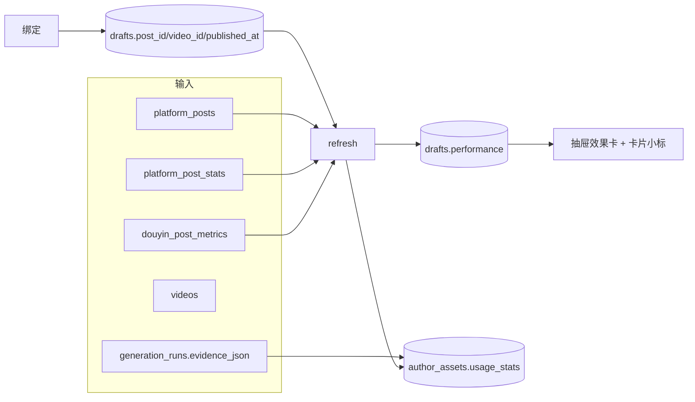

# R-267 开发设计：草稿→作品绑定与发布后效果回填

- **对应需求**：`requirements/R-267-draft-publish-attribution.md`
- **日期**：2026-11-19
- **状态**：设计完成，待开发
- **排期**：M268
- **范围**：草稿显式绑定作品/本地视频、发布后指标回填（含留存）、草稿抽屉与工作台展示、资产效果回流；不做标题自动匹配、不做录制链路自动带上 draft_id

## 1. 开发背景

现有 `publish_backfill`（R-197）只覆盖「status ∈ used/done + work_id/video_id 都为空 + 标题相似度 ≥0.8」的草稿，实测候选 **0 条**；作者的实际流程是「另一台设备录制 → 手动发布」，所以自动匹配与自动带 id 都不可行。本期改为**显式绑定 + 自动回填**。

## 2. 涉及的技术

| 技术 | 用途 | 理由 |
|---|---|---|
| SQLAlchemy 2 / Alembic | `drafts.post_id` 新列 | 作品是回填指标的最短路径 |
| 现有 `build_comparison` | 指标 + 同话题同时长基线 | 与复盘同一口径，不另造一套 |
| 现有 `generation_runs.evidence_json` | 找到这篇稿用了哪些资产 | 效果回流定位 |
| 现有 `background_tasks` | 每日回填、手动刷新 | 复用 R-202 |
| React + framer-motion | 发布区、效果卡、卡片小标 | 沿用现有抽屉与动效 |

## 3. 开发流程图



## 4. 数据流转图



## 5. 实现细节

### 5.1 绑定（`services/draft_publish.py::bind`）

**输入**：`draft_id`、`post_id`（必填）、`video_id`（可选）、`publish_url`（可选）。

**校验（按顺序，失败抛 ValueError → 400）**：

1. 草稿存在且属于当前主博主；
2. 作品存在，且其 `account_id` 属于当前主博主的账号（`creator_accounts.creator_id = 当前主博主`）；
3. `video_id` 若传，视频必须属于当前主博主；
4. 作品平台不是 `douyin` 时允许绑定，但 `performance` 只会有公开互动，并写 `private_metrics=false`。

**写入**：

- `post_id`、`work_id = post.work_id`（可能为空）、`video_id = 入参 or post.local_video_id or 原值`；
- `publish_platform = post.platform`；
- `publish_url = 入参 or post.video_url or 平台页 URL`；
- `published_at = post.publish_time or 当前时间`。

**解除绑定**：清空 `post_id/work_id/video_id?`（`video_id` 仅在它等于绑定作品带出的那个时才清，避免误删作者手动关联的素材）、`publish_*`、`published_at`、`performance="{}"`。

### 5.2 回填（`refresh`）

**缓存**：`performance.refreshed_at` 距今 <6 小时且 `force=false` → 直接返回旧值。

**指标来源**：`build_comparison(db, post)`，取 `facts` 里以下 key：

| key | 说明 |
|---|---|
| `plays / likes / favorites / comments / shares` | 互动（公开统计） |
| `finish_5s_rate` | 5 秒完播（仅抖音有） |
| `bounce_2s_rate` | 2 秒跳出（越低越好） |
| `finish_rate` | 完整完播 |
| `avg_view_proportion` | 平均播放占比 |

**payload**：

```json
{
  "post_id": 2050, "platform": "douyin", "post_title": "...", "published_at": "...",
  "private_metrics": true,
  "metrics": {"finish_5s_rate": {"value": 0.42, "baseline": 0.38, "percentile": 72.0, "state": "normal", "sample_count": 9, "unit": "ratio", "missing": false}},
  "data_time": "2026-11-19T12:26",
  "baseline_note": "同类（60-120 秒）样本 6 条",
  "refreshed_at": "..."
}
```

**空值**：`value=null` 时 `missing=true`，不写 0；`baseline/percentile` 无值时同样 null。
**降级**：平台非抖音或无 `douyin_post_metrics` → `private_metrics=false`，留存字段全 null，抽屉提示「该作品没有创作者数据」。

### 5.3 基线

直接复用 `build_comparison` 的「同话题 + 同时长桶 + 同发布天数」中位数与百分位；样本 <5 时其 `state=limited`，原样透传，前端显示「样本不足」，不允许说「高于平时」。

### 5.4 资产效果回流

1. 取该草稿**最近一次** `generation_runs`，读 `evidence_json.author_assets[].id`；
2. 仅当 `private_metrics=true` 且 `finish_5s_rate.percentile` 非空时执行；
3. 对每个资产：`usage_stats.published = {"count": 旧值+1, "last_post_id", "last_percentile", "recent": [...]}`（`recent` 保留最近 5 个分位），`performance = median(recent)`；
4. 无运行记录（手写稿）→ 跳过。

### 5.5 展示

- **草稿抽屉「发布」区**：未绑定显示「标记已发布」；已绑定显示平台、作品标题、发布时间、链接、「解除绑定」「刷新数据」。
- **效果卡**：9 项指标（有值才显示），每项 `值 / 你平时 X / 样本 N`；`missing` 显示「—」；顶部 `baseline_note` 与 `data_time`。
- **工作台卡片小标**：`published_at` 非空时显示「已发布·抖音」+ `播放` + `5s`；无 5s 只显示播放；未绑定不渲染该区域（不占位）。
- 动效：效果卡入场 `opacity .9→1 + y 4→0`（0.2s），与现有抽屉一致；`prefers-reduced-motion` 直接显示。

### 5.6 每日任务

`_publish_backfill_job`（05:00）追加：查询 `post_id IS NOT NULL` 的草稿，逐条 `refresh(force=False)`；单条失败只记日志，不影响其它；返回更新条数写日志。

## 6. 表结构

### 6.1 `drafts`（+1 列）

| 字段 | 类型 | 可空 | 默认 | 说明 |
|---|---|---|---|---|
| `post_id` | INTEGER | 是 | — | 绑定的云端作品；外键 `platform_posts.id`，建索引 |

其余沿用现有 `video_id / work_id / publish_url / publish_platform / published_at / performance`。

### 6.2 迁移

- Alembic revision `r267draftpost`，`down_revision="r266openings"`；
- 只加列 + 索引，不回填（历史自动匹配保持 R-197 行为）；
- `docs/DATABASE.md` 同步（表总数不变，41 张）。

## 7. 接口

### 7.1 `GET /api/drafts/publish-candidates?query=&limit=20`

- 返回当前主博主账号下的作品（按发布时间倒序，标题/日期匹配）：

```json
{"items": [{"post_id": 2050, "platform": "douyin", "title": "...", "publish_time": "...",
  "plays": 13228, "has_local_video": true, "video_id": 703}]}
```

- 错误：`400` 无主博主/未绑定账号。

### 7.2 `POST /api/drafts/{id}/publish`

- 请求：`{"post_id": 2050, "video_id": 703, "publish_url": ""}`；
- 响应 `200`：`{"draft_id": 1, "post_id": 2050, "performance": {...}}`；
- 错误：`404` 草稿不存在；`400` 作品不属于当前账号 / 视频不属于当前博主 / 参数缺失。

### 7.3 `DELETE /api/drafts/{id}/publish`

- 响应 `200`：`{"draft_id": 1, "unbound": true}`；重复调用幂等。

### 7.4 `GET /api/drafts/{id}/publish?refresh=false`

- 返回绑定信息 + `performance`（`refresh=true` 时忽略 6h 缓存）；
- 未绑定：`{"draft_id": 1, "post_id": null, "performance": null}`。

### 7.5 列表扩展

`GET /api/drafts` 已在 `performance` 里带数据；新增 `post_id` 字段（`DraftOut`），卡片据 `published_at + performance.metrics` 渲染小标。无新查询（`performance` 已随行返回）。

## 8. 数据来源与原始字段明细

| 数据项 | 来源 | 原始字段 | 落库字段 | 用途 | 更新时机 | 空值处理 |
|---|---|---|---|---|---|---|
| 绑定作品 | 本地 `platform_posts` | `id/account_id/platform/title/video_url/publish_time/work_id/local_video_id` | `drafts.post_id/work_id/publish_platform/publish_url/published_at` | 归因入口 | 手动绑定 | 无作品 → 提示先同步 |
| 互动 | `platform_post_stats` | `plays/likes/favorites/comments/shares` | `drafts.performance.metrics.*` | 展示 | 绑定后/每日/手动 | 无快照 → null |
| 留存 | `douyin_post_metrics` | `finish_5s_rate/bounce_2s_rate/finish_rate/avg_view_proportion(raw)` | 同上 | 判断开头/结构 | 同上 | 非抖音/无数据 → null + `private_metrics=false` |
| 基线 | 程序计算 `build_comparison` | 同话题同时长同发布天数中位数 | `performance.metrics.*.baseline/percentile/sample_count` | 判断好坏 | 回填时 | 样本 <5 → state=limited |
| 稿→资产 | `generation_runs.evidence_json` | `author_assets[].id` | `author_assets.usage_stats` | 效果回流 | 回填时 | 无运行 → 跳过 |
| 本地视频 | 本地 `videos` | `id/filename/title` | `drafts.video_id` | 关联素材 | 绑定时 | 可选 |

## 9. 迁移与兼容

1. `drafts.post_id` 可空，老数据不受影响；R-197 的自动匹配（work_id）继续可用；
2. 未绑定草稿的 `performance` 保持 `{}`，前端按空态处理；
3. `refresh_published_performance`（R-189）保留，新路径只处理 `post_id` 非空；
4. 解绑只清 `video_id` 中「由绑定带出」的值，避免误删手动关联。

## 10. 测试计划

| 文件 | 用例 |
|---|---|
| `test_r267_bind.py` | 绑定成功写全字段；非当前账号作品 → 400；视频不属于博主 → 400；重复绑定覆盖；解绑清空且幂等；解绑不误删手填 video_id |
| `test_r267_performance.py` | 有 5 秒指标 → metrics 含 value/baseline/percentile；无抖音指标 → `private_metrics=false` 且 null；0 值显示 0；6h 缓存与 force 刷新；baseline_note 样本不足 |
| `test_r267_asset_feedback.py` | 有 generation_run → 资产 performance=分位中位数；5 次以上取最近 5 次；无分位不写；手写稿跳过 |
| `test_r267_candidates.py` | 只返回当前账号作品；query 过滤标题；limit 生效；无账号 400 |
| `test_r267_job.py` | 每日任务只刷新已绑定、单条失败不影响其它 |

前端：抽屉发布区与效果卡、工作台卡片小标的渲染（已发布/未绑定/无私有指标三种）。

## 11. 成本与风险

- 回填成本：每条 1 次 `build_comparison`（约 6 次查询），草稿量级小；不消耗 TikHub。
- 风险：作品选错 → 数据全错。对策：选择器显示标题+日期+播放；保存后效果卡显示作品标题与时间，随时可解绑重绑。
- 风险：基线口径与复盘不一致 → 统一走 `build_comparison`。
- 回滚：删列/清字段即可；不动作品与素材。

## 12. 实施顺序

| 批次 | 内容 | 验证 |
|---|---|---|
| A | 迁移 + 绑定/解绑/候选接口 + 列表 post_id | 单测 + 手工绑定 1 篇 |
| B | 回填（指标+基线）、每日任务、抽屉效果卡 | 单测 + 真实作品回填 |
| C | 工作台卡片小标 + 资产回流 | 单测 + 真实 AI 稿绑定验证 |
