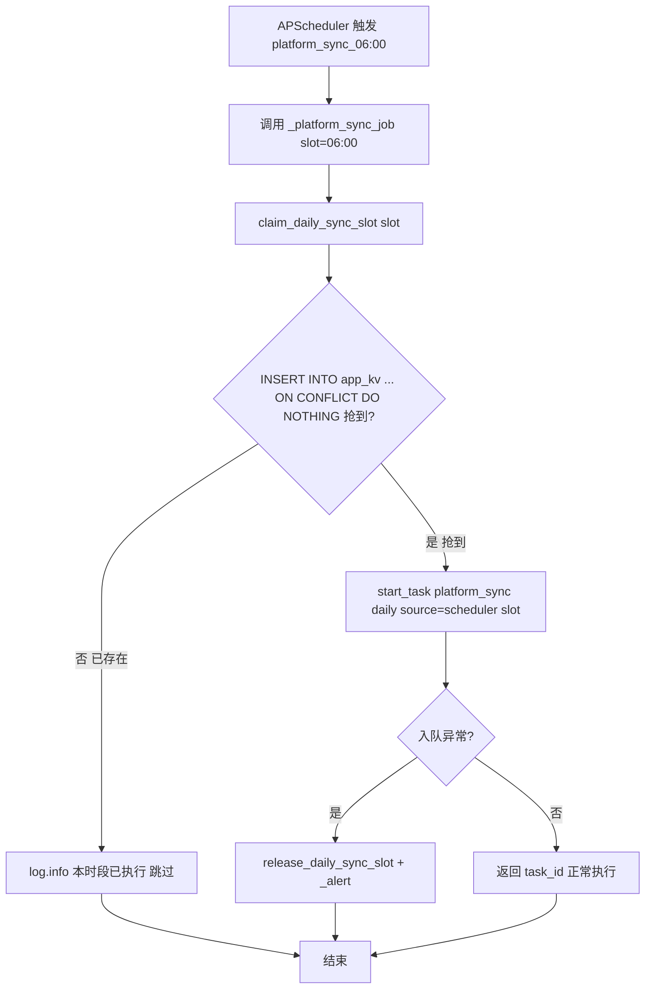
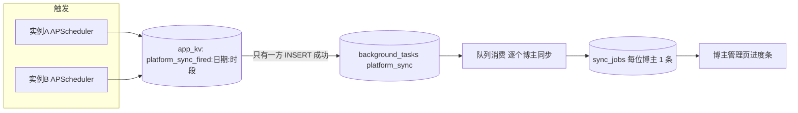

# R-268 开发设计：定时同步跨进程幂等

- **对应需求**：`requirements/R-268-sync-scheduler-idempotent.md`
- **日期**：2026-11-27
- **状态**：设计完成，待开发
- **排期**：M269
- **范围**：仅在 `platform_sync` 定时入队前加数据库级占位，保证多实例同一时段只跑一次；不改同步业务逻辑、不改表结构

## 1. 开发背景

`backend/app/scheduler.py::setup_scheduler` 为每个实例注册 `platform_sync_{HH:MM}` 的 cron，触发时 `_platform_sync_job` 调 `start_task("platform_sync", {"scope": "daily", "source": "scheduler"}, fn)`。

`start_task` 的防重是 `_START_LOCK`（`backend/app/tasks.py:89`，`threading.Lock`）+ `find_running_payload` 查询，两者都只在**单进程**内成立。两个后端实例在整点同时触发时，都查不到对方的 pending 任务（插入有先后竞态），于是各写一条，两个进程的 daemon 线程各跑一遍完整同步。

实测证据（只读查库）：11-27 06:00 两条调度任务相差 18ms；每个 creator 同一时段 2 条 `sync_jobs`；11-24、11-25 两份都 `done`。

## 2. 涉及的技术

| 技术 | 用途 | 理由 |
|---|---|---|
| PostgreSQL `INSERT … ON CONFLICT DO NOTHING` | 跨进程抢占执行权 | 唯一主键天然互斥，不需要额外中间件 |
| 现有 `app_kv` 表（`models/kv.py::Kv`） | 存占位键 | 已有轻量 KV，无需建表 |
| APScheduler `add_job(args=…)` | 把时段字符串传给任务体 | 占位键需要「这个 cron 是哪个时段」 |
| 现有 `today_key()`（`core/pipeline.py`） | 日期部分 | 与业务其它地方同一时区口径 |
| pytest | 并发/重入用例 | 复用现有测试设施 |

## 3. 开发流程图



## 4. 数据流转图



## 5. 实现细节

### 5.1 占位键规则

- 键名：`platform_sync_fired:{YYYY-MM-DD}:{HH:MM}`，例：`platform_sync_fired:2026-11-27:06:00`（长度 41，`app_kv.key` 上限 120）；
- 日期用 `today_key()`（应用时区，与 `sync_jobs.stat_date` 同口径）；
- 时段取自注册 cron 时的 `time_str`（`setup_scheduler` 里 `for time_str in settings.platform_sync_times.split(",")`），通过 `add_job(..., args=[time_str])` 透传；若任务体被手动调用且没传 slot，用当前时间 `%H:%M` 兜底。

### 5.2 抢占（`services/platform_sync.py::claim_daily_sync_slot`）

```python
def claim_daily_sync_slot(db: Session, slot: str) -> bool:
    key = f"platform_sync_fired:{today_key()}:{slot}"
    row = db.execute(
        text(
            "INSERT INTO app_kv (key, value) VALUES (:k, '1') "
            "ON CONFLICT (key) DO NOTHING RETURNING key"
        ),
        {"k": key},
    ).first()
    db.commit()
    return row is not None
```

- 返回 `True`＝本次抢到；`False`＝别的进程/本进程已抢过；
- 单条 SQL 原子完成「判断 + 写入」，不存在「先查再写」的竞态。

### 5.3 释放（`release_daily_sync_slot`）

```python
def release_daily_sync_slot(db: Session, slot: str) -> None:
    db.execute(text("DELETE FROM app_kv WHERE key = :k"), {"k": f"platform_sync_fired:{today_key()}:{slot}"})
    db.commit()
```

只在「抢到占位但 `start_task` 抛异常」时调用；任务执行失败不释放。

### 5.4 任务体改造（`scheduler.py::_platform_sync_job`）

```python
def _platform_sync_job(slot: str = "") -> None:
    slot = slot or now().strftime("%H:%M")
    db = SessionLocal()
    try:
        if not claim_daily_sync_slot(db, slot):
            log.info("本时段定时同步已执行过，跳过（slot=%s）", slot)
            return
    finally:
        db.close()
    try:
        start_task("platform_sync", {"scope": "daily", "source": "scheduler", "slot": slot}, fn)
    except Exception as exc:
        with SessionLocal() as db2:
            release_daily_sync_slot(db2, slot)
        _alert("platform_sync", "定时平台同步入队失败", str(exc))
```

- payload 新增 `slot`：同时也让 `find_running_payload` 的「完全相等」判断能区分 06:00 与 17:00；
- 占位与入队之间不 sleep，窗口极小（见风险）。

### 5.5 注册处改造（`scheduler.py::setup_scheduler`）

```python
_scheduler.add_job(
    _platform_sync_job,
    CronTrigger(hour=sh, minute=sm, timezone=settings.tz),
    args=[time_str],
    id=f"platform_sync_{time_str}",
    misfire_grace_time=3600,
    coalesce=True,
)
```

其余 cron 不动。

### 5.6 判定顺序与降级

| 情况 | 行为 |
|---|---|
| 两个实例同时触发 | 一方 `True` 正常入队；另一方 `False` 打日志退出 |
| 同一实例内重复触发 | 第二次 `False`（`start_task` 的进程内去重仍保留，双保险） |
| 数据库不可用 | 抢占抛异常 → 任务不执行 + 告警，不产生半截任务 |
| 进程在「抢占后、入队前」被 kill | 该时段不再自动执行，作者可手动点「同步」（可接受，见 §11） |
| 占位残留跨天 | 不会：键里带日期，次日自动换新键，旧键无副作用 |

## 6. 表结构

**无新增表、无新增列、无 Alembic revision。**

沿用 `app_kv`：

| 字段 | 类型 | 说明 |
|---|---|---|
| `key` | VARCHAR(120) PK | 本期新增一种键：`platform_sync_fired:{日期}:{时段}` |
| `value` | TEXT | 固定写 `'1'`，只作为占位标记，不参与业务读取 |

`docs/DATABASE.md` 表数不变（41 张），仅需在 `app_kv` 章节补一句键名约定（如该文件已记录键名规范）。

## 7. 接口

**无新增、无修改接口。** 手动同步接口 `/api/platform/sync`、`/api/platform/sync-all` 行为不变。

## 8. 数据来源与原始字段明细

| 数据项 | 来源 | 原始字段 | 落库字段 | 用途 | 更新时机 | 空值处理 |
|---|---|---|---|---|---|---|
| 时段标识 | 配置 `ECHO_PLATFORM_SYNC_TIMES` | `"06:00,17:00"` 拆分后的 `HH:MM` | `app_kv.key` 片段 | 区分不同时段 | 每次注册 cron | 配置缺失 → 默认 `06:00,17:00` |
| 日期 | 程序计算 `today_key()` | 应用时区当天 | `app_kv.key` 片段 | 每天自动换新键 | 每次触发 | — |
| 执行权 | PostgreSQL 唯一主键 | `app_kv.key` 冲突结果 | 同左 | 跨进程互斥 | 每次触发 | 插入失败 = 已有执行者 |
| 任务记录 | `start_task` | `kind/payload` | `background_tasks.kind/payload/status` | 前端进度来源 | 抢到占位后 | 入队失败 → 删除占位 |

## 9. 迁移与兼容

1. 老实例（未升级的进程）仍会双跑；升级后需重启所有实例才生效，部署文档/交付说明里注明。
2. 旧 `app_kv` 无该前缀的键，互不影响。
3. 若某天两个实例升级时间不同，升级前的实例仍会插入任务——但升级后的实例会因占位已存在而跳过，结果最多一份（可接受）。

## 10. 测试计划

新增 `backend/tests/test_r268_scheduler_idempotent.py`：

| 用例 | 断言 |
|---|---|
| `test_claim_once` | 第一次 `True`，第二次 `False`；`app_kv` 只有 1 行 |
| `test_claim_two_sessions` | 两个独立 Session 模拟两个进程：只有一个 `True` |
| `test_claim_concurrent_threads` | 10 线程并发抢：恰好 1 个 `True` |
| `test_release_allows_retry` | 抢占 → 释放 → 再抢 `True` |
| `test_next_day_new_key` | 伪造日期参数，次日能重新抢到 |
| `test_slot_isolation` | 06:00 与 17:00 互不影响 |
| `test_job_skips_when_claimed` | 预置占位后调 `_platform_sync_job("06:00")`（monkeypatch `start_task`）：不产生任务 |

## 11. 成本与风险

- 成本：每时段 1 条 `INSERT ON CONFLICT`，可忽略；直接减少约 **50%** 的定时同步请求（原先双跑）。
- 风险 1：进程在「抢占成功、入队前」崩溃 → 该时段不跑。概率极低（两条语句之间），且页面有手动同步入口；不引入看门狗，避免过度设计。
- 风险 2：有人把 `platform_sync_times` 改成同一时间重复（如 `06:00,06:00`）→ 两个 cron 抢同一个键，仍只跑一次（符合预期）。
- 回滚：删除两处改造 + 键可留可删，不影响业务数据。

## 12. 实施顺序

| 批次 | 内容 | 验证 |
|---|---|---|
| A | `claim_daily_sync_slot` / `release_daily_sync_slot` + 单测 | 新增 7 条单测 |
| B | `_platform_sync_job` + `setup_scheduler(args)` 接入 | 双实例模拟：只 1 条任务；日志有「已执行，跳过」 |
| C | 真实双实例整点前手动调函数验证（不等到 17:00） | 8000/8001 同时调 `_platform_sync_job("17:00")`，只入队 1 条 |
