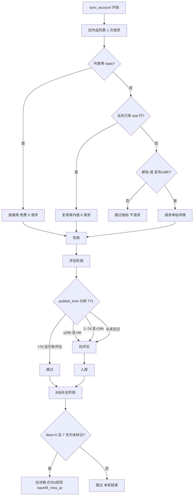
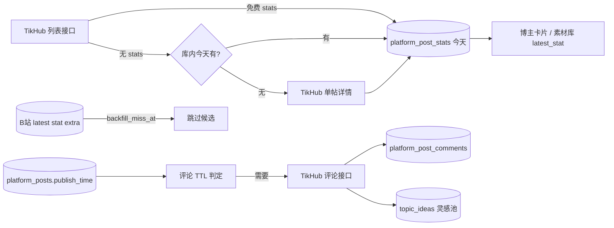

# R-269 开发设计：同步节流与增量

- **对应需求**：`requirements/R-269-sync-throttle-incremental.md`
- **日期**：2026-11-27
- **状态**：设计完成，待开发
- **排期**：M270
- **范围**：指标同日复用、评论 TTL 分级、只拉增量、B站补全降噪、小红书解析与 400 修复；不改表结构、不改页面字段、不改曲线口径

## 1. 开发背景

`sync_account`（`services/platform_sync.py`）每轮固定做四件事：拉列表 → 逐帖补指标（列表没带时）→ 拉前 10 帖评论 → B站补历史指标。三个环节都没有「今天已经做过就不再花钱」的判断：

- `_ensure_post`：`stats = post.stats or None`，列表没带就直接请求单帖，不看当天是否已有记录；
- `_collect_comments` → `_comments_synced_recently`：固定 6 小时 TTL；
- `_backfill_bili_stats`：候选只看 `likes=0`，补不到的下轮还是候选（主 B站账号 30 条）。

实测：14:11 一次「同步所有博主」消耗约 350 次请求；同一帖当天可被 06:00 / 17:00 / 手动点击重复请求。

## 2. 涉及的技术

| 技术 | 用途 | 理由 |
|---|---|---|
| SQLAlchemy 批量查询 | 预加载当天 `platform_post_stats` | 避免逐帖查库（沿用 R-222 的预加载模式） |
| `platform_posts.publish_time` | 评论 TTL / 增量判定 | 已有字段，不新增 |
| `platform_post_stats.extra`（TEXT JSON） | B站「补不到」标记 | 不新增列/表 |
| 现有 TikHub 解析层 | 小红书字段修正 | 只改映射 |

## 3. 开发流程图



## 4. 数据流转图



## 5. 实现细节

### 5.1 指标取值顺序（`sync_account` + `_ensure_post`）

在 `sync_account` 进入作品循环前，一次性预加载「本批作品 id → 当天 stat 行」：

```python
today_stats = {
    row.post_id: row
    for row in db.query(PlatformPostStat)
    .filter(PlatformPostStat.post_id.in_(existing_ids), PlatformPostStat.stat_date == today_key())
    .all()
}
```

`_ensure_post` 新增参数 `today_stat: PlatformPostStat | None`（以及 `is_new: bool`），判定顺序：

| 顺序 | 条件 | 行为 | 请求数 |
|---|---|---|---|
| 1 | `post.stats` 非空（列表带的） | 正常写库（`_write_stat` 合并） | 0 |
| 2 | 列表为空 && `today_stat` 存在 | 复用库内值，**跳过 `_write_stat`**（不重复写同一份数据） | 0 |
| 3 | 列表为空 && 无当天记录 && (`is_new` 或 发布 ≤48h) | `client.fetch_post_stats` | 1 |
| 4 | 其余（老帖、无当天记录、非新帖） | 跳过指标 | 0 |

- 48 小时阈值写成模块常量 `INCREMENTAL_METRIC_WINDOW_HOURS = 48`；
- `is_new` 由调用方 `existed is None` 判断（`_ensure_post` 已能拿到 `existing` 字典）；
- 降级：`BudgetExceeded` 照旧向上抛，由 R-162 worker 取消后续博主。

### 5.2 评论 TTL 分级（`_collect_comments` / `_comments_synced_recently`）

新增：

```python
def _comment_ttl_hours(post: PlatformPost) -> float:
    ttl = 24.0
    if post.publish_time:
        age_h = (now() - post.publish_time).total_seconds() / 3600
        if age_h <= 24:
            ttl = 6.0
        elif age_h > 24 * 7:
            ttl = float("inf")
    return ttl
```

- `_collect_comments` 过滤改为 `_comments_synced_recently(db, post.id, hours=_comment_ttl_hours(post))`；
- 语义保持：该帖**从未**有评论记录时函数返回 `False` → 仍会拉一次（满足「老帖首次也补」）；
- `inf` 只对「已有评论记录」生效，即超过 7 天的帖子不再定时重拉；
- 阈值全部是常量，不加配置项（避免过度配置）。

### 5.3 只拉增量

- 本节落到实处就是 5.1 的顺序 3/4；涉及的成本大头是 B站单帖详情（15 次/账号/轮），老帖当天重复点时直接走顺序 2 或 4；
- 「全量同步」（`scope=initial`）不受 48h 限制：作者显式点全量时照常逐帖补。

### 5.4 B站历史补全降噪（`_backfill_bili_stats`）

- 候选过滤新增：读最新 stat 的 `extra`（已有 `latest_stats` 预加载），若 `backfill_miss_at` 距今天 <7 天 → 跳过；
- 补完仍为 0：把标记塞进本次写入的 `stats["extra"]["backfill_miss_at"] = today_key()`，由 `_write_stat` 合并进当天行；
- 上限 150/账号/轮不变；
- 常量 `BILI_BACKFILL_RETRY_DAYS = 7`。

### 5.5 小红书修复

1. **字段映射**（`services/platform/tikhub.py::_real_post_stats`）：

```python
"play_count": note.get("view_count") or note.get("pre_view_count"),
```

2. **400 排查**：用真实账号 `6201fbb0000000001000c3d2` 调 `/api/v1/xiaohongshu/app_v2/get_user_posted_notes` 复现，核对该接口当前必填参数（是否需要 `xsec_token` / `lastCursor`），按文档修正请求参数；
3. 若接口确实已变更且无替代：账号卡片显示真实失败原因（已有机制），不再尝试伪造 0 值；
4. 不做熔断/冷却。

## 6. 表结构

**无新增表、无新增列、无 Alembic revision。**

- `platform_post_stats.extra` 新增一个 JSON 键 `backfill_miss_at`（值为 `YYYY-MM-DD` 字符串），仅在 B站补全失败时写入；
- `docs/DATABASE.md` 在 `platform_post_stats` 章节补一行 `extra` 可含 `backfill_miss_at` 的说明，表数不变（41）。

## 7. 接口

**无新增、无修改接口。** 现有 `POST /api/platform/sync`、`/api/platform/sync-all` 行为不变，只是内部少发请求。

## 8. 数据来源与原始字段明细

| 数据项 | 来源 | 原始字段 | 落库字段 | 用途 | 更新时机 | 空值处理 |
|---|---|---|---|---|---|---|
| 列表指标 | TikHub 列表接口 | `statistics.{play_count,digg_count,collect_count,share_count,comment_count}` | `platform_post_stats.*` | 卡片/曲线 | 每轮（0 请求） | 缺失字段不写 |
| 单帖指标 | TikHub 单帖详情 | 同上（B站 `View.stat`） | 同上 | 补齐 | 仅新帖/48h 内/无当天记录 | 失败只丢当天指标 |
| 当天记录判定 | 本地 `platform_post_stats` | `post_id/stat_date` | — | 决定是否请求 | 每轮 | 无记录 → 继续判定 |
| 评论 | TikHub 评论接口 | `text/digg_count/user.nickname` | `platform_post_comments` | 灵感池 | 按 TTL 分级 | 失败跳过不阻断 |
| B站补全标记 | 程序计算 | `likes==0` + 当天日期 | `platform_post_stats.extra.backfill_miss_at` | 7 天冷却 | 补全后 | 有标记 → 跳过 |
| 小红书播放量 | 小红书笔记详情 | `view_count`（`pre_view_count` 兜底） | `platform_post_stats.plays` | 卡片 | 每轮 | 接口恒 0 → 显示「-」 |

## 9. 迁移与兼容

1. 老数据无需清洗；新逻辑只影响「是否发起请求」，不删任何历史统计。
2. 老帖当天不再产生新 `platform_post_stats` 行 → 素材库 `latest_stat`、博主卡片取「最新一条」不受影响。
3. 曲线依赖 `platform_post_stats` 日期序列：老帖曲线本来就不会每天增长，R-265 的留存回填负责发布后 7 天；本期不改该任务。
4. `POST_SYNC_COMMENT_TTL_HOURS` 保留作为默认值，新增分档函数后旧常量仅作兜底。

## 10. 测试计划

新增 `backend/tests/test_r269_sync_throttle.py`：

| 用例 | 断言 |
|---|---|
| `test_metric_reuse_today_stat` | 列表无 stats + 当天行存在 → client 未被调用 |
| `test_metric_fetch_new_post` | 新帖无当天行 → 调用 1 次 |
| `test_metric_skip_old_post` | 老帖无当天行 → 0 次 |
| `test_comment_ttl_recent` | 发布 2h、已有 2h 前评论 → 跳过 |
| `test_comment_ttl_mid` | 发布 3 天、已有 10h 前评论 → 跳过；30h 前 → 拉 |
| `test_comment_ttl_old_never_fetched` | 发布 30 天、从无评论 → 拉一次 |
| `test_bili_miss_marker` | 补完 likes=0 → extra 有标记；次日候选被过滤；第 8 天重新入选 |
| `test_xhs_play_mapping` | raw 含 `view_count=0` → plays=0 不报错；含 `view_count=1200` → plays=1200 |

前端：无改动，跑既有 vitest 确认卡片展示不回归。

## 11. 成本与风险

| 项 | 改前 | 改后（估） |
|---|---|---|
| 单次全量点击 | 350 次 | 140~180 次 |
| 同日第二次点击 | 350 次 | ≤ 60 次 |
| 17:00 轮 | 350 次 | ≤ 100 次 |
| 每天合计（两轮 + 一次手动） | ~700 | ~250 |

- 风险 1：老帖当天不再取新指标 → 若某条老帖播放量次日才涨，卡片要等下一轮 24h 后更新。可接受（老帖增长慢）。
- 风险 2：B站 7 天冷却可能漏掉「后来才有数据」的作品 → 7 天后自动重试，且作者可手动「同步数据」。
- 风险 3：小红书 400 若无法修复 → 该账号持续失败，需要作者提供新参数/换接口，文档不承诺修复。
- 回滚：三处判断加常量，回滚即恢复每轮全量。

## 12. 实施顺序

| 批次 | 内容 | 验证 |
|---|---|---|
| A | 5.1 指标复用 + 5.3 增量（B站最受益） | 单测 + 真实同步一次看请求差值 |
| B | 5.2 评论 TTL + 5.4 B站标记 | 单测 + 连续两轮对比 |
| C | 5.5 小红书映射/参数 | 真实账号同步 |
| D | 端到端：同日两次点击、两轮定时 | 用 `tikhub_budget_used` 差值出报告 |
