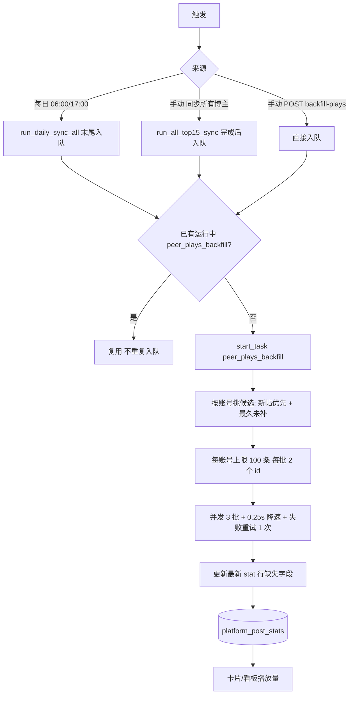
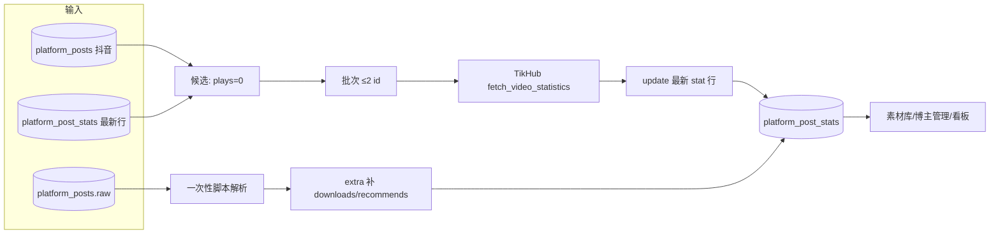

# R-270 开发设计：抖音播放量批量补齐与历史回补

- **对应需求**：`requirements/R-270-douyin-metric-batch-backfill.md`
- **日期**：2026-11-27
- **状态**：设计完成，待开发
- **排期**：M271
- **范围**：复用并扩展 `fetch_benchmark_plays`（时间窗/配额/手动触发/写入口径）、batch 请求封装、raw 存量字段补全；不新增表、不换接口、不碰小红书

## 1. 开发背景

抖音公开接口（列表 `fetch_user_post_videos`、单条 `fetch_one_video_v2`）已不返回 `play_count`，唯一来源是 `fetch_video_statistics`，但它一次最多 2 个 `aweme_id`（官方文档明确）。

现有 `douyin_creator_sync.fetch_benchmark_plays` 已经实现了「2 个一批 + 0.25s 降速 + 6h 复用 + 失败重试」，但有三个限制：`days=30`、`max_requests=120`、只在日更链路触发。于是 11 个对标账号 608 条作品（含主账号 1 条共 609 条）播放量长期为 0，而作者手动点同步也不会补。

另有一个零成本收益：1257 条抖音 raw 里已经带了 `recommend_count` / `download_count` 等未解析字段。

## 2. 涉及的技术

| 技术 | 用途 | 理由 |
|---|---|---|
| TikHub `/douyin/app/v3/fetch_video_statistics` | 播放量唯一来源 | 文档指定，一次 ≤2 个 id |
| 现有 `_stats_by_aweme` / `_number` 解析 | 批量响应转字段 | 已在用，避免重复实现 |
| 现有 `gather`（`sync_pool`）+ 令牌桶 | 并发 3 批 + 全局限速 | 沿用 R-240，避免 87 次连发 400 |
| 现有 `peer_plays_backfill` 任务类型 | 进度条/通知/任务列表 | 不用新增任务类型 |
| `background_tasks` + `app_kv` | 去重、暂停开关 | 不新增表 |
| `scripts/` 一次性脚本 | raw 存量补全 | 一次性数据修复，不进运行时 |

## 3. 开发流程图



## 4. 数据流转图



## 5. 实现细节

### 5.1 批量请求封装

在 `douyin_creator_sync.py` 抽出（原 `_fetch_batch` 逻辑不变，补参数化）：

```python
def fetch_statistics_raw(client, ids: list[str], *, retries: int = 1, throttle: float = 0.25) -> tuple[dict | None, int, str]:
    """返回 (raw, attempts, warning)；ids 超过 2 个由调用方切批。"""
```

- 切批：`for i in range(0, len(ids), 2)`；
- 重试：仅对非业务错误重试 1 次（业务错误如 402 立即停）；
- 降速：成功批次后 `time.sleep(0.25)`；
- 计费：整任务结束后按 `attempts` 汇总一次 `_charge`（沿用现状，减少事务）。

### 5.2 回补任务改造（`fetch_benchmark_plays`）

**签名扩展**：

```python
def fetch_benchmark_plays(
    db, owner, *,
    days: int = 365,             # 0 = 全部历史
    max_requests: int = 300,     # 本轮请求上限
    per_account_limit: int = 100,  # 每账号作品上限
    concurrency: int = 3,
    force: bool = False,
) -> dict:
```

**候选规则**（按账号循环）：

1. 账号：`is_current` 主博主下的全部 `kind=benchmark` + `platform=douyin` + `enabled`；
2. 作品：`publish_time >= now - days`（`days=0` 不限）；最新统计 `plays <= 0`；`is_ad=false`；
3. 排序：账号内「发布 ≤48h 的新帖优先」，其余按 `publish_time` 升序（越老越先补，保证历史逐步覆盖）；
4. 截断：每账号最多 `per_account_limit` 条；
5. 全局：累计批次达到 `max_requests` 即停，返回 `remaining` 供下次继续。

**写入口径（与现状的差异）**：

```python
stat_row = (
    db.query(PlatformPostStat)
    .filter_by(post_id=post.id)
    .order_by(PlatformPostStat.stat_date.desc())
    .first()
)
if stat_row is None:
    stat_row = PlatformPostStat(post_id=post.id, stat_date=today, source="tikhub_statistics")
    db.add(stat_row)
# 只补缺失字段，不覆盖真实值
stat_row.plays = stat_row.plays or play_count
stat_row.likes = stat_row.likes or digg_count
stat_row.shares = stat_row.shares or share_count
stat_row.comments = stat_row.comments or comment_count
```

- 不再「找不到今天的行就新建今天的行」（旧实现会给老帖插一个今天的数据点）；
- `source` 保持 `tikhub_statistics`，优先级 2 < `tikhub_creator` 3，不会覆盖创作者中心值。

**暂停开关**：任务开始读 `app_kv.metric_backfill_paused`，为 `"1"` 直接返回 `{"paused": true}`。

### 5.3 手动触发（`run_all_top15_sync` 末尾）

```python
from ..tasks import find_running_task, start_task
from .douyin_creator_sync import peer_plays_worker
from ..config import get_settings

if synced:
    running = find_running_task("peer_plays_backfill")
    if not running:
        start_task(
            "peer_plays_backfill",
            {"owner_id": owner.id, "days": s.metric_backfill_days,
             "max_requests": s.metric_backfill_max_requests,
             "per_account_limit": s.metric_backfill_per_account},
            peer_plays_worker,
        )
```

- 只在有博主同步成功时入队（沿用 R-262 的「全失败不触发后续」口径）；
- 已有运行中任务 → 复用，不重复入队。

### 5.4 新增接口（`api/platform.py`）

```python
@router.post("/backfill-plays")
def trigger_play_backfill(payload: dict | None = None, db: Session = Depends(get_db)):
    ...
```

- 校验主博主存在（400）；
- `force=true` 时忽略 6h 冷却；
- 已有运行中 → 返回 `{"task_id": 现有id, "dedup": true}`（200，不报错）；
- 暂停中 → 400「回补已暂停」。

### 5.5 配置（`config.py`）

| 配置 | 默认 | 环境变量 | 说明 |
|---|---|---|---|
| `metric_backfill_days` | 365 | `ECHO_METRIC_BACKFILL_DAYS` | 0 = 全部历史 |
| `metric_backfill_max_requests` | 300 | `ECHO_METRIC_BACKFILL_MAX_REQUESTS` | 单轮请求上限 |
| `metric_backfill_per_account` | 100 | `ECHO_METRIC_BACKFILL_PER_ACCOUNT` | 每账号作品上限 |

### 5.6 存量 raw 补全（一次性脚本 `scripts/backfill_raw_extra.py`）

- 扫 `platform_posts.platform='douyin'` 且有 `raw` 的行（1257 条）；
- 解析 `raw.statistics`：`download_count / recommend_count / forward_count / admire_count / live_watch_count`；
- 写入该帖最新 `platform_post_stats.extra`（缺失键才写，`json` 合并）；
- 参数：`--dry-run`（只统计待补条数）、`--limit N`；
- 幂等：重复执行不会重复写；不产生 TikHub 请求。

### 5.7 失败与降级

| 情况 | 行为 |
|---|---|
| 单批 400/5xx | 重试 1 次；仍失败记 warning，继续下一批 |
| 402 余额不足 | 立即停止，`BudgetExceeded` 向上抛，任务 failed，通知 |
| 预算剩余 < 批大小 | 停止并写「剩余不足」 |
| 某作品接口无返回 | 跳过，不写 0 |
| 任务被暂停 | 返回 paused，不入队新批次 |

## 6. 表结构

**无新增表、无新增列、无 Alembic revision。**

- `platform_post_stats.extra` 新增 JSON 键：`downloads / recommends / forwards / admires / live_watch`（由 raw 或批量接口补）；
- `app_kv` 新增键：`metric_backfill_paused`（`"1"` = 暂停）；
- `docs/DATABASE.md` 在对应章节各补一行说明，表数不变（41）。

## 7. 接口

### 7.1 `POST /api/platform/backfill-plays`

- **请求**（可空）：

```json
{"days": 365, "max_requests": 300, "force": false}
```

- **响应 200**：

```json
{"task_id": 12345, "dedup": false, "days": 365, "max_requests": 300}
```

- **错误**：
  - `400`：无主博主 / 回补已暂停（`metric_backfill_paused=1`）；
  - `403`：无权限（沿用全局 token 中间件，不单独处理）。

### 7.2 既有接口

- `POST /api/platform/sync-all`：响应不变（`task_id / creator_count / skipped`），只是任务完成后会额外入队回补；
- `GET /api/tasks` / `task.update`：回补任务沿用 `peer_plays_backfill` 类型与中文名「同行播放量补齐」。

## 8. 数据来源与原始字段明细

| 数据项 | 来源 | 原始字段 | 落库字段 | 用途 | 更新时机 | 空值处理 |
|---|---|---|---|---|---|---|
| 播放量 | TikHub `fetch_video_statistics` | `play_count` | `platform_post_stats.plays` | 卡片/爆款排序/看板 | 回补任务 | 无返回 → 不写 |
| 点赞 | 同上 | `digg_count` | `.likes` | 卡片 | 同上 | 已有值不覆盖 |
| 评论数 | 同上 | `comment_count` | `.comments` | 卡片 | 同上 | 同上 |
| 转发 | 同上 | `share_count` | `.shares` | 卡片 | 同上 | 同上 |
| 下载数 | 同上 / 存量 raw | `download_count` | `.extra.downloads` | 新增展示 | 回补 / 脚本 | 缺失不显示 |
| 推荐数 | 存量 raw | `recommend_count` | `.extra.recommends` | 新增展示 | 脚本 | 缺失不显示 |
| 转发（站内） | 存量 raw | `forward_count` | `.extra.forwards` | 观测 | 脚本 | 缺失不显示 |
| 赞赏 | 存量 raw | `admire_count` | `.extra.admires` | 观测 | 脚本 | 缺失不显示 |
| 直播观看 | 存量 raw | `live_watch_count` | `.extra.live_watch` | 观测 | 脚本 | 缺失不显示 |
| 时间窗 | 配置 | `metric_backfill_days` | — | 决定候选 | 每次任务 | 0 = 全部 |
| 暂停 | 作者/运维 | `app_kv.metric_backfill_paused` | — | 停止发请求 | 手动 | 未设置 = 运行 |

## 9. 迁移与兼容

1. 老帖「今天新增行」问题：本设计只更新最新行，历史上已经被旧实现插入的日期行**不删除**（避免破坏曲线与历史）。
2. `peer_plays_backfill` payload 增加字段，旧任务行（pending 状态）payload 缺字段时按默认值处理。
3. `_peer_plays_fresh` 6h 冷却保留；手动 `force=true` 时跳过。
4. 若作者同时开着两个实例，回补任务由 `find_running_task` 去重（跨进程查库，能识别对方 pending/running）。

## 10. 测试计划

新增 `backend/tests/test_r270_play_backfill.py`：

| 用例 | 断言 |
|---|---|
| `test_batch_chunks_two` | 5 个 id → 3 次请求，每批 ≤2 |
| `test_update_latest_row_only` | 有旧日期行 → 更新旧行，不新增今天的行 |
| `test_no_row_creates_today` | 完全无行 → 新建 1 行，来源 `tikhub_statistics` |
| `test_creator_value_not_overwritten` | 最新行来源 `tikhub_creator` 且 plays>0 → 回补不改 |
| `test_per_account_limit` | 单账号 200 条候选 → 只取 100 |
| `test_window_days_zero` | days=0 → 不限历史 |
| `test_paused_flag` | `app_kv` 暂停 → 任务直接返回 paused、0 请求 |
| `test_budget_exceeded_stops` | 预算不足 → 抛 BudgetExceeded，任务 failed |
| `test_raw_extra_script_idempotent` | 跑两次，`extra` 键不重复、值不变 |

## 11. 成本与风险

| 项 | 数值 |
|---|---|
| 609 条缺播放 → 补齐所需请求 | 305 次（2 个/批） |
| 按 $0.001–0.01/次估算 | $0.3–3.05（一次性） |
| 默认单轮上限 300 次 | 一天内可完成，预算 2000 内 |
| 卡片/看板收益 | 11 个对标账号播放量从 0 → 真实值 |

- 风险 1：接口对高频调用返回 400（历史实测 87 次连发出现）→ 0.25s 降速 + 并发 3 + 重试 1 次。
- 风险 2：历史回补让某天用量突增 → 单轮 300 上限 + 每日预算 + 暂停开关。
- 风险 3：老帖播放量是「现在补的」而非「当时的值」→ 只写入最新行，不伪造历史曲线点。
- 回滚：停止任务 + 删除脚本产物即可；已补的字段是真实值，无需回滚。

## 12. 实施顺序

| 批次 | 内容 | 验证 |
|---|---|---|
| A | 5.1 批量封装 + 5.2 写入口径/配额/窗口 | 单测 + 真实补 20 条播放 |
| B | 5.3 手动同步触发 + 5.4 接口 + 5.5 配置 | 点一次同步，任务列表出现回补任务 |
| C | 5.6 raw 脚本 | `--dry-run` 条数核对 + 实跑后抽查 extra |
| D | 全量回补 | 609 条覆盖率 ≥90%，报告请求数/预算 |
