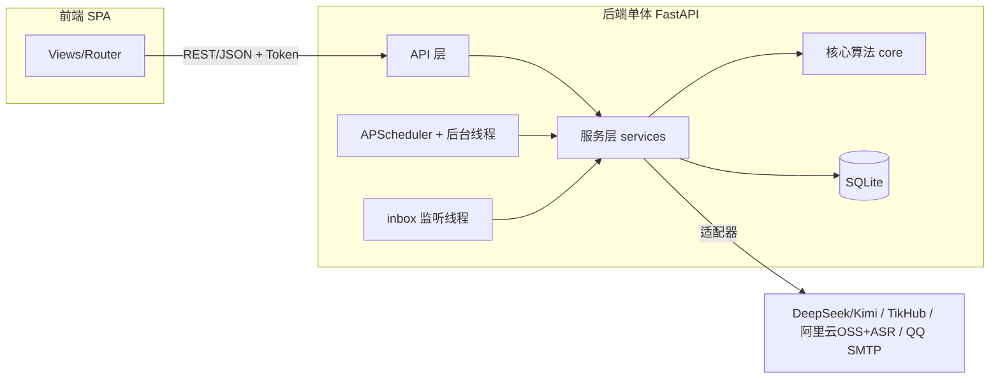
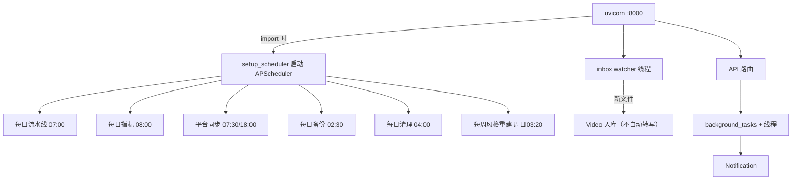

# echo 系统架构文档

> 面向“新开发者/新设备部署”的完整架构说明：技术选型、进程、分层、模块、数据、
> 外部依赖、配置、部署。设计决策见 `DECISIONS.md`，实现细节见 `DESIGN.md`。

## 1. 技术栈

| 层 | 选型 | 说明 |
|---|---|---|
| 后端 | Python 3.12+ / FastAPI / Uvicorn | 单进程单体，路由薄、业务厚 |
| 前端 | Vue 3 + Vite + Naive UI | SPA，桌面/移动响应式，构建产物可被后端托管 |
| 数据库 | SQLite + SQLAlchemy 2.x | 单用户零运维；轻量幂等迁移兜底（Alembic 为 tech-debt） |
| 定时任务 | APScheduler（进程内） | 每日流水线/同步/备份/每周风格重建 |
| 后台任务 | DB 任务表 + daemon 线程 | 长任务状态入库，完成写通知（不引入队列） |
| 文件监听 | 自研线程轮询 `data/inbox` | 拖入视频自动入库 |
| LLM | DeepSeek + Kimi（适配器） | 可配任意模型；双模型讨论生成 |
| ASR | 阿里云录音文件识别（FileTrans 4.0） | ffmpeg 抽音轨 + OSS 中转 |
| 平台数据 | TikHub（第三方聚合） | 抖音/B站/小红书主页/作品/统计/评论 |
| 邮件 | QQ SMTP | 每日推送可配置开关 |
| 部署 | Docker Compose（NAS）/ 本地开发 | 数据目录挂载 |



## 2. 目录与分层

```
echo/
├── AGENTS.md            # 运行手册（强制流程/规范）
├── docs/                # PRD/PRODUCT/ARCHITECTURE/DESIGN/DECISIONS/milestones/WORKFLOW/CHANGELOG
├── requirements/        # 需求事实源 R-xxx + README 索引
├── backend/
│   ├── app/
│   │   ├── main.py      # FastAPI 组装：路由/静态托管/令牌校验
│   │   ├── config.py    # 环境配置（ECHO_ 前缀，pydantic-settings）
│   │   ├── db.py        # engine/SessionLocal/轻量迁移
│   │   ├── api/         # 路由层（薄）：videos/persona/drafts/chat/topics/metrics/review/…
│   │   ├── services/    # 业务层：generation/ingest/persona/platform_sync/works_service/chat_service/…
│   │   ├── services/platform/tikhub.py  # 平台客户端（mock/real 适配器）
│   │   ├── services/platform/link_utils.py  # 主页/作品分享链接解析（自 tikhub 拆出，R-061-C）
│   │   ├── services/platform_assets.py  # 图片识别/HEIC/封面头像下载命名（自 platform_sync 拆出）
│   │   ├── core/        # 纯逻辑算法：retrieval/style_profile/transcript/signature/topics/…
│   │   ├── models/      # SQLAlchemy 模型（表见 §6）
│   │   ├── schemas/     # Pydantic 契约
│   │   ├── scheduler.py # APScheduler 任务注册
│   │   ├── tasks.py     # 后台任务运行器 + 通知
│   │   └── watcher.py   # inbox 监听
│   ├── tests/           # 纯逻辑测试 + 服务测试（离线 mock）
│   └── .venv/
├── frontend/src/        # views/api/router/components
└── scripts/             # verify.sh（质量门禁）/ backup.sh
```

依赖方向：`api → services → models`、`api → core`、`services → core`，禁止反向；适配器模式隔离外部服务。

## 3. 外部服务与适配器

| 外部 | 用途 | 模式 | 关键配置 |
|---|---|---|---|
| DeepSeek/Kimi | 生成/校对/复盘/对话/讨论 | `llm.py` 客户端，模型名可配 | `ECHO_DEEPSEEK_API_KEY/MODEL`、`ECHO_KIMI_API_KEY/MODEL` |
| TikHub | 平台数据 | `tikhub.py`，`mock/real` 可切 | `ECHO_TIKHUB_API_KEY/MODE/BASE_URL/DAILY_BUDGET` |
| 阿里云 OSS | ASR 文件中转 | `aliyun_oss.py` | `ECHO_ALIYUN_ASR_ACCESS_KEY_ID/SECRET`、`ECHO_ALIYUN_OSS_BUCKET/REGION` |
| 阿里云 FileTrans | 录音文件识别 | `aliyun_filetrans.py` | `ECHO_ALIYUN_ASR_APP_KEY`、`ECHO_ASR_MODE` |
| QQ SMTP | 邮件推送 | `notify.py` | `ECHO_SMTP_*` |

## 4. 运行形态（进程）



开发运行：
- 后端：`cd backend && .venv/bin/uvicorn app.main:app --host 0.0.0.0 --port 8000`
- 前端：`cd frontend && npm run dev`（5173，dev 反向代理 8000）

## 5. 数据存储位置（由 .env 决定）

| 配置 | 默认示例（当前本机） | 内容 |
|---|---|---|
| `ECHO_DATA_DIR` | `/Users/yeah/document/echo_resource` | 数据根目录 |
| `ECHO_DB_PATH` | `…/echo.db` | SQLite 数据库 |
| videos/covers/uploads/inbox | `…/videos|covers|uploads|inbox` | 视频/封面/图片/待入库 |

仓库 `backend/data/` 仅为代码默认残留（未使用，env 已覆盖指向 echo_resource）。

## 6. 数据库（表清单与关系）

```mermaid
erDiagram
    CREATOR ||--o{ CREATOR_ACCOUNT : owns
    CREATOR_ACCOUNT ||--o{ PLATFORM_POST : posts
    CREATOR_ACCOUNT ||--o{ CREATOR_ACCOUNT_SNAPSHOT : daily
    PLATFORM_POST }o--o| WORK : merged
    PLATFORM_POST ||--o{ PLATFORM_POST_STAT : stats
    PLATFORM_POST ||--o{ PLATFORM_POST_COMMENT : comments
    PLATFORM_POST }o--o| VIDEO : local_bound
    VIDEO ||--o| TRANSCRIPT : has
    VIDEO ||--o{ METRICS_SNAPSHOT : daily
    VIDEO ||--o{ DRAFT : related
    DRAFT ||--o{ FEEDBACK : rated
    DRAFT ||--o{ DRAFT_DISCUSSION : debate
    PERSONA_TAG }o--|| CREATOR : style
```

主要表（models/*.py）：
- **内容**：`videos`（本地素材）、`transcripts`（ASR 转写/校对/原始文案）、`works`（跨平台同作品）、`platform_posts`（平台作品）、`platform_post_stats`（每日统计）、`platform_post_comments`（评论）、`drafts`（脚本草稿）、`draft_discussions`（双模型讨论留痕）。
- **人设/学习**：`persona_tags`（风格/赛道/红线/金句锚点）、`ai_prompts`（提示词版本）、`feedback`（1-5 分/采用）、`app_kv`（KV：风格禁词、预算、计数等）。
- **平台/博主**：`creators`（主/对标）、`creator_accounts`、`creator_account_snapshots`（粉丝/作品数快照）、`sync_jobs`（同步记录）。
- **分析**：`metrics_snapshots`、`review_reports`、`hot_topics`、`topic_candidates`、`topic_ideas`（灵感池）、`pipeline_runs`。
- **系统**：`background_tasks`、`notifications`、`chat_conversations`、`chat_messages`、`requirements` 相关（页面数据来自文件）。

## 7. 关键数据流（摘要，详见 DESIGN）

1. **导入学习闭环**：上传 → 手动转写(ASR) → 校对 → 预打标/人设建议 →（确认后）进入语料。
2. **平台同步**：博主 → 账号 → 拉取作品/统计/评论 → 平台表 → 自动合并 work →（可选）转本地。
3. **每日选题/生成**：热点/灵感 → 人设+风格检索 →（可选双模型讨论）→ 脚本 → 反馈回流。
4. **复盘**：平台统计/本地指标 → 看板 → 周报 ABCD。

## 8. 配置速查（.env，均带 ECHO_ 前缀）
访问令牌、DeepSeek、Kimi、阿里云 ASR+OSS、SMTP、数据/DB 路径、每日推送时间、热点源模式、TikHub（key/mode/base/budget/同步时刻）、生成策略与讨论轮数等；完整清单见 `backend/app/config.py`。

## 9. 安全与备份
- Web 入口校验 `X-Access-Token`（.env `ECHO_ACCESS_TOKEN`）。
- 密钥只放 .env（gitignore）；需求文档等一律打码。
- 每日 02:30 自动备份（SQLite 官方热备份 + requirements/docs 快照，保留 10 份），`scripts/backup.sh`。
- 交付门禁 `scripts/verify.sh`：lint(ruff) + mypy + pytest + 前端 lint/build。

## 10. 部署（Docker/NAS）
数据目录（echo_resource）挂载进容器；端口 8000 暴露；环境变量由宿主 .env 注入；
后端容器内 `uvicorn` 启动即注册定时任务与 watcher；前端可用 `npm run build` 产物由 FastAPI 静态托管，也可单独 nginx。
