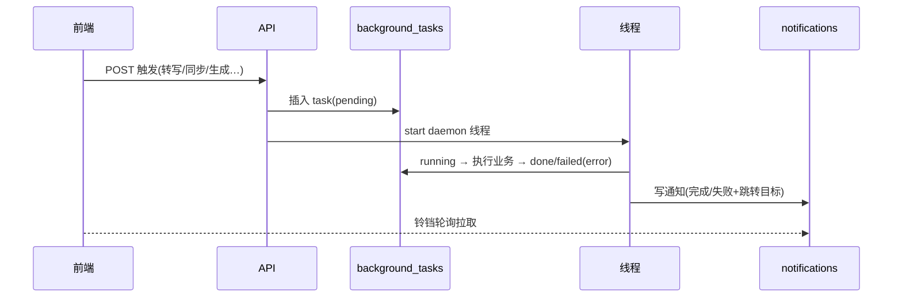
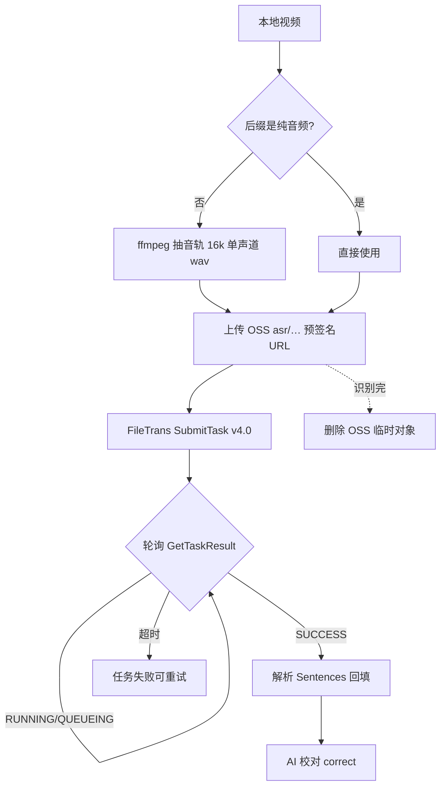

# echo 开发设计文档

> 面向开发者的实现细节：API 面、异步任务、定时任务、各核心算法与数据设计、异常与
> 护栏、扩展点。产品与架构见 `PRODUCT.md` / `ARCHITECTURE.md`。

## 1. API 面（前缀 /api，除登录外均需 X-Access-Token）

| 域 | 前缀 | 主要能力 |
|---|---|---|
| 素材 | /api/videos | 上传、列表、详情(含 platform_links/transcript)、PATCH、封面、删除、确认标签、手动转写 POST /{id}/transcribe |
| 人设 | /api/persona | 列表(建议/确认)、手动增、决策、编辑/删除、金句提取、初始化、风格 GET/PUT /style |
| 草稿/脚本 | /api/drafts | 列表、CRUD、生成(异步)、改写、check、rework、discussions、debate-status、feedback |
| AI 对话 | /api/chat | conversations CRUD、history、SSE 流式 message |
| 提示词 | /api/prompts | keys、版本列表、save/enable/optimize/selfcheck |
| 设置 | /api/settings | 生成模型(deepseek/kimi/random/alternate)、讨论轮数 |
| 选题/流水线 | /api/topics · /api/pipeline | 热点列表/刷新、缺口、角度生成、每日流水线触发 |
| 指标/复盘 | /api/metrics · /api/review | 录入/批量导入/抓取、汇总、报告生成与读取、雷达 |
| 博主/平台 | /api/creators · /api/platform · /api/works | 博主/账号 CRUD、链接解析、同步(scope)、帖子/统计/评论、作品合并/拆分/转本地、预算 |
| 通知 | /api/notifications | 列表、已读、清空 |
| 上传 | /api/uploads | 富文本插图 |

统一约定：列表带分页(total/items)；错误返回 `{detail}`；写操作多数先建后台任务再通知。

## 2. 异步任务与通知（tasks.py）



- 任务类型：import_video(素材转写)、persona_init、daily_pipeline、diff_analysis、generate_draft、platform_sync(_single)、prompt_selfcheck。
- 通知 target 映射页面深链（如 `/videos?edit=id`、`/prompts?key=generation`）。

## 3. 定时任务（scheduler.py，Asia/Shanghai）

| 时间 | 任务 |
|---|---|
| 07:00 | 每日流水线：热点→选题→匹配打分→生成脚本→(可选)邮件 |
| 08:00 | 每日指标归档 + 热点/指标留存清理 |
| 07:30 / 18:00 | 平台同步（前10条 + 评论选题采集） |
| 02:30 | 每日备份 |
| 04:00 | 每日清理（R-061：通知90天/任务30天/同步60天/平台统计400天） |
| 周日 03:20 | 每周风格重建 → 产出提示词候选并通知 |

## 4. 语音转文字设计（R-032/R-033）



要点：官方限制识别文件必须公网 URL→OSS 中转；AppKey+AK 签名走官方 CommonRequest；
上传文件按“标题-视频/音频”语义由上游命名；超时/轮询间隔可在 .env 配置；错误清晰入任务 failed + 通知。

## 5. 平台同步设计（R-027~R-029，platform_sync.py）

### 5.1 scope 语义
- `daily`：每平台最新 N(默认10) 条 + 资料快照 + 评论（仅新增作品，否则刷新最新3条省额度）
- `initial`（全量）：翻页拉取该账号全部作品（has_more=false），无数量上限
- `weekly`：对标账号最新 3 条
- 账号级同步：单账号走 daily；三平台并发（ThreadPoolExecutor ≤3，各自独立会话）
- B站列表不含赞/藏/评：`_backfill_bili_stats` 每轮最多 150 条详情补全，重复同步会补完

### 5.2 预算与幂等
- 每日请求预算（默认 2000，页面可改）：`_charge(db)` 扣减，超限抛 BudgetExceeded 停止本轮并通知
- 作品幂等：按 (platform, platform_post_id) upsert；评论按 (post_id, text) 去重
- 同步后自动跨平台合并：规范化标题(去话题/标点/空白、小写)相同 → 同一 work
- 隔离：单平台失败不拖垮其它平台；失败账号可单独重试

### 5.3 素材/作品语义
- 云端作品=已发布：有真实平台链接/发布时间即 published
- 本地素材：上传/转本地；可绑定多平台（local_video_id / work_id / platform_post_id 三路）
- 绑定链接：编辑页三平台链接 → `POST /api/platform/videos/{id}/bind-links`（解析→复用/创建 PlatformPost→绑定）
- `同步数据`：本地=遍历绑定平台逐个拉统计并聚合当天 MetricsSnapshot；云端=单条拉统计+评论
- 文件命名：`标题-视频/封面`，安全清洗 + 重名自增

## 6. 生成与“像作者”设计（generation.py / core）

### 6.1 生成上下文（按序注入 prompt）
人设标签 → 红线 → 金句锚点 → 语言习惯统计 → 风格样本节选 → 对标参考 → 近期最佳草稿共性 → AI 腔禁用词

### 6.2 风格样本检索与加权
- TF-IDF(二元组) 检索，样本权重重合三点：
  1. 互动加权：`weight = (1+log1p(plays+likes*5+favorites*3+comments*10)) * e^(-age/500)`
  2. 去重：同文案只计一次
  3. 黄金样本：你打 4-5 分/采用的稿 weight=6 直入
- 高互动自动加权已在生效（无需额外开发）

### 6.3 风格画像（style_profile.py，纯逻辑、离线可测）
- R-061：画像文本进程内缓存（素材数量/字数变化才重算，结果一致）
输入全部非广告文案 → 输出：样本数/平均句长/中位句长/问句与感叹占比/高频二元与三元组/标志性语气词。
每周重建 & 表达清单：人设页“表达风格”面板可查可编辑；AI 腔禁用词注入生成；
`core/style_profile.default_avoid_words()` 提供默认清单。

```mermaid
flowchart TD
    T[选题/热点] --> A[召回相关风格样本(TF-IDF×权重)]
    A --> B[拼上下文: 人设+画像+样本+红线+禁词]
    B --> C{单模型 or 双模型?}
    C --单--> D[DeepSeek/Kimi 生成 JSON]
    C --双5轮--> E[DeepSeek/Kimi 讨论定稿]
    D --> F[脚本入库]
    E --> F
    F --> G[工作台 你 打分/改稿]
    G --> H[黄金样本/反馈回流]
    H --> A
```

### 6.4 提示词版本化（prompt_service.py）
- 每 key 一套 AiPrompt：version/enabled；`get_prompt(key)` 取当前启用版
- `optimize()`：当前版 + 新素材 + 打分反馈 → LLM 产出候选(不启用)
- 节流：`auto_optimize_generation` 每累计 3 条新素材才产出一次（Kv 计数）
- 每周重建：全量画像 + 表现最好 3 条 → 候选 + 通知

## 7. 双模型讨论（R-023，services/debate.py）
生成(或改写)可选“讨论模式”：DeepSeek/Kimi 交替发言 N 轮(默认5，页面可配)，
讨论全程写入 `draft_discussions`（聊天式 UI 留痕），最后形成定稿脚本；模型可在配置切换 A/B。

## 8. 复盘设计（R-006/R-007）
- 指标快照：(video_id, snapshot_date) 幂等 upsert；多平台聚合当天指标
- 复盘报告：A 报表(按视频/赛道/平台) + B 归因 + C 建议 + D 赛道方向（LLM 优先、启发式兜底），结果落 `review_reports`
- 赛道雷达：按互动率/发布天数归一化排序

## 9. AI 对话权限（chat_service.py）
- 会话模型 + SSE 流式；工具按“只读直答 / 写操作需同意”两类：
  - 只读：指标汇总、今日选题、复盘报告、赛道雷达、搜草稿
  - 写操作（生成草稿等）：先明确询问作者同意再执行

## 10. 工程护栏与测试
- 五维：简单/易读/可靠/扩展/性能；适配器模式；分层依赖方向
- 质量门禁 `scripts/verify.sh`：compileall → test_core(离线纯逻辑) → ruff → mypy → pytest → 前端 lint/build
- 测试策略：纯逻辑放 `tests/test_core.py`（stdlib 可跑）；服务层 mock 外部依赖放 pytest；
  真实链路用“真实素材+阿里云/TikHub 冒烟”在交付前人工跑
- 交付前 AI 自测 + 改完保持前后端运行（见 AGENTS.md）

## 11. 扩展点（未来）
- 分词升级 BM25/向量检索；批量历史文件按标题重命名脚本；多用户化（数据隔离层）；
- 平台/LLM/ASR/推送全部可插拔适配器；Alembic 迁移落地。
