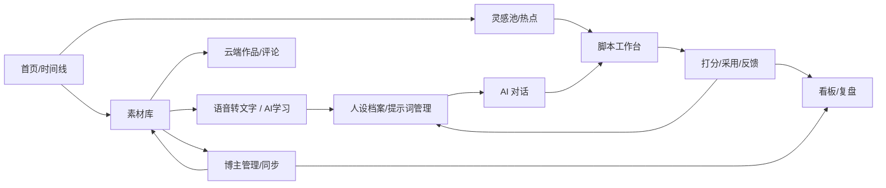

# echo 产品文档（功能手册）

> 产品：echo（回声）—— 自媒体复盘纠错平台（单用户，作者本人）。
> 目标：让 AI 越来越懂作者的人设，每天自动产出匹配“人设 × 当日热点”的选题与脚本，
> 并对已发布内容复盘纠错，辅助作者经营抖音 / B站 / 小红书。
> 本文按“用户能做什么”组织，覆盖全部已上线功能；接口与实现细节见 `ARCHITECTURE.md` 与 `DESIGN.md`。

## 1. 产品地图（总览）



## 2. 全局信息流（一张图看懂数据怎么转）

```mermaid
graph TD
    U[作者上传/拖入素材] --> T[自动入库（不自动转写）]
    T --> M[素材库]
    U -->|编辑页按钮| ASR[语音转文字：ffmpeg抽音轨→OSS→阿里云FileTrans→AI校对]
    ASR --> TR[转写稿(只读)+校对稿]
    TR --> LEARN[风格学习语料（广告除外）]
    SYNC[博主同步: 前10条/全量/账号同步] --> POSTS[云端作品+统计+评论]
    POSTS --> M
    POSTS --> IDEAS[灵感池(热榜+评论)]
    HOT[每日热点] --> IDEAS
    IDEAS --> DRAFT[脚本工作台生成]
    P[人设档案] --> DRAFT
    PROFILE[风格画像+加权样本+表达清单] --> DRAFT
    DRAFT -->|DeepSeek/Kimi 讨论5轮| SCRIPT[定稿脚本]
    SCRIPT --> FB[1-5分/采用/弃用]
    FB --> LEARN
    FB --> PB[提示词候选/每周风格重建]
    POSTS --> DASH[看板/复盘ABCD]
```

## 3. 首页（Home）

- **时间线**：本地视频 + 云端作品按“发布时间”倒序排列（最新在最左），仅显示“今天及以前”，同一天多条顺序排开；点击本地→素材编辑，点击云端→素材库打开该作品。
- **灵感池**：热榜 + 评论区灵感均衡混排，人工挑选；“换一批”随机刷新，“抓取更新”触发最新抓取；每条可“生成文案”。
- **每日选题/热点**：热点以小 tag 呈现，点 tag 直接按人设生成整套文案（可先选切入角度）。

## 4. 素材库（核心）

### 4.1 素材的两类来源与语义
| 类型 | 说明 | 是否参与 AI 学习 |
|---|---|---|
| 本地素材 | 上传/转本地，有本地视频文件与转写稿 | 是（非广告） |
| 云端作品 | 平台同步回来的已发布作品（带真实链接/发布时间） | 不直接参与（转本地后学习） |

- 跨平台同作品：标题相同自动合并为一个作品；也支持手动“合并/拆分”；素材库不重复展示。
- 广告素材：标记“广告+价格”，**全程不进入人设学习**。

### 4.2 卡片与筛选
- 卡片：封面、标题、标签（最多 5 个 +N）、平台指标三行（抖音/B站/小红书，缺失平台灰字 —）、发布时间、操作按钮（同步数据/确认标签/删除；云端：同步数据/拆分/删除）。
- 筛选栏：平台（多选+输入）、状态、广告、标题模糊搜索、标签（多选+输入）、点赞 ≥/≤（任一平台命中）；改条件后点「查询」生效。

### 4.3 编辑弹窗（本地）
- 顶部：标题、三平台链接输入（可手动粘贴，保存后绑定/同步）、封面（点击上传/移除）、已关联脚本、平台/状态/广告/价格/计划与发布时间/标签。
- Tab「编辑信息 / 评论数据」；评论按平台“加载评论”（实时拉取→去重入库→之后读本地）。
- 语音转文字：本地有视频且未转写时提供“开始转写”；云端先选视频，“保存并语音转文字”一键转本地并识别。
- 原始文案文本框位于转写稿（只读）下方。

### 4.4 上传与命名
- 上传入口：顶部“选择视频文件→上传”（成功后自动进编辑页）；`data/inbox` 拖入自动入库（均不自动转写）。
- 文件命名：本地视频落盘 `标题-视频.后缀`；封面 `标题-封面.后缀`；云端同步封面也按“标题-封面”命名（安全清洗 + 重名自动 -2/-3）。

## 5. 语音转文字与 AI 校对（R-032/R-033）
1. 手动触发：素材编辑页点「语音转文字」（或云端“保存并语音转文字”）。
2. 链路：ffmpeg 抽音轨(16k 单声道 wav) → 上传 OSS 预签名 URL → 阿里云录音文件识别(FileTrans 4.0) → 轮询结果 → 回填转写稿（只读）→ DeepSeek 结合原始文案校对 → 预打标签/人设增量建议。
3. 完成提醒：右上角通知，可跳回素材；识别中编辑页轮询自动展示。

## 6. 人设档案（R-002/R-020/R-030/R-057）
- 标签体系：风格 / 赛道 / 红线 / 金句锚点；AI 建议→你确认/拒绝；也可手动增删改。
- 金句库：从高表现素材提取，确认后作为风格锚点强注入。
- 表达风格面板：自动统计（样本数/平均句长/问句与感叹占比/高频词/语气词）+ AI 腔禁用词 chips 增删保存。
- 初始化：用历史转写稿一键生成初版人设（后台任务）。

## 7. 脚本工作台（R-005/R-018/R-024/R-023/R-030）
- 三 tab：**草稿（可用） / 废稿 / 待制作**；不采用→废稿（可恢复），采用→待制作。
- 编辑：富文本/Markdown（可插图）；生成/改写；删除为逻辑删除。
- 讨论留痕：双模型（DeepSeek/Kimi）就你的草稿讨论 5 轮定稿，每个脚本有 tab 可看“讨论过程”（聊天框式）。
- 反馈：1-5 分 + 👍/👎；高分稿进入黄金样本、低分稿用于提示词校准。
- 素材关联：素材 ↔ 脚本可双向关联。
- 体检：生成前/后体检（AI 感、内容密度等）。

## 8. AI 对话（R-011/R-017）
- ChatGPT 式多会话：新建/切换/重命名/删除，历史保留，流式输出 + Markdown。
- 只读类问题直接答；写操作（生成草稿等）需你明确同意。
- 会检索你的素材/复盘/指标来回答。

## 9. AI 提示词管理（R-021/R-057）
- 每个功能一套提示词（生成/校对/复盘/对话/打标…），可查看/编辑当前启用版。
- 版本化：历史归档，可回滚启用旧版；每 3 条新素材自动产出候选（R-022 节流）。
- 每周日 03:20 自动“风格重建”，产出提示词候选并通知（不自动启用）。

## 10. 博主管理（R-027~R-029）
- 主博主 + 对标博主；可多个主博主，切换主博主整套随动（有确认弹框防误触）。
- 每博主下配置抖音/B站/小红书账号（主页分享链接解析/ID/增强配置/头像/同步频率/启停）。
- 同步按钮：**同步前10条**（每平台最新 10 条+资料快照+评论）、**全量同步**（全部作品翻页拉完）、账号级「同步」（单平台前10条）、对标「每周同步」。
- 每账号“云端作品”列表可单条“同步数据”“转本地素材”。
- 每日 07:30/18:00 自动跑“前10条”范围并采评论灵感。
- 预算/余额：每日请求上限可配，超限停止并通知；余额查询不阻塞页面。

## 11. 云端作品、合并与评论
- 作品 = 同一内容在三平台的聚合（work）；“云端=已发布”。
- 转本地素材：可选带视频（不自动转写）+ 文案；绑定本地后素材库不重复展示，云端记录仍保留关联。
- 评论：同步时增量入库；素材评论 tab“加载评论”实时拉取并去重落库。

## 12. 看板与复盘（R-006/R-007）
- 指标：手动/批量导入/每日自动归档（TikHub），看板展示增长。
- 复盘 ABCD：A 报表（按视频/赛道/平台）+ B 归因 + C 建议 + D 赛道方向（AI 优先、启发式兜底）；赛道雷达。
- “我 vs 对标”对比卡。

## 13. 通知中心（R-019）
- 右上角铃铛：异步任务（转写/初始化/每日流水线/生成/同步…）完成或失败提醒，点击跳转到对应界面；支持全部已读/清空。

## 14. 需求归档（R-009）
- 页面内可看需求列表/状态；事实源在 `requirements/*.md`（原文不可改）。

## 15. 验收主线（“能不能日更”）
1. 上传 50+ 条真实视频 → 语音转文字入库（非广告）。
2. 每天从热点/灵感池生成 2 条 → 1-5 分 + 改稿。
3. 人设档案定期核对；提示词候选按需启用。
4. 看板/复盘周看，博主同步保证数据新鲜。
